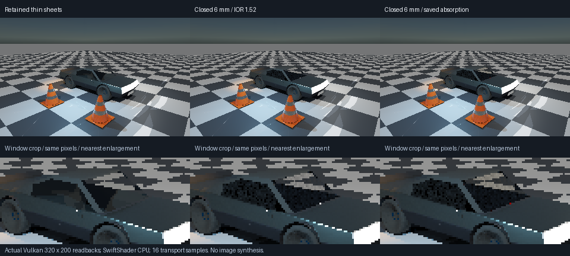

# Finite-thickness ControlVehicle glazing — 2026-10-26

This phase derives closed glazing from the retained vehicle's window surfaces and binds native saved/reloaded
IOR and RGB absorption to the resulting geometry. Original archives and the thin-sheet comparison are retained.

**Validation status:** native and vehicle Vulkan acceptance passed freshly on the restored build. The complete retained
transport regression chain also completed with **exit 0**. Prior interrupted-workspace observations are not used as
proof of this build.



Actual 320×200 captures, 16 transport samples, **SwiftShader Device (Subzero), CPU type 4**, triangle BVH.
Left: original thin-sheet model; centre: closed clear panes; right: saved RGB absorption. The lower row is a
nearest-neighbour crop of those same pixels, not new detail. Finite sample noise is visible; no glass denoiser
or finished appearance claim. The sheet and solid models differ physically, so this is not an energy identity.

| Fresh vehicle check | Result |
|---------------------|--------|
| Visible glass | 887 primary pixels |
| Absorption | 1,851 channels decrease; monotone on primary glass; max decrease 9.13125 / sum 43.2632 linear RGB |
| Bounded paths | **0 capped / 0 unsupported** on visible primary glazing |
| Repeat | Exact seeded absorbing-render equality |
| Camera movement | Moved camera equals cold submission; fresh transport, not denoising |
| Source removal | **64,000 black pixels** after analytic/emissive/environment removal |

[Fresh GPU log](Results/VehicleGlazingGpu.txt), [source/capture hashes](Results/VehicleGlazing.json),
[authored spectrum](Materials/VehicleGlazing.material), and
[retained native round trip](Materials/VehicleGlazingRoundTrips/ClosedGlass3.material).
The maximum/sum decrease are scene-radiance differences, not a new analytic error bound.

## Construction

| Item | Mechanism |
|------|-----------|
| Input | 74 retained window triangles, selected with the existing native vehicle material selectors |
| Components | Three exact-edge-connected panes |
| Offset | ±3 mm along area-weighted vertex normals; nominal thickness 6 mm |
| Closure | Reversed interior faces; two outward triangles per original boundary edge |
| Result | 284 triangles; zero unmatched indexed edges; opposite winding on paired edges |
| Volume | Positive signed volume checked separately per component; total approximately 0.0213574 m³ |
| Material | Native TOML → disk reload → `CompiledSurfaceMaterial` → existing category-4 float atlas |
| Spectrum | IOR 1.52; RGB absorption [1, 4, 12] inverse metres |
| Preserved | Racing Green cellular flakes, rubber, two BVH mirror panes, plastic/band cones and lighting routes |

[Production construction](../../Engine/Render/PaneThickness.h) is bounded to 512 input triangles and thickness
0.1–50 mm. It welds exact float positions, not nearby corners. It rejects nonmanifold/inconsistent winding,
non-cycle boundaries, closed input components, opposed adjacent normals, degenerate/inverted output faces,
nonpositive component volume and nonadjacent output triangle intersection/contact, including coplanar overlap.

This is a conservative normal-offset construction, **not a general CAD offset/collision certificate**. Curved
panes have nominal vertex-normal thickness, not an exact constant-distance implicit offset. Intersection checks
skip triangles sharing an indexed vertex; arbitrary adjacent-face overlap and collisions with the opaque body
are not exhaustively certified. Dimensions use the archive's metre scale, not measured manufacturing data.

## Transport corrections

The restored ray-aligned projected edge test replaces independently rounded Moller barycentrics. Precise
products keep shared edges evaluated consistently. This addresses the seam observed during the previous turn;
it is not a formal watertight guarantee at every coordinate scale. Shadow-only predicates are unchanged; this
is not a claim to have reproduced or fixed the old half-pole shadow defect.

Curved thin panes can guide rays through hundreds of total internal reflections. The finite interaction limit
is now **2,048**, rather than 32. The primary TIR diagnostic saturates at 65,535 before packing it alongside the
capped-path count, preventing diagnostic overflow without changing radiance. GPU descriptors/material ABI are
unchanged. No performance improvement or hardware tracing claim is made.

## Fresh pinned negative control

[Previous shader control](Results/VehicleGlazingBoundPrevious.txt), pinned to `250616f` for the three optical
shader files and compiled against the same current fixture: **59 capped paths / 16 unsupported paths**.
The probe device line describes the production limit; the preceding source-override line explicitly identifies
the previous 32-step shader. This is an old-source/current-fixture comparison, not the entire previous app.

## Fresh native checks

| Check | Result |
|-------|--------|
| Native geometry/host packing | 52 assertions, strict and ASan/UBSan passed |
| Invalid geometry | 16 cases rejected |
| Analytic planar volume | Three thicknesses; maximum error 1.78814e-9 m³ |
| Six archived poses | Same 3 components / 284 triangles; volume drift below 1e-7 m³ |
| Saved material | 39 assertions; four disk save/reload/compile cases; five legacy presets |
| Existing native CTests | 4/4 passed |

- [Geometry assertions](Results/PaneThickness.txt)
- [Geometry sanitizers](Results/PaneThicknessSanitized.txt)
- [Native saved coefficients](Results/VehicleGlazingAuthoring.txt)
- [Four native CTests](Results/VehicleGlazingNative.txt)

## Full retained regression — exit 0

`DIFFUSE_BUILD=0 bash Exhibits/LightCompute/RunDiffuseDielectric.sh` completed successfully with the current
13 production shader entries and restored native host. This reruns the previous camera, mirror, rough,
window and diffuse glass fixtures, pinned negative controls, opaque-history/filter tests and four native CTests.

| Retained check | Fresh result |
|----------------|--------------|
| Boundary / primary glass | 199 boundary cases; four slabs, max mean error 0.00346691; caps/unsupported zero |
| Mirror / glass | Four 196-pixel analytic cases; source-off black and pinned blocked-path control |
| Rough / glass | 11,118 absorption-changed channels; all three screen/BVH comparisons exact |
| Retained rough reflection | 14,941 screen / 204,392 BVH rays; hybrid/BVH RGB error zero; source-off/moved/repeat pass |
| Window / glass | Four 100-pixel cases; sheet-energy, source-removal and pinned blocked-path checks pass |
| Compact diffuse / glass | 15,360 absorption-changed channels; 327,680 rays = 146,417 hits + 181,263 misses |
| Emitter routing | Shielded refracted source remains exactly equal with emitter sampling on/off |
| Retained vehicle transport | 901 native probes; max RGB error 4.5973e-6; 3,603,424 secondary rays |
| Source families | Analytic/emissive/environment retained; additivity error 8.44436e-6; source-off black |
| Reconstruction | Fresh RMSE 0.0103498 → filtered 0.00585726; 210 native probes, max error 4.23087e-8 |
| Six poses | Reuse 0/12076/12067/0/12064/12079; current emission preserved; direct delta ≤3.8147e-6 |

[Full vehicle transport](Results/DiffuseDielectricTransportRegression.txt),
[reconstruction and six poses](Results/DiffuseDielectricHistoryRegression.txt), and
[compact diffuse](Results/DiffuseDielectric.txt).

These 640×400 vehicle / 160×100 history fixtures retain their earlier material assignments; they are regression
checks, **not** a six-pose film of the new closed glazing. New closed-glazing captures are the separate 320×200
vehicle comparison and moved-camera image above. No timing/performance acceptance is inferred.

## Reproduce

```bash
bash Exhibits/LightCompute/RunVehicleGlazing.sh
# Reuse a completed production shader/archive build:
GLAZING_BUILD=0 bash Exhibits/LightCompute/RunVehicleGlazing.sh
# Optional isolated previous/current path-budget comparison:
bash Exhibits/LightCompute/RunGlazingBounds.sh
```

Prerequisites: pinned CMake/Slang/SwiftShader/Vulkan headers from the existing compute setup, pinned toml++
and stb from `Automation/UIDependencies.json`, C++20 compiler and Pillow. Native tests use Linux GCC 12.2,
strict C++20 `-O2`, `-O1` ASan/UBSan, Release Vulkan host and 13 production Slang `-O0` entries.

## Boundaries of this phase

- Actual derived vehicle assignment in the native compute exhibit, not a general editor/scene importer.
- Original archives are not rewritten. Six-pose checks are native geometry tests, not a six-pose GPU film.
- No physical RTX/GTX/Windows execution, real-time performance or finished renderer claim.
- No nested/rough glass, inside-camera support, transmitted analytic shadows or caustic solver.
- No new glass temporal-denoising or unified moving vehicle + baked distance field + sun/sky/cloud/fog acceptance.
- Sun/flare/stars and cellular flakes are preserved; sky/cloud appearance is not redone here.
