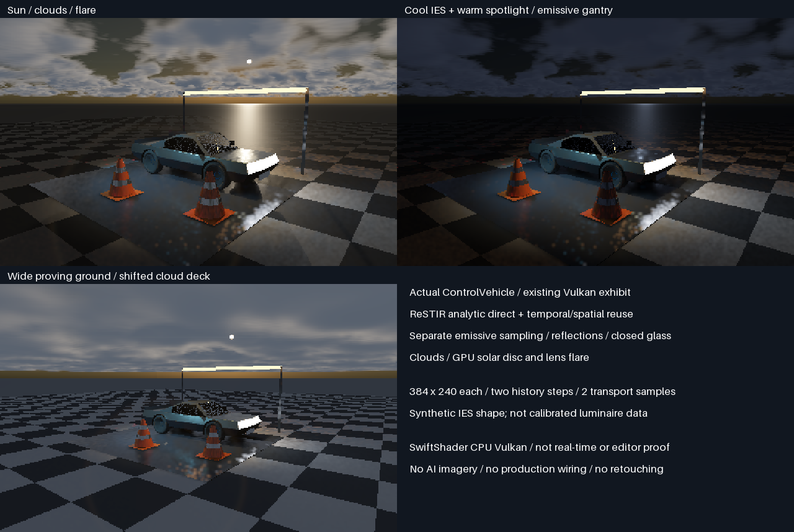
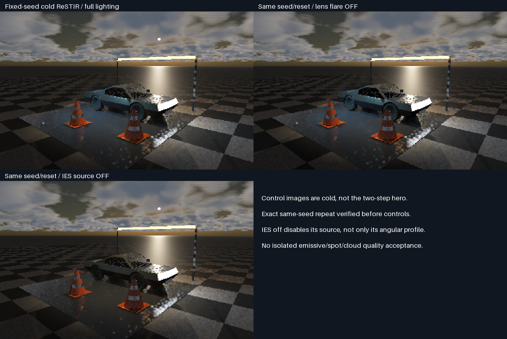

# ControlVehicle lighting renders

Exhibit-only visual studies of the authored ControlVehicle. **No production wiring or engine changes.**
Actual Slang/Vulkan readbacks on SwiftShader CPU,not AI illustrations or Windows editor captures.



| View                       | Lighting / scene                                         | Native size |
| -------------------------- | -------------------------------------------------------- | ----------- |
| Sun / flare                | Low sun,clouds,warm spot,cool IES,emissive gantry           | 384×240     |
| Artificial-light study     | Dim solar light,warm spot,cool IES,emissive gantry         | 384×240     |
| Wide proving-ground study  | Same vehicle/props,shifted denser cloud deck,sun and flare | 384×240     |

Individual renders:[sun](Images/VehicleLighting0.png),[artificial light](Images/VehicleLighting1.png),
[wide](Images/VehicleLighting2.png). Gallery enlarges source pixels with nearest-neighbour interpolation.

## Verified capture results

| Check                         | Result                                     |
| ----------------------------- | ------------------------------------------ |
| Fresh views                   | 3,all six history-step submissions passed   |
| Same-seed cold repeat          | Exact float4 readback equality              |
| Flare-off changed pixels       | 92,160 /92,160                              |
| IES-source-off changed pixels  | 35,545 /92,160                              |
| HDR readbacks                  | All three finite                           |
| Published individual PNGs      | All three match source PPM RGB bytes        |

**Showcase100% complete /0% remaining.** Overall~97% complete /~3% remaining is the unchanged earlier
planning estimate,not measured renderer readiness. Preview noise and blocky cloud appearance remain visible.
No new sanitizer or native radiometric-reference comparison was run for this scene;build/runtime/repeat/toggle
and image integrity are the checks above. The display is neither converged nor a real-time performance result.

Subjective showcase fit only;more stars is better,not a numerical quality metric.

| View                 | Fit         | Why                                  |
| -------------------- | ----------- | ------------------------------------ |
| Sun / flare          | ⭐⭐⭐⭐⭐ 🏆 | Most requested features in one image |
| Artificial light     | ⭐⭐⭐⭐     | Separates cool IES and warm sources  |
| Wide cloud deck      | ⭐⭐⭐       | Shows weather/context,smaller car    |

## What these show

- Original25,068 authored vehicle triangles before closed-pane replacement. Racing Green cellular-flake paint,
  rubber,three6mm closed glass components,side mirrors,traffic cones,cloth banner,reflective apron and light gantry.
- **ReSTIR analytic direct:**eight RIS candidates,temporal reservoir reuse,spatial reuse and existing filtering.
  Two stationary history steps per view. Geometry/material input comes from GPU primary intersections,not
  uploaded native shaded pixels. Camera/light/cloud changes reset history between views.
- **Emissive geometry is separate:**existing global facet distribution/area sampling and two transport samples
  per pixel,not clustered emissive ReSTIR GI. The latest maintained generic CDF ownership exhibit is not wired here.
- A normal warm spotlight plus a cool spotlight using the existing synthetic asymmetric LM-63 IES shape.
  This is not measured luminaire photometry,real candela calibration or exhaustive IES format acceptance.
- Procedural atmospheric sky and a32-pixel-face cloud cube with20 view-march samples. GPU solar visibility,
  disc and lens-flare composition on views0/2;no flare in the artificial-light study. No fog in this preview batch.
- Standard shared display encoding:exposure0.45,gamma2.2. No extra grading,AI upscaling or offline denoising.
  This is a small-sample preview,not a converged path-traced reference or new rendering-quality promotion.

## Paired controls



Controls use the same cold seed/reset,not the two-step hero output. Exact cold repeat is required before
publication. Flare-off and IES-source-off must change pixels. IES-source-off disables that light entirely;
it does not isolate only the angular-profile shape. Spot/emissive/cloud source-off isolation is not tested here.

[Runtime log](Results/VehicleLighting-render.txt),[input provenance](Results/VehicleLighting-inputs.json),
[geometry export](Results/VehicleLighting-archive.txt),[raw/image hashes](Results/VehicleLighting-images.json).
The initial640×400 attempt was stopped without a completed frame because it exceeded a practical CPU preview
budget;[aborted log](Results/VehicleLighting-attempt640.txt). It is not a passing render or timing benchmark.

## Reproduce

Base revision5a9225bd63fa156967173fa942dbdd2cb1c0c92e plus accompanying exhibit-only additions. Linux x86-64,
GCC12.2,CMake3.31.6,Slang2026.14.1,Vulkan-Headers1.4.321,SwiftShader CPU Vulkan,Python3.11,NumPy/Pillow,Node,gh.
Pinned tools are restored using the existing [tool instructions](FacetCausalGpu.md#reproduce-and-provenance).

```bash
bash Exhibits/LightCompute/RunVehicleLighting.sh
```

The input preparer retrieves17 pinned files from the prior authored repository revision
`eosclient0001-rgb/Frontier@3de9061ab614856de03ef61b534c641061d14a53`,verifies Git blob identities and retains
SHA-256 provenance. Meshes,presets,textures and recovered archive-export code stay in ignored scratch storage;
no production content or renderer is restored/rewired. Requires access to that repository through configured gh.
It uses the original input exporter with only include/content paths redirected into scratch,then the unchanged
shared material-atlas preparer. Raw float captures stay ignored;their hashes and regenerating code are retained.
Exhibit diagnostic buffers are not the compact production output ABI.

No physical-GPU,Windows/editor,real-time performance,convergence,denoising or general material/history acceptance.
Production348.046875MiB/defaults/32B unchanged;transport HELD/norm FAIL unchanged. No PR or Actions.
This showcase does not increase the earlier~97% overall planning estimate or establish release readiness.
