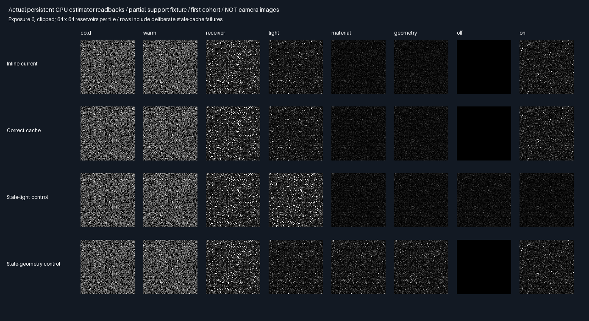

# Persistent vertex/outgoing cache — fixed Vulkan experiment

## Protocol before measurement

Retain selected secondary position, outgoing diffuse lighting and area normalization across actual submissions.
Use the verified triangle/BVH fixture and source proposal unchanged. No production port or PR.

| Concern | Fixed choice |
|---------|--------------|
| Source | Eight .75 cosine/.25 uniform-triangle candidates, donor x=0, target floor .01 |
| Payload | Two float4 arrays: XY/outgoing/area weight, M/present/light revision/valid |
| Telemetry | One separate float4 array; 32 B payload + 16 B diagnostic telemetry per test receiver |
| Arms | Inline reference; correct cache; deliberately stale light; deliberately stale geometry/material |
| Cohorts | 32 independent cohorts × 4096 reservoirs; MT19937-64 0x73a4c951 + fixture×0x1000193 |
| Pairing | Same source seed for all eight states within a cohort and all arms |
| Fixtures | Prior no-strip/self, no-strip/shift, .12 strip, .6 strip; packed triangle BVH |
| Cadence | Cold, static warm, receiver move, half light, half albedo, wider strip, light off, light on |
| Cache validity | Explicit light revision plus existing host geometry/material reset; cold overrides negatives |
| Movement | Only receiver moves; donor domain stays x=0, so source payload remains applicable |
| Receiver shading | Fresh BVH visibility every submission; stored outgoing suffix, no warm source retracing |
| Mean gate | Inline/cache within 4 nominal SE+.0001 of independent clipped-area quadrature |
| Pair gate | Every correct cached estimate within 2e-6 of same-seed inline current evaluation |
| Lifecycle gate | Cache reuse only at warm/receiver steps; all other correct-cache steps regenerate |
| Work gate | Warm correct-cache source queries=0; at most one current receiver query/reservoir |
| Negatives | Stale light must fail at half-light/off; stale geometry must fail at albedo revision |
| Negative gate | Mean error >6 nominal SE+.005 integral; no acceptance tuning |
| Promotion | Zero; no general GI, history reprojection, multiple donor merging or physical-GPU timing |

Half-light uses an explicit caller revision token; changing intensity without that token is intentionally unsafe.
Geometry/material resets use the existing exhibit host's actual packed-facet/BVH change detection. The geometry
step widens the opaque strip by .05. Receiver motion does not change the stationary source domain.
Cold resets isolate cohorts; repeated warm submissions are not counted as independent samples or larger M.
This is payload persistence, not temporal sample accumulation. The production 348.046875 MiB output is unchanged.

## Verified result: persistence removes repeated work without changing the paired estimate

| Fixture | Inline eight-step queries | Cached queries | Total reduction | Static warm reduction | Moved reduction |
|---------|--------------------------:|---------------:|----------------:|----------------------:|----------------:|
| Self | 26,897,901 | 19,580,858 | 27.20% | 96.24% | 96.24% |
| Shift | 26,941,694 | 19,583,586 | 27.31% | 96.24% | 96.24% |
| Partial support | 23,132,018 | 16,996,523 | 26.52% | 95.74% | 95.77% |
| Dark donor | 18,833,118 | 14,940,172 | 20.67% | 94.95% | 95.02% |

- Correct cached estimates match same-seed inline evaluation within **5.96e-8**, including all revisions.
- All **64 inline/cache reference gates** pass. All **12 stale-cache negative controls** fail as required.
- Static and moved-receiver warm submissions perform **zero source/suffix queries**, with at most one fresh
  receiver visibility query per reservoir. Payloads persist in GPU storage across submissions, not registers.
- Six rebuilds and two reuse submissions are included in each eight-step total, not excluded as warm-up cost.

These are actual nearest-facet calls on software Vulkan, not physical-GPU execution time. The reference arm
recomputes the same source bank intentionally, isolating caching rather than fresh-sample quality. Frozen
payloads add no independent samples, do not increase M and do not establish better temporal convergence.

## Actual readbacks and invalidation evidence



The partial-support fixture's first cohort is shown. These are 64×64 reservoir-estimate arrays, **not camera
images**. Exposure 6/clipping is display-only; metrics use unclamped linear values over 32 independent cold cohorts.
The stale-light row wrongly stays lit after light-off. The stale-geometry row misses the material revision.
Both are deliberate failures; neither is accepted behavior. Correct-cache and inline rows track each other.

## Verification

| Check | Outcome |
|-------|---------|
| Device | SwiftShader Device (Subzero), CPU Vulkan type4 |
| Release + ASan/UBSan host | Both exit0; five CTests each |
| Cross-build parity | 194 identical semantic rows; 63 logged hashes verified per build |
| Captures | 32 raw files byte-identical; 32 retained representative PNG pixel arrays exact |
| Pair identities | All32 fixture/cadence pairs pass; maximum5.96e-8 |
| Lifecycle | Reuse only at static/moved steps; light/material/geometry/off/on regenerate |
| Shader derivation | Regenerated source exactly matches both measured builds |
| Production | No engine source/default/layout changes; no promotion |

[Release](Results/VertexCache-release.txt), [sanitizer](Results/VertexCache-sanitized.txt),
[parity](Results/VertexCache-parity.txt), [query comparison](Results/VertexCache-comparison.md).
Host sanitizers do not instrument SwiftShader or shader instructions. This does not replace physical-GPU testing.

```sh
bash Exhibits/LightCompute/RunVertexCache.sh
SANITIZE=1 BUILD_JOBS=1 bash Exhibits/LightCompute/RunVertexCache.sh
_ClaudeScratch/venv/bin/python Exhibits/LightCompute/Code/VertexCacheEvidence.py
```

Prerequisites/platform: pinned Slang2026.14.1 and SwiftShader via Automation/PrepareReplayTools.py, Vulkan
headers1.4.321, CMake/CTest3.31.6, Linux/GCC12.2 C++20; Python/Pillow for evidence. Builds ran sequentially.
Release base282bd5a plus the prototype; sanitizer base0441442 contains that same measured prototype source.
Hashes prove source/shader parity despite the intervening checkpoint. Logs/PNGs and generating code are retained;
binaries/raw float inputs remain ignored scratch. Earlier checkpoints keep their historical measured-host hashes.

## Limits and next phase

This validates a stationary diffuse secondary square, fixed donor domain, deterministic directional-light suffix,
explicit caller-supplied light revision and conservative geometry/material invalidation. It does not automatically
detect an unannounced light change; the stale-light control demonstrates why the revision contract is mandatory.
The cache is not yet RGB, arbitrary-vertex/normal storage, multi-donor merging, reprojection or temporal resampling.
The extra payload/telemetry are exhibit-only; fitting them into production storage needs a separate design review.

The prior occlusion-driven variance penalty is not fixed: this optimization preserves the inline estimator,
including its noise. Frozen source banks also need a tested refresh policy; repeated cached samples cannot be
counted as accumulating independent quality. Physical-GPU timing, full Whole6/Whole8 comparisons, general
materials, stochastic multi-bounce suffixes and Windows/editor remain untested.

**Next:** fixed bounded-refresh and moving-receiver holdouts, measuring temporal quality/correlation as well as
queries against fresh controls. Keep explicit revision invalidation and visibility checks. Do not port solely on
these query savings; production output stays **348.046875 MiB/1080p**.


The subsequent [bounded-refresh checkpoint](CacheRefresh.md) now measures these moving/temporal holdouts;
it preserves the query savings but rejects fixed-period freezing as a quality-preserving fresh replacement.
