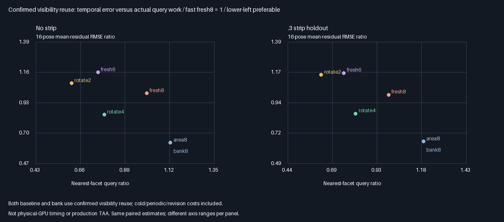
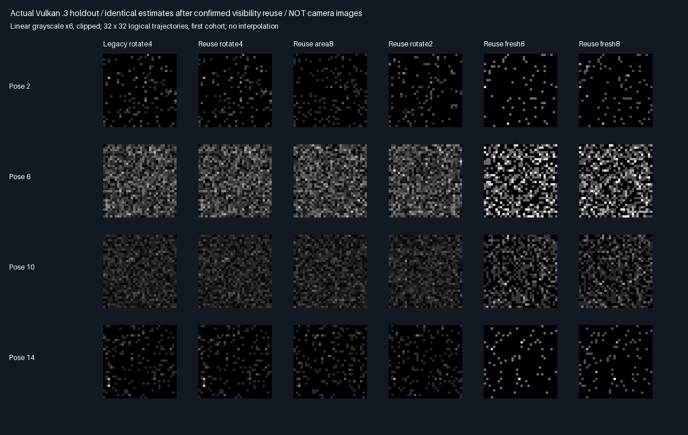

# Confirmed visibility reuse: complete numerical contract and matched-work comparison

## Protocol fixed before measurement

Preserve the reconstructed-point visibility decision,including the three previously failing rays. A primary
hit is not substituted for that decision. Cache one actual reconstructed-point visibility result per new bank
candidate and reuse it for validation,density and newborn receiver evaluation. Older candidates are retraced.
Fresh cosine paths skip only rechecks for out-of-domain/null proposals,which contribute zero regardless.

| Concern | Fixed choice |
|---------|--------------|
| Arms | Legacy6 + confirmed-reuse6:area8,bank8,rotate4/2,fresh6/8;12 arms in one dispatch |
| Samples | Same32 independent cold cohorts×1024 trajectories×16 poses×four existing fixtures |
| Events | Same cold0,half-light9,restored13;identical RNG advances,mixture,normalization and rotation |
| Contract | Confirmed reconstructed-point visibility is authoritative for a stored surface position |
| Numerical fix | Query once and reuse its decision;no shadow margin,epsilon or tolerance changes |
| Instrumentation | Record original/reconstructed directions,hit points,facet IDs,distances,float words |
| Ray isolation | Query original and reconstructed directions with identical origins and short maximum distances |
| Boundary probes | First960 historical entries plus64 neighboring representable inputs per fixture |
| Neighbors | Receiver1 and its adjacent floats;target shadow-cut+1e-7 ±3 ULPs;three y coordinates |
| Regressions | Original indices918/938/958 must still have first=1,recheck=0,safe=0 |
| Safety | All4096 retained boundary cases preserve recheck;log old first-hit disagreements separately |
| Main identity | All paired estimates within2e-6;all stored candidate words equal;queries never increase |
| Fresh savings | Exactly the number of out-of-domain misses,not the entire6/8 candidate budget |
| Means | 768 pose means within4 nominal cohort SE+.0001 versus independent converged quadrature |
| Quality/work | All instant/temporal/flicker/lag1 metrics;paired fast rotate4/2 vs fast fresh6/8 MSE/SE |
| Cold cost | Every submission,cold/revision rebuild and current receiver query included |
| Storage | Existing144B bank payload+16B telemetry;no production storage claim |
| Promotion | No automatic production promotion,no physical-GPU timing claim |

The positive q>.25 indicator encodes the confirmed birth query only in this fixed-normal,known-square mixture.
Only candidates born at the current submission use it;all historical slots get a fresh visibility query.
The failed blanket-elision exhibit remains unchanged and failing;this is a different implementation preserving
its original semantics,not a weakened safety gate. Numerical diagnostic input repeats preserve prepared extent.

Reproduce with the existing pinned tool dependencies and Python/Pillow environment:

```bash
bash Exhibits/LightCompute/RunVisibilityReuse.sh
SANITIZE=1 BUILD_JOBS=1 bash Exhibits/LightCompute/RunVisibilityReuse.sh
_ClaudeScratch/venv/bin/python Exhibits/LightCompute/Code/VisibilityReuseEvidence.py
```

The archived negative-control log records the current release host running the previous RayBudget modules with
`--ray-budget`;it exits1 as required. `bash Exhibits/LightCompute/RunRayBudget.sh` also reproduces that original
rejection and must not be treated as a passing command. On a clean workspace,run it before the new comparison
if those historical modules are absent. Production output348.046875MiB,Engine/defaults/layout unchanged;
no memory packing.

## Outcome:confirmed reuse passes;blanket elision remains rejected

| Choice | Suitability | Decision and reason |
|--------|-------------|---------------------|
| Reuse confirmed reconstructed-point visibility | ⭐⭐⭐⭐⭐ 🥇🏆 | Chosen:preserves boundary decisions and estimator |
| Infer visibility from primary hit alone | ⭐ 🔴 | Rejected:one-ULP direction changes can hit a blocker |
| Change epsilon or ignore boundary probes | ⭐ 🔴 | Rejected:would weaken the numerical contract |

Stars rate suitability for this problem,not measured image quality or hardware speed.

### Isolated cause and correction

At original probes918/938/958,the reconstructed direction.x changes by exactly one float ULP. Direction.y/z
are unchanged. With the **same origin and short maximum distance**,the original direction misses while the
reconstructed direction hits blocker facet2. This isolates the direction change as sufficient to flip the query;
it does not establish a defect in production BVH traversal.

| Probe | Original direction.x bits | Reconstructed bits | Original short query | Reconstructed short query |
|------:|--------------------------:|-------------------:|----------------------|---------------------------|
| 918 | 0xbf480a13 | 0xbf480a14 | miss | blocker2 |
| 938 | 0xbf5050d5 | 0xbf5050d6 | miss | blocker2 |
| 958 | 0xbf480a13 | 0xbf480a14 | miss | blocker2 |

The correction does **not** force these rays visible. It preserves recheck=false and reuses that actual result.
The added64 neighboring representable inputs/fixture retain23 first-hit/recheck disagreements on .3,but zero
confirmed-reuse/recheck disagreements across all4096 retained cases. Original three regressions remain present.

### Complete release/sanitized baseline comparison

Both baseline and bank now use safe same-contract query reuse. All cold/light-revision costs are included.
Quality values below compare bank rotate4 against fresh8;the visibility optimization itself changes no estimate.

| Strip | Rotate4 queries | Safe fresh8 queries | Fewer queries | Instant RMSE reduction | Temporal RMSE reduction |
|------:|----------------:|--------------------:|--------------:|-----------------------:|------------------------:|
| 0 | 4,404,083 | 5,632,094 | 21.80% | 37.90% | 16.17% |
| .12 | 4,146,147 | 5,216,988 | 20.53% | 33.75% | 14.56% |
| .3 | 3,844,868 | 4,716,590 | 18.48% | 32.69% | 14.07% |
| .6 | 3,597,399 | 4,291,754 | 16.18% | 31.78% | 16.65% |

This is a smaller query benefit than the previous37.72–49.46% against inherited controls. It survives the fairer
comparison without discarding silhouette rays. It remains an actual-call result,**not physical-GPU timing**.
Safe fresh6 is cheaper than rotate4:rotate4 uses4.28–11.76% more queries but has25.75–27.79% lower temporal
RMSE. Do not repeat the earlier all-fixture fresh6 query-win claim against these corrected controls.

Nonpersistent area8 still lowers temporal RMSE34.82–37.60% versus safe fresh8,but now uses12.20–23.85% more
queries;it is a lower-history-storage quality tradeoff,not a query win. Rotate2 saves36.24–38.60% queries versus
safe fresh8 but worsens temporal RMSE3.89–14.96%,so remains unaccepted as a quality-neutral replacement.





These are logical estimate arrays,not camera images. Display exposure6/clipping do not affect measurements.
See [all48 arm/fixture summaries](Results/VisibilityReuse-comparison.md) and
[recorded direction words](Results/VisibilityReuse-rays.md). Paired temporal-MSE contrasts favor rotate4 over
safe fresh8 in all four fixtures,minimum24.41 nominal cohort SE;no guaranteed confidence-interval claim.

### Practical choice, storage and remaining scope

| Option | Priority | Why carry it forward or retain it |
|--------|----------|-----------------------------------|
| Confirmed-reuse rotate4 | 🥇🏆 ⭐⭐⭐⭐ | Quality/query win over corrected fresh8 in all four fixtures |
| Corrected fresh6/8 | 🥈 ⭐⭐⭐⭐ | Essential cheap/no-history controls;fresh6 costs less than rotate4 |
| Nonpersistent area8 | 🥉 ⭐⭐⭐ | Stronger quality,more queries;potentially lower history storage |
| Rotate2 | ⭐⭐ ⚠️ | Lower work,but correlated temporal error still loses to fresh8 |

Ratings express next-work priority within this restricted component,not production readiness. The measured
quality benefit belongs to receiver-anchored candidate reuse;the new confirmed-visibility optimization preserves
it exactly. Nonpersistent history savings are algorithmic,not an allocation measured by this common debug harness.

Eight-slot144B payload plus16B telemetry remains an experimental burden. Relative to the earlier32B payload,
its extra112B/reservoir extrapolates to221.484375MiB at1080p. **No production adoption or allocation reduction**:
accepted output-only348.046875MiB,Engine/layout/defaults stay unchanged. Further packing remains deferred.

Next distinct problem:prove a lower-storage weighted-reservoir/fresh-injection alternative against these corrected
controls,without losing historical-density correctness or quality. General geometry/RGB/full GI,production C++
integration,physical-GPU/Windows/editor/TAA and wall-time/bandwidth acceptance remain separate unfinished gates.
The present proof is scalar,diffuse,known-square/directional-suffix software Vulkan,not that broader acceptance.

Overall renderer completion is approximately35% as a **rough planning estimate**,not measured code completion or
production readiness. This scoped problem is100% complete:both matrix runs,evidence checks,comparison and GitHub backup.
Remaining work in this focused phase:0%;the broader unfinished gates above are not silently accepted.


## Final verification and provenance

- Release and host ASan+UBSan focused runtime commands both **exit0**;five standard CTests pass/build.
  No host sanitizer finding;external SwiftShader driver and SPIR-V are not sanitizer-instrumented.
- **929 identical semantic rows,177 checked source/module/raw hashes per build**;exact regenerated shader.
- All768 pose-mean gates pass the frozen4 nominal SE+.0001 reference bound;12,582,912 paired estimates have
  maximum difference**0**. Current-born and historical payload words match;34,078,720 retained-slot checks.
- All408 historical six-arm mean/result rows remain unchanged,including fresh6/8. All24 legacy/fast quality
  summaries match. Full-refresh inline/bank estimates and total queries match;fresh savings equal measured
  out-of-domain/null misses,not a blanket6/8 queries per receiver.
- **136 raw captures are byte-identical across builds**,24 PNG arrays match the captured values exactly.
  Independent1,572,864-candidate reconstruction checks historical q/current estimates,maximum errors
  1.35335272267e-7/5.22758408783e-8. All4096 retained edge cases preserve confirmed recheck visibility.
- The unsafe original gate was rerun using the new release host and original module hashes:expected**exit1**,
  all eight archived device/edge/detail rows unchanged. The new neighboring rays do not erase that rejection.
- No PR or Actions;source and final evidence are committed/pushed to the session branch. Raw captures/builds
  stay ignored;their hashes and regenerated24 per-panel PNGs,comparison chart and readback grid are retained.

Evidence:[release](Results/VisibilityReuse-release.txt),[sanitized](Results/VisibilityReuse-sanitized.txt),
[parity audit](Results/VisibilityReuse-parity.txt),[old negative control](Results/VisibilityReuse-legacy-rejection.txt).
Counts above are per independent build unless explicitly cross-build;matched native checks include both old/new
arms within a build,and density reconstruction uses the captured first cohort,not all32 cohorts.
