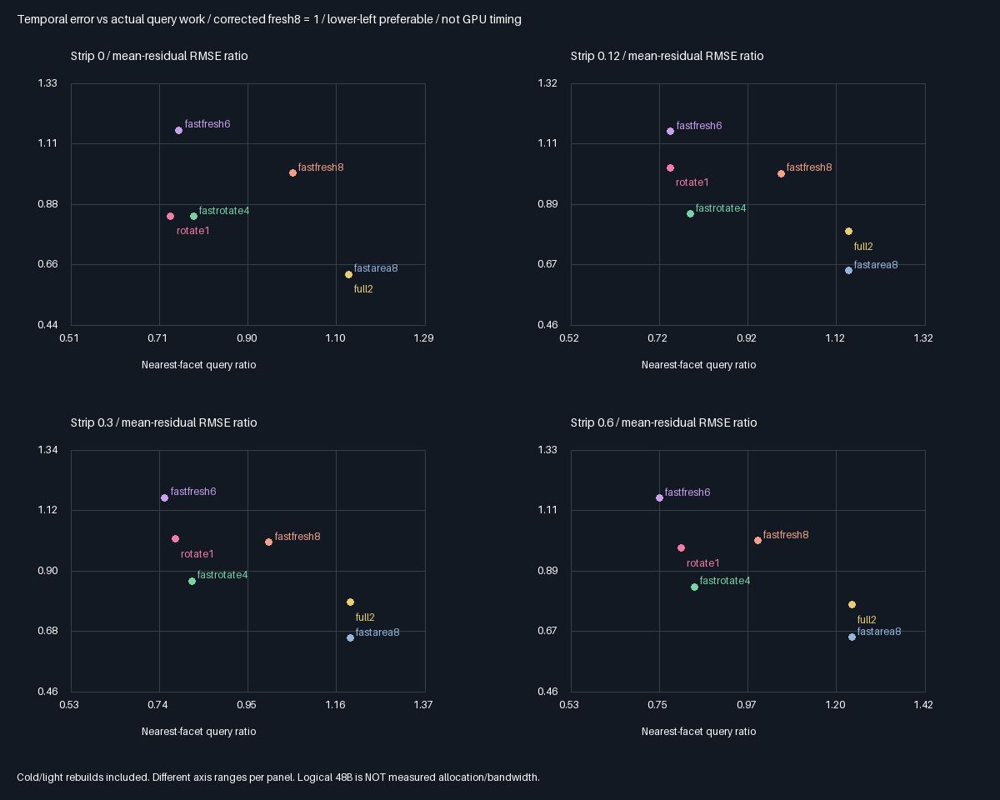
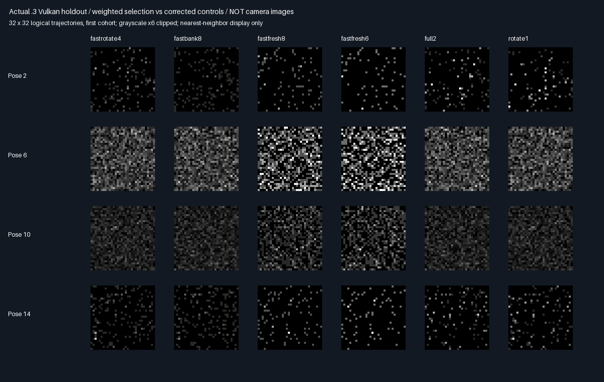

# Two weighted reservoirs:lower-storage candidate retention

## Protocol frozen before measurement — 2026-10-29

Problem:replace eight raw density-bearing candidates with two selected samples without changing historical
importance weights or losing support when the receiver moves. No production adoption,memory packing or tuning.

| Concern | Fixed specification |
|---------|---------------------|
| Controls | Previous12 arms unchanged;new full2 and rotate1 weighted pairs;14 arms |
| Pair | Two float4(point.xy,outgoing,Z) reservoirs plus one float4 revision descriptor:48B logical payload |
| Sources | Four proposals per reservoir;fixed .25 uniform+.75 cosine mixture at current receiver |
| Selection | Positive geometry-only target h=cosine×area-measure/π;exclude visibility and outgoing from h |
| Weight | w=h/q;select proportional to w;Z=sum(w)/(4×h(selected));nulls count in divisor4 |
| Randomness | Proposal stream unchanged;separate deterministic stream for reservoir selection |
| Refresh | Full2 replaces both every pose;rotate1 alternates one reservoir,full rebuild at0/9/13 |
| Current | Confirmed birth-query reuse for newborns;retrace historical visibility;average2 of .6×L×hCurrent×Z×V |
| History | Preserve selected point,outgoing,and birth Z bitwise;never replace birth h with current h |
| Samples | Same32 cold cohorts×1024 trajectories×16 poses×strips0/.12/.3/.6 and previous seeds |
| Mean gates | All896 means within4 nominal cohort SE+.0001;reference quadrature convergence<1e-7 |
| Identity | Previous12 estimates/payloads/query totals unchanged;all old safety gates retained |
| Exact check | Full2 versus full-bank8 on empty strip,where target matches integrand,within2e-6 |
| Independent | Enumerate finite RIS/null cases;reconstruct selection,Z,current estimate and retained payloads |
| Quality | Compare new arms vs corrected Fresh6/8 and Rotate4;no cadence/target tuning after measurement |
| Acceptance | Rotate1 instant+temporal RMSE no worse than corrected Fresh8 in all fixtures;queries≤Fresh8 |
| Evidence | Release and host ASan/UBSan,raw/module/source hashes,actual-buffer images,paired MSE/SE |
| Allocation | Common debug SSBO unchanged;48B logical payload is NOT measured allocation/bandwidth reduction |

The score is positive on every supported surface point even when birth visibility/outgoing is zero. A birth
visibility-weighted target would delete future-visible support;it is an explicit negative control,not a repair.
If quality fails,retain the rejection and stop this design rather than tune against the existing holdouts.

Result below:correct weights and lower-query tradeoff,but two temporal-quality gates fail.
Production Engine/defaults/layout and accepted348.046875MiB output-only remain unchanged.

Preflight before any trajectory means:reuse confirmed newborn visibility via existing telemetry,as for controls;
record all four resampling weights per reservoir for exact float32 replay. Neither change alters sampling.

## Final outcome:correctness passes;quality-neutral replacement rejected

| Option | Priority | Outcome |
|--------|----------|---------|
| Existing corrected Rotate4 | 🥇🏆 ⭐⭐⭐⭐ | Stronger temporal quality;144B logical payload still expensive |
| Corrected Fresh6/8 | 🥈 ⭐⭐⭐⭐ | Keep no-history controls and practical fallback |
| Weighted rotate1 pair | 🥉 ⭐⭐⭐ | Useful lower-query/logical-storage tradeoff;fails all-fixture temporal gate |
| Full2 pair | ⭐⭐ | Compression control;no history benefit,more queries than Fresh8 |

Stars rank suitability for further work,not a measured quality score. No production option is promoted.

### Results against equally corrected Fresh8

Negative RMSE change means better;query savings are actual call counts,not physical-GPU speed.

| Strip | Rotate1 queries | Fewer queries | Instant RMSE change | Temporal RMSE change | Frozen acceptance |
|------:|----------------:|--------------:|--------------------:|---------------------:|-------------------|
| 0 | 4,119,403 | 26.86% | −37.67% | −16.03% | pass |
| .12 | 3,909,592 | 25.06% | −19.39% | +2.05% | fail |
| .3 | 3,658,784 | 22.43% | −19.29% | +1.19% | fail |
| .6 | 3,453,999 | 19.52% | −20.02% | −2.59% | pass |

The two failing paired temporal-MSE contrasts are+3.74/+2.03 nominal cohort SE,not guaranteed confidence
intervals. Do not call this biased:all reference-mean gates pass. Do not call it quality-neutral either.

Against corrected Rotate4,the pair saves3.99–6.46% queries but temporal RMSE is0.17–19.43% higher and instant
RMSE0.37–21.67% higher. Against corrected Fresh6,it lowers temporal RMSE11.32–27.51%;query changes range
from−2.46% to+7.30%. It remains a meaningful budget tradeoff,not a universal replacement or timing result.
Full2 lowers temporal RMSE20.79–37.60% vs Fresh8 but needs12.20–23.85% more queries. Inline area8 has the
same query totals and less error in occluded fixtures:compression is not free variance reduction.





These are logical trajectory arrays,not camera images.
Full summaries:[all56 arms/fixtures](Results/WeightedPair-comparison.md).

### Why the means survive but temporal quality does not

For four proposals,selection probability is(h/q)/S and Z=S/(4h). The conditional selected estimate has expectation
Σ(F/q)/4,including null draws. Historical Z therefore remains valid as the receiver moves. Averaging two such
reservoirs is unbiased under the fixed-scene/revision contract,without substituting current h for birth h.

Selecting one sample adds conditional variance unless Fcurrent/hbirth is constant across the proposed points.
On the empty strip,full refresh matches the eight-draw integrand:maximum observed discrepancy5.96046447754e-8.
Occlusion and receiver motion break that proportionality. The positive target preserves support but does not
preserve the eight stored evaluations' conditional averaging. No target/cadence was tuned after these results.

### Storage and completion accounting

- **Logical persistent payload144→48B(−66.67%)**:two selected float4s plus one revision float4. Existing16B
  telemetry is unchanged;debug proposals,weights and uniforms are audit-only,not algorithmic history.
- Common debug SSBO allocation is unchanged in structure;14-arm allocation is NOT a measured reduction versus
  the previous12-arm test. Potential96B/reservoir layout difference is189.84375MiB at1080p,not allocated savings.
- Production Engine/layout/defaults and accepted**348.046875MiB** output-only extrapolation remain unchanged.
  Packing stays deferred. The logical48B alternative has not passed production memory or bandwidth acceptance.
- This design's investigation,implementation,baseline/alternative comparison and acceptance decision are complete.
  The broader goal of lower storage **without the temporal regressions** remains open;do not hide it as done.
- Overall renderer remains roughly**35% planning estimate**,not measured code completion or readiness. Focused
  evaluation100%,remaining evaluation work0%:dual-build audit and GitHub backup complete;production gates remain open.
- Next distinct numerical design:an intermediate selected-reservoir count/support-safe target,with a new frozen
  holdout rather than tuning this pair against these results. General RGB/GI/geometry,production port and actual
  physical-GPU/Windows/editor/TAA/timing acceptance remain outstanding.

## Reproduction and independent verification

Use existing pinned Slang2026.14.1,SwiftShader CPU Vulkan(type4),GCC12.2,CMake and Python/Pillow dependencies:

```bash
python3 Exhibits/LightCompute/Code/WeightedPairFinite.py
bash Exhibits/LightCompute/RunWeightedPair.sh
SANITIZE=1 BUILD_JOBS=1 bash Exhibits/LightCompute/RunWeightedPair.sh
_ClaudeScratch/venv/bin/python Exhibits/LightCompute/Code/WeightedPairEvidence.py
```

The preflight was stopped before trajectory means to add recorded selection weights and reuse confirmed newborn
visibility,as for controls. Final source and gates were fixed before quality measurement. No baseline weakening,
shadow epsilon change,post-result target tuning or new production configuration.

- Both focused commands **exit0**;five CTests/build pass. Host ASan+UBSan reports no finding;driver and SPIR-V
  are not sanitizer-instrumented. Release/sanitized source hashes and numerical results match.
- **1,069 semantic rows identical;243 source/module/raw hashes checked/build;896 reference-mean gates pass.**
  All816 historical12-arm mean/result rows and136 control/diagnostic capture hashes remain unchanged.
- **200 raw captures byte-identical across builds;24 PNG arrays exact.** Native1,703,936 weighted-history
  retention checks and34,078,720 raw-bank retention checks/build. Original4096 edge regressions still pass.
- Independent262,144 exact float32 selection replays and1,048,576 proposal-slot checks,including retained sets.
  Maximum q/weight/Z/current-estimate errors:1.37e-7/6.54e-7/3.73e-7/7.78e-8. Regenerated shader matches exactly.
- All6,144 finite configurations satisfy conditional first moments. Wrong valid-count normalization/current-h
  denominator/birth-visibility support give means6.3336/4.0/3.7 instead of3.9;all three negative controls detected.
- Frozen quality acceptance is**[pass,fail,fail,pass]**. The audit exits0 because it verifies this rejection,
  not because it silently promotes the pair. Sources,results and actual-buffer images are committed/pushed;
  no PR or Actions. Raw datasets/builds remain ignored,their hashes retained.

Evidence:[Release](Results/WeightedPair-release.txt),[sanitized](Results/WeightedPair-sanitized.txt),
[parity/decision](Results/WeightedPair-parity.txt). Native counts are per build;independent reconstruction uses
captured first-cohort buffers rather than every cohort. Empty-strip identity is checked only on fixture0;
zero fields on other fixtures are not additional identity tests.

## Intermediate count evaluated separately

[Four weighted reservoirs](WeightedQuartet.md) keep the same positive score and fresh4 warm budget,but select
from2 proposals/reservoir.80B logical history passes the five-fixture corrected-Fresh8 gate,including new .45.
That does not erase this pair's .12/.3 temporal failures or imply a production memory/layout change.
