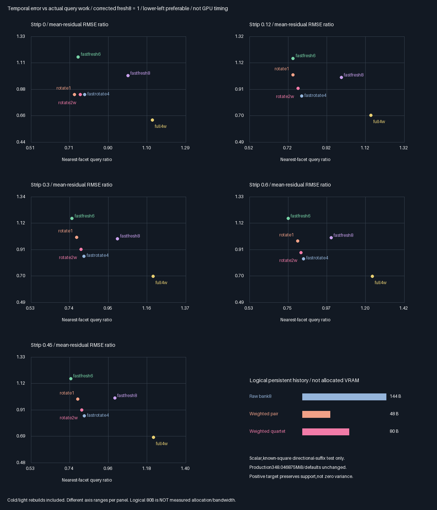
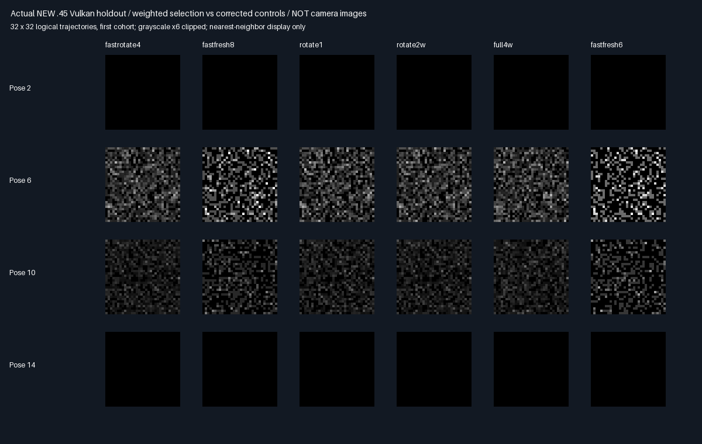

# Four weighted reservoirs:intermediate memory/variance compromise

## Outcome:restricted memory/quality compromise accepted

**All five frozen acceptance fixtures pass in Release and host ASan/UBSan**,including the new .45 holdout.
Four selected reservoirs retain80 logical bytes rather than144,with lower query count and instantaneous/temporal
RMSE than corrected Fresh8. This is a scalar known-square result,not production memory or hardware acceptance.

| Choice | Priority | Decision |
|--------|----------|----------|
| Weighted quartet,rotate2w | 🥇🏆 ⭐⭐⭐⭐ | Carry forward the intermediate logical-memory/query/quality compromise |
| Corrected raw Rotate4 | 🥈 ⭐⭐⭐⭐ | Stronger quality;larger144B logical history |
| Corrected Fresh6/8 | ⭐⭐⭐⭐ | Keep practical no-history controls;Fresh6 remains cheaper |
| Weighted pair | ⭐⭐⭐ | Smaller48B budget option;old temporal failures remain |

Stars rank next-work suitability within this component,not universal quality or GPU speed.

### Complete paired baseline comparison

All cold/revision costs included. Negative error changes mean improvement. Query savings are calls,not time.

| Strip | rotate2w queries | Fewer vs Fresh8 | Instant RMSE change | Temporal RMSE change | Gate |
|------:|-----------------:|---------------:|--------------------:|---------------------:|------|
| 0 | 4,280,299 | 24.00% | −37.82% | −16.12% | pass |
| .12 | 4,046,462 | 22.44% | −28.59% | −8.64% | pass |
| .3 | 3,768,631 | 20.10% | −27.98% | −8.60% | pass |
| .6 | 3,540,423 | 17.51% | −27.62% | −11.69% | pass |
| .45(new) | 3,634,996 | 18.81% | −29.21% | −9.59% | pass |

All five paired temporal-MSE contrasts favor rotate2w versus corrected Fresh8;minimum14.85 nominal cohort SE,
not a guaranteed confidence interval. Full4w matches full-bank8 query totals;empty-strip estimate difference
is at most4.47034835815e-8. Occluded compression does not preserve the dense bank's conditional variance.

| Comparison | Query change | Temporal RMSE change | Interpretation |
|------------|-------------:|---------------------:|----------------|
| Quartet vs raw Rotate4 | −2.81% to−1.58% | +0.06% to+6.93% | Less logical history,slight work win,quality cost |
| Quartet vs weighted pair | +2.50% to+3.91% | −10.47% to−0.11% | A small work increase repairs pair's acceptance gap |
| Quartet vs corrected Fresh6 | +1.35% to+9.99% | −27.59% to−20.61% | Quality/work tradeoff,not a Fresh6 query win |

Raw Rotate4 remains more accurate;the quartet is not a quality-neutral replacement for that larger bank.
Acceptance was fixed against corrected Fresh8,not changed after observing these differences. The old pair's
.12/.3 failures are retained,not relabeled as accepted.
[All80 arm/fixture summaries](Results/WeightedQuartet-comparison.md).





### Verification and progress

- Both focused commands **exit0**;five standard CTests/build pass. No host ASan/UBSan finding;external driver
  and SPIR-V are not instrumented. Software Vulkan only,no physical-GPU timing or Windows/editor claim.
- **1,527 identical semantic rows;375 source/module/raw hashes checked/build;all1,280 reference-mean gates pass.**
  All952 historical14-arm mean/result rows and200 old raw-capture hashes are unchanged on the original fixtures.
- **330 raw captures byte-identical across builds;24 PNG arrays exact.** Original three boundary regressions stay
  present;all5,120 retained boundary cases preserve authoritative recheck visibility. No epsilon relaxation.
- Native selected-history checks:quartet4,259,840,pair2,129,920;raw-bank42,598,400 retained-slot checks/build.
  Native15,728,640 legacy/confirmed matched estimates retain maximum difference0.
- Independent655,360 exact quartet selections and327,680 pair selections replayed in float32;both proposal
  families cover2,621,440 captured proposal-slot checks,including repeated held sets. q/weight/Z/estimate maximum
  errors1.37e-7/6.54e-7/4.71e-7/7.78e-8. Generated shader reproduced exactly;384+6,144 finite checks pass.
- **Focused phase100%,remaining0%**:implementation,all comparisons,new holdout,both builds,regressions,visual
  evidence and GitHub backup complete. Overall renderer about**40% planning estimate**,not audited code progress
  or production readiness. No PR or Actions.
- Next distinct gate:general-scene RGB/facet descriptors and support-safe target validation at this fresh-query
  budget,before an Engine port. Actual storage allocation/bandwidth,full GI,physical-GPU/Windows/editor/TAA and
  game-time acceptance remain open. Production348.046875MiB unchanged;further packing stays deferred.

Evidence:[Release](Results/WeightedQuartet-release.txt),[sanitized](Results/WeightedQuartet-sanitized.txt),
[parity/decision](Results/WeightedQuartet-parity.txt). Native counts are per build;independent reconstruction uses
captured first-cohort buffers,not all32 cohorts. Empty-strip identity is tested only on fixture0;other zero fields
are sentinels,not evidence of identity under occlusion. Raw datasets/builds stay ignored;their hashes are retained.


## Protocol frozen before measurement — 2026-10-29

| Concern | Fixed choice |
|---------|--------------|
| Problem | Reduce eight-candidate history without the pair's temporal regressions |
| New arms | full4w and rotate2w;four reservoirs,two proposals each |
| Controls | Previous14 arms unchanged,including rejected pair,corrected Rotate4 and Fresh6/8 |
| Target | Same positive geometry h;w=h/q,Z=Σw/(2hselected);never include birth visibility/outgoing in h |
| Estimate | Average4 of .6×outgoing×hCurrent×birthZ×currentVisibility;null draws count in divisor2 |
| Injection | Replace2 reservoirs/update,alternate halves;full rebuild0/9/13;8 cold/4 warm proposals |
| Visibility | Reuse actual confirmed newborn query;retrace history;no epsilon or tolerance relaxation |
| Storage | Four float4s+revision float4=80 logical bytes,versus144 raw/48 pair;telemetry16B unchanged |
| Allocation | Shared32-slot debug SSBO;logical reduction is not measured allocation or bandwidth saving |
| Samples | 32 cold cohorts×1024 trajectories×16 poses;previous seeds,path and intensity events |
| Fixtures | Existing0/.12/.3/.6 plus new predeclared .45 strip;no post-result score/cadence tuning |
| Means | All1280 means within4 nominal cohort SE+.0001;quadrature convergence<1e-7 |
| Safety | All previous boundary probes retained,including original three disagreement regressions |
| Baseline | Previous14-arm mean/result rows and captured bytes unchanged on original four fixtures |
| Identity | Empty-strip full4w estimate within2e-6 of full-bank8;old exact elision identities maintained |
| Audit | Exact float32 selection replay,Z/current-estimate reconstruction,retention/epoch checks,null controls |
| Acceptance | rotate2w instant/temporal RMSE≤corrected Fresh8 and queries≤Fresh8 in ALL five fixtures |
| Comparisons | Paired MSE/SE vs corrected Fresh6/8,Rotate4 and weighted pair;full4w vs Fresh8 |
| Completion | Both builds,all comparisons,visual evidence,independent audit,report and GitHub backup |
| Production | No Engine/default/layout change,packing,PR,Actions or physical-GPU timing claim |

If any acceptance fixture fails,retain the result without tuning the score or injection cadence against it.
Production output-only348.046875MiB stays accepted and unchanged. Broader RGB/GI/game acceptance is separate.

Results below:restricted acceptance passes5/5;production promotion remains0.

## Mechanism and independent checks

- Four selected samples each represent two proposals. Selection probability is(h/q)/Σ(h/q),with
  Z=Σ(h/q)/(2hselected). Their average4 has the same conditional first moment as the eight proposal evaluations.
- Null proposals still count in2. A zero-normalizer reservoir is canonical zero. Score h stays positive across
  this known square even when source visibility/outgoing is zero,so future-visible support is not deleted.
- Historical selected position,outgoing and Z remain bitwise unchanged. Only newborns use their actual confirmed
  source query;history gets a current visibility query. Half-light/restoration revisions rebuild all four.
- `WeightedQuartetFinite.py` exhausts384 two-proposal configurations,including nulls. Deliberately wrong valid
  divisor,current-target denominator and birth-visibility score yield means5.46/4.0/3.7 instead of3.9.
  The original6,144 four-proposal configurations are checked independently as regressions.
- The debug capture retains candidates,uniforms,weights,sum,selected target/index and birth anchor. The audit
  replays selection in float32 and reconstructs Z/current estimates,not just an equality between two GPU arms.

## Storage limits and reproduction

| Logical history | Selected float4s | Revision | Total | Meaning |
|-----------------|-----------------:|---------:|------:|---------|
| Raw bank8 | 128B | 16B | 144B | Existing density-bearing samples |
| Weighted pair | 32B | 16B | 48B | Rejected quality-neutral replacement;budget control |
| Weighted quartet | 64B | 16B | 80B | Intermediate candidate evaluated here |

History alone is44.44% smaller than the scalar raw bank;16B telemetry is unchanged. Potential64B/reservoir
layout difference extrapolates to126.5625MiB at1080p,**not allocated or measured savings**. The16-arm debug
buffer also contains audit fields and is larger than the preceding14-arm test;it is not a reduced-memory demo.

The80B count relies on a known planar square's two coordinates and scalar outgoing intensity. It does not specify
RGB,facet/barycentric descriptors,normals or general-scene storage cost. Those need a separate measured layout.
The current production output-only**348.046875MiB**,Engine/layout/defaults and deferred packing stay unchanged.

Pinned prerequisites:Slang2026.14.1,SwiftShader CPU Vulkan(type4),GCC12.2,CMake and Python/Pillow environment.

```bash
python3 Exhibits/LightCompute/Code/WeightedQuartetFinite.py
bash Exhibits/LightCompute/RunWeightedQuartet.sh
SANITIZE=1 BUILD_JOBS=1 bash Exhibits/LightCompute/RunWeightedQuartet.sh
_ClaudeScratch/venv/bin/python Exhibits/LightCompute/Code/WeightedQuartetEvidence.py
```

Sources and protocol were fixed before measurement. No source visibility convention,epsilon,mean tolerance,
post-result target or injection cadence change. Logical-array images are not camera or TAA output. No physical
GPU,Windows/editor,wall-time/bandwidth or production acceptance follows from this restricted component test.
