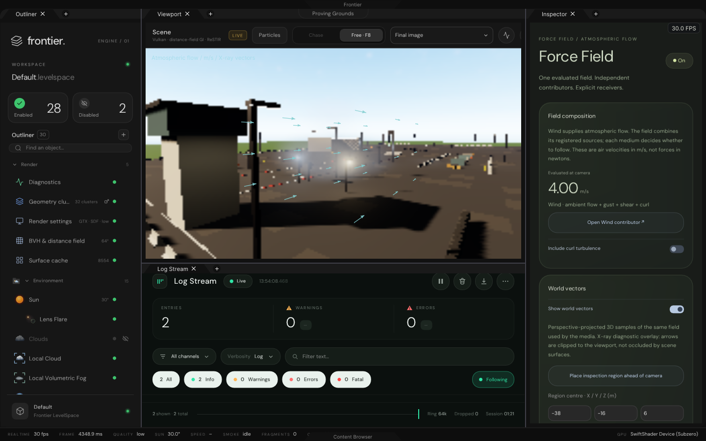
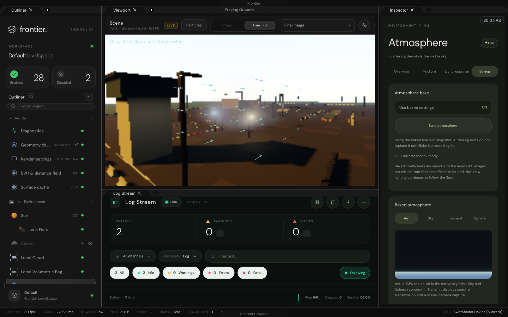
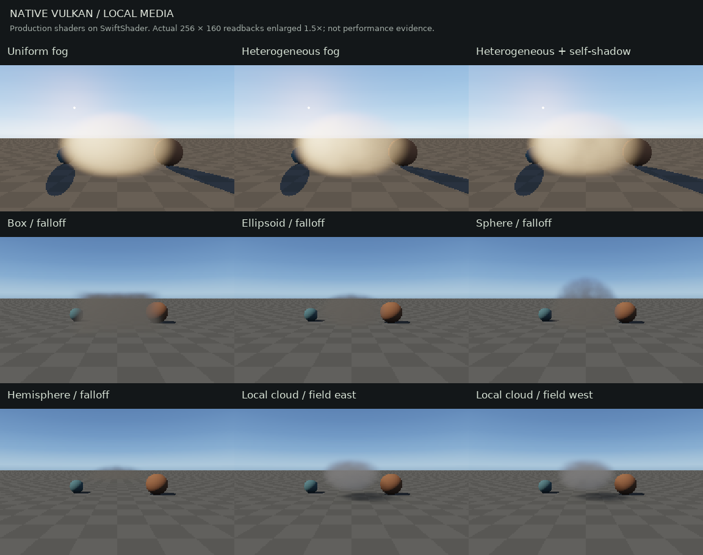
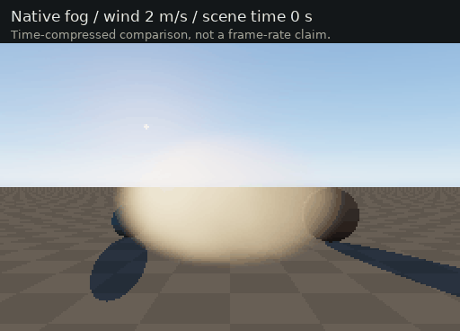

# Functional baking, force fields and local media

This exhibit verifies the requested behaviour in production C++ and native Vulkan. It is not a browser approximation.
The pre-existing UI implementation was committed and pushed before this work, as requested.

## Actual editor output





The scene above is the real Everest viewport at a deliberately small **192 × 120** rendering extent, enlarged by the
native editor for these software-Vulkan checks. UI is 1440 × 900. The fixed ImGui clock is not a measured frame rate.

## Behaviour delivered

| Area        | Behaviour                                                                                         |
|-------------|---------------------------------------------------------------------------------------------------|
| Baking      | Native LUT bakes publish real transmittance, scattering and sky pixels |
| Snapshot    | Baked optical coefficients persist in TOML; authored edits remain separate until explicit rebake  |
| Live mode   | Turning off Use baked settings resumes normal dirty-gated native lookup updates                    |
| Force Field | Scene-wide atmospheric composition, evaluated velocity readouts and a bounded 3D sampling region  |
| Wind        | Separate Wind contributor; native gust/curl plots, frequency and eddy-scale controls |
| World view  | Perspective-projected velocity arrows from the same field used for advection                       |
| Local fog   | Local records render with box/ellipsoid/sphere/dome bounds, falloff, noise and self-shadow |
| Local cloud | Viewport receives local records; bounded native density, wind advection, erosion and lighting      |
| Quality     | Real 16/32/64/128 march budgets; cloud resolution changes actual trace dispatch |
| Creation    | Local Cloud and Local Fog have explicit creation-menu registrations                                |

- Bounds remain fixed while density coordinates advect. Displacements are integrated per receiver token, so changing
  speed, stopping Wind or unlinking a medium does not multiply a new velocity by the whole scene age or jump the noise.
- The existing force-field solver is reused. **Arrows are velocity in m/s, not force in newtons.** Its existing coherent
  sources can contribute through that solver; this change does not create new authoring interfaces for all source types.
- Vectors are a labelled **X-ray diagnostic**: projected and clipped in 3D/viewport space, not hidden behind opaque
  geometry.
- Vegetation is not a registered receiver in Everest. Tree bending and precipitation response are not claimed.
- Local Cloud and Local Volumetric Fog already existed as disabled default records. They now render when enabled or
  placed using their inspector. The default level contains **30 records**, including the Force Field parent of Wind.
- Shared cloud sampling is authored on the global Cloud record, even when viewed from a local cloud inspector.
  Fog uses the highest requested sample count among enabled local fog volumes. Actual effective quality is reported.
- Cloud resolution reduces ray traces and reconstructs the full image using visibility/depth checks. The work image
  remains full-sized; this is not a claim of proportional memory savings or frame-time improvement.

## Native volume evidence





The GIF uses four actual shader readbacks at scene times 0, 2, 4 and 6 seconds, played faster for comparison.
No fog, noise or motion is painted into these images after rendering.

### Before/after verification

Mean absolute RGB differences are measured on linear native GPU readbacks, not estimated from the PNGs.

| Check                               | Before          | After          | Acceptance                           |
|-------------------------------------|-----------------|----------------|--------------------------------------|
| Reverse configured fog wind         | 0               | 0.00131972     | Must change                          |
| Zero fog velocity; advance time      | 0.00092608      | 0              | Must remain still                    |
| Uniform → heterogeneous fog         | 0.000686922     | 0.000468153    | Noise must affect radiance           |
| Reverse Force Field for local fog   | Not measured    | 0.00114368     | Shared field must affect fog         |
| Reverse Force Field for local cloud | Not measured    | 0.00102684     | Shared field must affect cloud       |
| Cloud 32 samples versus 128          | Not measured    | 0.00000196025  | Compare with the next row            |
| Cloud 64 samples versus 128          | Not measured    | 0.00000103712  | Lower error than 32                  |
| Cloud trace at 25% of 256 × 160      | Fixed full view | 64 × 40        | Real reduced dispatch extent         |
| Backlit uniform → noisy fog         | Not measured    | 0.0364023      | Visually measurable heterogeneity    |

`Results/Before/` is retained from commit `255846f` before the renderer repairs. It is explicitly a failure
reproduction,
not a passing acceptance test. The GPU shader then used the fixed drift `(1.4, 0.25, 0.6)` regardless of configured
wind.

### Baking semantics

1. Edit the atmosphere's supported optical settings and press **Bake atmosphere** with the viewport running.
2. The request invalidates the native tables and executes the compute shaders. Completion requires successful,
   finite GPU readbacks; the button does not fabricate a ready flag or a texture.
3. The inspector shows the tables and the **inputs used by the displayed bake**, not a copy of current unsaved sliders.
4. **Use baked settings** freezes the optical snapshot used by the renderer. A warning distinguishes later authoring
edits.
5. **Bake atmosphere** again replaces the snapshot. Turning off the switch returns to live optical settings.
6. Save the level normally. Coefficients persist; GPU textures are recreated from them on reload. Sun-dependent sky-view
   lighting remains dynamic. This is not a frozen environment cubemap or an on-disk GPU texture export.

Multiple-scattering enablement and transmittance integration samples now affect actual LUT generation. Unimplemented
artistic sky/shadow controls remain explicitly unavailable; they are not disguised no-ops.

## Retained checks

| File / program                       | Coverage                                                               |
|--------------------------------------|------------------------------------------------------------------------|
| `Results/Before/Checks.tsv`           | Pre-repair native wind failure                                         |
| `Results/After/Checks.tsv`            | Native wind/noise/shape/quality comparisons                             |
| `Results/Editor/Checks.tsv`           | 78 real record-to-renderer, bake, persistence and vector checks          |
| `Results/Inspectors/Validation.tsv`   | Native interaction/serialization regressions, including Bake activation |
| `Results/WindowsPackage.json`        | Exact Windows archive/source revision, hashes and limitations           |
| `Results/Verification.txt`            | Final build, regression and package results                             |
| `Results/CaptureManifest.json`        | Dimensions and SHA-256 of actual retained captures                      |
| `Results/SourceManifest.json`         | Source hashes for the delivered change                                  |

The editor test checks both local media reaching the viewport, evaluated +X wind, a real 3D vector lattice,
freeze/resume continuity, successful bake acknowledgement, changed GPU pixels, frozen coefficients, explicit rebake,
live-mode restoration, stale-record rejection, multiple-scattering disablement, and persistence across level reload.

The native input test separately presses the actual Bake control: unavailable without a live viewport; a command is
queued when available; completion remains false until a successful renderer acknowledgement.

## Reproduction

| Property          | Configuration                                                                    |
|-------------------|----------------------------------------------------------------------------------|
| Session branch    | `arena/8b705b7d-frontier`                                                          |
| Preserved UI work | `e4c9e57b607dbc73d44967e3fe5f2a698865dff1`                                         |
| Additional source | `streamlinkinbox/Frontier`, revision `7bc60250e153a9b7d70c9740744723fde19fae22` |
| Host validation   | Linux x86-64, GCC 12, Debug, native Vulkan on SwiftShader Device (Subzero)          |
| Shader compiler   | Pinned Slang from `Automation/PrepareVulkanCompute.py`                             |
| Windows delivery  | Release x64, Zig 0.13.0; compiled, not interactively executed on Windows            |

```bash
_ClaudeScratch/venv/bin/python Automation/PrepareVulkanCompute.py
_ClaudeScratch/venv/bin/cmake -S . -B _ClaudeScratch/build/UI -G Ninja \
  -DFRONTIER_HOST_VERIFICATION=ON -DCMAKE_BUILD_TYPE=Debug \
  -DGLFW_BUILD_X11=OFF -DGLFW_BUILD_WAYLAND=OFF \
  -DPython3_EXECUTABLE="$PWD/_ClaudeScratch/venv/bin/python" \
  -DCMAKE_MAKE_PROGRAM="$PWD/_ClaudeScratch/venv/bin/ninja" \
  -DFRONTIER_ENV_SLANGC="$PWD/ExternalPackages/VulkanCompute/Slang/slangtorch/bin/slangc"
_ClaudeScratch/venv/bin/cmake --build _ClaudeScratch/build/UI \
  --target LocalMediaValidation SceneMediaValidation EnvironmentInspectorValidation \
  EverestInterfaceValidation EverestShippingValidation -j 3
export VK_ICD_FILENAMES="$PWD/ExternalPackages/VulkanCompute/SwiftShader/vk_swiftshader_icd.json"
export LD_LIBRARY_PATH="$PWD/ExternalPackages/VulkanCompute/SwiftShader${LD_LIBRARY_PATH:+:$LD_LIBRARY_PATH}"
_ClaudeScratch/build/UI/LocalMediaValidation . _ClaudeScratch/build/UI/ShaderArchives/Environment \
  Exhibits/LocalMedia/Results/After
_ClaudeScratch/build/UI/SceneMediaValidation EngineContent Projects/Everest \
  _ClaudeScratch/build/UI/ShaderArchives Exhibits/LocalMedia/Results/Editor
_ClaudeScratch/build/UI/EnvironmentInspectorValidation EngineContent Projects/Everest \
  Exhibits/LocalMedia/Results/Inspectors Exhibits/EnvironmentInspectors/Results/ReferenceExpectations.tsv
TESTS='EverestInterfaceValidation|EverestShippingValidation|SolarOcclusionValidation'
TESTS="$TESTS|ForceFieldTriggerValidation|SceneViewportFlightValidation|StoredShaderArchiveValidation"
_ClaudeScratch/venv/bin/ctest --test-dir _ClaudeScratch/build/UI -R "^($TESTS)$" --output-on-failure
_ClaudeScratch/venv/bin/python Exhibits/LocalMedia/Code/AssembleEvidence.py Exhibits/LocalMedia/Results
```

The evidence assembler requires Pillow and DejaVu Sans. It only labels/resizes actual captures and assembles the
captured time sequence. Build tools and scratch output remain ignored. No GitHub Actions were used.

**Limitations:** software Vulkan is not hardware-GPU or Windows interaction validation. No performance guarantee is
made. The Windows archive is unsigned and not antivirus-scanned. Shadow-field artistic strength/softness/sampling,
vegetation response and separate force-source authoring interfaces are outside this delivery.
