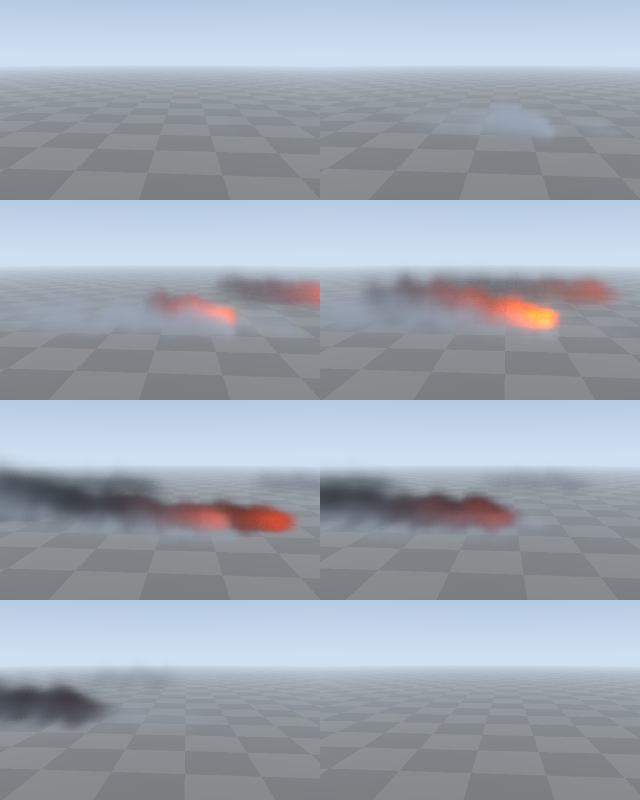

# Plume simulation (C++): evidence

The smoke-and-fire plume of the HTML prototype (`Experimental/VehicleHmiPrototype`: tyre smoke, burnouts, flames, bursts)
in C++, Vulkan and Slang. A 3D lattice of velocity, heat, smoke and fire is advected, confined and projected every
refresh, lit by the sun through the smoke, and marched into the picture. The HTML ran it in WGSL on WebGPU; every program
and every CPU rule is ported without approximation, and the parity below shows the Slang programs leaving the same
numbers as the WGSL on the same inputs, bit for bit.

## Where the code lives

| What | Where | Prototype source |
|---|---|---|
| The 33 gas parameters, their ranges, the six presets, the map from gas to plume settings | `Engine/PhysicalDynamics/FluidDynamics/GasParameterCatalogue.*` | `SmokeSequence.js`, `InspectorPages.js` (`GasPresets`) |
| The sources: tyres, arches, flame seats, exhaust pops, bursts, embers, fire lights | `FluidDynamics/PlumeSourceProjection.*` | `PlumeSourceProjection.js` |
| The tyre and vehicle readings the plume follows | `FluidDynamics/PlumeTelemetryProjection.*` | `ProjectPlumeTelemetry` |
| The editor's decay curves and blackbody strip | `FluidDynamics/GasInstrumentProjection.*` | `DrawDecay`, `DrawBlackbody`, `ResolveHelland` |
| The schedule (residency, the moving window, steps per refresh) and the sequence | `Engine/Rendering/PlumeSimulation/PlumeSchedule.*`, `SmokeSequence.*` | `SmokeSequence.js` |
| The device half: lattices, 256-byte step record, transport and march dispatches | `PlumeSimulationSequence.*` | `PlumeSpace.js` |
| The nine compute programs | `Engine/Shaders/PlumeSimulation/Plume{Advection,Vorticity,Pressure,March}.slang`, `PlumeLayouts.slang` | `Shader/Plume{Advection,Vorticity,Pressure,March,Records}.wgsl` |
| The stored SPIR-V | `EngineContent/ShaderArchives/PlumeSimulation/` (9 files and their manifest) | |
| The editor | `Engine/Interface/FluidPlumeEditor*`: see `Exhibits/FluidPlumeEditor` | `BuildGas` page |

The fluid, gas and plume code is a simulation, not a drawing: it is meant for the planned `SimulationSpace`, with the
vehicle's own plume sources supplied by the vehicle extension. The plume's march into the picture belongs with the
illumination host's composite, which this exhibit does not change.

## Results

| Check | Program | Result |
|---|---|---|
| CPU modules against the prototype's own | `PlumeSimulationValidation` | 🟢 706 assertions, 0 failures; 74,071 doubles compared, 73,935 exact (99.82%), the rest within 1e-12 |
| The Slang programs against the WGSL, on the same inputs | `Code/RunPlumeParity.sh` | 🟢 9 of 9 captures bit for bit, 0 beyond tolerance, 0 claims failed (`Results/PlumeParity.tsv`) |
| The parity, one line of a program wrong at a time | `Code/MutatePlumeShaders.sh` | 🟡 12 of 15 mutants flagged; 3 survive, none a defect (below) |
| The instruments, one line wrong at a time | `Code/MutateGasInstruments.sh` | 🟡 52 of 55 mutants caught; 3 survive, none a defect (below) |
| Stored archives against a recompile with slangc 2026.14.1 | `Automation/RecompileShaderArchives.py --set PlumeSimulation` | 🟢 9 of 9 SPIR-V files reproduced byte for byte |
| Pictures of a burnout on a Vulkan device | `PlumeSimulationCapture capture` | 🟢 8 shots and a sheet (medium grade), SwiftShader |

### What the validation compares

`Code/ExportPlumeReference.mjs` runs the prototype's own modules and writes `Results/PlumeReference.toml` (every value is
one the JavaScript computed; the exporter hashes every input it fed and the validation refuses to compare unless its own
inputs hash the same). `PlumeSimulationValidation` checks, against it:

- the gas catalogue and its six presets, the map from gas to plume settings, and the four grades (Low 64 × 64 × 20,
  Medium 96 × 96 × 24, High 128 × 128 × 32, Ultra 160 × 160 × 48);
- the editor's instruments: 133 strokes (2,508 points) and 5,738 blackbody bands in 19 gas sets, and Helland's fit at 281
  temperatures;
- the tiling detail volume, the fire-light record, the xorshift and the onset hysteresis;
- the source projection over 240 steps and the whole sequence (projection, residency, the moving window, the 256-byte
  step record, the fire-light record) over a 420-refresh burnout and a 1,000-refresh fade, including residency stopping on
  the twelfth second to the refresh and restarting, and records written past the decay caps.

Doubles that pass through `sin`, `cos`, `pow`, `exp` or `log` (V8's fdlibm against the C library) are compared to 1e-12
and the exact share is reported; the float records, the origin, the counters and the detail volume must match bit for
bit.

### The parity

`RunPlumeParity.sh` runs the prototype's WGSL plume on Dawn over SwiftShader (`Experimental/VehicleHmiPrototype/Tools/PlumeParityGpu.mjs`)
and leaves a reference folder; then the C++ port runs the same burnout through the Slang programs on Vulkan over the same
SwiftShader and compares what is left, element for element. Low grade, 170 refreshes (124 transport steps), a 128 × 80
march and a 256 × 160 screen:

| Capture | Elements | Result | Largest value |
|---|---|---|---|
| Velocity | 40,960 | bit for bit | 2.21 |
| Thermo (four values per cell) | 327,680 | bit for bit | 2.79 |
| Light (the sun's transmittance through the smoke) | 40,960 | bit for bit | 1 |
| Curl | 40,960 | bit for bit | 4.08 |
| Divergence | 10,240 | bit for bit | 0.514 |
| PressureA, PressureB | 10,240 each | bit for bit | 0.19, 0.187 |
| Coverage (the box of cells that hold anything visible) | 8 | bit for bit | 43 |
| March | 40,960 | bit for bit | 1.97 |

Before the comparison it also checks the steps taken (124), the refreshes that took a step, the source count of every
step, the 256-byte record of every step (124 hashes), the source records, the fire-light record and the frame record
read from the reference.

### The mutation checks

**Shader parity** (`Results/PlumeShaderMutations.txt`). Each mutant edits a copy of one Slang unit, recompiles every entry
that includes it and runs the parity. 11 are caught beyond the 1e-3 tolerance (a changed retention word, relaxation
divisor, confinement edge, heat rise, sun transmittance, source falloff, flame flicker, buoyancy saturation, push rate,
ground bounce, detail drift), and one (`SunOctave`, an exponent moved by 0.01) differs from the reference without leaving
the tolerance, which the bit-for-bit comparison still flags. Three survive:

| Mutant | Why it survives |
|---|---|
| `BlackbodyBlue` | Equivalent: the fit's blue clamps to 0 for every Hecto up to 19.04, so a gate at 19 or at 11 gives the same colour |
| `CoverageGate` | Not reached: the change moves the red threshold from 0.002 to 0.003, and no cell of the scenario holds red in that band while its other two tests fail |
| `EdgeSolid` | Not reached: the change moves the reach under the ground by 0.01 of a cell, and no cell of the scenario lies in that band |

**Instruments** (`Results/GasInstrumentMutations.txt`). 55 changes to `GasInstrumentProjection.cpp`: the clamp, the six fit
constants (each by 1e-10 and by 1e-6), the blue gate, the ceilings and gamma, the margins, grid, curves and labels of the
decay instrument, and the bands, ramp, brightness, tone map and labels of the blackbody strip. Three survive:
`BlueGateLow` is equivalent (between Hecto 18 and 19 the fit's blue is negative and clamps to 0, as the gate does), and
`GreenOffset` and `BlueOffset` change an offset by 1e-10, which moves a colour by less than the comparison's 1e-12
tolerance. The 1e-6 changes are caught.

## Captures

`PlumeSimulationCapture capture <root> <shader folder> <output folder> [grade] [trace scale]` runs the burnout script
(tyre smoke, a thick burnout, fire, an inferno with a burst, a crosswind, a shredded tyre, the tyres burning out, then
switched off) on a Vulkan device and writes a picture at eight moments. These were run at medium grade (96 × 96 × 24); the
march is traced at a fraction of the picture's size (half, by default) and sampled up, which is why the smoke is soft.

| Image | Refresh | Steps | Sources | Pixels with smoke | Darkest transmittance | March (SwiftShader) |
|---|---|---|---|---|---|---|
| `Plume-Tyre-smoke-1.0-s.png` | 60 | 28 | 8 | 9,960 | 0.844 | 41 ms |
| `Plume-Thick-burnout-2.0-s.png` | 120 | 81 | 5 | 40,908 | 0.0152 | 78 ms |
| `Plume-Fire-3.0-s.png` | 180 | 133 | 11 | 82,464 | 0.00044 | 135 ms |
| `Plume-Inferno-and-burst-3.8-s.png` | 230 | 177 | 6 | 93,776 | 0.00073 | 157 ms |
| `Plume-Crosswind-5.0-s.png` | 300 | 238 | 8 | 95,300 | 0.00013 | 208 ms |
| `Plume-Shredded-5.7-s.png` | 345 | 260 | 4 | 86,456 | 0.00149 | 181 ms |
| `Plume-Tyres-burning-out-6.5-s.png` | 390 | 288 | 0 | 62,292 | 0.00835 | 238 ms |
| `Plume-Switched-off-7.0-s.png` | 419 | 297 | 0 | 0 | 1 | 0.24 ms |
| `Plume-Burnout.png` | all eight, as a sheet | | | | | |



`Results/PlumeCaptures.tsv` has the ledger. The last shot is the plume switched off: residency has stopped, no pixel holds
smoke, and the march costs 0.24 ms.

## What is real, and what is not

- **The scene is stand-in.** The plume's programs bind the illumination port's scene distance field, shadow cascades and
  sky. This exhibit binds the smallest resources of the right kind: a distance field of zero cascades (the analytic
  ground plane at z = 0 answers every sample and no occupant is ever indexed), no opaque surface, a shadow with no
  cascade (the sun is always seen) and a one-texel sky. The pictures composite the march's radiance over a flat backdrop on
  the CPU. The plume is not drawn into the ReSTIR picture, and the fire's light is not fed to the illumination port: that
  is the illumination host's composite, which is a 1:1 port this work does not change.
- **Parity is on SwiftShader, at Low grade.** The prototype's WGSL and the C++ Slang ran on the same CPU Vulkan
  implementation; nothing here is measured, or compared, on a GPU. Medium to Ultra run the same programs on larger
  lattices; they were captured, not compared with the WGSL.
- **Timings are SwiftShader's.** The march times above say nothing about a GPU.
- **The prototype's `FluidNodeEditor.html` could not be ported as it stands.** It is a shell whose entry script
  (`./FluidEditorEntry.js`) exists nowhere in the reference or the repository. The editor (`Exhibits/FluidPlumeEditor`) is
  ported from the page that does exist, the `BuildGas` page of the demo's `InspectorPages.js`, and the plume's own
  parameters.

## Reproduce

```sh
cmake -S . -B build -G Ninja -DFRONTIER_HOST_VERIFICATION=ON
ninja -C build PlumeSimulationValidation PlumeSimulationCapture FrontierPlumeSimulationShaders
build/PlumeSimulationValidation .
node Exhibits/PlumeSimulation/Code/ExportPlumeReference.mjs        # rewrites Results/PlumeReference.toml from the prototype
Exhibits/PlumeSimulation/Code/RunPlumeParity.sh build [low] [170]  # the WGSL on Dawn, then the Slang programs; writes Results/PlumeParity.tsv
Exhibits/PlumeSimulation/Code/MutatePlumeShaders.sh build > Exhibits/PlumeSimulation/Results/PlumeShaderMutations.txt
Exhibits/PlumeSimulation/Code/MutateGasInstruments.sh build > Exhibits/PlumeSimulation/Results/GasInstrumentMutations.txt
build/PlumeSimulationCapture capture . build/ShaderArchives/PlumeSimulation Exhibits/PlumeSimulation/Images medium
```

The parity needs `npm ci` in `Experimental/VehicleHmiPrototype/Tools` (Dawn and SwiftShader come from npm) and
`python Automation/PrepareVulkanCompute.py` (the SwiftShader the C++ side runs on).
