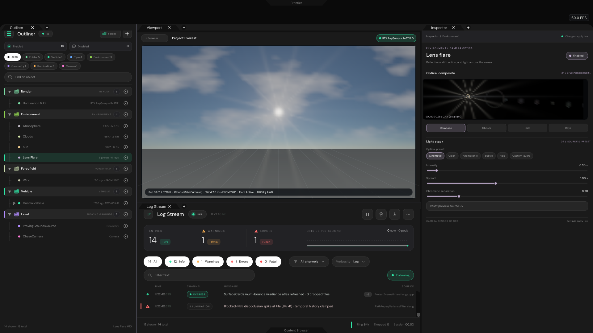
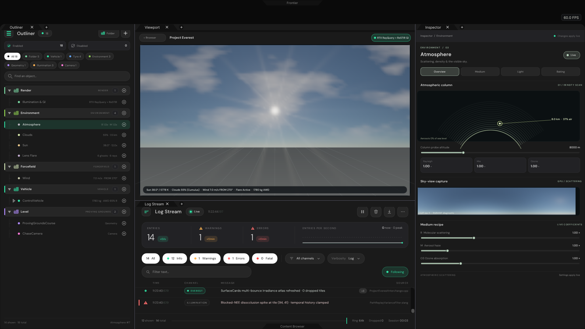
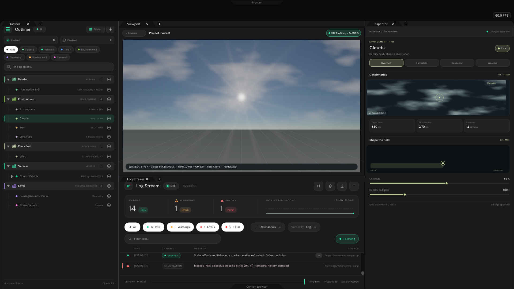
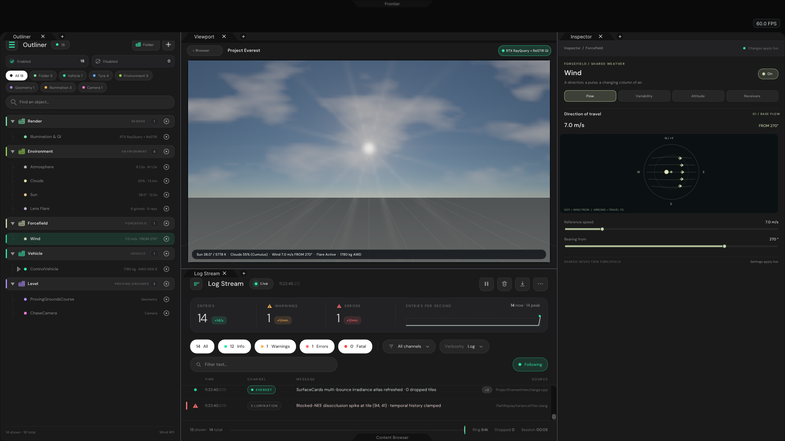
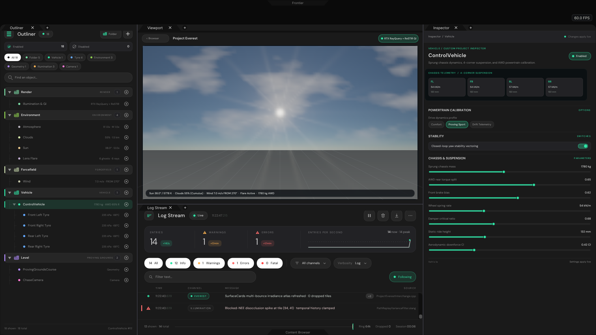
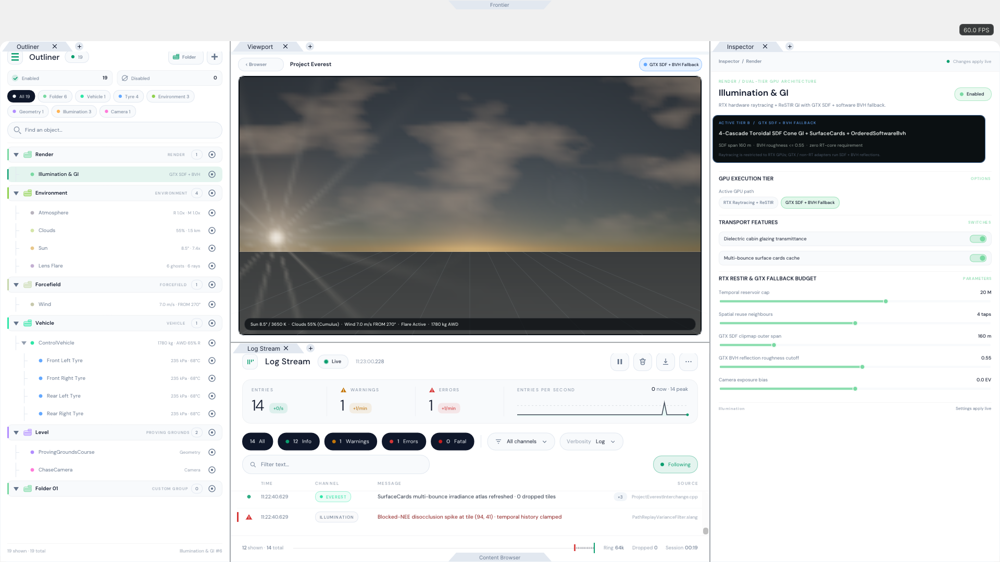

# Project Everest — Phase 2 Global Engine Observatories, Folder UI, and WorkspaceApplication Loop

Retained evidence and validation harness for **Project Everest** (`Frontier/Projects/Project-Everest/ProjectEverest.frontier`):
- **Unified `WorkspaceApplication` lifecycle (`Frontier/Applications/Editor/WorkspaceApplication.{h,cpp}`)**: replaces
  removed `FrontierMain.cpp` with `Initialize -> Loop -> Finalize` (`ExecuteWorkspaceApplication`) and a single unified
  `RunWindowsApplication` loop transitioning cleanly between `ProjectBrowserPanel` and the 3-column workspace (`Outliner` |
  `Viewport` over `LogStream` | `Inspector`).
- **Global Reusable Engine Components (`Frontier/Engine/Scene/EnvironmentRecords.{h,cpp}` + `Frontier/Engine/Interface/SceneInspectorPanel.{h,cpp}`)**:
  1. **Folders (`FolderRecord`)** — tabbed colour-coded Outliner enclosures, `+ Folder` creation, `Enabled`/`Disabled`
     counters, cascade visibility (`ConfigureCascadeVisible`), and `FolderObservatory`.
  2. **Sun (`SunRecord`)** — `ENVIRONMENT / 02`, 4 tabs (`Overview`, `Daylight`, `Light`, `Disc & optics` + jump to
     `Lens Flare`), polar sky-arc dial, solar ephemeris trajectory, and Planck blackbody colour.
  3. **Lens Flare (`LensFlareRecord`)** — `ENVIRONMENT / CAMERA OPTICS`, live CPU HDR optical composite (`SOURCE U/V`
     drag), presets (`Cinematic`, `Clean`, `Anamorphic`, `Subtle`, `Halo`, `Custom layers`), and 4 tabs (`Compose`,
     `Ghosts`, `Halo`, `Rays`).
  4. **Atmosphere (`AtmosphereRecord`)** — `ENVIRONMENT / 03`, wired to `Frontier::AtmosphereModel` (`SingleScattering` +
     `BakeTransmittance`), concentric column density scan, live sky-view panorama, and 4 tabs (`Overview`, `Medium`,
     `Light`, `Baking`).
  5. **Clouds (`CloudRecord`)** — `ENVIRONMENT / 01`, wired to `Frontier::CloudField`, live top-down FBM density atlas,
     interactive `Coverage` x `Density` XY pad, axonometric formation stack, and 4 tabs (`Overview`, `Formation`,
     `Rendering`, `Weather` + jump to `Wind`).
  6. **Wind (`WindRecord`)** — `FORCEFIELD / SHARED WEATHER`, `FROM` meteorological streamline compass, 40 s procedural
     gust envelope + XYZ scope, altitude shear/veer ladder, and receiver routing (`Overview`/`Flow`, `Variability`,
     `Altitude`, `Receivers`).
- **Project Everest Custom User Inspectors (`Frontier/Projects/Project-Everest/Source/ProjectEverestScene.{h,cpp}`)**:
  - `EverestVehicleRecord` (`ControlVehicle`) + 4 nested `EverestTyreRecord`s with custom 4-corner FL/FR/RL/RR
    suspension telemetry card, drive dynamics profile, yaw stability vectoring, and AWD/brake/chassis setup.
  - `EverestIlluminationRecord` dual-tier GPU architecture card switching live between **RTX Raytracing + ReSTIR**
    (`VK_KHR_ray_query` + `PathReplayRayQuery` + `DielectricBoundary`) and **GTX SDF + BVH Fallback** (`SceneClip0..3`
    toroidal 3D SDF + `SurfaceCards` + `OrderedSoftwareBvh`).

## Rendered native C++ UI evidence (`1920 x 1080`, CPU rasterized)

1. **`01-ProjectBrowser-Library.png`** — `ProjectBrowserPanel` opens and enumerates **Project Everest** beside sibling `.frontier` projects.
2. **`02-ProjectBrowser-SelectEverest.png`** — Reader stage opened on **Project Everest** prior to **Open in Frontier** hand-off.
3. **`03-Folder-Outliner-Observatory.png`** — 3-column workspace with 5 colour-coded `FolderRecord` groups (`Render`, `Environment`, `Forcefield`, `Vehicle`, `Level`), `+ Folder`, live KPI badges, smooth coupled sky/cloud/flare viewport, and `Environment` **Folder Observatory**.
4. **`04-Sun-Observatory-Overview.png`** — Global Engine **Sun Observatory** (`ENVIRONMENT / 02`) with polar sky-arc dial, solar azimuth/tint/illuminance cards, and lighting presets.
5. **`05-LensFlare-Observatory-Optics.png`** — Global Engine **Lens Flare Observatory** (`ENVIRONMENT / CAMERA OPTICS`) with live HDR sensor optical composite, presets, and chromatic separation controls.
6. **`06-Atmosphere-Observatory-Medium.png`** — Global Engine **Atmosphere Observatory** (`ENVIRONMENT / 03`) with concentric column density scan and live `SingleScattering` sky-view capture.
7. **`07-Clouds-Observatory-Weather.png`** — Global Engine **Clouds Observatory** (`ENVIRONMENT / 01`) with procedural FBM density atlas and interactive XY field pad.
8. **`08-Wind-Observatory-Forcefield.png`** — Global Engine **Wind Forcefield Observatory** (`FORCEFIELD / SHARED WEATHER`) with `FROM 270°` streamline compass.
9. **`09-Custom-Vehicle-Inspector.png`** — Project Everest custom **`ControlVehicle` Inspector** with 4-corner FL/FR/RL/RR suspension telemetry and expanded tyre children in Outliner.
10. **`10-DualTier-GTX-Fallback-LightTheme.png`** — Dual-tier GPU renderer switched to **`GTX SDF + BVH Fallback`** + Golden-hour solar preset + dynamically spawned `Folder 01` + **Control Centre Light Theme** (`Dark Inspector luma = 32.59`, `Light Inspector luma = 226.00`).

## Reproduction & verification

- **Platform / compiler tested**: Linux x86_64 sandbox (`g++ 12.2.0`, `-std=c++20 -O2 -Wall -Wextra`, plus `-std=c++17`
  and `-fsanitize=address,undefined` on portable suites). Windows native MSVC / Vulkan swapchain runtime remains
  untested in this Linux sandbox.
- **Suites verified**:
  - `ProjectEverestValidation` (`1920x1080` software rasteriser + assertions): **PASS** (`ProjectEverestChecks.json`).
  - `SceneDirectoryValidation` (Development profile): **45 passed, 0 failed**.
  - `SceneDirectoryValidation` (Shipping profile, `-DFRONTIER_SHIPPING_PROFILE=1`): **17 passed, 0 failed**.
  - `LogStreamValidation` (`-fsanitize=address,undefined`): **69 passed, 0 failed**.
  - `FrontierHeadless` (`WorkspaceApplication` `--project=ProjectEverest.frontier --headless` & `--browser`): **PASS**.
  - `ProjectBrowserValidation`: **PASS** (770 states).
