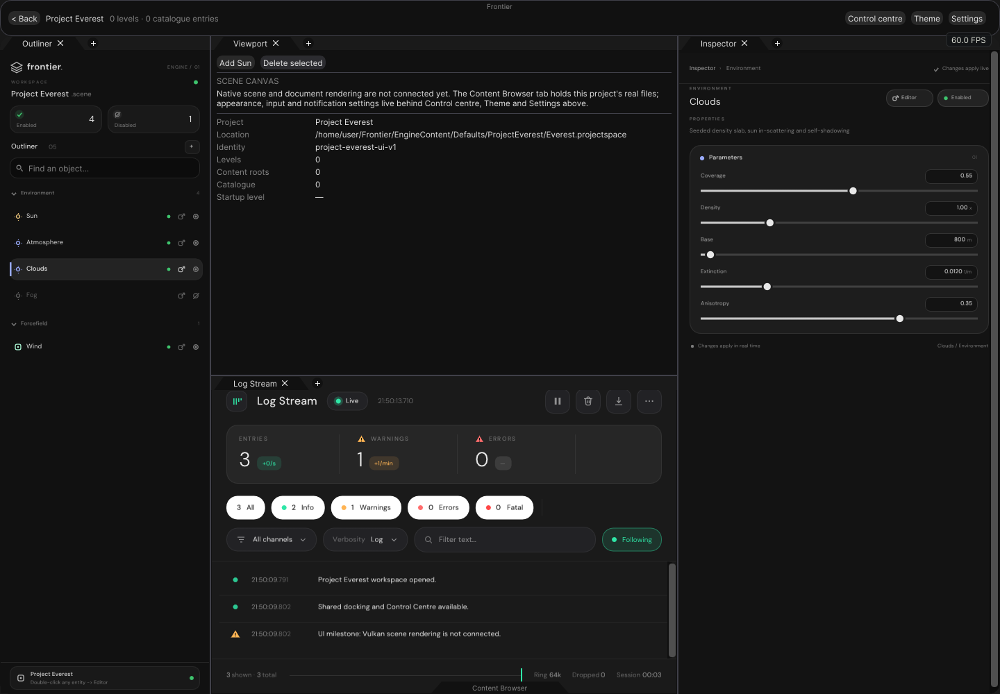
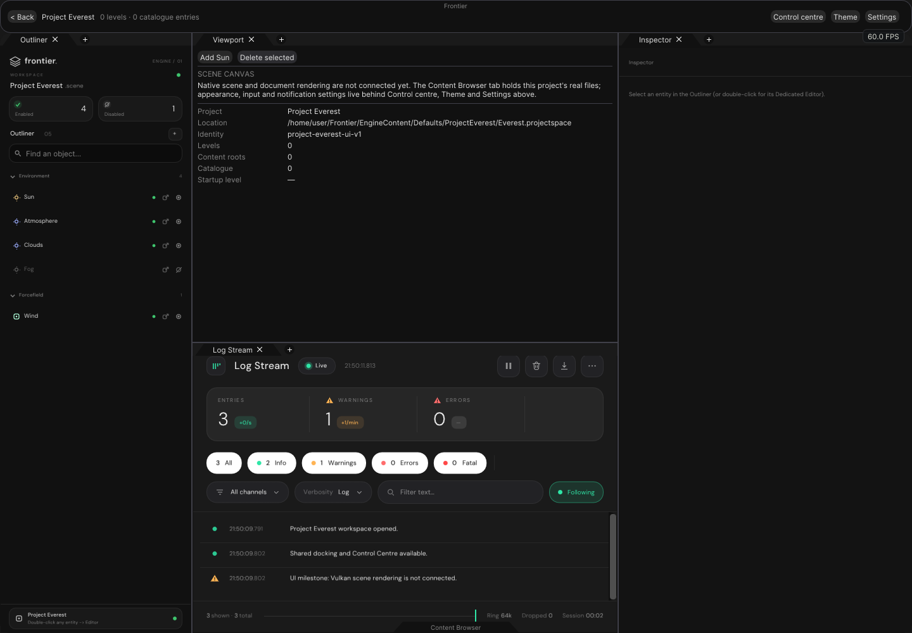

# Project Everest — native UI exhibit

The browser, application-selection dialog and workspace below are rendered by production C++ UI code.
These are CPU-rasterized ImGui draw lists, not browser mockups or generated illustrations.

## Workspace


The layout is Outliner / central viewport above LogStream / Inspector. The viewport is intentionally unconnected.
The five initial scene records are shared Sun, atmosphere, clouds, fog and wind components. Sun construction and
selection publish its own inspector fields; deleting it removes the description and clears selection.





## Browser and application selection


## Shared Control Centre and themes


## Verification

| Check                                      | Current result                                    |
|--------------------------------------------|---------------------------------------------------|
| Native C++ target                          | Built with GCC 12.2, C++20, Linux x86-64           |
| Focused CTest                              | 1/1 passed; see `Results/CTest.txt`                |
| Browser                                    | Everest searchable, selectable                    |
| Application selection                      | Real mouse press/release activates launch button  |
| Handoff                                    | TOML decode; correct path; consumed exactly once   |
| Workspace registration                     | Repeated configuration does not duplicate panels  |
| LogStream                                  | Existing native panel registered; close/reopen    |
| Outliner                                   | Authored names, grouping, filter, mouse selection |
| Inspector                                  | Mouse slider edits the actual Sun setting         |
| Application-owned inspector                | Test-only vehicle description targets live fields |
| Add / Delete                               | Actual mouse buttons create/remove Sun records    |
| Scene lifetime                             | Stale tokens, recreate, external destruction, constructor failure, teardown |
| ASan / UBSan / leak detection               | Passed; see `Results/Sanitized.txt`                |
| Docking / Control Centre / theme            | Actual shared native draw output captured         |
| Native Windows windowing / Vulkan display   | Not run                                           |
| Vehicle scene / ray tracing / ReSTIR         | Not connected or tested in this UI milestone       |

Configuration: default CMake configuration (no explicit optimization profile), host verification,
`FRONTIER_EVEREST_EXHIBIT_ONLY=ON`. Test source and captures are retained together here.
`Results/CaptureHashes.json` identifies the exact capture source and images. `Results/Build.txt` retains the final
incremental build result. Tested work is the Outliner / Inspector patch over the saved LogStream checkpoint `8e330357`.
Canonical UI baseline: `71e4a17`; LogStream, scene editing and environment description baseline: `f97b991`. The native Windows application already uses
`EditorWorkspace::ConfigureProject`, which activates the added Everest panels after decoding the launch path.
The isolated `FrontierUI` exhibit entry also propagates the project summary.

## Reproduce

Prerequisites: GCC / Clang C++20, Python 3.9+, CMake 3.21+, Ninja, network access to the pinned GitHub dependencies.
Use a Python virtual environment; `GH_TOKEN` can come from existing local `gh` authentication if API limits apply.

```bash
python -m venv .venv
.venv/bin/pip install cmake ninja pillow -r Automation/FontRequirements.txt
export PATH="$PWD/.venv/bin:$PATH"
python Automation/PrepareUI.py
python Automation/PrepareFonts.py
cmake -S . -B build/everest -G Ninja \
  -DFRONTIER_HOST_VERIFICATION=ON -DFRONTIER_EVEREST_EXHIBIT_ONLY=ON \
  -DPython3_EXECUTABLE="$PWD/.venv/bin/python"
cmake --build build/everest --target ProjectEverestValidation -j 4
ctest --test-dir build/everest --output-on-failure
python Exhibits/ProjectEverest/Code/ConvertCaptures.py
```

The default desktop configure was attempted but blocked by missing wayland-scanner and X11 development headers.
The focused exhibit option intentionally returns before GLFW/platform targets; it still builds and draws the real
shared engine, editor and LogStream code. It does not prove native window dragging, detached platform windows,
GPU presentation, renderer performance or Windows runtime correctness. No binaries are delivered.
The browser preview is deliberately unavailable here. No vehicle image has been substituted.

## Follow-up

See [UI sequence and lifetime contract](../../Documentation/Plans/Ongoing/ProjectEverest.md).
Review these three-panel exhibits before the next UI or renderer work. Full demo UI parity is not claimed.
Record settings are session-only: save/load, undo/redo and scene serialization are not connected.
The temporary viewport Add Sun / Delete selected buttons exercise real construction and destruction; unsupported
Outliner add categories report a warning instead of creating fake records. Dedicated editor requests likewise
report unavailable when no authored callback exists. Fracture/fluid/particle editors are not implemented.
The vehicle used in the validation source is an application-authored inspector test, not a ported vehicle design.

## Sanitized reproduction

Use the same configure options with a separate directory and add:

```bash
cmake -S . -B build/everest-sanitized -G Ninja \
  -DFRONTIER_HOST_VERIFICATION=ON -DFRONTIER_EVEREST_EXHIBIT_ONLY=ON \
  -DPython3_EXECUTABLE="$PWD/.venv/bin/python" \
  -DCMAKE_CXX_FLAGS="-fsanitize=address,undefined -fno-omit-frame-pointer" \
  -DCMAKE_EXE_LINKER_FLAGS="-fsanitize=address,undefined"
cmake --build build/everest-sanitized --target ProjectEverestValidation -j 4
ASAN_OPTIONS=detect_leaks=1 build/everest-sanitized/ProjectEverestValidation \
  "$PWD/EngineContent" "$PWD/_ClaudeScratch/EverestSanitized"
```

All new interaction/lifetime assertions run in both builds. The test also verifies that an exception in a derived
constructor unregisters its partially constructed record. Allocation-failure injection is not tested.
