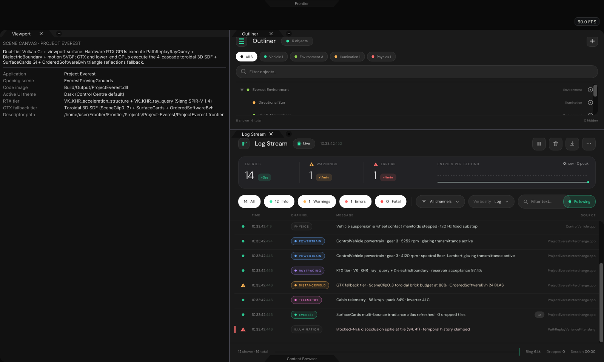
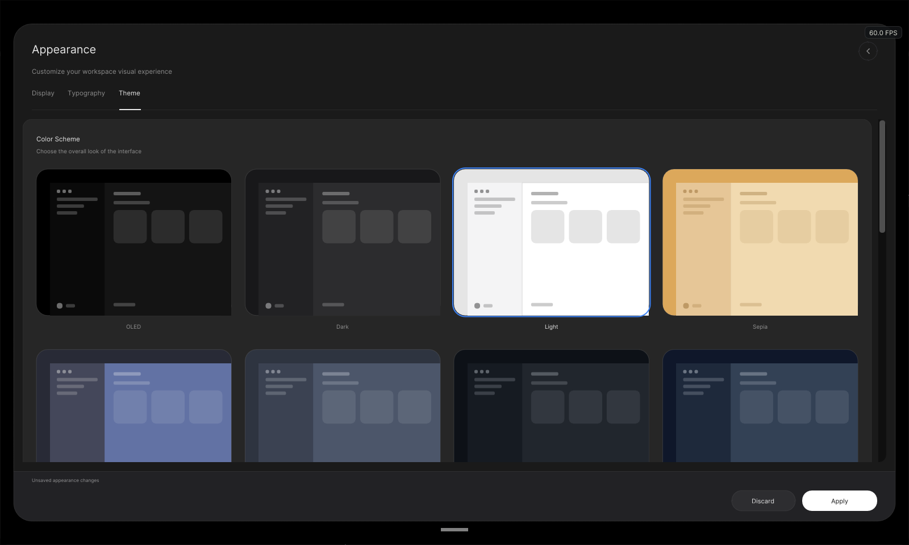
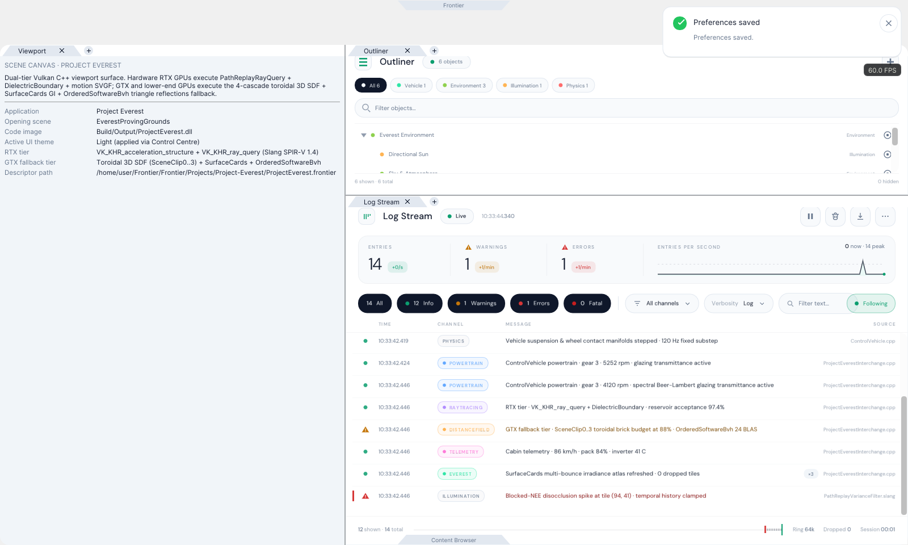
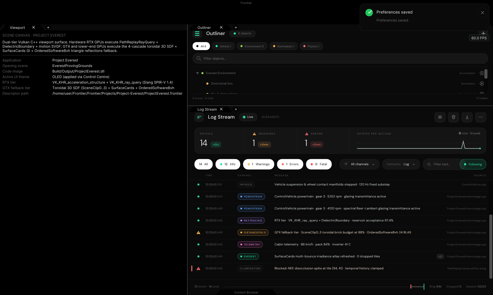

# Project Everest — Phase 1 UI Port, Browser Hand-Off, and Three-Branch Audit

Retained evidence and validation harness for **Project Everest** (`Frontier/Projects/Project-Everest/ProjectEverest.frontier`):
native `ProjectBrowserPanel` application discovery and selection -> native launch hand-off -> docked **Project Everest**
workspace composed from upstream `ControlCentrePanel` (trapezoidal notch + `OLED` / `Dark` / `Light` UI theme controller),
`PanelDockspace`, `SceneDirectoryPanel` (Outliner), and `LogStreamPanel`.

## Three-branch engine audit summary

| Branch | Verified strengths (reuse) | Audited failures / gaps (reject or replace) |
|---|---|---|
| `streamlinkinbox/Frontier` `arena/08e7de48-frontier` | Slang Vulkan compute kernels for solid & thin-pane dielectric glass (`DielectricBoundary.slang`, `SolidDielectricTransport.slang`, Beer-Lambert transmittance), 6-pose `ControlVehicle` glazing, roughness-cone prior-screen exitance, fence-published `FacetCdfSubmission`, and documented negative controls (`ReplayPowerReuse`, `QueryElision`, `CacheRefresh`, `WeightedPair`). | No hardware `VK_KHR_ray_query`, no motion SVGF, no editor UI panels. |
| `streamlinkinbox/Frontier` `arena/5ec53579-frontier` | Hardware RTX `PathReplayRayQuery` (`VK_KHR_acceleration_structure` + `VK_KHR_ray_query`, SPIR-V 1.4) with 16-bin SAH-2 `OrderedSoftwareBvh` fallback, `PathReplaySubmissionSequence`, motion SVGF (`PathReplayVarianceFilter.slang`), `beta = 2` Power MIS, blocked-NEE temporal visibility guard, and naming-compliant `EnvironmentRecords` + `RecordEditorDescription` + `SceneInspectorPanel`. | Lacks the 4-cascade toroidal 3D SDF (`SceneClip0..3`) + `SurfaceCards` multi-bounce GI fallback. |
| `egoistm1inbox/Frontier` `arena/9ce908bc-frontier` | `LogStreamPanel` + `Diagnostics` (identical to upstream `11f31835`), 25-record Outliner grouping & Dedicated Studio UX reference, Jolt `v5.6.0` vehicle physics reference, 41k Hipparcos sky & Pyro fluid reference, and explicit `HardwareRayTracingRtx` vs `SignedDistanceFieldGtx` contract. | **Disqualified renderer & stale UI**: `SceneRenderer.cpp` runs CPU `std::thread` raytracing uploaded via ImGui textures; `VulkanShaderCompiler.cpp` synthesises dummy FMA SPIR-V loops; `PanelDockspace` and `ControlCentrePanel` lag upstream `11f31835`; `DedicatedEntityEditors` / `SharedEntityMemory` / `StableId` violate `SKILL-Naming.md`. |

## Dual-tier Vulkan GPU architecture (Phase 3+)

- **RTX tier** (`VK_KHR_acceleration_structure` + `VK_KHR_ray_query`): `PathReplayRayQuery` + `DielectricBoundary` +
  `SolidDielectricTransport` + `FacetCdfSubmission` + `PathReplayVarianceFilter` (motion SVGF).
- **GTX / lower-end GPU fallback tier**: Vulkan `.slang` port of `VehicleProvingGrounds` 4 nested toroidal `rgba16float`
  3D SDF cascades (`SceneClip0..3`, `DistanceTraversal`) + `SurfaceCards` (`CardSampling`) + nearest-depth pyramid
  (`ScreenTraversal`), paired with 2-level SAH triangle **BVH reflections** (`OrderedSoftwareBvh`).

## Rendered native C++ UI evidence (`1600 x 960`, CPU rasterized)

1. **`01-ProjectBrowser-Library.png`** — `ProjectBrowserPanel` opens, enumerates `Frontier/Projects/*/*.frontier`, and
   presents **Project Everest** beside `"Blank Project"` while preserving all 6 default sample catalogue invariants.
2. **`02-ProjectBrowser-SelectEverest.png`** — Selecting **Project Everest** opens the Browser Reader stage showing its
   descriptor metadata and **Open in Frontier** launch button.
3. **`03-ProjectEverest-Workspace-Dark.png`** — Native launch hand-off opens the docked **Project Everest** workspace
   (`ControlCentrePanel` top notch + `PanelDockspace` + `SceneDirectoryPanel` Outliner + `LogStreamPanel` streaming
   `POWERTRAIN`, `RAYTRACING`, `DISTANCEFIELD`, `TELEMETRY`, and `EVEREST` diagnostics) in **Dark** theme (`luma = 38.25`).
4. **`04-ProjectEverest-ControlCentre-ThemeDrawer.png`** — Clicking the top trapezoidal notch opens the travelling
   **Control Centre** drawer navigated to `Appearance -> Theme` with **Light** selected.
5. **`05-ProjectEverest-Workspace-Light.png`** — Applying **Light** theme in Control Centre dynamically re-themes
   `PanelDockspace`, `Viewport`, `Outliner`, and `LogStreamPanel` (`luma = 243.16`).
6. **`06-ProjectEverest-Workspace-OLED.png`** — Applying **OLED** theme in Control Centre propagates pure-black OLED
   surfaces across the entire workspace (`luma = 23.32`).







## Reproduction

- **Platform / compiler tested**: Linux x86_64 host verification (`g++ 12.2.0`, `-std=c++20 -O2 -Wall -Wextra`, plus
  `-fsanitize=address,undefined` on `LogStreamValidation`). Windows native MSVC / GPU execution remains untested in
  this Linux sandbox.
- **Prerequisites**:
  ```bash
  python3 Automation/PrepareUI.py
  python3 Automation/PrepareFonts.py
  ```
- **Build and run**:
  ```bash
  # Compile Exhibits/ProjectEverest/Code/ProjectEverestValidation.cpp + ProjectEverestInterchange.cpp
  # against FrontierEditorUI + FrontierInterface + ThorVG software rasteriser + Frontier/Engine units:
  _ClaudeScratch/build/ProjectEverestValidation /home/user/Frontier Exhibits/ProjectEverest
  ```

## Plan for porting remaining UI components (Phase 2)

| Batch | Target location | Reusable kit & scope |
|---|---|---|
| **2A. Outliner grouping & Inspector foundation** | `Frontier/Engine/Scene/EnvironmentRecords.{h,cpp}`, `Frontier/Engine/Interface/RecordEditorDescription.h`, `SceneInspectorPanel.{h,cpp}` | Port `5ec53579`'s naming-compliant `RecordEditorDescription` + `SceneInspectorPanel` onto `ControlKit::Palette()` and `StackRailControls`. Wire `RecordEntry` constructor/destructor RAII registration for both `SceneDirectoryPanel` (grouped under `Render`, `Environment`, `Forcefield`, `Vehicle`, `Effects`, `Destruction`, `Level`) and `SceneInspectorPanel`. |
| **2B. Reusable engine environment Inspectors** | `Frontier/Engine/Scene/` + `Frontier/Engine/Interface/` | Ship reusable engine `RecordEntry` + Inspector cards for Directional Sun, Sky & Atmosphere (Hipparcos stars + aerial perspective), Volumetric Clouds, Height/Volumetric Fog, Wind Forcefield, Rect/Point/Spot Lights, and Camera/Post-Process (`ControlKit` sliders, segmented pills, colour swatches, `DropdownControlSurface`). |
| **2C. Project Everest custom user Inspectors** | `Frontier/Projects/Project-Everest/Source/` | Author user-created `ControlVehicle` `RecordEntry` + custom Inspector cards (6-pose chassis/doors/glazing, Beer-Lambert glass tint, multi-layer paint/flakes, Jolt suspension/powertrain parameters, and cabin telemetry gauges) plus dual-tier GPU tier switcher (`RTX RayQuery` vs `GTX Toroidal SDF + BVH`) and debug-view selector. |
| **2D. Viewport HUD & telemetry overlay** | `UI/Editor/` + `Frontier/Projects/Project-Everest/` | Port top-canvas camera/play/simulation transport pills, gizmo mode selector (Translate / Rotate / Scale / Local-World), frame-time / reservoir / SDF-cascade HUD readout, and interactive cabin telemetry strip. |
| **2E. Dedicated domain Studios** | `UI/Editor/` | Port naming-compliant Dedicated Studio workspaces/modals using `PanelDockspace` + `ControlKit`: **Fracture Studio** (Voronoi cell authoring & impulse preview), **Fluid / Plume Studio** (emitter/buoyancy/vorticity solver preview), **Particle Studio**, and **Object / Mesh Studio**, alongside existing **Texture / Material Studio**. |
