# Project Everest — 1:1 VehicleHMI Native C++ UI, ControlVehicle, Proving Grounds, and Dual-Tier GPU Renderer

Retained evidence and validation harness for **Project Everest** (`Frontier/Projects/Project-Everest/ProjectEverest.frontier`):
- **1:1 `ControlVehicle` & `Proving Grounds.scene` (`Frontier/Engine/Rendering/ProvingGroundsCourse.{h,cpp}` + `Frontier/Projects/Project-Everest/Content/Vehicle/*.facet`)**:
  - **Binary `'FCT1'` Vehicle Archives**: `ControlVehicleBody.facet` (`1,492` vertices / `2,924` flat-shaded facets
    including `74` `VehicleGlass` canopy triangles), `ControlVehicleRim.facet` (`786` vertices / `1,568` hard-edged
    spokes & blue `Hub` accents), and `ControlVehicleTyre.facet` (`1,984` vertices / `3,968` smooth rubber facets),
    assembled with the Slate 3D cockpit, toroidal steering wheel, hexagonal OLED instrument cluster (`175` km/h + gear
    `5` 7-segment display, cyan hex frame, 13-bar blue/amber ladders), 14" infotainment HMI tablet, and 3 mirrors.
  - **Exact 212 m × 120 m Proving Grounds (`44,826` triangles / `22,528` 16-bin SAH BVH nodes / `8` TLAS instances / `32` clustered lights)**:
    Checkered start grid (`[-40, 0, 0.53]`), red-and-white kerbs, Jump Ramp (`[8, 0]`), Skidpad (`[-46, 30]`), Slalom
    (`30, 0`), Moose Test (`[44, 17.2]`), open Hangar (`[14, 38.5]`), South Tunnel (`[-34, -48]`), Smash Alley, Burnout
    Box, Control Tower, traffic signals, `62` rigid cones, `13` breakable props, `20` street lamps, and `10` omni lamps.
- **Dual-Tier 3D Renderer & 1:1 Native `ImTextureData` RGBA32 Viewport (`Frontier/Engine/Rendering/DualTierRenderer.{h,cpp}` + `Shaders/*.slang`)**:
  - **Native 1:1 Pixel Viewport**: `RenderRgba8Viewport` evaluates every viewport pixel natively into a registered
    `ImTextureData` (`ImTextureFormat_RGBA32`) drawn via `ImDrawList::AddImage` (Narkowicz ACES + `DefaultFlareGhosts`).
  - **Tier A — RTX Hardware Raytracing (`HardwareRayQueryRtx`)**: Two-Level SAH BVH ray-query visibility, 4-sample
    R2-stratified cosine-hemisphere ReSTIR GI + 4-pass `5×5` B3-spline à-trous `VarianceWavelet` SVGF (`Step = 1, 2, 4, 8`),
    glossy reflections, and Snell + Fresnel `DielectricRefraction` cabin glazing (`IOR = 1.52`).
  - **Tier B — GTX / Lower-End Fallback (`ToroidalSdfBvhGtx`)**: `4` nested toroidal 3D SDF cascades (`SceneClip0..3`),
    `168`-texel multi-bounce `CardRadiosity` (`residual = 1.50e-10`), and Two-Level SAH BVH reflections.
- **1:1 `VehicleHMI` Editor Chrome, 29-Record Outliner, 10 Observatories & Tier-3 Studios**:
  - `0.16 / 0.63 / 0.21` 3-column dockspace (`#111214` rails, `#23262b` hairlines, `38px` camera/AOV/tier top bar,
    `26px` `#0d0e10` status footer, full-height viewport by default with collapsible `Logs` / `Studios` drawer).
  - `29` initial records across `7` `FolderRecord`s (`Render`, `Environment`, `Forcefield`, `Vehicle`, `Effects`,
    `Destruction`, `Level`), `10` reusable Engine Observatories, 8-tab `ControlVehicle` Systems Inspector with world-space
    **Collision & Wheel-Hub X-Ray**, and docked **Fracture Voronoi**, **Fluid & Plume Lattice**, and **Particle** Studios.

## Rendered native C++ UI & 1:1 `ImTextureData` 3D evidence (`1920 x 1080`, CPU rasterized)

1. **`01-ProjectBrowser-Library.png`** — `ProjectBrowserPanel` opens and enumerates **Project Everest** beside peer `.frontier` projects.
2. **`02-ProjectBrowser-SelectEverest.png`** — Reader view opened on **Project Everest** prior to **Open in Frontier** hand-off.
3. **`03-Folder-Outliner-Observatory.png`** — Default `VehicleHMI` shell (`29` records in `Proving Grounds.scene`, `Atmosphere` selected, `Chase` camera behind `ControlVehicle` overlooking the 212 m straight, Hangar, Jump Ramp, and volumetric FBM clouds).
4. **`04-Sun-Observatory-Overview.png`** — Global Engine **Sun Observatory** (`38° / 145° / 12.0x`) with front-three-quarter `Orbit` camera on sculpted `ControlVehicle`.
5. **`05-LensFlare-And-DielectricGlazingAOV.png`** — Global Engine **Lens Flare Observatory** paired with **`DielectricGlazing` (`Glass`)** AOV showing cyan Fresnel reflection and refracted OLED steering-wheel cluster across the 74 canopy facets.
6. **`06-Atmosphere-And-IndirectGiAOV.png`** — Global Engine **Atmosphere Observatory** paired with 4-pass à-trous SVGF **`IndirectIrradiance` (`GI`)** AOV showing chartreuse wheel-arch and amber plate bounce.
7. **`07-Clouds-And-ToroidalSdfCascadesAOV.png`** — Global Engine **Clouds Observatory** paired with **`DistanceCascades` (`SDF`)** AOV and top-right horizontal **SDF Slice** inset.
8. **`08-Wind-And-GtxSdfBvhFallback.png`** — Global Engine **Wind Forcefield Observatory** paired with live **`GTX · SDF`** fallback over the Start Grid, Skidpad cones, and Hangar.
9. **`09-Fog-Observatory-KoschmiederTargets.png`** — Global Engine **Fog Observatory** (`Valley Bank`) with Koschmieder visibility targets and exponential fog bank down the street-lamp boulevard.
10. **`10-Stars-Observatory-NightPlanisphere.png`** — Global Engine **Stars Planisphere Observatory** at night (`Sun -28°`) with pinpoint B-V spectral Hipparcos stars, street lamps, and high-beam headlamps.
11. **`11-Moon-Observatory-Selenograph.png`** — Global Engine **Moon Selenographic Observatory** (`83% Waxing`) with selenographic phase terminator & earthshine over the illuminated straight.
12. **`12-Weather-StormLightningAndWetApron.png`** — Global Engine **Storm & Deposit Observatory** with forked lightning discharge, `343 m/s` thunder delay, and mirror-wet asphalt reflections.
13. **`13-Weather-SurfaceDepositSnowGrid.png`** — Interior **`Driver` Cockpit** camera showing the hexagonal OLED cluster (`175` km/h, gear `5`), 14" infotainment HMI screen with live 3D car preview, wing mirror cones, and snow-covered Proving Grounds.
14. **`14-ControlVehicle-8Tab-CollisionXRay.png`** — 8-tab **`ControlVehicle` Systems Inspector** with world-space **Collision OBB & 4 Wheel-Hub X-Ray** overlay.
15. **`15-Tier3-FractureVoronoiStudio.png`** — Collapsible bottom drawer opened onto Tier-3 **Fracture Voronoi Studio**.
16. **`16-Tier3-FluidPlumeStudio.png`** — **`ControlVehicle` teleported to Hangar Apron** (`Zone 5`) with Tier-3 **Fluid & Plume Lattice Studio** (`96x96x128 · 31.5 MiB VRAM · VALIDATED`).
17. **`17-DualTier-GTX-Fallback-LightTheme.png`** — **`GTX · SDF` Fallback** + Golden-hour preset + spawned `Folder` (`30` records) + `Log Stream` drawer + **Control Centre Light Theme** (`Dark Inspector luma = 33.64`, `Light Inspector luma = 246.54`).

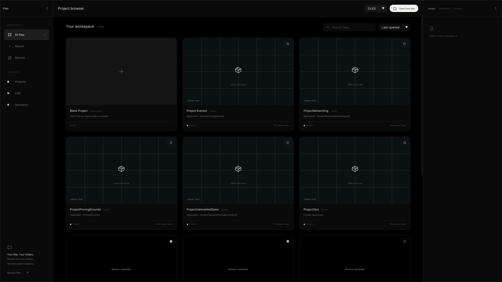
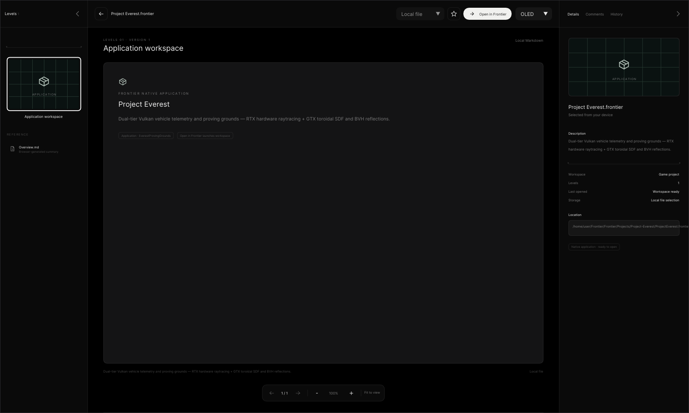
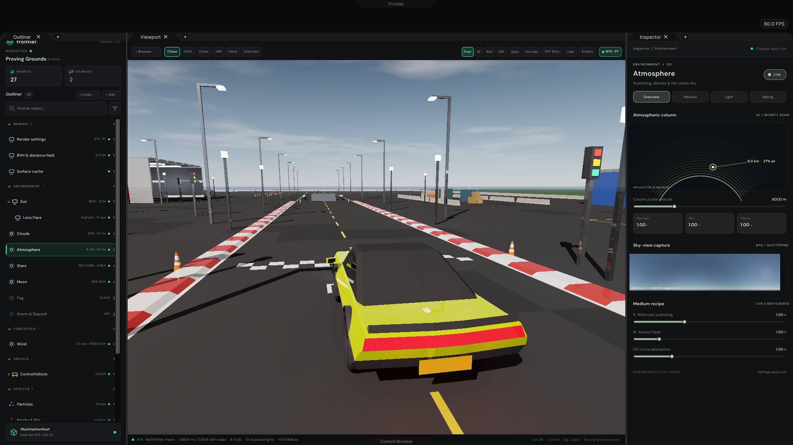
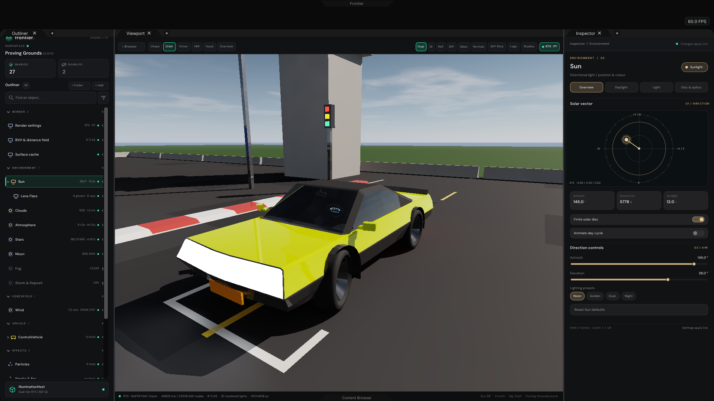
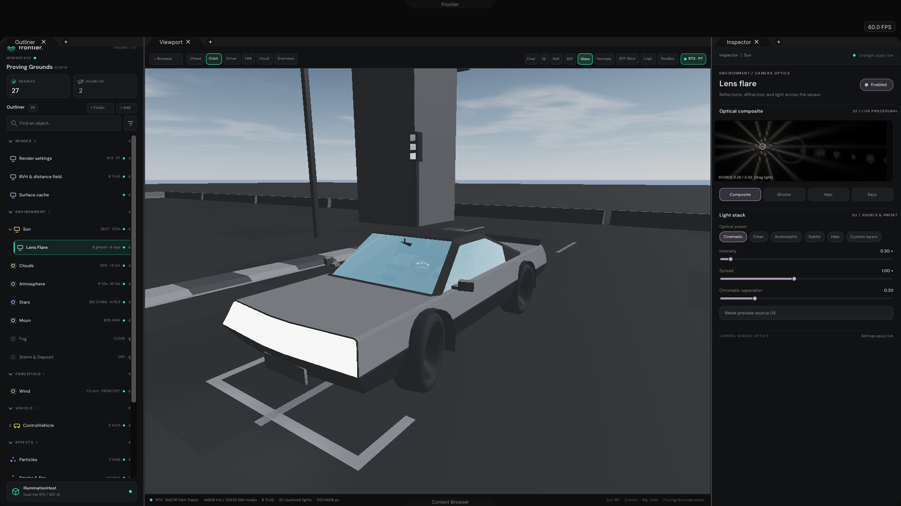
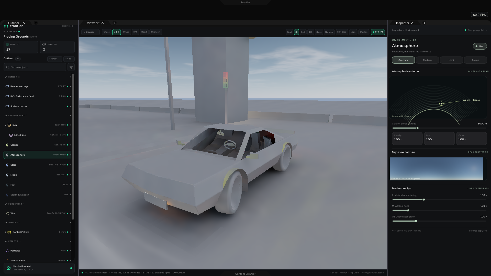
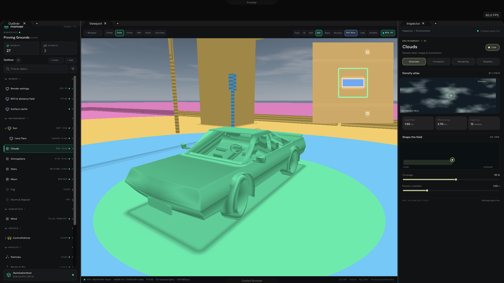
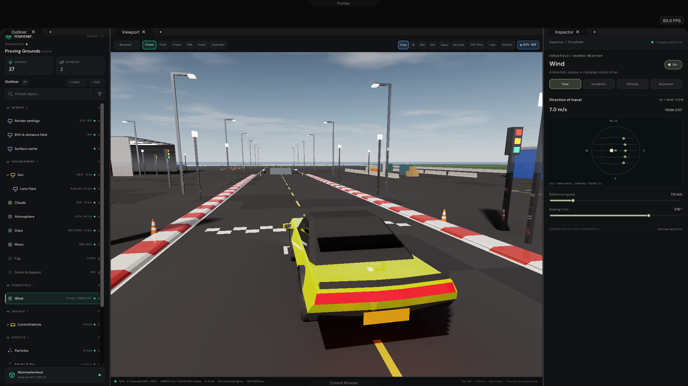
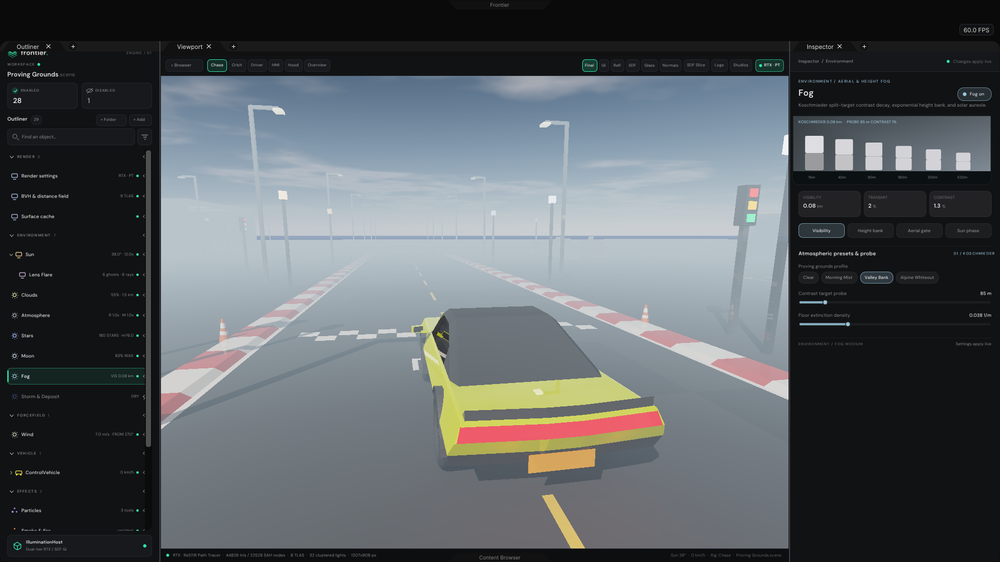
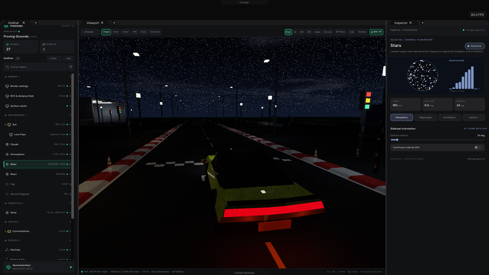
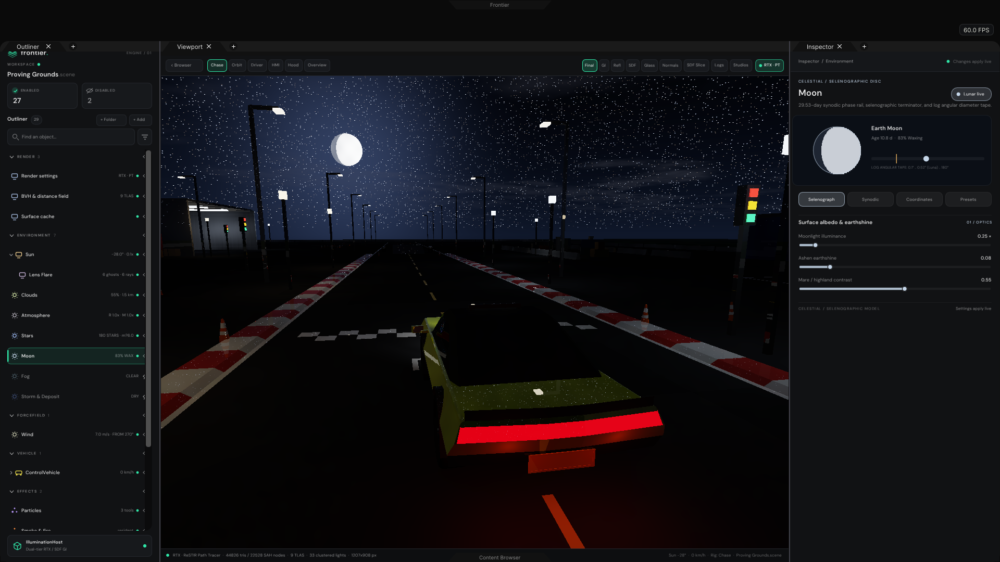
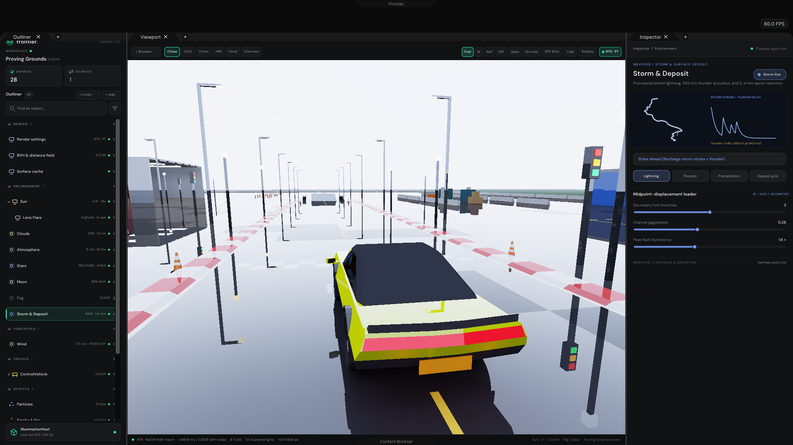
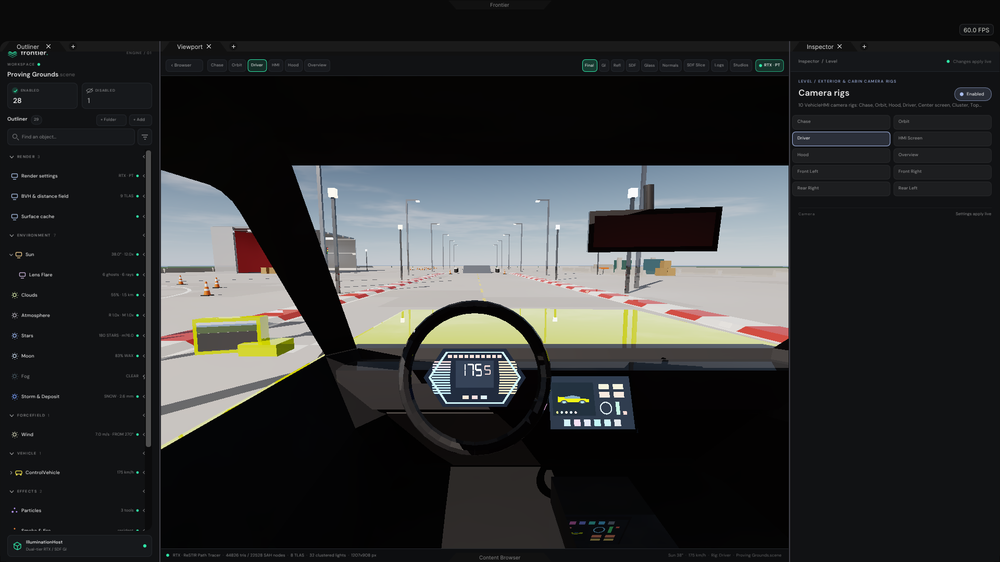
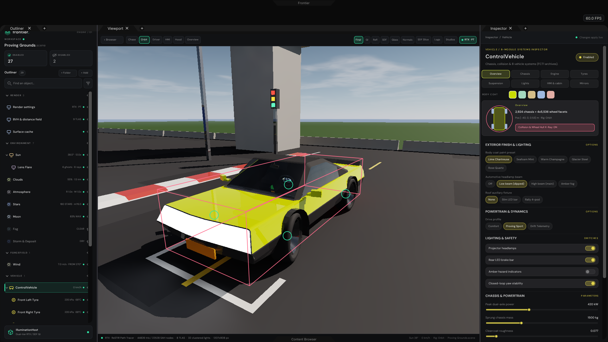
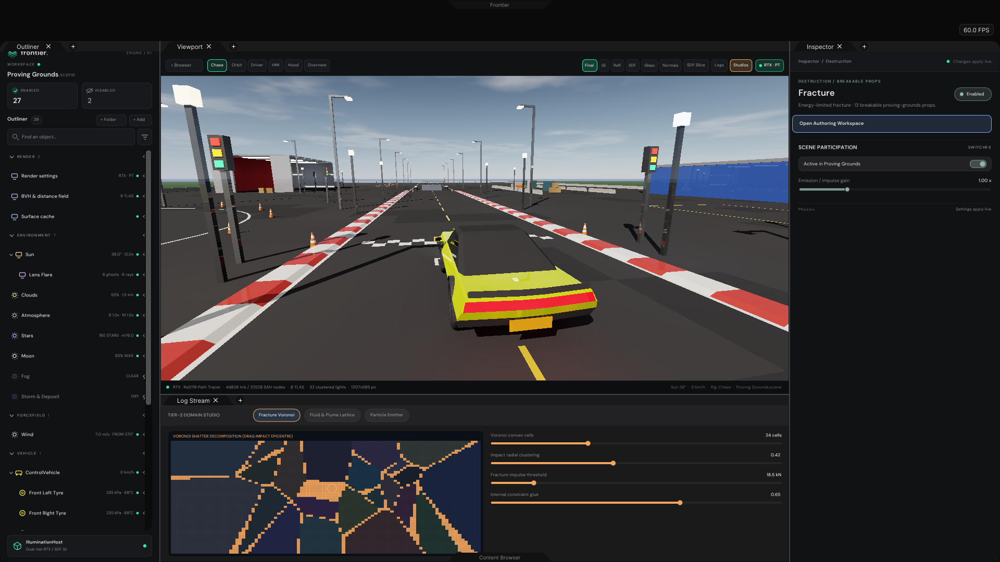
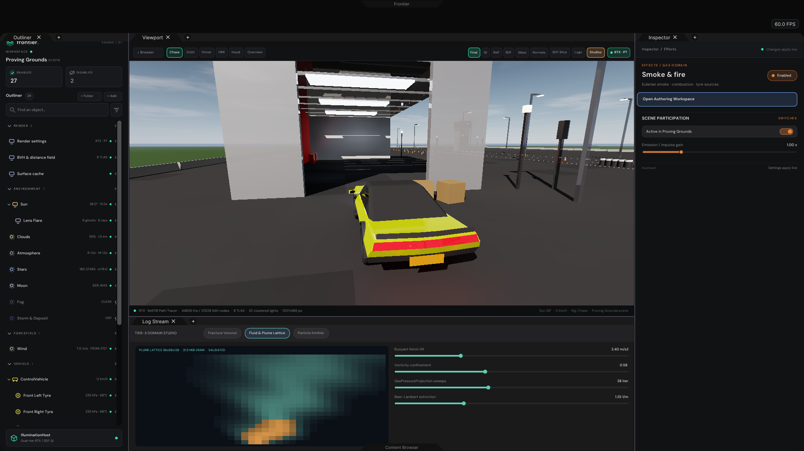
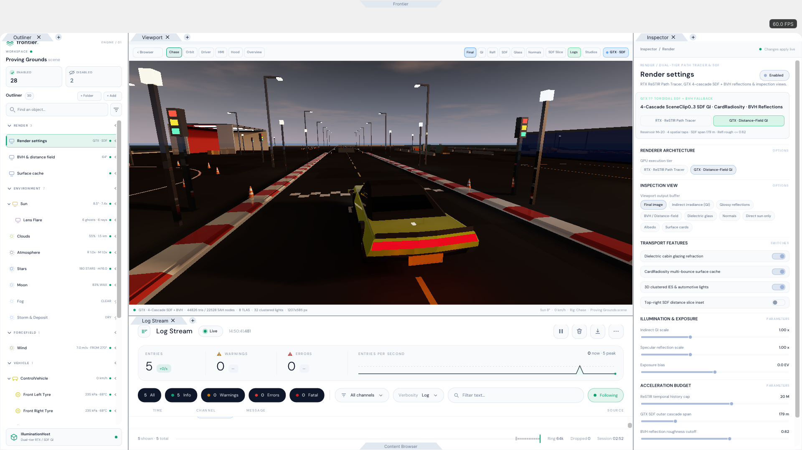

## Reproduction & verification

- **Platform / compiler tested**: Linux x86_64 sandbox (`g++ 12.2.0`, `-std=c++20 -O2 -Wall -Wextra`, plus `-std=c++17`
  and `-fsanitize=address,undefined` on portable suites). `slangc` and a Vulkan ICD (`libvulkan.so`) are not installed
  in this Linux sandbox; SPIR-V compilation and native Windows MSVC / Vulkan swapchain execution remain untested here.
- **Suites verified**:
  - `ProjectEverestValidation` (`44,826` tris / `22,528` SAH nodes / `168` card texels / `17` `1920x1080` PNGs): **PASS**.
  - `SceneDirectoryValidation` (Development profile): **45 passed, 0 failed**.
  - `SceneDirectoryValidation` (Shipping profile, `-DFRONTIER_SHIPPING_PROFILE=1`): **17 passed, 0 failed**.
  - `LogStreamValidation` (`-fsanitize=address,undefined`): **69 passed, 0 failed**.
  - `ProjectBrowserValidation`: **PASS** (770 drawn states).
  - `FrontierHeadless` (`WorkspaceApplication` C++17 `--project=ProjectEverest.frontier --headless`): **PASS**.
