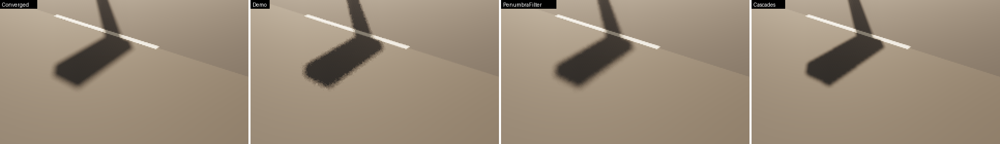
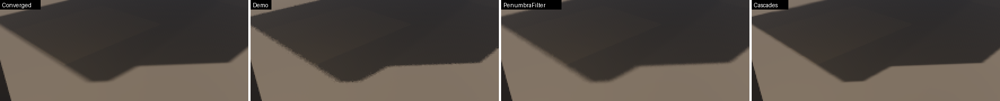
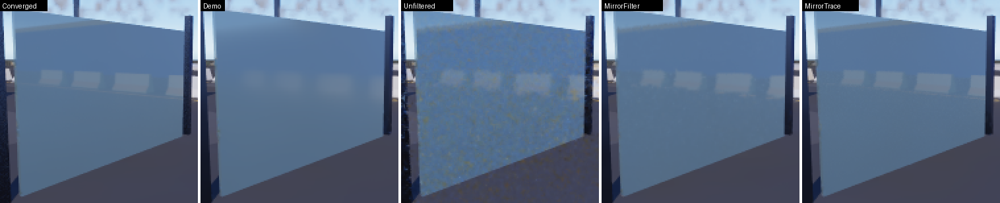
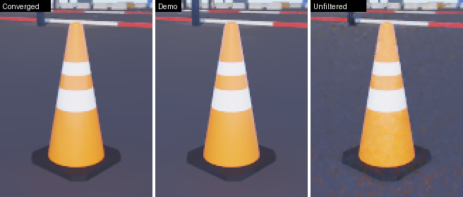
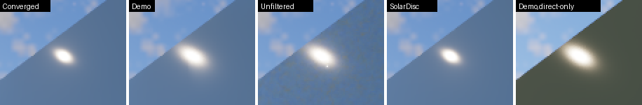

# Ray-traced reflections and sun shadows — sources of noise, options, measurements

The editor's RTX path (`RayTracing = true`, "RTX ReSTIR PT" in the readout) shows three problems. Its reflections
carry fireflies. Its variance filter blurs every reflection. Its ray-traced sun shadows flicker along their edges,
while the GTX path's shadows are clean. This exhibit finds where each comes from in the port's code, tests options
against the demo's behaviour and measures them in the editor's own scene viewport, offscreen. The report and the
recommendation live in `Documentation/Plans/Ongoing/RayTracedLighting.md`.

Every option is a bit of `RefreshToggles::Refinements` (`RefinementBit`, `SceneLayouts.slang` `RefinementBit…`). All
bits clear reproduce the demo: with mask 0, the direct radiance target was bit-identical to the demo's shader over
8 refreshes in two views (the shader compiled from the commit before the change, swapped into the same host).

## Options

| Bit | Option | What changes | Added work |
|---|---|---|---|
| 1 | 🌞 `SolarDisc` | The sun's highlight is shaded as a disc (representative point, energy-normalised) toward the disc's centre, in the direct term and at every path vertex; reflection rays no longer see the solar disc, whose light the direct term carries | none |
| 2 | 🎲 `StratifiedSun` | Sun-disc samples for the shadow ray follow the R2 sequence ranked over 4×4 pixel blocks, so each block covers the disc evenly every refresh | none |
| 4 | 🌗 `PenumbraFilter` | `PenumbraResolve.slang` averages the sun-ray verdicts over a disc a quarter of the local penumbra wide (half of blocker travel × tan of the sun's radius), with plane and normal weights | one screen-resolution dispatch, early exit outside penumbrae |
| 8 | 🪞 `MirrorFilter` | Surfaces with roughness below 0.10 take the unfiltered reflection, fading to the variance-filtered one by 0.20 | one 4-tap upsample dispatch |
| 16 | 🔍 `MirrorTrace` | With `MirrorFilter`: surfaces below roughness 0.20 are traced once per screen pixel instead of upsampled from half resolution | one ray per smooth screen pixel |

## Run

```sh
cmake --build <build> --target RayTracedLightingCapture
FRONTIER_VULKAN_DRIVER=<SwiftShader>/libvulkan.so.1 VK_ICD_FILENAMES=<SwiftShader>/vk_swiftshader_icd.json \
<build>/RayTracedLightingCapture <build>/ShaderArchives/GlobalIllumination <build>/ShaderArchives/Environment \
    EngineContent/EnvironmentArchives/ProvingGround EngineContent/EnvironmentArchives/CelestialMaps <out> \
    PenumbraNear,TowerShadow ShadowReference,Demo,Cascades,PenumbraFilter 8 16 0
<build>/RayTracedLightingCapture … PaneNear,ConesNear \
    MirrorReference,Demo,Unfiltered,SolarDisc,MirrorFilter,MirrorTrace 8 16 1
<build>/RayTracedLightingCapture … PaneSunGlint \
    MirrorReference,Demo,Unfiltered,SolarDisc,DemoDirect,DemoSpecular,SolarDiscDirect,SolarDiscSpecular 8 16 1
<build>/RayTracedLightingCapture … PaneNear \
    DemoDiffuse,UnfilteredDiffuse,DemoSpecular,UnfilteredSpecular,MirrorFilterSpecular 8 16 1
```

The tool takes views and variants as comma-separated lists, then warm-up refreshes, measured refreshes and indirect
light on or off. Each variant starts from a cleared history (reservoirs, variance filters and antialiasing restart)
with time frozen; its warm-up refreshes run first, then 16 measured refreshes, one whole antialiasing jitter cycle. A
`…Reference` variant runs first and changes only what its views test. `ShadowReference` traces 64 stratified sun rays
per pixel. `MirrorReference` traces every reflective pixel 16 times at screen resolution and takes it unfiltered. Every
later refresh is compared with the reference's mean. Every stage is its own submission, and
`DeviceExchange::SubmissionTiming` names each stage's cost.

## Measures

| Measure | Definition |
|---|---|
| Visible errors | pixels per refresh whose luminance is more than 12 levels (8-bit) from the reference's mean, in the measured region |
| Refresh RMS | luminance RMS of a single refresh from the reference's mean over the region: noise and bias together, what one image shows |
| Transition RMS | the same over transition pixels: those whose 9×9 neighbourhood in the reference spans over 24 levels and whose own luminance lies in the middle 80 % of that span (penumbrae, reflected edges) |
| Temporal noise | standard deviation of each transition pixel over the measured refreshes (flicker) |
| Mean error (bias) | RMS of the variant's mean image from the reference's mean over the transitions (blur, displacement, slow residual noise) |
| Fireflies | per refresh: pixels brighter than all 8 neighbours by over 0.12 of full scale and over 1.6× their mean |
| Stage cost | wall time of each stage's awaited submission (SwiftShader: CPU emulation, so ratios matter, not absolutes) |

## Views

| View | Camera → target | What it shows |
|---|---|---|
| `PaneNear` | (3.0, −23.6, 1.5) → (6.0, −27.2, 1.0) | the glass pane (roughness 0.04) mirroring the barriers |
| `ConesNear` | (−31.07, 16.39, 0.8) → (−30.0, 15.2, 0.3) | a skid-pad cone (roughness 0.22), the sun behind the camera |
| `PenumbraNear` | (−3.0, −4.5, 2.5) → (−5.8, −1.0, 0.0) | a light pole's head and mast shadow, penumbra 0 → ~17 cm |
| `TowerShadow` | (−37.0, −13.0, 4.0) → (−46.0, −20.0, 0.0) | the control tower's shadow, long edges with growing penumbra |
| `PaneSunGlint` | (4.72, −27.93, 0.3) → (6.0, −26.5, 1.8) | the glass pane mirroring the sun (the view ray reflects toward it) |

The sun sits at 38° elevation and 132° azimuth with 98 klx; the clouds cover 42 %. All captures used 480×270 at the
low grade, on SwiftShader on a 2-CPU Linux sandbox (2026-11-02).

## Results — sun shadows

Each view was compared with a converged reference of its own (`ShadowReference`: 64 stratified sun rays per pixel, the
reflections unchanged), with indirect light off so the reservoirs' own noise does not mask the shadows. *Visible
errors* counts pixels per refresh more than 12 luminance levels from the converged image. *Transition* figures cover
the penumbra and edge pixels only.

| View | Variant | Visible errors / refresh | Transition RMS | Temporal noise | Mean error (bias) | Shadow stages |
|---|---|---:|---:|---:|---:|---:|
| `PenumbraNear` (9,740 transition px) | 🟥 Demo (1 RT ray) | 928 | 7.11 | 1.93 | 6.32 | 610 ms |
| | 🟩 Cascades (GTX) | 1,601 | 10.65 | 1.03 | 10.45 | 337 ms |
| | 🌗 PenumbraFilter, full radius | 1,023 | 6.32 | 1.34 | 5.95 | 546 + 37 ms |
| | 🌗 **PenumbraFilter, half radius** | **615** | **5.69** | **1.30** | **5.29** | 540 + 36 ms |
| `TowerShadow` (4,210 transition px) | 🟥 Demo | 903 | 8.21 | 2.59 | 7.17 | 442 ms |
| | 🟩 Cascades | 2,246 | 21.35 | 1.82 | 20.77 | 288 ms |
| | 🌗 PenumbraFilter, full radius | 999 | 7.48 | 1.75 | 6.73 | 485 + 35 ms |
| | 🌗 **PenumbraFilter, half radius** | **673** | **6.61** | **1.83** | **5.73** | 456 + 34 ms |

Luminance levels are 8-bit display steps. Shadow stages are the direct radiance stage plus the penumbra resolve; the
direct stage itself varies about ±10 % between runs. The filter variants include `SolarDisc` and `StratifiedSun`.

- The half radius (filter disc = a quarter of the penumbra width) beats the full radius on every measure. A disc as
  wide as the penumbra blurs the true profile, and at its edges that costs more than it saves in noise. The half radius
  became the option's only setting.
- Against the demo it removes a third of the visible errors near the pole and a quarter at the tower. It lowers the
  per-refresh error by a fifth and the flicker by 30 %, keeps contact hardening where an occluder meets the ground, and
  adds 34–37 ms of SwiftShader time to a 7.5–8 s refresh (about 0.4 %).
- The cascades are the cleanest in time (lowest noise) but furthest from the true shadow: a fixed blur with no
  contact hardening, and at the tower's distance the shadow map's resolution moves whole edges (mean error 21 levels).
  "Clean" there means wrong but stable.
- `StratifiedSun` on its own did not change the demo's figures in a first run with a noisier reference (840 against
  766 visible errors). The per-pixel R2 walk is already stratified over time; spatial stratification pays off only
  under the filter, which averages across pixels.

## Results — reflections

Measured with indirect light **on**: the glossy variance filter and its upsample take their validity guide from the
ReSTIR step, so with indirect light off every half-resolution reflection was dropped (see the report, §5; fixed
since). The reference (`MirrorReference`) traces every reflective pixel 16 times at screen resolution and takes it
unfiltered; figures cover the pane's and the cone's regions only.

| View | Variant | Visible errors / refresh | Refresh RMS | Transition RMS | Temporal noise | Mean error (bias) | Reflection stages |
|---|---|---:|---:|---:|---:|---:|---:|
| `PaneNear` (roughness 0.04, 17,664 px) | 🟥 Demo | 57 | 2.70 | 4.98 | 1.31 | 4.55 | 188 + 59 ms |
| | ⬜ Unfiltered (variance filters off) | 65 | 2.51 | 4.76 | 1.80 | 4.15 | 191 + 13 ms |
| | 🌞 SolarDisc | 51 | 2.75 | 5.00 | 1.33 | 4.55 | 179 + 59 ms |
| | 🪞 **MirrorFilter** | **37** | **1.58** | 4.42 | 1.33 | 4.00 | 191 + 59 + **13** ms |
| | 🔍 MirrorTrace | 35 | 1.36 | 3.65 | 1.30 | 3.04 | 212 + 67 + **561** ms |
| `ConesNear` (roughness 0.22, 11,264 px) | 🟥 Demo | 339 | 5.50 | 10.33 | 1.95 | 9.92 | — |
| | ⬜ Unfiltered | 423 | 6.49 | 11.29 | 2.72 | 10.67 | — |
| | 🌞 SolarDisc | 419 | 6.51 | 11.26 | 1.84 | 10.90 | — |

Reflection stages are the half-resolution trace plus the glossy variance filter, plus the mirror stage where present.

- On the mirror-smooth pane, 🪞 `MirrorFilter` takes 41 % off the per-refresh error and a third off the visible errors.
  It shows the mirrored barriers as sharp as the converged image, with no added flicker, for a 13 ms upsample (0.6 % of
  the illumination stages). 🔍 `MirrorTrace` halves the error but costs 561 ms here, three times the whole
  half-resolution reflection trace, because the pane covers 13 % of the screen and each of its pixels traces a
  two-bounce path with next-event estimation.
- Switching the variance filters off (the owner's "without the blur") sharpens the pane only slightly and adds 37 %
  more flicker. The images show why: the pane fills with coloured grain.
- The cone (roughness 0.22) is meant to keep the variance filter: its lobe blurs the reflection physically. Without the
  filter its flicker rises 40 %. Every variant there sits 10–11 levels from the converged image, because all of them
  trace the cone at half resolution. The small spread follows the order of the runs (the surface cards keep relighting
  while indirect light is on), not the options.

## Results — where the fireflies and the grain come from

**The sun, counted twice** (`PaneSunGlint`: the camera sits where the glass pane mirrors the sun;
`Results/SunGlint.txt`). The demo shades the sun's highlight toward the shadow ray's jittered direction with roughness
floored at 0.03, a GGX peak of about 393,000, so a smooth surface sparkles. Its reflection rays then add the solar disc
at 2,500× the solar radiance, clamped only at 200, on every surface smoother than 0.25.

| Image | Saturated glint core (> 230 levels) | Temporal noise | Visible errors / refresh |
|---|---:|---:|---:|
| Converged reference | 58 px | 0.58 | — |
| 🟥 Demo | 100 px | 0.48 | 572 |
| 🌞 **SolarDisc** | **58 px** | 0.46 | **56** |
| Demo, direct term only | 115 px | 3.26 | — |
| SolarDisc, direct term only | 68 px | 1.31 | — |
| Demo, specular term only | 2,389 px above half brightness | 2.74 | — |
| SolarDisc, specular term only | 2,184 px above half brightness | 1.55 | — |

The demo's glint is 1.7× too large: its direct term alone saturates 115 pixels and flickers (3.26 levels), and its
specular term adds a smeared halo of about 200 half-bright pixels with 77 % more noise. 🌞 `SolarDisc` matches the
converged glint exactly and removes 90 % of the visible errors, at no cost. Without the variance filters a classic white
firefly appears beside the glint (image below). The firefly counter (an isolated pixel brighter than all its neighbours)
stays at zero in these views: the spikes sit inside the bright glint, where the visible-error count catches them.

**The grain without the blur** (`Results/GrainAttribution.txt`): switching the variance filters off unfilters both
signals. On the pane, the diffuse term's grain rises 2.9× and the specular term's 2.1×. The final image doubles its
grain (0.56 → 1.21 levels). 🪞 `MirrorFilter` drops only the glossy filter, and only on smooth surfaces, so the final
image keeps the converged image's detail (0.72 against 0.67) without the grain.

## Images

Crops at 2× (nearest), last refresh of each variant:







## Limitations

- SwiftShader only: stage costs are CPU emulation, so ratios matter more than milliseconds. No GPU and no Windows run.
- One sun (38°, 132°) and one resolution (480×270). Penumbrae a few pixels wide at this size are wider in pixels on a
  1080p screen; the filter's radius follows the penumbra in pixels, and its search stride grows with the screen height.
- With indirect light on, the surface cards keep relighting during a run, so variants measured later drift slightly
  from the reference's lighting (about one level on the cone).
- Converged references are themselves estimates (64 sun rays or 16 reflection samples per pixel, 16 refreshes).
