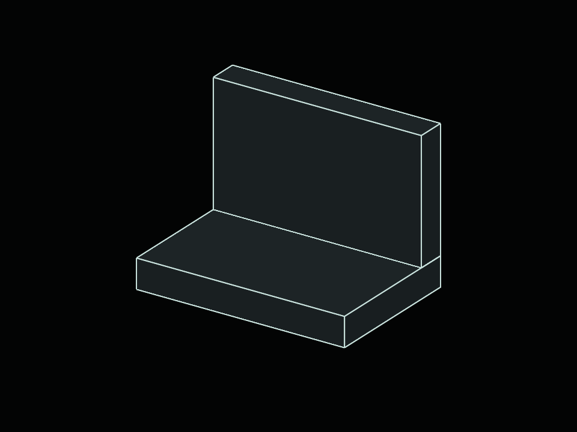
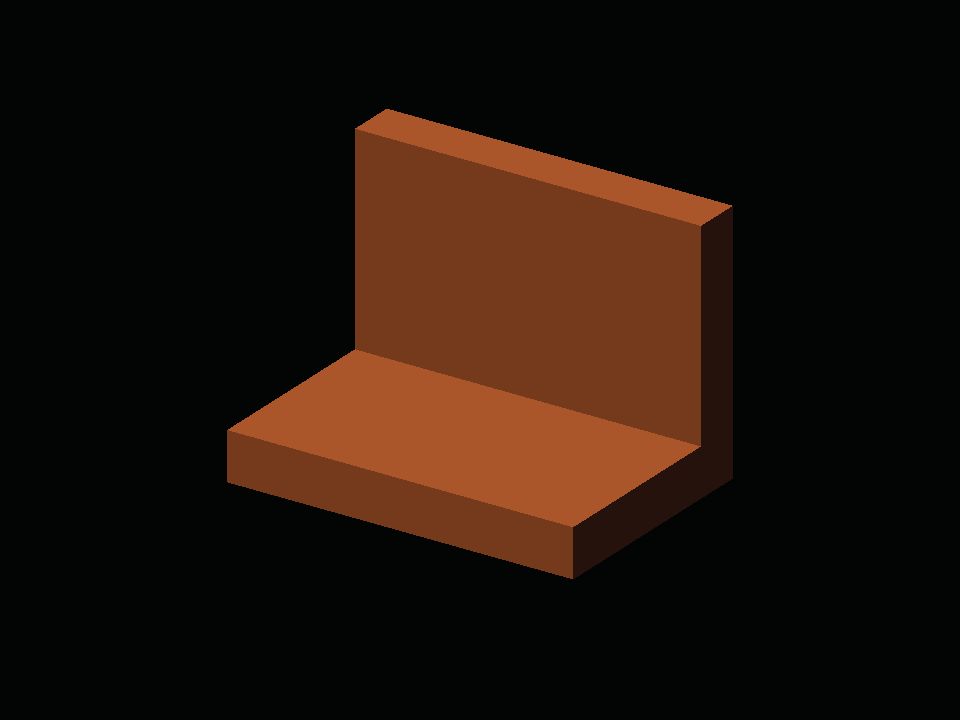

# Vulkan surface and authored-material evidence

Actual native C++/Vulkan CAD, MatCap, preview-PBR and authored-material rendering using the production `Engine/Render` sources and Slang.
These are unmodified GPU-image readback pixels from **SwiftShader software Vulkan**, not HTML/WebGL substitutes.



## Scope and ownership

| Unit | Owns | Reused by |
| --- | --- | --- |
| `SurfaceRasterPrograms` | Shared CAD/MatCap/PBR/material pipelines, samplers and layouts | All sized targets |
| `SurfaceGeometryResidence` | Device-local corners, indices, edges and initial transfer storage | Cameras/targets |
| `SurfaceRasterization` | Sized RGBA8/D32 images and attachment views | Repeated caller-owned command construction |
| `SurfaceTextureResidence` | Immutable sampled image and texture set | MatCap and PBR targets |
| `SurfaceScatteringResidence` | Immutable bounded scattering uniform and set | PBR targets |
| `BracketFixture.h` | Two authored blocks and explicit block edges | Validation only; never a project preset |

Geometry residency does not depend on a material/shader program, allowing later shading modes to reuse it.
Targets retain shared program/geometry allocations and sampled texture/scattering allocations through the completion boundary.
Ending the original source scopes does not invalidate them.
All units borrow the device; the caller owns one graphics queue, command buffers, successful submission confirmation,
completion fences and retirement. No engine-side device creation or idle waits are introduced.

## Executed checks

- Forty geometry/MatCap/dormant-lifecycle assertions: valid fixture, bad indices/counts, finite coordinates/normals,
  zero-length edges, explicit edge omission, dormant device/command refusal and repeated finalization.
- Ten Slang entries compile to SPIR-V. Reflection verifies CAD 112-byte and shared-normal 128-byte push declarations,
  input locations, texture/sampler slots and PBR 672-byte and material 832-byte uniform offsets/strata. Host offsets are statically asserted.
- Every shader requires only core SPIR-V `Shader` capability. Direct Vulkan vertex indexing avoids the optional
  shader-draw-parameters capability; no optional wide lines, geometry shaders or non-solid fill are enabled.
- Real opaque surface/edge depth testing, orthographic versus perspective pixels, and a 320 × 240 thumbnail.
- Exactly one accepted geometry upload serves both camera captures and the thumbnail. CAD-only targets share
  exactly two pipeline creations; MatCap adds one shared pipeline and sampler, not one per target/texture.
- A deliberately cancelled first-use command buffer leaves transfer pending; the next accepted submission retries it.
- A rear stroke is hidden inside an occluder but visible outside it; a front stroke remains visible.
- Near/eye clipping produces bounded strokes; screen-space distance uses non-perspective interpolation.
- Rendering still agrees after explicit program/geometry source finalization, while targets retain those allocations.
- The C++ CPU and actual Vulkan executions also pass ASan/UBSan. See `Results/Verification.json` for build evidence.

The bracket contains separate blocks, not a Boolean union or decoded CAD document. Its edges are authored explicitly,
not inferred from triangle wireframe. CAD colours are display-style values, not a PBR colour-management implementation.

## MatCap lookup and normal-transform evidence



- `MatCapProjection.h` derives the inverse-transpose view-from-surface normal transform in double precision,
  including non-uniform scale, shear and reflections. Singular/non-affine/nonfinite transforms are refused.
- `MatCapSurface.slang` normalizes after interpolation, samples a real resident texture with linear clamp filtering,
  maps positive camera Y to the top row, and ignores source alpha for opaque surfaces. RGB is display-referred:
  no sRGB decode, scene light, environment evaluation or tone mapping is silently applied.
- Independent CPU bilinear reference matches real GPU lookup pixels, including camera-normal rotation, grazing-angle
  clamp boundaries, tint, non-uniform scale/shear/reflection, depth occlusion and ignored zero source alpha.
- CAD → MatCap → CAD round-trips exactly, keeping the original geometry uploaded once. Thumbnails share the same
  resident lookup; texture replacement/restoration does not duplicate geometry or previous texture uploads.
- Cancelled first-use command construction retries both geometry and texture transfers. Source pixel mutation after
  initialization cannot alter resident bytes. Ending source scopes before submission leaves retained resources valid.
- `MatCapCalibration.png` is an analytical smooth-normal sphere, not a second CAD document, import or project preset.
  Its lookup texture is generated deterministically by `MatCapFixtures.h`; the image itself is actual Vulkan readback.
- The user explicitly authorized MatCap next while the shared native presenter/Windows acceptance work remains open.
  This is offscreen implementation evidence, not completion of those pending host gates.

## Captures and reports

- `Images/CadOrthographic.png`, `CadPerspective.png`: 960 × 720 actual Vulkan captures.
- `Images/CadThumbnail.png`: independently sized 320 × 240 target using the same resident geometry/programs.
- `Images/CadDepthOcclusion.png`, `CadNearClip.png`: 128 × 128 analytical visibility fixtures.
- `Images/MatCapBracket.png`, `MatCapThumbnail.png`, `MatCapCalibration.png`: actual MatCap readbacks.
- `Results/MatCapRasterChecks.json`: lookup, normal-transform, mode-change and texture-residency checks.
- `Results/CadRasterChecks.json`: executed device, pixel counts, geometry submission and pipeline counts.
- `Results/ShaderCompilation.json`: compiler/artifact/source hashes, exported entries and capabilities.
- `Results/Cad*.json` and `MatCapSurface*.json`: compiler reflection, not hand-authored runtime material serialization.
- `Code/EncodeRasterEvidence.py`: standard-library PPM-to-PNG encoding; no image generation, retouching or overlays.

## Reproduce on Windows

Prepare the existing pinned UI/font dependencies as described in `../UIFoundation/README.md` and
`../ControlCentre/README.md`. Supply a native Slang compiler explicitly; CMake never downloads one.

```powershell
cmake -S . -B Build/RendererWindows -A x64 -DBUILD_TESTING=ON `
  -DFRONTIER_SLANGC=C:/Tools/Slang/bin/slangc.exe `
  -DFRONTIER_VULKAN_DRIVER=C:/Windows/System32/vulkan-1.dll
cmake --build Build/RendererWindows --config Debug --target `
  SurfaceGeometryValidation SurfaceRasterizationValidation MatCapRasterizationValidation PreviewPbrRasterizationValidation MaterialRasterizationValidation
ctest --test-dir Build/RendererWindows -C Debug `
  -R "(Surface(Geometry|Rasterization)|MatCapRasterization|PreviewPbrRasterization|MaterialRasterization)Validation" --output-on-failure
```

Native Slang builds target SPIR-V 1.3. The portable WASM compiler used for the executed evidence emits SPIR-V 1.5;
that execution therefore explicitly requests Vulkan 1.2. The native validator chooses its minimum API from the archives.
The supplied driver must support RGBA8 colour/sampling/blending/transfer and D32 depth, or initialization fails clearly.

Cross-built CAD, MatCap, PBR and authored-material Windows x64 executables remain under ignored `Binaries/RendererValidation/`,
not committed.
Run each with an explicit Vulkan loader, shader-archive directory and output directory; MatCap requires six entries,
PBR eight entries.
None of these executables has been executed on Windows. The MSVC/CMake commands above are reproduction instructions,
not a claim that they ran in this sandbox: CMake is absent here, and no Linux package was installed to obtain it.

## Reproduce the executed portable checks

The compiler is `slang-loader@0.0.7` from npm, embedding Slang 2026.19; binaries remain ignored, with hashes retained.
This is a compiler tool only, not a new application dependency or a WGSL production path.

```bash
npm install --prefix _ClaudeScratch/tmp/SlangCompiler --ignore-scripts --no-audit --no-fund slang-loader@0.0.7
node Automation/CompileSurfaceShaders.mjs \
  _ClaudeScratch/tmp/SlangCompiler/node_modules/slang-loader/vendor/slang-wasm.js \
  _ClaudeScratch/tmp/CadRasterization/Shaders
```

With GCC, Node and pinned Zig/Python tools already available, the end-to-end local runner downloads nothing:

```bash
LD_LIBRARY_PATH=/tmp/al2023/lib:/tmp python3 Exhibits/Renderer/Code/VerifyRasterEvidence.py \
  --slang-wasm _ClaudeScratch/tmp/SlangCompiler/node_modules/slang-loader/vendor/slang-wasm.js \
  --driver /tmp/libvk_swiftshader.so --windows-tools _ClaudeScratch/tmp/WindowsTools \
  --destination _ClaudeScratch/tmp/CadRasterization
```

The `/tmp` driver paths describe this sandbox only, not required paths or a driver package to install.
The Windows cross-toolchain is the already approved `ziglang==0.13.0`, supplied through `--windows-tools`.

Compile `Engine/Render/SurfaceRasterization.cpp` with each validation `.cpp`, C++20, `VK_NO_PROTOTYPES`,
repository/Vulkan-Headers include roots; the device test additionally uses the platform dynamic library facility.
Run the device test with an explicitly available Vulkan driver; it does not install one.
`Code/EncodeRasterEvidence.py <readback-directory> Exhibits/Renderer` retains the actual PNGs and runtime report.
For memory checks add `-fsanitize=address,undefined -fno-omit-frame-pointer` on an already available compiler.

## Explicit limitations

- No native Project Browser viewport/thumbnail binding, document/CAD decoding, interaction or presentation integration.
- No Windows execution, hardware GPU performance results, MSVC run, or Vulkan validation-layer coverage.
- Independent target sizing is tested; native window resize/DPI, overlapping readers and deferred retirement
  are not. Callers must obey the fenced replacement contract; this slice does not implement a retirement scheduler.
- Shared-edge deduplication/crease policy, imported-instance transforms and large-coordinate rebasing are still pending.
- All current modes remain offscreen. Authored materials support opaque/coating scattering only; no painting, GI or RT.
- Both painting app/reference collections remain intact. Blank Project is still the only native creation preset.

The single progress tracker and approved acceptance sequence remain in `Documentation/Tracker.md` and
`Documentation/Plans/Ongoing/RendererIntegration.md`.


## Preview PBR and earlier HTML

The production surface unit now supports an optional preview-PBR shader pair and immutable
`SurfaceScatteringResidence` uniform allocations. `SurfaceTextureResidence` and `SurfaceNormalProjection`
are shared contracts; the old MatCap type/function names remain compatibility aliases. The tint member is now
`SurfaceTint`. CAD-only callers still create two pipelines; enabling MatCap and PBR creates four total, not
per-material pipelines. Textures retain a single shared linear/clamp sampler per program allocation.

| Contract | Implemented boundary |
| --- | --- |
| Scattering | Up to eight ordered `ScatteringStratum` entries; opaque GGX + diffuse, absorbing dielectric coatings |
| Coatings | Evaluated BSDF attenuation using entrance/exit Fresnel + Beer absorption; shared directions/normal |
| Illumination | Directional light + bounded analytical-sky cosine/GGX mixture quadrature; not converged HDRI/GI |
| Texture | Explicit planar coordinates; UNORM source interpreted as sRGB albedo exactly once; alpha ignored |
| Output | Scene-linear accumulation → exposure → ACES-fit tone map → sRGB display; opaque alpha |
| Lifetime | Immutable uniform/texture allocations retained by recorded target; caller still owns submission/fences |
| ABI | 128-byte projection; set 0 image/sampler; set 1 binding 0 uniform: 672 bytes, strata offset 160, stride 64 |

`PreviewPbrRasterizationValidation` checks scalar-reference pixels, metallic/coating coverage, eight strata,
sRGB decoding/opacity, mode round trips, exposure/environment response, unchanged geometry/program counts,
cancelled recording and finalized source retention. Strict, sanitizer and Windows cross-build execution details
are recorded by `Results/Verification.json`; Windows cross-compilation is not Windows execution.

The earlier browser, not a replacement UI, now includes **Renderer validation**. Its versions select PBR,
MatCap or CAD; the second view is an analytical calibration sphere, not another imported CAD document.
Roughness, metallic, coating coverage and exposure submit same-origin requests to the persistent C++ Vulkan
readback process. Saved captures are explicitly labelled when that process is unavailable; there is no WebGL
substitution for the Vulkan specimen. Original browser samples remain WebGL references.

Example with already provisioned tools (the server never installs/builds dependencies):

```bash
python3 "Exhibits/Renderer/Code/ServeRenderer.py" \
  --executable _ClaudeScratch/tmp/PreviewPbr/Verification/PreviewPbrRasterizationValidation \
  --driver _ClaudeScratch/tmp/PreviewPbr/Runtime/libvk_swiftshader.so \
  --shaders _ClaudeScratch/tmp/PreviewPbr/Verification/Shaders \
  --captures _ClaudeScratch/tmp/PreviewPbr/Live --port 8775
```

Open `/?renderer=1` for the specimen, or `/` for the original library. The Windows `.exe` can be supplied
instead on Windows with an available Vulkan loader; that host path has not been executed here. These paths
are sandbox examples, not production installation locations.

Browser validation is generated by `Code/PreviewPbrBrowserChecks.mjs`, using explicitly supplied Chromium,
Playwright module and runtime-library paths. `Images/PreviewPbrBrowser.png` is an HTML screenshot;
`PreviewPbrBracket.png` and `PreviewPbrCalibration.png` contain unmodified native Vulkan readback pixels.
The authored-material section below supersedes the preview-only authoring/UV/normal-map boundary.
Advanced transport, native editor binding and Windows/hardware/validation-layer execution remain open.


## Authored material implementation

The bounded opaque/coating material slice is implemented in `Engine/Render/SurfaceMaterial.{h,cpp}`.
Strict `.material` TOML compiles to an immutable 1216-byte uniform and four typed texture arrays with complete mip pyramids.
PNG/JPEG references are contained within `ContentDirectory`. Albedo/radiance are sRGB, ORM/normals linear;
colour filtering/mips operate in linear light and normal mips renormalize. Authored UVs/tangent handedness
replace planar projection for this mode. Opaque and absorbing coating strata use the same angular equations
as preview PBR through `ScatteringEvaluation.slang`.

There are five shared pipelines with all modes enabled, not per-material compilation of Vulkan pipelines.
Material textures have a separate repeat/trilinear sampler; CAD/MatCap retain their original behaviour.
Material parameter edits do not reupload geometry or unchanged textures. Recorded targets retain immutable
parameters/images through source finalization; callers still own completion and replacement fences.

`MaterialRasterizationValidation` passes 187 checks: strict TOML/round-trip/diagnostics, path containment,
sRGB decode-before-filter, colour-correct/odd-dimension mips, normal mip renormalization, scalar-reference
GPU pixels and reflected tangent handedness, eight strata, source mutation/finalization, cancelled uploads, texture response, geometry/texture
reuse and five shared pipelines. Directional tests cover rotated/signed anisotropic GGX GPU/scalar agreement,
normalized half-vector densities, exact Fresnel/TIR/equal-IOR cases, layer array deduplication/mip offsets/sampling,
neutral expansion, out-of-residence slice refusal, independent coat/base cosines, normal strength and negative/zero UVs.
The common runner reproduces strict and ASan/UBSan executions, malformed
archive refusal, four Windows x64 cross-builds and 20 exact native captures. Windows execution, hardware
Vulkan and validation-layer coverage remain unverified. CMake/native Slang are instructions, not executed evidence.

To run the earlier HTML with authored materials, use the material executable and explicit content library:

```bash
python3 "Exhibits/Renderer/Code/ServeRenderer.py" \
  --executable _ClaudeScratch/tmp/AdvancedPbr/Verification/MaterialRasterizationValidation \
  --driver _ClaudeScratch/tmp/PreviewPbr/Runtime/libvk_swiftshader.so \
  --shaders _ClaudeScratch/tmp/AdvancedPbr/Verification/Shaders \
  --captures _ClaudeScratch/tmp/AdvancedPbr/Live \
  --material-library Exhibits/Renderer/Materials --port 8775
```

Open `/?renderer=1`, select **Authored material**, and use the material selector or TOML **Apply / Import / Export**.
Compiler errors preserve the last valid image and show diagnostics; the original imported file is unchanged.
Four material specimens and six texture maps are generated by `Code/GenerateMaterialFixtures.py`; they are
not native project creation presets. Side thumbnails are saved default-material native captures, not live
renders of every edited material. The central image is the actual requested Vulkan readback.

`Code/MaterialBrowserChecks.mjs` accepts explicit Chromium executable, Playwright module and library paths;
its report verifies all four specimens, changed native pixels after TOML Apply, unsupported-category errors,
last-valid-image retention, actual import/export and narrow layout. `MaterialBrowser.png` is an HTML screenshot;
`Material*Bracket.png` / `Material*Sphere.png` are unmodified native readbacks.

The compiler lowers the supported material description into shared shader inputs; it is **not** an arbitrary
shader-expression compiler. Native document material assignment/presentation, transmission/refraction, SSS, complex-IOR conductor Fresnel, multiple scattering,
converged HDR lighting and GI/RT
remain outside this implemented slice. Full semantics and exact limits: `Documentation/Rules/SurfaceMaterials.md`.


## Evidence relocation

Vulkan validation no longer appears in the application Project Browser HTML. `Exhibits/Renderer/index.html` is the
separate live review, linked from the existing native/ImGui evidence pages in `Exhibits/SpaceFormats` and
`Exhibits/ProjectBrowser`. Run `Exhibits/Renderer/Code/ServeRenderer.py` with the arguments above; its root now serves
this evidence page, and `/project-browser/` serves the original six-file application reference separately.
`/?renderer=1` remains an accepted review URL on the evidence server, but is not a Project Browser entry.
