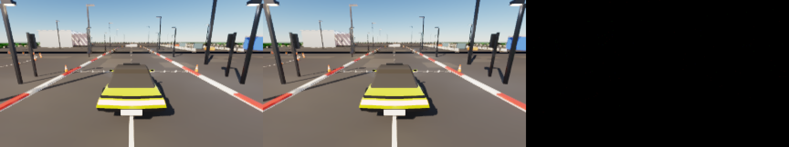

# ReSTIR GI 1:1 port — parity with the VehicleHMI demo

## Result

The C++/Vulkan/Slang port (`Frontier/Engine/Rendering/GlobalIllumination`, `Frontier/Engine/Shaders/GlobalIllumination`)
reproduces the original WebGPU demo refresh for refresh. Every deterministic stage is **bit-identical**; the presented image matches
**99.93 %** of 8-bit values (max 1/255, PSNR 79.7 dB) — the same agreement as two runs of the demo itself (99.94 %,
80.0 dB). Across repeated port runs the presented-image agreement ranged 99.93–99.98 %.



Left: the original demo (Dawn on SwiftShader). Middle: the C++ port (SwiftShader). Right: |difference| × 8.

## Parity table — refresh 11, quality low, 288 × 162, C++ host encoders driving the refresh

| Stage                                   | Port vs demo                         | Demo run A vs demo run B             |
|-----------------------------------------|--------------------------------------|--------------------------------------|
| Facet vertices, BLAS, BLAS triangles    | byte-identical                       | —                                    |
| Card / occupant profiles, distance list | byte-identical                       | —                                    |
| Refresh constants (12 refreshes)        | byte-identical                       | —                                    |
| TLAS, card tiles, cascades, bricks      | byte-identical (12 refreshes)        | —                                    |
| Occupant distance space (13.2 M halves) | 100 % bit-identical                  | —                                    |
| Card capture (albedo/normal/incand./depth) | 100 % bit-identical               | —                                    |
| Scene distance cascades, shadow cascades | 100 % bit-identical                 | 100 %                                |
| Sky view + atmosphere LUTs              | 100 % bit-identical (refresh 0)      | —                                    |
| Surface depth / attributes / motion     | 100 % bit-identical                  | 100 %                                |
| Direct radiance, card direct irradiance | 100 % bit-identical                  | 100 %                                |
| Card final radiance                     | 90.7 % identical, PSNR 69.6 dB       | 91.5 % identical, PSNR 70.5 dB       |
| Reservoirs (slot 0 / 1)                 | 87.3 % / 86.8 % bit-identical        | 93.8 % / 93.7 % bit-identical        |
| Resampled irradiance (ReSTIR GI)        | 99.70 % identical, PSNR 103 dB       | 99.91 % identical, PSNR 122 dB       |
| Reflection radiance                     | 99.88 % identical, PSNR 89 dB        | 99.92 % identical, PSNR 98 dB        |
| Diffuse / glossy SVGF (screen)          | 99.69 % / 97.18 %, PSNR 111 / 99 dB  | 99.56 % / 96.69 %, PSNR 114 / 112 dB |
| Recombined radiance                     | 99.82 % identical, PSNR 114 dB       | 99.75 % identical, PSNR 126 dB       |
| Resolved radiance (TAA, slot A / B)     | 99.37 % / 99.39 %, PSNR 111 dB       | 99.35 % / 99.35 %, PSNR 110 dB       |
| Presented image (8-bit sRGB)            | 99.93 % identical, PSNR 79.7 dB      | 99.94 % identical, PSNR 80.0 dB      |

Full logs: `Results/ParityLiveLow.txt` (port vs demo) and `Results/NoiseFloorLow.txt` (demo vs demo).

## Noise floor

The demo is not deterministic run to run. In `CardRadiosity` an 8×8 relighting tile that overhangs its card writes
zero into the radiosity site of the neighbouring card in the atlas, racing that card's own workgroup. The race is part
of the original and is ported unchanged; everything downstream of card radiosity (card final radiance, the reservoirs
that read it, the resolved signals) therefore varies between any two executions — including two runs of the demo.

## Method

1. `Code/CaptureReference.sh` runs the **original demo** under Node + Dawn (`webgpu@0.6.2`) on the SwiftShader Vulkan
   ICD, with `Code/CaptureHooks.mjs` recording every host → device write, every unit and draw, the scene topology,
   the camera and light of each refresh, and raw dumps of the listed targets (a deterministic clock replaces
   `performance.now()`).
2. `Code/RestirGiParityValidation.cpp` builds the port from the same scene topology and runs the same refreshes:
   - host uploads are compared byte for byte with the demo's write log;
   - with `live`, the port's own host encoders produce:
     - the refresh constants, including the environment block (`EncodeEnvironment`, the celestial solver);
     - the luminaire register (`LuminaireRegister`);
     - the cascades, invalidated bricks and TLAS.

     Only buffers of systems outside the port (vehicle/effect/cloud constants, cone transforms) are taken from the
     capture;
   - device targets are read back and compared texel for texel.

## Reproduce

```bash
# 1. the demo, exactly as reviewed
git fetch https://github.com/SultanAladin/Frontier arena/e9bd7db5-frontier
git archive 6afb6f00b5f25c45f7cda92c7da65b64845768f3 Experimental/VehicleHmiPrototype ReferenceApps/Working | tar -x -C /tmp/upstream
(cd /tmp/upstream/Experimental/VehicleHmiPrototype/Tools && npm ci)

# 2. reference run (cabin overlay omitted, clouds/flare/smoke/sparks/tyre marks off) — about 3 minutes per run
CAPTURE_FRAMES=11 Exhibits/RestirGiParity/Code/CaptureReference.sh /tmp/upstream/Experimental/VehicleHmiPrototype /tmp/capture 12 low 480x270

# 3. port parity (FRONTIER_VULKAN_DRIVER / VK_ICD_FILENAMES point at SwiftShader)
build/RestirGiParityValidation build/ShaderArchives/GlobalIllumination /tmp/capture /tmp/parity low 12 288 162 live
```

`CAPTURE_TEXTURES` selects the dumped targets; on a 4 GB host dump at most about a dozen targets per run.

## Revision and environment

- Port: branch `arena/88b72faa-frontier`; demo: SultanAladin/Frontier `6afb6f00b5f25c45f7cda92c7da65b64845768f3`.
- Linux x86-64, GCC 12.2, Slang 2026.14.1, SwiftShader 5.0.0 (Subzero), Node 22, Dawn `webgpu@0.6.2`.

## Limitations

- SwiftShader on Linux only. No hardware GPU and no Windows run. Since 2026-11-01 the port is part of the Windows editor
  build (cross-compiled and linked, `Exhibits/SceneViewport`).
- Not ported (switched off in the reference): clouds and cloud shadows, lens flare, smoke/fire, sparks, tyre marks,
  lightning, precipitation, the cabin overlay (glass, HMI screens, mirrors), the HMI screen textures the ray tracer
  samples on the car's displays, vehicle physics, the demo's editor UI.
- Inputs still taken from the capture in `live` mode: vehicle visual and effect constants (systems outside the port).
  Since 2026-11-01 the environment block and the luminaire register are native, byte-identical over 12 refreshes.
- This validation renders offscreen. The editor presents the port live in the Everest Scene Viewport
  (`Exhibits/SceneViewport`).
- One reference resolution and quality grade (low, 288 × 162) was compared.
