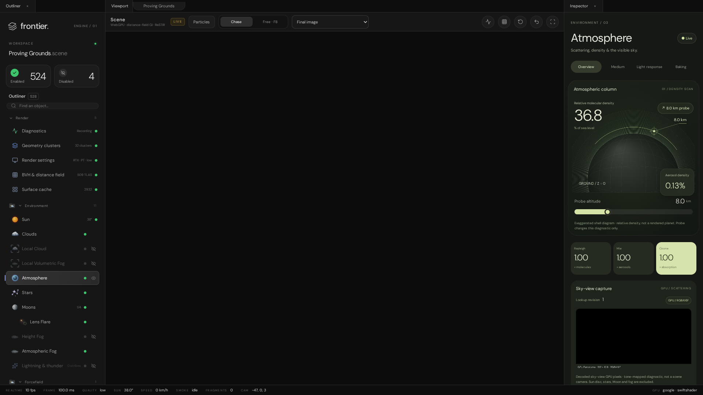
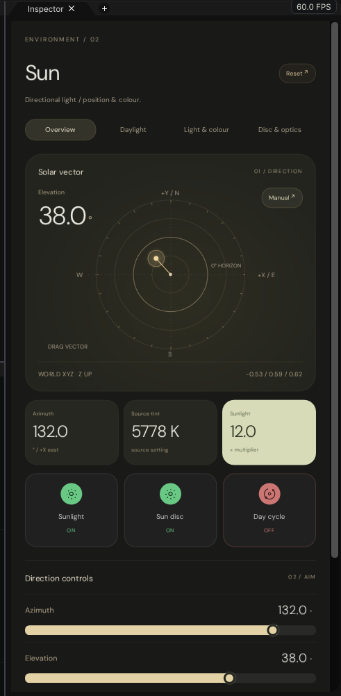
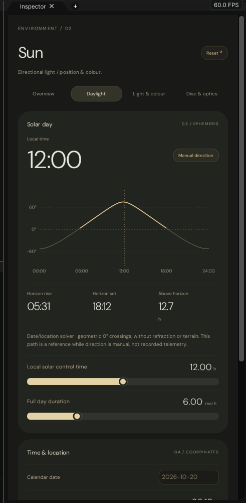
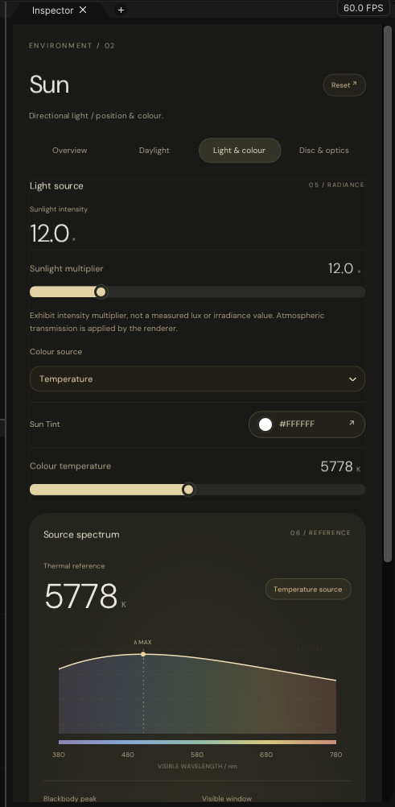
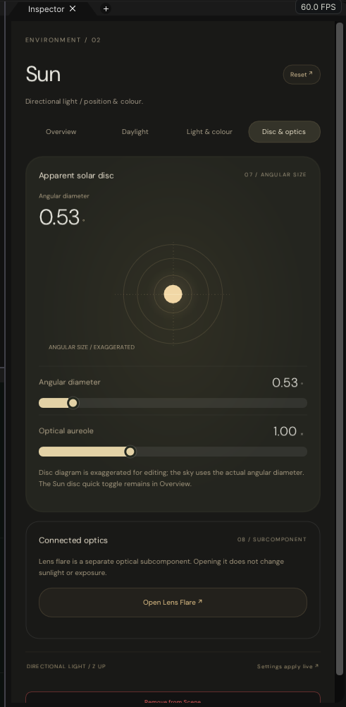

# VehicleHMI demo interface — 1:1 port inventory

The demo's interface is being ported into the Everest workspace one region at a time, following the contract in
SultanAladin/Frontier `e7a0aaf2` (`Frontier/Projects/Project-VehicleHmiDemo/Contract`). Every row ends as *ported → C++
file* or *removal approved by the owner*. Two regions are ported: the **viewport column** (tab strip, viewport bar,
readout, distance slice, notices, bring-up, failure) with the **status strip**, and the first environment Inspector
page, **Sun**, with the controls its page family shares. The other environment pages come next (see *Pending regions*).

*The demo at `6afb6f00`, captured headless on SwiftShader (`Tools/CaptureDemoInterface.js`). Its viewport is black
because the capture path presents off-canvas. The port is `Images/EverestLiveSceneViewport.png`.*

## Viewport column and status strip

Sources: `index.html`, `Source/EditorControls.js` (bar), `Source/EditorShell.js` (status), `Source/OverlayDock.js`,
`Source/IlluminationHost.js` (`PresentMeasurements`), `Style/FrontierEditor.css`. The controls carry the CSS metrics and
colours (`Frontier/Engine/Interface/ViewportChromeControls.{h,cpp}`), and the Everest workspace lays them out and
wires them (`Projects/Everest/Source/EverestWorkspace.cpp`).

| Demo element                                                  | Status                                                                           | C++                                                    |
|---------------------------------------------------------------|----------------------------------------------------------------------------------|--------------------------------------------------------|
| `.viewport-tabs`: tab "Viewport"                              | ✔️ ported (dock caption; the window id is unchanged)                             | `EverestWorkspace` dock registration                   |
| `.scene-pill` "Proving Grounds"                               | ✔️ ported                                                                        | `ConstructScenePill`                                   |
| `.scene-heading` "Scene" / subtitle                           | ✔️ ported; subtitle names Vulkan, not WebGPU                                     | `ConstructSceneHeading`                                |
| `.live-pill` LIVE                                             | ✔️ ported; shown while an image is live                                          | `ConstructLivePill`                                    |
| `.particle-launch` Particles                                  | ✔️ ported; opens the level's `Particles` record in `ParticleEditor`              | `ConstructLabelButton`                                 |
| `.segmented` Chase / Free · F8                                | ✔️ ported; Chase inactive (no vehicle); Free is the Unreal Engine camera         | `ConstructSegmentedSwitch`                             |
| `.select-field`: the 15 inspection views                      | ✔️ ported; writes `RenderPipeline.InspectionModeIndex`, the port's `Inspection`  | `ConstructSelectField`, `RenderInspectionModes`        |
| Readout (H)                                                   | ✔️ ported                                                                        | `ConstructIconButton`                                  |
| Distance slice (I)                                            | ✔️ ported; the port's inset (HMI word bit 0); I and J both toggle it             | `ConstructIconButton`                                  |
| Respawn (R)                                                   | ✔️ ported, inactive: this level has no vehicle                                   | `ConstructIconButton`                                  |
| Reassemble every prop                                         | ✔️ ported, inactive: no breakable props in this viewport                         | `ConstructIconButton`                                  |
| Clean view (V)                                                | 🚩 readout and slice hidden as in the demo; the editor columns stay              | `ToggleViewportOverlay`                                |
| `#hud` readout                                                | ✔️ ported: line 1 and the TLAS line in the demo's format; the vehicle line states the omission; this viewport's camera keys replace the driving keys | `ConstructReadoutOverlay` |
| `#inset-frame`, legend, close                                 | ✔️ ported (legend verbatim)                                                      | `ConstructInsetFrame`                                  |
| `#overlay-notice`                                             | ✔️ ported (camera speed, clean view)                                             | `ConstructOverlayNotice`                               |
| `#event-notice`                                               | 🚧 pending (fracture events are not in this viewport)                            | —                                                      |
| `#overlay-dock` "⊞ Editor (P)"                                | 🚧 pending (P hides the editor columns)                                          | —                                                      |
| `#bring-up` heading, caption, bar                             | 🚩 ported as a card; the bring-up runs synchronously, so the bar shows no steps  | `ConstructBringUpCard`                                 |
| `#failure`                                                    | ✔️ ported                                                                        | `ConstructFailurePanel`                                |
| `footer#status`: REALTIME FRAME QUALITY SUN SPEED SMOKE FRAGMENTS CAM … GPU | ✔️ ported; SPEED "–" (no vehicle), SMOKE idle, FRAGMENTS 0          | `ConstructStatusStrip`                                 |

The demo's labels disagree about the distance-slice key. The bar says "Distance slice (I)" and the inset's close
button says "(J)". `OverlayKeys` binds J, and I cycles the vehicle's lights. With no vehicle here, both keys toggle the
slice, and both labels are kept verbatim.

## Environment Inspector page: Sun

Sources: `Source/SunInspectorDashboard.js`, `Source/ObservatorySlider.js`, `Source/SliderControl.js`,
`Source/NativeEnvironmentControls.js` (`Tiles`, `Select`, `Diagram` and its `Pen`), `Source/InspectorPages.js`
(`LightingPresets`), `Style/CloudInspector.css`, `Style/SunInspector.css`, `Style/NativeEnvironment.css` and
`Style/SliderControl.css`. The observatory family's controls are
`Frontier/Engine/Interface/ObservatoryControls.{h,cpp}`:

- header, section tabs, cards with their `[data-instrument]` looks;
- readouts, metric tiles, quick switch tiles;
- observatory sliders, select, presets, data rows, tags, the next button, footers;
- the canvas `Pen`, which draws the diagrams in their own logical coordinates.

The page itself is `Frontier/Engine/Interface/SolarObservatory.cpp`. It occupies the whole Inspector column
(`RecordInspector::QueryOccupiesColumn`), so no crumb bar, record header or switch grid is drawn around it. The
Inspector column is narrower than the sheets' 520 px container breakpoint, so the narrow cascade applies; the quick
tiles follow the 369 px breakpoint (two columns at the demo's width, one row of three in Everest's wider column).

| Demo element | Status | Native binding |
|---|---|---|
| Header: `ENVIRONMENT / 02`, "Sun", Reset ↗, subtitle | ✔️ ported | Reset restores the demo's defaults: 38°, 145°, ×12, 5778 K, 0.54°, aureole 1, manual, temperature source |
| Tabs: Overview, Daylight, Light & colour, Disc & optics | ✔️ ported | page state |
| 01 / DIRECTION: dial (drag), Elevation, Manual ↗ / Time linked ↗, `WORLD XYZ · Z UP` | ✔️ ported | `ElevationDegrees`, `AzimuthDegrees`, `TimeLinked` |
| Tiles: Azimuth, Source tint, Sunlight | ✔️ ported | `AzimuthDegrees`, `KelvinTemperature` or RGB, `IlluminanceKilolux` (× = 12 · klx / 98) |
| Quick switches: Sunlight, Sun disc, Day cycle | ✔️ ported | `Enabled`, `DiscVisible`, `DayCycle`. Sun disc reaches the GI sky's disc; the PlanetaryAtmosphere sky still draws its own |
| 02 / AIM: Azimuth, Elevation, caption; presets Noon, Golden, Dusk, Night | ✔️ ported | `LightingPresets` (64°/145°, 10°/160°, 1.5°/172°, −14°/172°) |
| 03 / EPHEMERIS: local time, clock tag, solar-day timeline (drag), rise, set, hours above horizon, two sliders | ✔️ ported | the GI port's `SolveCelestial` through `InspectorRuntime::RegisterSolarPlacementSolver`; `LocalSolarHours`, `DayDurationHours` |
| 04 / COORDINATES: calendar date, latitude, longitude, UTC offset | ✔️ ported | `CalendarDate`, `LatitudeDegrees`, `LongitudeDegrees`, `UtcOffsetHours` |
| 05 / RADIANCE: intensity, multiplier, colour source, Sun Tint, colour temperature | ✔️ ported | `IlluminanceKilolux`, `ColourSource`, `TintLinear` (→ the port's `SunColourIsRgb` / `SunTint`, which the environment's sun follows), `KelvinTemperature` |
| 06 / REFERENCE: thermal reference, Planck spectrum, blackbody peak, visible window | ✔️ ported | computed from `KelvinTemperature` |
| 07 / ANGULAR SIZE: readout, disc diagram (drag), angular diameter, optical aureole | ✔️ ported | `AngularDiameterDeg`, `AureoleGain` (→ the port's `SunGlow`) |
| 08 / SUBCOMPONENT: Open Lens Flare ↗ | ✔️ ported | selects the Optical Flare record (`InspectorRuntime::RequestSelection`) |
| Footer: `DIRECTIONAL LIGHT / Z UP`, "Settings apply live ↗" | ✔️ ported | — |
| "Frontier render switches" card (ray-traced shadows, light shafts) | ➕ Frontier addition | keeps the native sun's two switches reachable now that the page replaces the generic switch grid |

The day clock is `Everest::AdvanceSolarDay`, the demo's `AdvanceCelestial`, run every frame:

- A running day cycle advances the local solar time by Δt · 24 / (day duration · 3600).
- A time-linked sun takes the solved elevation and azimuth, so both renderers follow it.
- `ResolveSky` gives the port's moons, planets and sidereal stars the same date, place and time.

At the defaults (2026-10-20, −26.18°, 28.32°, UTC+2) the page shows the demo's own figures: rise 05:31, set 18:12,
12.7 h above the horizon.

| Overview | Daylight | Light & colour | Disc & optics |
|---|---|---|---|
|  |  |  |  |

*`EverestInterfaceValidation` writes one capture per section (`08-Observatory-Solar-{1..4}.png`) and asserts that the
page occupies the column. The demo's page at its own width is `Images/SunPage-DemoReference.png`.*

### Text sizes

CSS sizes text by the em. ImGui's stb_truetype loader sizes a face by ascent − descent: 1.302 em for DM Sans and
1.32 em for JetBrains Mono. Both the observatory controls and the viewport chrome now convert. Before this turn the
viewport bar and status strip text drew about 23 % small.

## Label contract

`Results/UiLabels.tsv` is the contract's `UiLabels.tsv` (138 labels) with its `PortedTo` and `ApprovedRemoval` columns
filled.

| Status                      | Labels | How it was decided                                                                      |
|-----------------------------|-------:|-----------------------------------------------------------------------------------------|
| ✔️ ported this turn         |      6 | the Sun page's labels: Sun Tint, plus five accessibility names carried as ids and tooltips |
| ✔️ ported earlier           |     41 | the viewport column and status strip (13); 25 GPU labels found verbatim in the GI port's sources; Outliner, Inspector and the search field |
| 🗑️ removal approved         |      1 | "Could not load the app runtime." (a web module-loading failure): approved by the owner on 2026-11-02 |
| 🚧 pending                  |     90 | the other Inspector pages, cabin, CSV export, geometry debug and others                 |

## Pending regions

| Region                                           | Demo sources                                                                                   |
|--------------------------------------------------|------------------------------------------------------------------------------------------------|
| Outliner restyle (brand, workspace, count tiles, tree rows with meta and state dots) | `EditorShell.js`, `EditorIcons.js`, `FrontierEditor.css`          |
| Inspector top (crumbs, title, live pill, section tabs)                              | `InspectorPages.js`, `InspectorCategories.js`                     |
| Environment pages on the observatory controls: Clouds, Atmosphere | `CloudInspectorDashboard.js`, `AtmosphereInspectorDashboard.js`, `AtmosphereColumnInstrument.js`, `CloudInspector.css`, `AtmosphereInspector.css` |
| Environment pages with their own families: Stars, Moons (`ci-`), Height and Atmospheric fog (`fg-`), Wind, Lens optics | `StarsInspectorInfographics.js`, `MoonInspectorInfographics.js`, `FogInspectorDashboard.js`, `NativeWindPanel.js`, `NativeFlarePanel.js`, `CelestialInfographics.css`, `FogDashboard.css`, `WindInstruments.css`, `LensOptics.css` |
| Other Inspector pages: Lightning, Vehicle systems, Cabin HMI, Environment root, Diagnostics, Geometry debug, Particle workspace, Materials | `Native*Panel.js`, `*Inspector.js`, the remaining panel stylesheets |
| Editor-column toggle (P), overlay dock, event notices | `OverlayDock.js`, `EditorShell.js`                                                        |

The reference set for these regions comes from `Tools/CaptureDemoInterface.js`: the shell, the HTML of every region and
one page per Outliner entry (45 entries at `6afb6f00`). It is regenerated rather than committed.
