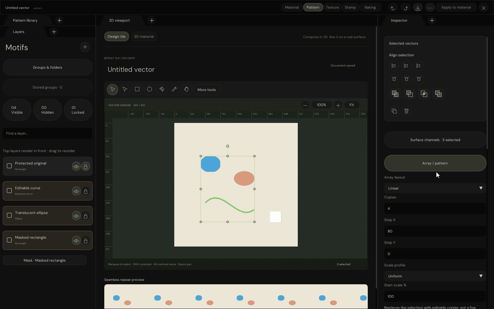

# Pattern completion work · clipboard and layer order

Pattern Studio remains in progress. This checkpoint ports the session clipboard, independent duplication,
Select All and layer-stack commands. It does not mark the full workspace complete or start Stamp.

| Implemented control                 | Native behaviour |
| ----------------------------------- | ---------------- |
| Copy / Ctrl or Command C             | Read-only editable source snapshot; no history edit |
| Cut / Ctrl or Command X              | Copy and remove editable selection atomically |
| Paste / Ctrl or Command V            | Fresh layer/group identities, 18-unit offset |
| Paste in place / modified Shift V    | Same coordinates, fresh identities |
| Duplicate / Ctrl or Command D        | Independent copy; does not overwrite the clipboard |
| Select All / Ctrl or Command A       | Visible, unlocked sources only |
| `[` / `]`                           | One step backward / forward |
| Shift `[` / `]`                     | Send to back / bring to front |
| Document actions menu               | Matching native controls with the shared dropdown style |

The clipboard is local to the editor instance, persists across document changes in that instance, and is not
saved to disk or sent to the operating-system clipboard. This matches the HTML editor's clipboard scope.
Keyboard commands do not intercept text editing, pending Pen work or active transform gestures.

## Preserved semantics

- Primitive and cubic source, Boolean expressions, owned masks and their modes, channel contributions,
  visibility and enclosing-group ancestry remain editable; no evaluated images replace source.
- New groups/layers receive fresh identities. Fresh copies are unlocked; original protection remains unchanged.
- Copy/paste preserves relative stacking. Stack commands preserve the internal order of selected/unselected sets.
- Copied captions are distinct without renaming original layers. UTF-8 stems are not split mid-codepoint.
- Invalid source, nonfinite offsets, exhausted identities and storage budgets refuse without partial mutation.
- Cut, paste, duplication and stack changes are undoable with their selections; boundary no-ops add no history.
- Unused curve storage is reclaimed during transfer, including repeated cut/paste and owned cubic mask references.

## Actual native evidence



The GIF shows native menu Copy, paste, send-to-back, Cut, Undo/Redo and paste in place.
Additional automated input checks cover protected sources, cross-document paste, Command-key equivalents,
independent duplication and no-op stacking.

The [earlier HTML evidence page](../SpaceFormats/index.html#PatternNativeMotion) embeds the current GIF and
labelled historical recordings. Its original five tabs and 43 capture choices remain available.
Static review server: port **8765**. No pixel stream was started or refreshed.

## Validation

| Automated validation                  | Result |
| ------------------------------------- | ------ |
| Native UI/input/GPU checks             | 606 normal / 606 ASan+UBSan |
| Focused native clipboard checks        | 16 in each run |
| Shared selection/transfer/stack checks | 1,431 normal / 1,431 ASan+UBSan |
| Windows translation-unit compilation   | 22; not application linking or execution |
| Native GIF                            | 222 captured frames → 26 encoded frames |

This is actual C++ ImGui input/cursor output with software-Vulkan canvas coverage and CPU-captured UI triangles.
It is not a browser authoring mockup, physical Windows-window capture or hardware-GPU validation.

- [Native results and source/compiler provenance](Results/NativePatternWorkspaceChecks.json)
- [Native sanitizer results](Results/NativePatternWorkspaceSanitizedChecks.json)
- [Shared source-operation results](Results/VectorSelectionChecks.json)
- [Current motion/source/executable fingerprints](Results/NativePatternClipboardMotionChecks.json)
- [Evidence-page embedding checks](Results/NativePatternEvidencePageChecks.json)
- [Browser GIF decoding and navigation checks](Results/NativePatternEvidenceBrowserChecks.json)

## Reproduction

With the existing pinned UI/font dependencies, compiled vector shaders and software-Vulkan runtime:

```bash
python3 Exhibits/TextureStudio/Code/VerifyVectorSelection.py
python3 Exhibits/TextureStudio/Code/VerifyPatternWorkspace.py \
  --driver /tmp/libvk_swiftshader.so \
  --shader _ClaudeScratch/build/VectorAuthoringEditing/ShaderArchives/VectorCoverageCompute.spv \
  --windows-tools _ClaudeScratch/tmp/PatternPython
python3 Exhibits/TextureStudio/Code/VerifyPatternWorkspace.py \
  --driver /tmp/libvk_swiftshader.so \
  --shader _ClaudeScratch/build/VectorAuthoringEditing/ShaderArchives/VectorCoverageCompute.spv \
  --sanitizers --build-directory _ClaudeScratch/build/PatternWorkspaceSanitized
_ClaudeScratch/build/PatternWorkspace/PatternWorkspaceValidation \
  /tmp/libvk_swiftshader.so \
  _ClaudeScratch/build/VectorAuthoringEditing/ShaderArchives/VectorCoverageCompute.spv \
  EngineContent/FontArchives/DMSans/DMSans-Regular.ttf \
  _ClaudeScratch/build/ClipboardMotion --animate-clipboard
PYTHONPATH=_ClaudeScratch/tmp/PatternPython \
  python3 Exhibits/TextureStudio/Code/EncodeNativePatternMotion.py \
  --captures _ClaudeScratch/build/ClipboardMotion --caption NativePatternClipboard \
  --executable _ClaudeScratch/build/PatternWorkspace/PatternWorkspaceValidation
python3 Exhibits/TextureStudio/Code/EmbedNativePatternEvidence.py
```

Use `Code/ServeReview.py` under the SpaceFormats exhibit to serve the existing review. With local Node/Chromium
packages and libraries available through `NODE_PATH` / `LD_LIBRARY_PATH`, run `VerifyNativeEvidencePage.cjs`
and the existing `SpaceFormats/Code/ReviewValidation.cjs`. Builds/raw captures remain in ignored scratch paths.

## Completion still requires

- Broader joins, advanced segment constraints/smoothing, cross-path/marquee point editing and remaining gestures.
- Text, SVG, image and freehand authoring; presets/defaults and complete group-aware arrangement/distribution.
- Complete group editing, stored/linked definitions, mask isolation, painted/image masks and independent strokes.
- GPU material channels, height/normal output, 3D preview, material application and export.
- Final layout/icon/typography/responsive parity, detached GPU safety and linked Windows/native acceptance.

Stamp remains paused. No Actions, package, commit, push or release; glint defaults and hair scope are unchanged.
