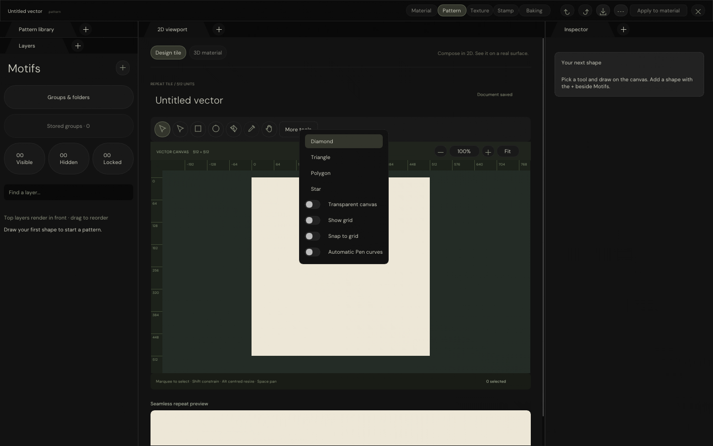
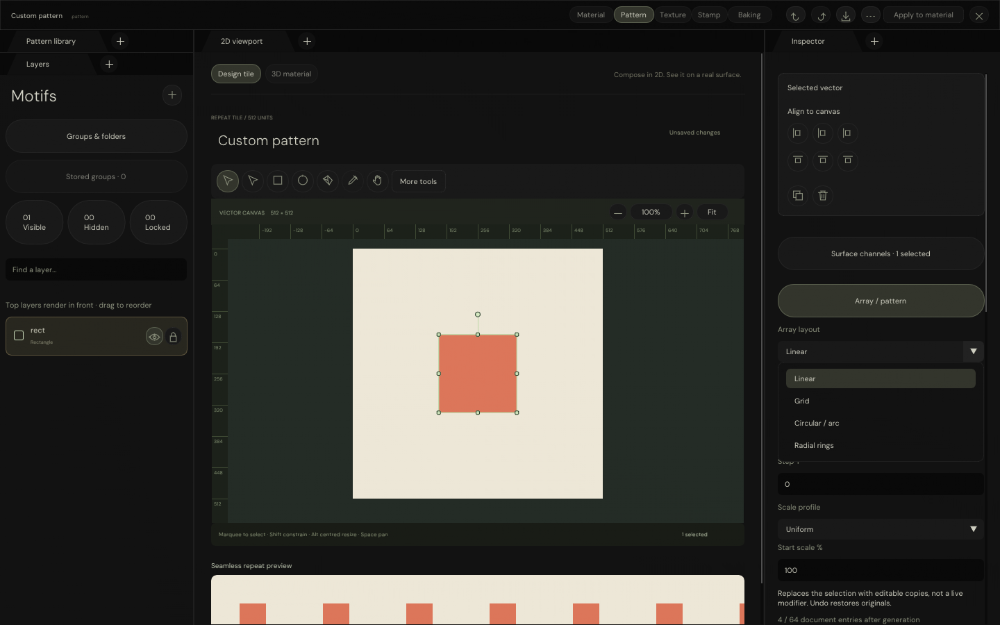
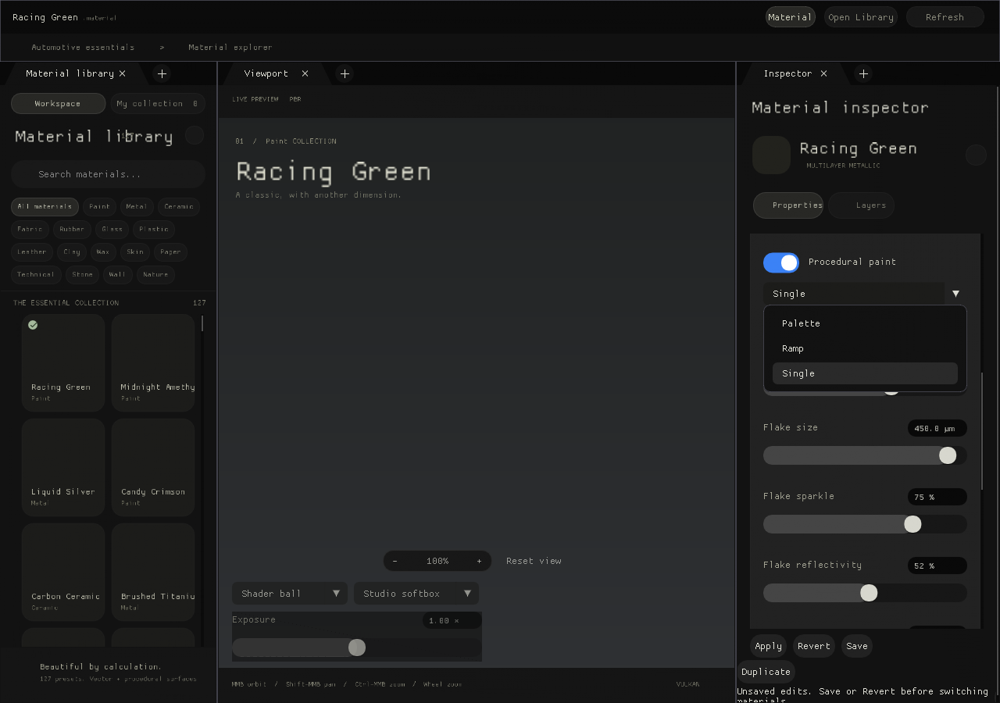

# One native dropdown style

Selection lists, action menus and context menus now share subtly rounded backgrounds, internal padding
and rounded selection rows. Long toggle captions expand the menu instead of being clipped.

| Shared geometry at scale 1 | Size |
| -------------------------- | ---- |
| Popup corner radius        | 8 px |
| Row corner radius          | 6 px |
| Internal padding           | 12 × 10 px |
| Row height / spacing       | 28 / 4 px |

## Coverage

- `Engine/Interface/DropdownControls.h` supplies native selection, action and context-menu rendering.
- Material, vector masks and Pattern controls consume that shared surface rather than local dropdown styles.
- `ControlKitTokens` owns the geometry for both native ImGui and the existing PixelSpace dropdown renderer,
  including editor Appearance and Content Browser consumers. These remain two rendering paths, not two styles.
- Backgrounds are opaque and themed; hovered/selected rows are rounded and internally padded.
- Colour pickers and modal dialogs retain their purpose-specific layouts; intentional pill controls are unchanged.
- `CLAUDE.md` records the shared-style rule. The audit rejects direct native combo bypasses in Engine/UI.

## Validation

| Automated validation                         | Result |
| -------------------------------------------- | ------ |
| Native Pattern UI, input and GPU-backed tests | 454 passed |
| Pattern ASan / UBSan                         | 454 passed |
| Focused dropdown tests in each Pattern run   | 33 passed |
| Material normal / ASan / UBSan               | 343 / 343 passed |
| Windows translation-unit cross-compilation  | 22 passed; not Windows execution |
| Native HTTP transport                        | 14 passed |
| Browser pointer / keyboard transport         | Passed |
| Shared-style audit                           | Passed; five captures fingerprinted |

Tests cover shared geometry at three scales, selection, action menus, dismissal, PixelSpace hit testing
and long-caption fit. The test host now enables keyboard navigation like the production host, so Escape
exercises native ImGui dismissal. The large sanitizer fixture uses minimal debug metadata to avoid GCC's
variable-tracking retry; address/undefined-behaviour instrumentation remains enabled.

## Actual C++ captures

Action menu, including the previously clipped toggle captions:



Selection list:



Material selection uses the same geometry:



Additional captures: [Add motif](Images/NativeDropdownAddMotif.png),
[Document actions](Images/NativeDropdownDocument.png).

These are actual ImGui captures, not an HTML reconstruction. Pattern uses software-Vulkan canvas coverage
and captured native UI triangles; Material evidence exercises CPU-rendered ImGui controls, not its PBR preview.
No physical Windows-window execution or hardware-GPU validation is claimed.

The updated native pixel-stream preview runs on **8779**. Existing previews on 8776–8778 are preserved.
Its browser surface relays input to C++; it does not recreate dropdowns in HTML.

## Reproduction

From repository root, with the existing local compiler, font, shader and software-Vulkan dependencies:

```bash
python3 Exhibits/TextureStudio/Code/VerifyPatternWorkspace.py \
  --driver /tmp/libvk_swiftshader.so \
  --shader _ClaudeScratch/build/VectorAuthoringEditing/ShaderArchives/VectorCoverageCompute.spv \
  --windows-tools _ClaudeScratch/tmp/PatternPython
python3 Exhibits/TextureStudio/Code/VerifyPatternWorkspace.py \
  --driver /tmp/libvk_swiftshader.so \
  --shader _ClaudeScratch/build/VectorAuthoringEditing/ShaderArchives/VectorCoverageCompute.spv \
  --sanitizers --build-directory _ClaudeScratch/build/PatternWorkspaceSanitized
python3 Exhibits/TextureStudio/Code/VerifyMaterialLibrary.py \
  --destination _ClaudeScratch/build/DropdownMaterialLibrary
python3 Exhibits/TextureStudio/Code/VerifyDropdownStyle.py
python3 Exhibits/TextureStudio/Code/VerifyNativePatternStream.py --url http://127.0.0.1:8779
node Exhibits/TextureStudio/Code/VerifyNativePatternBrowser.mjs http://127.0.0.1:8779
```

Transport tests mutate their target test document; do not run them against unsaved user work.
The preview is supplied by `Code/ServeNativePattern.py` with the current native validation executable.

- [Pattern results and source fingerprints](Results/NativePatternWorkspaceChecks.json)
- [Pattern sanitizer results](Results/NativePatternWorkspaceSanitizedChecks.json)
- [Material results](Results/MaterialLibraryChecks.json)
- [Shared geometry, source and capture fingerprints](Results/DropdownStyleChecks.json)
- [HTTP transport](Results/NativePatternStreamChecks.json)
- [Browser transport](Results/NativePatternBrowserChecks.json)

Full Pattern parity remains open; broader joins are next and Stamp remains deferred. Glint defaults and
hair scope are unchanged. No GitHub Actions, package, commit, push or release was performed.
