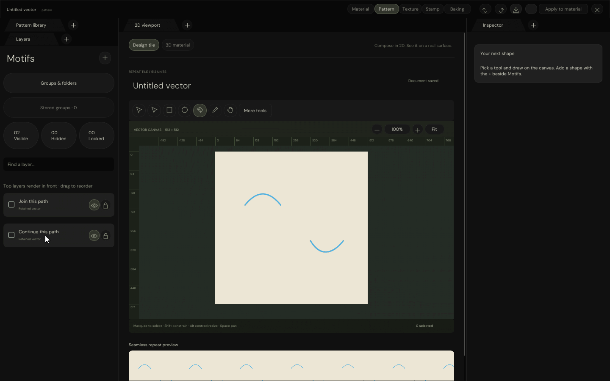

# Native Pen endpoint joining

Continue a retained open path, optionally place more anchors, then click another open endpoint to join.
Continuation and joining finalize as one undoable edit. Ctrl-click bypasses joining; Escape cancels the draft.

| Validation                                  | Result |
| ------------------------------------------- | ------ |
| Native UI / input / GPU-backed checks        | 585 passed |
| ASan / UBSan native checks                   | 585 passed |
| Focused endpoint-join checks, each run        | 102 passed |
| Existing Inspector join checks, each run     | 52 passed |
| Windows translation units                   | 22 compiled; not linked or executed |
| Actual native motion                        | 185 captures → 45 GIF frames |
| Earlier HTML evidence page                  | Three GIFs decoded and hashed in Chromium |
| Original HTML evidence navigation           | Five tabs and 43 capture choices retained |

## Actual C++ interaction



The same GIF is embedded in the [earlier native-evidence HTML](../SpaceFormats/index.html#PatternNativeMotion).
Two earlier GIFs remain available there under explicitly historical labels; the original evidence is preserved.
A static HTML review server runs on port **8765**. No pixel-stream process was started or refreshed.

The recording shows actual C++ mouse input/cursor, ImGui triangles and software-Vulkan canvas coverage.
It is not an HTML authoring reconstruction, physical Windows-window capture or hardware-GPU execution.
The capture fixture now handles ImGui's dynamic font textures individually, without rebuilding the legacy
atlas after draw-command UVs have been recorded; this fixes missing letters in late test captures.

## Behaviour and boundaries

| Interaction / condition                     | Behaviour |
| ------------------------------------------- | --------- |
| All four start/end combinations             | Same result as shared `IntegrateCubicPaths` |
| Direct join or join after extending          | One history edit; retained token and selection |
| Coincident endpoints                        | One shared anchor, original used controls preserved |
| Disjoint endpoints                          | Straight bridge, original segments preserved |
| Ctrl-click on another endpoint              | Ordinary anchor placement; no automatic consumption |
| Escape / Undo / Redo                        | Exact source restoration tested |
| Hidden, closed or compound contours         | Not exposed as endpoint targets |
| Masks, gradients, transparency              | Refused without changing source or pending draft |
| Non-adjacent / mismatched styles or channels | Refused without changing stacking or contributions |
| Protected target                            | Refused without consuming its source |

This uses the existing shared atomic join operation, not a second geometry implementation. It does **not**
add broader masked, gradient, translucent or non-adjacent joining. Full Pattern parity remains open;
Stamp remains deferred. Existing endpoint-start, tangent, placement and dropdown regressions remain covered.

## Reproduction

Use the repository's pinned UI dependencies, DM Sans fonts, software-Vulkan driver and compiled vector shaders.
Build products and raw frames stay in ignored scratch directories.

```bash
python3 Exhibits/TextureStudio/Code/VerifyPatternWorkspace.py \
  --driver /tmp/libvk_swiftshader.so \
  --shader _ClaudeScratch/build/VectorAuthoringEditing/ShaderArchives/VectorCoverageCompute.spv \
  --windows-tools _ClaudeScratch/tmp/PatternPython
python3 Exhibits/TextureStudio/Code/VerifyPatternWorkspace.py \
  --driver /tmp/libvk_swiftshader.so \
  --shader _ClaudeScratch/build/VectorAuthoringEditing/ShaderArchives/VectorCoverageCompute.spv \
  --sanitizers --build-directory _ClaudeScratch/build/PatternWorkspaceSanitized
_ClaudeScratch/build/PatternWorkspace/PatternWorkspaceValidation \
  /tmp/libvk_swiftshader.so \
  _ClaudeScratch/build/VectorAuthoringEditing/ShaderArchives/VectorCoverageCompute.spv \
  EngineContent/FontArchives/DMSans/DMSans-Regular.ttf \
  _ClaudeScratch/build/EndpointJoinMotion --animate-endpoint-join
PYTHONPATH=_ClaudeScratch/tmp/PatternPython \
  python3 Exhibits/TextureStudio/Code/EncodeNativePatternMotion.py \
  --captures _ClaudeScratch/build/EndpointJoinMotion --caption NativePatternEndpointJoin \
  --executable _ClaudeScratch/build/PatternWorkspace/PatternWorkspaceValidation
python3 Exhibits/TextureStudio/Code/EmbedNativePatternEvidence.py
python3 Exhibits/SpaceFormats/Code/ServeReview.py --port 8765
```

The final command starts the static review server. In another terminal, browser verification uses the existing
local Chromium libraries and Node packages; `NODE_PATH` and `LD_LIBRARY_PATH` must point to those dependencies:

```bash
node Exhibits/SpaceFormats/Code/ReviewValidation.cjs
node Exhibits/TextureStudio/Code/VerifyNativeEvidencePage.cjs http://127.0.0.1:8765
python3 Exhibits/TextureStudio/Code/VerifyDropdownStyle.py
```

- [Native tests, build commands and source fingerprints](Results/NativePatternWorkspaceChecks.json)
- [Sanitizer tests and source fingerprints](Results/NativePatternWorkspaceSanitizedChecks.json)
- [Motion, executable, source and GIF fingerprints](Results/NativePatternEndpointJoinMotionChecks.json)
- [Embedded evidence page](Results/NativePatternEvidencePageChecks.json)
- [Chromium evidence-display checks](Results/NativePatternEvidenceBrowserChecks.json)
- [Existing dropdown style audit](Results/DropdownStyleChecks.json)

Earlier pixel-stream transport reports are historical, not current-build validation. No GitHub Actions,
package, commit, push or release was performed. Glint defaults and hair scope are unchanged.
