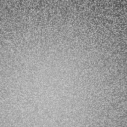
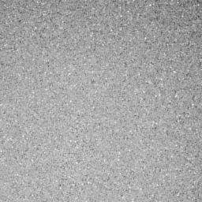
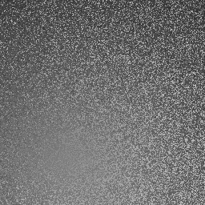

# Isolated glint speed comparison

**2026-10-19 · Executed software-Vulkan tests, not hardware-GPU or Windows performance. Hair skipped.**

Cellular was fastest in these fixed fixtures; Chermain followed, then the Glinty adaptation. This does **not**
establish the fastest production glint method: the models, appearance and rendering responsibilities differ.
No production shader, material default, memory setting or preset was changed.

## Measured comparison

**Median milliseconds per draw; run 1 / independent repeat. Lower is faster.** Each median uses seven measured
samples after two warmups. The raster floor uses the same target and a trivial gradient, not a glint shader.

| Extent | Natural log density | Cellular, 3 layers | Chermain adaptation | Glinty adaptation | Raster floor |
|---|---:|---:|---:|---:|---:|
| 128 × 128 | 20 | 18.54 / 18.55 | 20.67 / 18.41 | 21.28 / 22.40 | 0.26 / 0.24 |
| 128 × 128 | 26 | 16.72 / 18.25 | 17.77 / 18.73 | 19.63 / 20.82 | 0.24 / 0.32 |
| 256 × 256 | 20 | 69.55 / 70.61 | 74.39 / 73.72 | 85.53 / 83.07 | 0.69 / 0.60 |
| 256 × 256 | 26 | 70.03 / 68.67 | 71.75 / 72.32 | 78.62 / 78.84 | 0.67 / 0.65 |

| Candidate | Local finding | Evidence boundary |
|---|---|---|
| 🥇 Cellular adapter | Lowest medians in the retained fixtures | Property generation, not a physical glint NDF |
| 🥈 Chermain 2020 | Faster than this Glinty adaptation | Original MIT shader adapted to WebGL2 |
| 🥉 Glinty adaptation | No speed advantage demonstrated here | Third-party GGX adaptation, not authors' shader |
| Loubet 2020 | **Not executed; no speed rank** | Slope-space transport needs a different renderer/test |

**Recommendation:** retain cellular compatibility and do not switch defaults on an FPS claim. Keep Glinty as a
candidate for the requested new-component default, pending authentic-reference, hardware and environment-light
validation. Chermain's local result warrants that comparison; it does not remove the original method's lighting
limitations. Close cellular/Chermain timings and overlapping sample tails are not robust universal rankings.

## What actually ran

- Chromium `133.0.6943.0`, ANGLE → Vulkan 1.3 → **SwiftShader Device (Subzero)**, Intel Xeon @ 2.60 GHz.
  No hardware GPU is exposed here. These milliseconds are not predicted RTX/Radeon frame times or FPS.
- `EXT_disjoint_timer_query_webgl2` surrounds one full-screen triangle draw into an `RGBA32F` target.
  Queries must become available, remain nondisjoint and report positive durations. They measure this software
  device's execution intervals, **not hardware GPU performance**. Shader compilation/readback are outside them.
- An exploratory CPU `performance.now`/`gl.finish` measurement returned zero submission intervals and was
  rejected. It is not the reported timing method. Case order rotates between repetitions to reduce order bias.
- Two extents, two densities, fixed roughness `0.3`, UV domain `[0,1]²`, common view/light-direction fixture,
  one unshadowed white point-light direction per fragment, no diffuse/environment/coat/temporal reconstruction.
  A tiny phase change prevents relying on unchanged draw contents. Captures use phase zero.
- Cellular uses the current source's 3D nearest-cell search, three flake layers, noise and derived normal,
  with a fixed single-colour fixture and a simple GGX lighting wrapper. **Its density is unchanged** between
  the two density rows: these repeat the same cellular control while changing the NDF methods' facet density.
- Glinty evaluates GGX; Chermain evaluates Beckmann. Both use unit Fresnel and the reference V-cavity factor.
  The fixed cellular configuration can be compiler-specialized. These are **not image-matched or equal-quality
  full-material replacements**, nor the full Frontier Vulkan/Slang pipeline. Property generation is normally
  reused across lights, whereas a view/light-dependent NDF is evaluated during lighting.
- All 16 method/fixture combinations per run produced finite, nonnegative, nonconstant pixels with full alpha
  coverage. All source fingerprints and three capture hashes match both runs. Raw samples and maximum observed
  sample durations (`p95_ms`, nearest-rank percentile with seven samples) remain in the JSON reports.

## Source and resource audit

| Input | Pinned source | Licence / adaptation |
|---|---|---|
| Chermain | `ASTex-ICube/real_time_glint`, `96c08fdff986e9eb83509850770b4946d829bcea` | MIT; notice retained |
| Glinty | `Gistix/CreationEngineRaytracing`, `0ca4ab63223f2a836413daab9ab05cf4d29a8591` | GPL-3.0; scratch only |
| Cellular | `Engine/Render/Shader/AutomotivePaint.slang` | Existing Frontier source, not modified |

- Chermain: explicit GLES numeric conversions; 1D-array lookup replaced by a 2D atlas sampled at row centres;
  original 1,024 RGB EXRs loaded in the reference level/distribution order. `RGB16F` logical dictionary payload
  is **393,216 bytes (384 KiB)**; the upload buffer is float32. Logical payload is not measured physical VRAM.
- Glinty: HLSL syntax translated to GLSL without intentionally replacing its algorithm. The square, axis-aligned
  footprint avoids differing row/column Jacobian conventions. This is a third-party implementation, not a
  verified reproduction of every feature/result in the authors' paper. GPL source/generated shaders remain in
  ignored scratch; nothing was copied into the production renderer. Production licensing still needs review.
- The proposed **25,000,000-byte shared glint-resource cap remains a proposal**, not an implemented allocation
  or performance guarantee. Hair/fibres are excluded from this work.
- Loubet concerns specular-next-event/slope-space transport, not an interchangeable fragment NDF. There is no
  honest same-shader number to insert. A separate equal-error transport benchmark remains open.

## Actual shader readback images

These grayscale, gamma-encoded displays come from the float framebuffer. Different appearances are intentional
and demonstrate why this comparison must not be mistaken for matched visual quality.

**Glinty third-party adaptation**



**Chermain reference adaptation**



**Current cellular adaptation**



## Reproduction and evidence

Pinned external sources and generated shaders/dictionary stay under `_ClaudeScratch`, not production directories.
Preparation requires the pinned MIT reference clone, the pinned GPL shader, OpenEXR/numpy in `GlintPython`;
execution uses the existing `PatternTools` Chromium/puppeteer dependencies and native browser libraries.

```bash
PYTHONPATH=_ClaudeScratch/tmp/GlintPython python3 Exhibits/TextureStudio/Code/PrepareGlintComparison.py \
  --chermain _ClaudeScratch/tmp/GlintReference --glinty _ClaudeScratch/tmp/GlintyReference.hlsli \
  --destination _ClaudeScratch/build/GlintComparison
node Exhibits/TextureStudio/Code/VerifyGlintComparison.mjs _ClaudeScratch/build/GlintComparison
node Exhibits/TextureStudio/Code/VerifyGlintComparison.mjs _ClaudeScratch/build/GlintComparison \
  Exhibits/TextureStudio/Results/GlintComparisonRepeatChecks.json
```

- Reference repositories: <https://github.com/ASTex-ICube/real_time_glint> and
  <https://github.com/Gistix/CreationEngineRaytracing>.
- [Primary measurements and source/capture fingerprints](Results/GlintComparisonChecks.json)
- [Independent repeat and raw timing samples](Results/GlintComparisonRepeatChecks.json)
- [Paper findings and budget proposal](../../Documentation/Plans/Ongoing/MaterialGlintResearch.md)

**Still needed before production choice:** authentic Glinty reference/licence, matched Beckmann/GGX appearances,
more roughness/coverage/anisotropy/motion cases, equal-error convergence, real Windows GPU timestamps, full
lighting-loop/layer integration and end-to-end material-preview timing. Pattern continues first; Stamp is deferred.


## Parallel Pattern progress

Space-during-Pen-drag repositioning is implemented and tested: the newest anchor/controls move together;
release restores tangent shaping, retained resume endpoints stay protected, and history/cancel remain atomic.
383 native checks pass normally and under ASan/UBSan, including 10 placement checks. All 22 Windows translation
units compile; this is not Windows execution. Native HTTP/browser input checks passed; port 8777 runs the current
C++ pixel stream. Full Pattern parity remains open, and Stamp is deferred.

[Actual C++ cursor/input/Vulkan placement GIF](Images/NativePatternPenPlacement.gif): 167 captures, 42 encoded
frames. No HTML reconstruction of the workspace controls. No package, Actions, commit, push or release.
