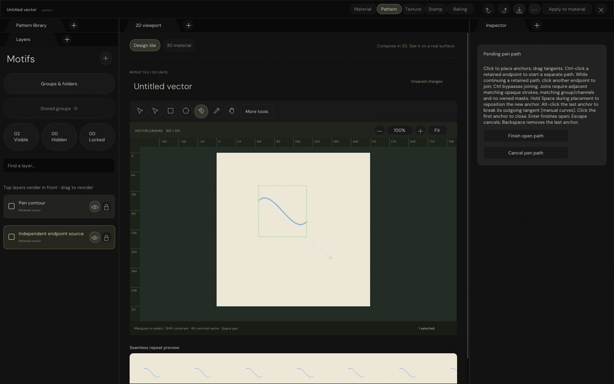

# Native Pattern — independent endpoint start

**2026-10-19 · Ctrl-click endpoint modifier implemented and locally verified.**

With the Pen tool and an existing open path selected, Ctrl-click either retained endpoint to begin a separate
path there. A normal endpoint click still resumes the original. Ctrl is needed only for the starting click;
release it and continue placing anchors normally.

## Behaviour and verification

| Concern | Verified result |
|---|---|
| Start / end endpoint | Both start a separate pending path under Ctrl |
| Original path | Geometry, layer identity and appearance unchanged |
| New path | Distinct layer identity; no duplicate anchors |
| Preview | No history entry until finalization |
| Enter / Undo / Redo | One finalized edit; restore the exact original / two-path document |
| Escape | Discard the separate path without changing the original |
| Normal endpoint click | Existing continuation remains functional |
| Native strict validation | 445 checks passed, including 22 focused endpoint checks |
| ASan / UBSan validation | 445 checks passed, including the same 22 endpoint checks |
| Windows cross-compilation | 22 translation units passed; no application linking or Windows execution |
| Native HTTP transport | 14 checks passed |
| Browser pointer/keyboard transport | Passed against the current executable |

Existing Alt-independent tangent and Space-placement behaviour also remains covered by the native suite.
The source fixture uses translucent coloured strokes to check preservation independently of the new path's
appearance. This is separate-path authoring, **not** a broader join implementation or a claim of matching paints.

## Actual native evidence

Two outliner entries and the unchanged blue source curve distinguish the retained path from the new pending
white path. The Inspector describes the Ctrl modifier.



The updated native pixel-stream preview runs on port 8778. Existing previews on 8776 and 8777 were not restarted
or reset in this increment. Browser controls relay input to C++; they do not reconstruct the workspace in HTML.
Evidence uses captured ImGui triangles and software-Vulkan coverage, not a physical Windows window or hardware
GPU validation. Previous GIFs/reports remain historical checkpoints, not current-source motion evidence.

## Reproduction and provenance

Run from repository root with the restored native dependencies, DM Sans archive, local software Vulkan driver,
compiled vector/selection shader archives, g++ and the existing Windows cross-compilation tools available.

```bash
python3 Exhibits/TextureStudio/Code/VerifyPatternWorkspace.py \
  --driver /tmp/libvk_swiftshader.so \
  --shader _ClaudeScratch/build/VectorAuthoringEditing/ShaderArchives/VectorCoverageCompute.spv \
  --windows-tools _ClaudeScratch/tmp/PatternPython
python3 Exhibits/TextureStudio/Code/VerifyPatternWorkspace.py \
  --driver /tmp/libvk_swiftshader.so \
  --shader _ClaudeScratch/build/VectorAuthoringEditing/ShaderArchives/VectorCoverageCompute.spv \
  --sanitizers --build-directory _ClaudeScratch/build/PatternWorkspaceSanitized
python3 Exhibits/TextureStudio/Code/VerifyNativePatternStream.py --url http://127.0.0.1:8778
node Exhibits/TextureStudio/Code/VerifyNativePatternBrowser.mjs http://127.0.0.1:8778
```

Transport commands require the native stream already running, as supplied by `Code/ServeNativePattern.py`.
These automated checks edit that stream's test document; do not target a preview holding unsaved user edits.
The endpoint-specific behaviour is exercised automatically by the C++ validation executable.

- [Native results, build commands, platform/compiler and source fingerprints](Results/NativePatternWorkspaceChecks.json)
- [Sanitizer results and fingerprints](Results/NativePatternWorkspaceSanitizedChecks.json)
- [HTTP transport results](Results/NativePatternStreamChecks.json)
- [Browser transport results](Results/NativePatternBrowserChecks.json)

All current source fingerprints were checked. Changes remain uncommitted on the existing session branch.
No glint default/shader/resource changes, hair work, GitHub Actions, package, commit, push or release.

**Next:** further join interaction and semantics-preserving broader joins. Full Pattern parity remains open;
Stamp is still deferred.
