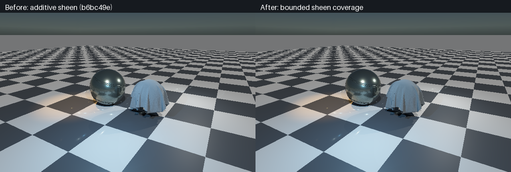

# Material energy allocation — scoped acceptance

**The original three excess fixtures are corrected in native C++ and actual shared Slang.** Cellular paint and all 399 archived material files remain intact. This is acceptance of the tested **isotropic Schlick/default-specular path**, not the entire material library or renderer.

## Actual before / after



Left: committed `b6bc49e` capture. Right: fresh native Vulkan capture, identical specimen geometry, materials, lighting, camera and display transform. Only the comparison labels/layout are added; pixels are not relit or enhanced. The retained denim changes modestly, becoming less bright where the former additive sheen spent energy twice; the extreme stress-fixture numbers do not describe this preset. This conservative fuzz mixture is **not** a complete fibre/multiple-scattering cloth model.

[Fresh vehicle, detail and specimen renders](../LightCompute/MaterialScene.md) retain green cellular clearcoat, thin transmitting windows, BVH mirrors, plastic depth-screen reflections and baked rubber. Both analytic and emissive lighting remain available; clouds/fog are disabled only for these material-isolation captures.

## Executed acceptance

Device: **SwiftShader Device (Subzero), Vulkan CPU software device, Linux**. Native C++ uploads fixtures, actual compiled Slang integrates the shared evaluator, and native C++ checks readback. No physical RTX/GTX, Windows or editor-viewport execution is claimed.

| Check | Before | Corrected |
|---|---:|---:|
| Original 24 native fixtures, energy >1.02 | 3 | **0** |
| Original 24 native maximum reflectance | 1.36977433 | **0.91952947** |
| Expanded 384 native fixtures, energy >1.02 | Not the historical diagnostic | **0** |
| Expanded native maximum / final quadrature delta | — | **1.00095336 / 0.00561955** |
| Actual Vulkan, 34 fixtures, energy >1.02 | 9 | **0** |
| Vulkan maximum reflectance | 19.1046 | **0.919532** |
| Current Vulkan/native maximum RGB error | Not checked for original negative control | **0.000864936**, limit 0.001 |
| Standalone native energy ASan / UBSan | — | **384 pass**, no sanitizer errors |
| Native finite / nonnegative / reciprocity | Original 24 pass | **384 pass**, absolute reciprocity tolerance 1e-10 |

The 19.1046 result belongs to a deliberately extreme grazing-fuzz fixture with tint `(1,2,0.5)`, **not a measured archived preset**. The original shared shader is extracted from pinned `b6bc49e` and compiled against the same kernel: it reproduces exactly the original three failures among the first 24 cases, plus six added fuzz failures. Its `native_max_rgb_error=0` field is unused, **not original-shader/native parity evidence**.

**Numerical acceptance is ≤1.02, not exact ≤1:** the native maximum is approximately 0.095% above unity. Zero excess means zero above the declared numerical limit. Refinement and finite sampling are not a mathematical guarantee over every authoring parameter.

| Native fixture group | Count | Coverage |
|---|---:|---|
| White isotropic | 270 | Roughness 0.045–1; view cosine 0.01–1; IOR 1/1.5/3; metal 0/0.5/1 |
| Fuzz coverage | 72 | Sheen roughness 0–1; view cosine 0.005–1; strength 0.5/1; tint `(1,2,0.5)` |
| Two-stratum coat | 18 | Coverage 0.25/1; roughness 0.045/0.35/0.8; view cosine 0.01/0.25/1 |
| Eight-stratum stack | 24 | Seven coats, alternating full/half coverage; three roughnesses; four views; zero/finite absorption |

Native acceptance uses deterministic cosine/GGX/**Charlie** mixture quadrature at 64² → 128² samples per proposal, refining to 256² if delta >0.005; it fails on energy >1.02, final delta >0.01, invalid/negative scattering or failed reciprocity. The Charlie proposal is essential for narrow grazing fuzz; it was added instead of loosening convergence tolerance. The separate Vulkan test uses uniform 256² hemisphere quadrature and a corresponding independent scalar calculation: 24 retained fixtures, six extreme fuzz fixtures and four eight-stratum stacks. It is a parity/negative-control test, not a replacement for the importance-resolved native coverage.

## Allocation changes

| Mechanism | Correction |
|---|---|
| Diffuse interfaces | Replace half-vector `1−F` with paired normal-angle `(1−F(light)) (1−F(view))` |
| Fuzz budget | Per-channel `q = clamp(tint,0,1) × strength`; `(1−q) × opaque + q × bounded sheen` |
| Charlie/Ashikhmin lobe | Analytic reciprocal normalization below; no final output clamp |
| Coating reciprocity | Multiply entrance/exit factors together before applying incoming scattering; avoids one-ULP asymmetry in very sharp eight-coat tests without relaxing tolerance |
| Zero fuzz | Skip sheen normalization/distribution when coverage is zero; no measured speedup claimed |
| Storage | No ABI/resource/LUT changes; no archive edits or library replacement |

Authoring semantics change intentionally: sheen tint above one remains accepted by the existing material format but no longer amplifies reflected energy beyond unit coverage. Appearance therefore changes, especially in the former bright fuzz rim.

### Standalone sheen bound

Let `n = 1/max(sheenRoughness², 0.001)`, `r = sqrt(n/8)`, and `B = (n+2) atan(r)/(4r)`. Scale the Charlie/Ashikhmin lobe by `1/max(1,B)`.

For upper-hemisphere unit light/view directions, `N·H ≥ (N·L)/2`. Therefore
`sin(θh)^n ≤ exp(−n(N·L)²/8) ≤ 1/(1+n(N·L)²/8)`.
Charlie gives `D ≤ (n+2)/(2π)/(1+n(N·L)²/8)`; Ashikhmin gives `V(N·L) ≤ 1/4`.
The existing sine-squared floor `1/128` also respects the inequality because it is below `1−(N·L)²/4` over this hemisphere. Integrating this upper bound over the hemisphere yields `B`. The scale is independent of light/view exchange and bounds the **standalone sheen** contribution. It can be conservative, particularly for smooth fuzz; it is not an analytic completeness result for every coated or exact-Fresnel model.

## Reproduction and raw evidence

```bash
# Restore pinned tools first if absent:
python3 Exhibits/LightCompute/Code/Prepare.py
bash Exhibits/LightCompute/RunMaterialScene.sh
bash Exhibits/LightCompute/RunMaterialEnergy.sh
python3 Exhibits/LightCompute/Code/MaterialEnergyImages.py
# Optional independent standalone memory/undefined-behaviour check used here:
c++ -std=c++20 -O1 -g -Wall -Wextra -Werror -fsanitize=address,undefined \
  -fno-omit-frame-pointer -I. Exhibits/TextureStudio/Code/MaterialEnergyValidation.cpp \
  -o _ClaudeScratch/build/MaterialEnergySanitizer
ASAN_OPTIONS=detect_leaks=1 _ClaudeScratch/build/MaterialEnergySanitizer \
  Exhibits/TextureStudio/Results/MaterialEnergySanitizer.txt
```

- [384-case standalone ASan/UBSan run](Results/MaterialEnergySanitizer.txt); this does not sanitize the whole Vulkan application.
- [384-case native acceptance](Results/MaterialEnergyAcceptance.txt), [current original-24 diagnostic](Results/MaterialEnergyCurrent.txt).
- [Actual Vulkan original negative control](Results/MaterialEnergyGpuOriginal.txt), [current Vulkan/native parity](Results/MaterialEnergyGpuCurrent.txt).
- [Machine-readable scope, results and hashes](Results/MaterialEnergy.json).
- [Original historical diagnostic](MaterialEnergy.md), [current material-source identity audit](MaterialReuse.md).
- [Fresh scene checks](../LightCompute/Results/MaterialScene.json), [compilation/native/legacy verification](../LightCompute/Results/MaterialVerification.json).

## Boundaries

Not accepted here: anisotropy, exact-Fresnel/specular-strength combinations, every archive preset, the analytic environment approximation, the independent compact legacy BRDF, solid-volume refraction, full sampler/PDF/temporal stability, or physical RTX/GTX/Windows/viewport execution. Production material shaders compile after the shared correction; compilation alone does not validate all their optional modes. Existing legacy transport regression remains separate.

The linked branch audit now reports **448/455 identical**, including **399/399 archived assets**. Four intentional optical-source differences coexist with three retained unrelated vector ABI differences. Production material SPIR-V intentionally differs from the pre-energy checkpoint; the prior byte-identity result applied only to the paint-footprint extension. No blind upstream merge was performed.
