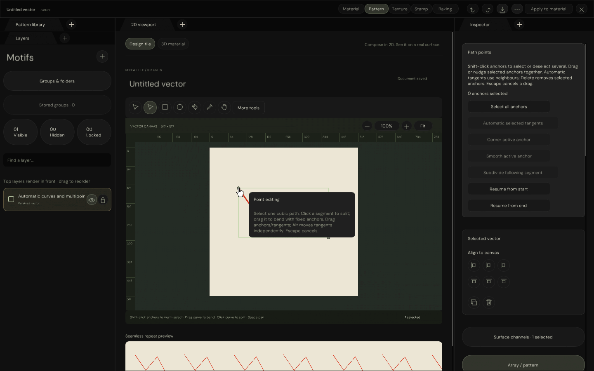
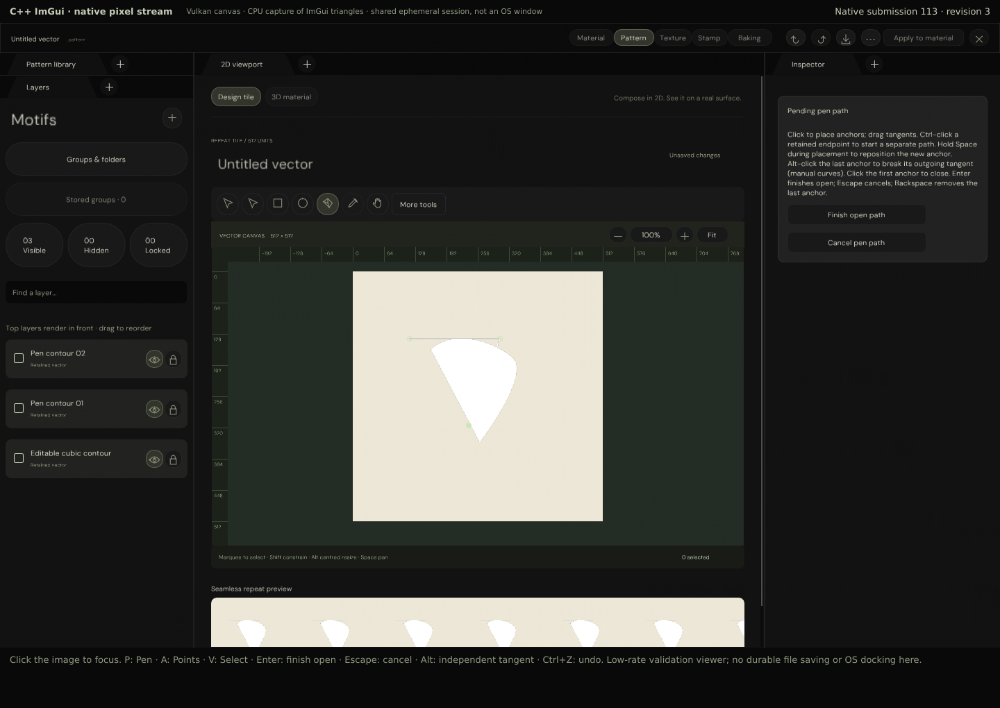
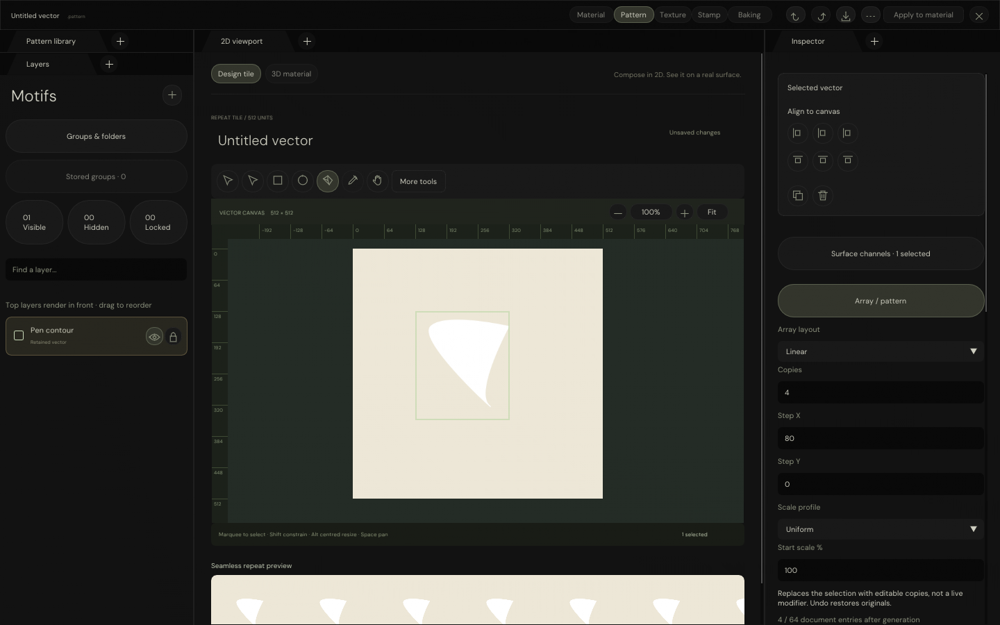
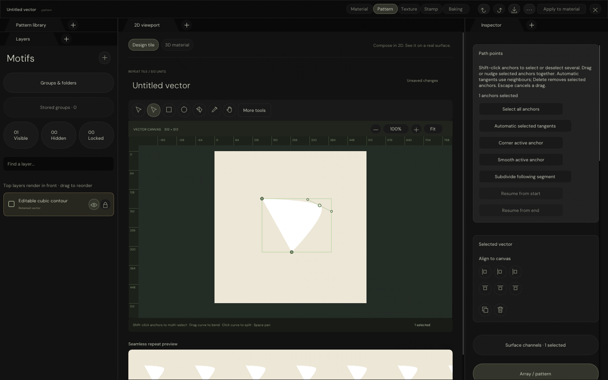
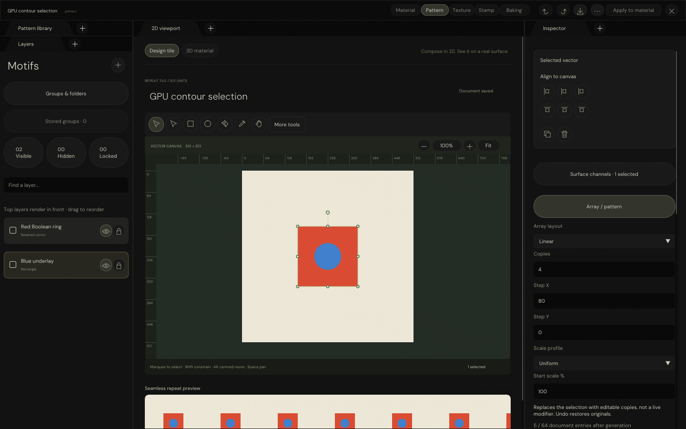

# Native Pattern workspace — automatic curves and multipoint checkpoint

Native Points mode now supports Shift-click multipoint selection, shared anchor edits and automatic tangents.
New Pen paths can derive automatic curves live. Direct click-to-split and fixed-endpoint bending remain supported.
Pen and Point retain 45-degree Shift constraints and shape-preserving de Casteljau subdivision.
Cards and rectangular actions use subtle corners; deliberate pills and glyph buttons retain their contours.
Open paths can continue from either endpoint, and compatible adjacent paths can now be joined through
four explicit endpoint pairings in the Inspector. Joining retains one layer identity and is one undo operation.
An actual C++-driven GIF is the main review evidence; the existing live session is left untouched.
Click selection continues to evaluate contour coverage on the GPU rather than primitive bounds.
Pattern remains first; full 1:1 acceptance is still open, and Stamp UI has not started.

## Current implementation

| Mechanism | Implemented behaviour |
|---|---|
| Automatic curves | More tools → Automatic Pen curves for new paths; Inspector automatic tangents for selected anchors |
| Multipoint | Shift-click toggle, select all, shared drag/nudge, corner/smooth, atomic batch deletion |
| Direct segments | Click interior curve to split at the pointer; drag to bend with fixed anchors; one undoable gesture |
| Joining | End/start, end/end, start/start and start/end; original curves retained with straight bridge or shared endpoint merge |
| Join constraints | Adjacent layers, matching opaque solid styles, group/channels and no owned masks; incompatibility disables actions |
| Continuation | Pen endpoint grips or Point Inspector actions resume either end; original orientation and used controls retained |
| Continuation lifetime | Copy-on-write preview in the same layer; no-op finish/cancel preserves source; one completed history edit |
| Refinement | Subdivide the segment following the active anchor; closing segments supported; open endpoints disabled |
| Direction constraints | Shift constrains pen anchor placement and Pen/Point tangents to 45-degree directions |
| Control contours | Cards 8 px, rectangular actions up to 6 px, scaled with UI; explicit capsules/glyph discs preserved |
| Pen placement | Click anchors, drag mirrored/Alt-independent tangents, close at first anchor, Enter finishes open |
| Pen lifetime | Pending GPU preview without history; Backspace, Escape/focus cancellation, one finalized operation |
| Pending source | Save/tool switches finish valid paths or refuse invalid ones; Ctrl+Z cancels only the draft |
| Point editing | Native anchor/tangent grips, mirrored or Alt-independent controls, keyboard nudges and anchor deletion |
| Primitive conversion | Explicit, undoable conversion; ellipse uses four cubic curves, not an exact analytic ellipse |
| Point history | One finalized edit per drag, fast release included; Escape/focus loss cancel without history |
| Coverage evaluation | Rendering and selection call the same Slang primitive/cubic/Boolean/mask evaluator |
| Point selection | Continuous document coordinates; highest visible, editable source with covered alpha |
| Holes and strokes | Boolean/cubic holes, stroke-only interiors, owned alpha/luminance masks and inversion |
| Retirement | One GPU output texel and four-byte token readback, consumed only after caller-reported retirement |
| Asynchronous input | Pending result is distinct from a miss; no queue wait and no CPU bounds fallback |
| Source authentication | Source snapshot and token checked; late results cannot change cancelled/replaced documents |
| Fast input | Release point retained while GPU reply is pending; one completed drag remains one history edit |
| Availability | Missing GPU selection reports a diagnostic and leaves the layer list available |
| Shader packaging | Both vector archives and their source/binary fingerprints required before Windows packaging |

The existing docked Pattern presentation, shape/array/mask controls, marquee, eight resize grips,
rotation, source/selection undo, native Open/Save and retired coverage images remain intact.

Reusable implementation:

- `Engine/Render/VectorSelectionEvaluation.{h,cpp}` — borrowed-device asynchronous dispatch/readback.
- `Engine/Render/VectorCoverageRasterization` — shared coverage allocation and retired selection metadata upload.
- `Engine/Render/Shader/VectorCoverage.slang` — shared evaluation, display and point-selection entries.
- `Engine/ContentInterchange/CubicPathEditing` — reusable anchor/tangent topology and copy-on-write replacement.
- `Engine/ContentInterchange/VectorAuthoringSelectionEditing` — authenticated selectable roots and masks.
- `PatternWorkspacePanel` — pending-input lifetime and source/selection edits; no CPU contour rasterization.

Editable document format and 128-instruction source budget remain unchanged. The instruction/cubic GPU ABI is 112/32 bytes; legacy documents without `stroke_colour` load with stroke colour matching fill colour. Native solid Fill and Stroke colours are independently authored and composited in the GPU coverage/surface shaders; stroke image sources remain deferred.
Selection metadata occupies reserved GPU upload slots, not serialized source instructions.
Native naming remains `VectorAuthoring`; the legacy `frontier.vector_artwork` format tag stays compatible.

## Verified results

Current uncommitted sources on `arena/73e163a3-frontier`; GCC 12.2.0 on Linux and Zig 0.13.0 for Windows objects.
Normal and ASan/UBSan/leak-detection native runs exercise the real shared renderer and native ImGui input path.

| Verification | Result |
|---|---|
| GPU picking assertions | 158 passed, repeated with sanitizers |
| Automatic/multipoint assertions | 24 passed, repeated with sanitizers |
| Direct segment assertions | 13 passed, repeated with sanitizers |
| Joining assertions | 52 passed, repeated with sanitizers |
| Continuation assertions | 40 passed, repeated with sanitizers |
| Refinement assertions | 12 passed, repeated with sanitizers |
| Native control-contour assertions | 6 passed at 1×, 1.5× and 2×, repeated with sanitizers |
| Shared cubic geometry | 27,708 strict and 27,708 sanitizer assertions passed; Windows object compiled |
| Pen assertions | 21 passed, repeated with sanitizers |
| Point editing assertions | 26 passed, repeated with sanitizers |
| Existing gesture assertions | 82 passed, repeated with sanitizers |
| Native UI/input/coverage-dispatch assertions | 367 passed, repeated with sanitizers |
| Source / docking / GPU residence | 9 / 4 / 8 passed in both native runs |
| Native coverage / point-selection dispatches | 196 / 63 |
| Shared regressions below | Historical focused runs; not rerun in this refinement checkpoint |
| Shared selection geometry | 1,360 strict and 1,360 sanitizer assertions passed |
| Existing authoring source | 2,269 strict and 2,269 sanitizer assertions passed |
| Existing native Boolean/mask controls | 42 passed |
| Existing GPU coverage regression | 54 assertions, 13 dispatches passed |
| HTTP native stream | 14 transport/input/refusal assertions passed |
| Real Chromium transport | Pointer events create native preview; Enter changes native history exactly once |
| Windows translation units | 22 compiled, including application host; not application linking or execution |
| Vector archive validation | 6 valid/negative cases passed; no executable package created |
| Distribution policy regression | 4 incomplete-report refusals and 72 policy combinations passed |

Picking cases include all six parametric primitives, fractional coordinates, rotated shapes, cubic winding rules,
Boolean holes, source overlap, owned masks, transparency, locked/hidden enclosures, the 64-candidate limit,
full 32-bit tokens, delayed retirement, changed-source requests, native click-through, missing GPU support,
late-result cancellation and release-before-reply drags. Actual transformed coverage pixel assertions also remain.

No hardware timing claim, Windows runtime acceptance, Defender scan, Actions, commit, push or release.

## Native mouse-animation evidence



The C++ executable Shift-selects two anchors, drags them together, applies automatic tangents, verifies Undo/Redo,
nudges/deletes multiple anchors, refuses deletion below the minimum, and cancels a group drag with Escape.
The GIF contains 388 raw native captures encoded as 70 changing/duration-merged frames at 1440×900.
The executable draws its own cursor; Python only quantizes/compresses captures. ImGui triangles are captured on
CPU; authored canvas/repeat pixels are software-Vulkan readbacks. No Windows/OS-window or hardware timing claim.
The separate normal/sanitized tests also exercise live automatic Pen preview and one-edit finalization.

```bash
_ClaudeScratch/build/PatternWorkspace/PatternWorkspaceValidation \
    /tmp/libvk_swiftshader.so \
    _ClaudeScratch/build/VectorAuthoringEditing/ShaderArchives/VectorCoverageCompute.spv \
    EngineContent/FontArchives/DMSans/DMSans-Regular.ttf \
    _ClaudeScratch/build/NativePatternMultipointMotion --animate-multipoint
PYTHONPATH=_ClaudeScratch/tmp/PatternPython python3 Exhibits/TextureStudio/Code/EncodeNativePatternMotion.py \
    --captures _ClaudeScratch/build/NativePatternMultipointMotion --caption NativePatternMultipoint \
    --executable _ClaudeScratch/build/PatternWorkspace/PatternWorkspaceValidation
```

Encoder dependency: scratch Pillow 11.3.0. Raw captures remain ignored. Current source/executable/frame/GIF
fingerprints: `Results/NativePatternMultipointMotionChecks.json`. Earlier segment/join/refinement motion reports
remain historical evidence, not current-build source verification.

## Automatic curves and multipoint semantics

- More tools → Automatic Pen curves affects new Pen paths. Neighbour positions derive aligned tangent directions,
  with each control length one third of its adjacent chord. Preview and finalization use the same computation.
  Generated controls remain ordinary editable cubic source controls, not a new persistent spline/solver format.
- Open endpoints use one-sided tangents; closed paths wrap their neighbours. Coincident/reversing neighbour chords
  collapse tangents deterministically. Automatic curves are not an overshoot-free or curvature-continuous solver.
- In automatic Pen mode, manually dragged tangent controls are replaced by generated controls. Existing retained
  endpoint continuation stays manual to avoid silently changing its original segments. The toggle defaults off.
- In Points mode, Shift-click toggles anchor membership within one selected path. Clicking a selected anchor keeps
  the group available for dragging; Select all anchors is also available. Selected grips are visibly brighter.
- Drag/nudge translates all selected anchors and their tangent controls by one shared displacement; unrelated
  anchors remain unchanged. Snapping uses the active anchor to derive the common displacement. Tangent dragging
  still affects only the active tangent; Alt retains its existing independent-control meaning.
- Inspector corner/smooth/automatic actions apply to the selected anchors. Delete removes the selected anchors
  atomically; open/closed minimum counts are preserved. Empty/repeated/out-of-range batches are rejected.
- Point selection is temporary UI metadata, not a serialized document edit. Undo/Redo of topology-changing edits
  clears stale point indices; same-topology motion history retains selection. Escape rolls back document previews.
- Multipoint marquee, cross-path point selection, persistent automatic-anchor modes and advanced Pen modifiers
  remain open. The rest of the user-approved Pattern backlog is not completed by this increment.

## Direct segment semantics and current boundaries

- In Points mode, select one retained cubic source. Click within six scaled screen pixels of an interior
  segment to insert an anchor at the projected curve parameter. Existing de Casteljau subdivision preserves
  the curve geometry. Anchors/tangent grips take precedence; the outer 2% of a segment is excluded.
- Drag the same interior curve position by at least two scaled screen pixels to bend instead of splitting.
  Both anchors stay fixed. Only that segment's outgoing/incoming controls move, using a minimum-squared-control
  displacement solution that moves the original grabbed parameter by the pointer displacement. Adjacent
  segments are unchanged; preserving smooth tangent alignment at shared anchors is not claimed.
- Projection is a bounded numerical approximation: 128 samples per segment, with 24 local refinement
  iterations for sampled minima. It is not an exact polynomial closest-point solver. Loops/cusps/extremely
  short or nearly coincident branches can be ambiguous; this is not GPU contour-selection replacement.
- CPU geometry projection and source edits are metadata operations. All authored coverage still uses Vulkan.
  No CPU authored-pixel rasterization, shader ABI or TOML schema change was introduced.
- Preview does not finalize history. Release finalizes one edit; Escape/focus-loss/invalid-pointer cancellation
  uses the existing gesture rollback. Invalid coordinates/budgets fail atomically. Snapping/Shift-constrained
  bending and automatic adjacent-tangent smoothing are not implemented.
- Native assertions cover pointer splitting, retained identity/parameter, exact Undo/Redo, live bend preview,
  fixed endpoints, actual changed Vulkan pixels, TOML round-trip and Escape rollback. Shared tests cover
  curved open/closed paths, closing seams, multiple parameters, unrelated controls and atomic invalid bends.

## Joining semantics and current boundaries

- Select two open cubic paths. The Inspector offers four explicit endpoint pairings, retaining the lower
  layer's token, name, paint, stroke, enclosing-group identity and surface-channel descriptors. The other
  selected layer is consumed; Undo restores both layers and their selection.
- Disjoint endpoints get a straight cubic bridge, using only previously unused endpoint controls.
  Coincident endpoints (within 0.000001 per world-coordinate axis) merge into one anchor retaining the
  meaningful incoming/outgoing controls. Original cubic segments survive under the chosen orientation.
- A join that closes a valid contour keeps fill disabled; it does not silently enable a new filled region.
  Closed results still require at least three anchors. Anchor/source/GPU storage limits are validated atomically.
- Independent aliases and their owned masks remain untouched. Selected paths with owned masks, different
  group/channel settings, non-adjacent stacking, mismatched styles, gradients or transparency are refused.
  Disabled native actions explain the specific refusal through shared tooltips; nothing is flattened or
  silently discarded. Rotation may differ because geometry is joined in world coordinates.
- Overlapping antialiased edge pixels can differ between single-source coverage and two-layer alpha-over;
  this is not an exact pixel-preservation claim. Opaque solid styles avoid silent colour/opacity migration.
- Shared source tests exercise all four orientations at multiple rotations, original segment sampling,
  both independent aliases, owned-mask preservation, coincident joins, valid/invalid closure, storage-budget
  refusal and atomic error handling. Native tests verify all four choices, actual new Vulkan bridge pixels,
  coincident controls/coverage, incompatible/protected actions and exact history/serialization.
- Shared cards retain 8 px corners and rectangular actions up to 6 px, UI-scaled. Explicit pills and glyph
  discs remain preserved. HTML applications are unchanged.

## Interactive native pixel stream

The running **Native ImGui Pattern — pixel stream** (port **8776**) is deliberately left on the earlier
refinement build so its temporary session is not reset. The current automatic/multipoint build was verified in a separate
instance on port 8777, now stopped. The GIF above shows the current build; newer editing is not claimed for the
untouched live session. Restart only when ready to discard that temporary session, using the command below.
Click the image to focus; **P** selects Pen, **A** Points and **V** Select. Place anchors with clicks;
drag to place tangent controls, click the first anchor to close, or press Enter for an open path.
Escape cancels; Alt creates an independent outgoing tangent. Backspace removes the last pending anchor.
In the current build, select an open path and click its endpoint with Pen, or use **Resume from start/end**
in the Point Inspector. Finishing keeps its token, name, paint, stroke, organization and owned descriptors.
Backspace cannot remove original anchors during continuation. Resuming and finishing without extending is a
no-op; an extension is one undo operation. Dragging a resumed endpoint only edits its newly usable outgoing
control, never the incoming control of the existing segment. Starting from the first endpoint reverses the
working path and restores its original orientation on replacement. Independent aliases remain unchanged.
Ctrl+S finishes and serializes a valid pending path; Ctrl+Z cancels only the pending draft.

This is not the original HTML Pattern app and does not reconstruct its controls in the browser. The image
is captured from the persistent C++ ImGui panel; pointer/key events are relayed to that same panel.
The browser only displays returned pixels. Native canvas/repeat pixels come from software Vulkan;
ImGui triangles are captured on CPU. It is **not an OS window**, Windows runtime test or hardware timing.
The validation viewer is low-rate, shared and temporary: saving is an in-memory test callback, not a durable
file download. Cross-window OS docking, file pickers and complete browser input methods are not claimed.

Restart after building the normal validation executable:

```bash
python3 Exhibits/TextureStudio/Code/ServeNativePattern.py \
    --executable _ClaudeScratch/build/PatternWorkspace/PatternWorkspaceValidation \
    --driver /tmp/libvk_swiftshader.so \
    --shader _ClaudeScratch/build/VectorAuthoringEditing/ShaderArchives/VectorCoverageCompute.spv
```

For isolated stream tests, launch another instance on port 8777 with a separate `--captures` scratch path:

```bash
python3 Exhibits/TextureStudio/Code/VerifyNativePatternStream.py --url http://127.0.0.1:8777
node Exhibits/TextureStudio/Code/VerifyNativePatternBrowser.mjs http://127.0.0.1:8777
```

Browser verification uses scratch Puppeteer Core 24.2.1 and Chromium 133.0.0, with its bundled NSS libraries
extracted to `_ClaudeScratch/tmp/NativeBrowser/lib`. Dependencies are not shipped or committed.
`Results/NativePatternStreamChecks.json` and `Results/NativePatternBrowserChecks.json` retain provenance;
the latter records actual Chromium execution, not merely HTTP requests or a JavaScript syntax check.
Only `/`, `/frame.png` and bounded same-origin `/input` are served; repository files are not exposed.



## Actual native capture



`Images/NativePatternPenDraft.png` also retains the unfinished native path with anchor/tangent guides.




The Point tool is active. The selected anchor and tangent grips edit retained source geometry;
the white contour and repeat preview come from Vulkan coverage. Native tests verify actual coverage
changes, exact undo/redo, preview-only history, mirrored/independent tangents, fast release, cancellation,
corner/smooth controls, point keyboard nudges, minimum-anchor refusal and primitive conversion.




The selected row is **Blue underlay**, reached through the red Boolean ring's hole.
Captures rasterize actual native ImGui triangles on CPU and sample actual software-Vulkan tile readbacks.
They are not browser mockups or Windows screenshots. Workspace/array/mask/marquee/resize/rotation captures
were refreshed by the same run.

## Evidence and reproduction

- `Results/NativePatternWorkspaceChecks.json` — normal UI/GPU results and Windows object manifest.
- `Results/NativePatternWorkspaceSanitizedChecks.json` — matching UI/GPU sanitizer results.
- `Results/VectorSelectionChecks.json` — shared geometry strict/sanitized verification.
- `Results/NativeVectorAuthoringEditingChecks.json` — source/control/GPU regressions.
- `Results/VectorShaderArchiveChecks.json` — valid archives and missing/corrupt/stale/duplicate/refused cases.
- `Results/WindowsDistributionPickingRegression.txt` — actual distribution-policy regression output.

Native reports retain source/header hashes, compiler, platform, commands, driver/font/shader hashes and
vector compilation manifest hash. The vector manifest links both binaries to the current Slang source.

```bash
python3 Automation/PrepareUI.py
node Automation/CompileVectorCoverage.mjs \
    _ClaudeScratch/tmp/PatternTools/node_modules/slang-loader/vendor/slang-wasm.js \
    _ClaudeScratch/build/VectorAuthoringEditing/ShaderArchives
python3 Exhibits/TextureStudio/Code/VerifyPatternWorkspace.py \
    --driver /tmp/libvk_swiftshader.so \
    --shader _ClaudeScratch/build/VectorAuthoringEditing/ShaderArchives/VectorCoverageCompute.spv \
    --windows-tools _ClaudeScratch/tmp/PatternPython
python3 Exhibits/TextureStudio/Code/VerifyVectorSelection.py
python3 Exhibits/TextureStudio/Code/VectorShaderArchiveValidation.py \
    _ClaudeScratch/build/VectorAuthoringEditing/ShaderArchives
python3 Exhibits/TextureStudio/Code/WindowsDistributionValidation.py
```

For UI sanitizers omit `--windows-tools`, add `--sanitizers`, and use
`--build-directory _ClaudeScratch/build/PatternWorkspaceSanitized`.
The source/control/GPU regression command is recorded in its JSON report.

Prerequisites restored locally: checksummed UI packages/inherited ImGui patches, five hash-verified DM Sans 5.3.0
faces and licence via FontTools 4.60.1, SwiftShader from `@sparticuz/chromium@133.0.0`,
`slang-loader@0.0.7` reporting Slang 2026.19, and Zig 0.13.0. Scratch tools and binaries remain ignored;
this is not a Linux distribution or Windows application handoff.

## Current completion work

The user requested completing Pattern Studio before beginning Stamp. The current clipboard/stack checkpoint
is documented in `ClipboardEditing.md`; earlier feature captures below are historical builds unless explicitly
refreshed. Completion is gated by the remaining features and native acceptance, not by the count of tests.

## Remaining Pattern gate

- Marquee remains bounds-intersection selection, as in the HTML reference; group-aware expansion is incomplete.
- Coverage-aware click selection uses the existing shader's one-design-unit antialias footprint and alpha
  threshold of 1/255, clipped to the 512-unit tile. Cubic stroke distance retains the renderer's 32 subdivisions.
  This is shared rendered-coverage behaviour, not exact analytic Bézier intersection or all HTML tool parity.
- Multipoint marquee/cross-path editing, persistent automatic-anchor modes and advanced segment constraints/smoothing.
- Joining masked, gradient, translucent or non-adjacent sources without changing their independent semantics.
- Further segment constraints/smoothing and semantics-preserving broader joins; Space placement, Alt continuation,
  Ctrl independent starts and direct endpoint joining are implemented.
- Text/SVG/image/freehand authoring, presets/defaults and complete arrangement/mixed-selection.
  Session clipboard, independent duplicate, Select All and four stack commands are implemented; distribution
  and complete group-aware arrangement remain open.
- Complete groups, stored/linked definitions, painted/image masks and independent stroke sources.
- GPU channels, height/normal outputs, 3D/material application and export.
- Exact typography/icons/spacing/responsiveness, safe detached GPU sampling and Windows application acceptance.

Mask-isolation canvas editing remains unavailable; owned masks can still be edited in the Inspector.
Stamp UI remains deferred until the full Pattern acceptance gate is satisfied.
