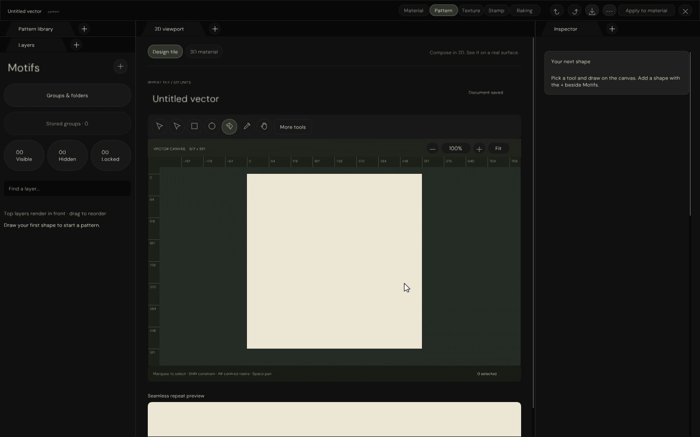

# Native Pattern — independent Pen continuation

**2026-10-19 · Next Pen increment implemented and locally verified. Full Pattern parity remains open.**

Alt-click the last pending anchor to collapse its outgoing control into a corner. Alt-drag from that anchor
instead shapes an independent outgoing control. Both preserve the incoming curve and avoid duplicate anchors.

## Interaction contract

| Gesture / condition | Result |
|---|---|
| Alt-click last pending anchor | Next segment starts from a corner; incoming segment stays unchanged |
| Alt-drag last pending anchor | Independent outgoing tangent; incoming tangent stays unchanged |
| Release Alt before mouse-up | Independent shaping remains latched for this drag |
| Place the next anchor | Ordinary new-anchor tangent behaviour resumes |
| Automatic Pen curves | Refuse corner conversion without mutation; explain how to disable automatic mode |
| Enter / Undo / Redo | One finalized path edit; source restored exactly by history |
| Escape during resumed continuation | Retained original path survives unchanged |

The unused outgoing control of an open final endpoint is not encoded as a retained segment until a following
segment exists. Validation adds that segment before asserting the outgoing control, and compares coordinates
against the actual ImGui pointer projection rather than assuming fractional screen positions remain unrounded.

## Verification

| Check | Result |
|---|---|
| Native C++ UI/input/software-Vulkan | 416 checks passed |
| Focused independent continuation | 17 checks included |
| Existing Space placement | 10 checks included |
| Address / undefined-behaviour sanitizers | 416 checks passed |
| Windows cross-compilation | 22 translation units passed; no application link or Windows execution |
| Native HTTP input/route validation | 14 checks passed |
| Browser pointer/keyboard transport | Passed against an isolated native stream |
| Actual native motion | 370 raw captures → 100 GIF frames, 1440 × 900 |

The live C++ pixel stream remains on port 8777; the inherited 8776 stream was preserved. Final automated
transport checks used temporary port 8778 so they did not reset the active preview; that test stream was stopped.
Rendering evidence combines real ImGui triangle capture with software-Vulkan vector coverage. It is not a
physical Windows window, a hardware-GPU performance test or an HTML reconstruction of the workspace controls.



[Full-resolution native corner capture](Images/NativePatternPenCorner.png)

## Reproduction

Prerequisites: restored repository dependencies/fonts, local Vulkan software driver, compiled vector/selection
shader archives, g++, and the existing Python Windows-tool/Pillow installation. Commands run from repository root.

```bash
python3 Exhibits/TextureStudio/Code/VerifyPatternWorkspace.py \
  --driver /tmp/libvk_swiftshader.so \
  --shader _ClaudeScratch/build/VectorAuthoringEditing/ShaderArchives/VectorCoverageCompute.spv \
  --windows-tools _ClaudeScratch/tmp/PatternPython
python3 Exhibits/TextureStudio/Code/VerifyPatternWorkspace.py \
  --driver /tmp/libvk_swiftshader.so \
  --shader _ClaudeScratch/build/VectorAuthoringEditing/ShaderArchives/VectorCoverageCompute.spv \
  --sanitizers --build-directory _ClaudeScratch/build/PatternWorkspaceSanitized
mkdir -p _ClaudeScratch/build/PatternPenContinuationMotion
_ClaudeScratch/build/PatternWorkspace/PatternWorkspaceValidation /tmp/libvk_swiftshader.so \
  _ClaudeScratch/build/VectorAuthoringEditing/ShaderArchives/VectorCoverageCompute.spv \
  EngineContent/FontArchives/DMSans/DMSans-Regular.ttf \
  _ClaudeScratch/build/PatternPenContinuationMotion --animate-continuation
PYTHONPATH=_ClaudeScratch/tmp/PatternPython python3 Exhibits/TextureStudio/Code/EncodeNativePatternMotion.py \
  --captures _ClaudeScratch/build/PatternPenContinuationMotion --caption NativePatternPenContinuation \
  --executable _ClaudeScratch/build/PatternWorkspace/PatternWorkspaceValidation
```

- [Native checks, build commands, compiler/platform and source fingerprints](Results/NativePatternWorkspaceChecks.json)
- [Sanitizer results and fingerprints](Results/NativePatternWorkspaceSanitizedChecks.json)
- [Native motion, executable and source fingerprints](Results/NativePatternPenContinuationMotionChecks.json)
- [HTTP transport checks](Results/NativePatternStreamChecks.json)
- [Browser input checks](Results/NativePatternBrowserChecks.json)

Changes are uncommitted on the existing session branch. Previous GIF reports remain historical checkpoints;
this continuation report and the current workspace/transport reports describe this increment.

**Still pending:** remaining continuation/join modifiers, broader joins preserving masked/gradient/translucent
and nonadjacent layer semantics, then the queued Pattern 1:1 authoring work. Stamp remains deferred. No glint
shader/default/resource changes, hair work, GitHub Actions, package, commit, push or release were performed.
