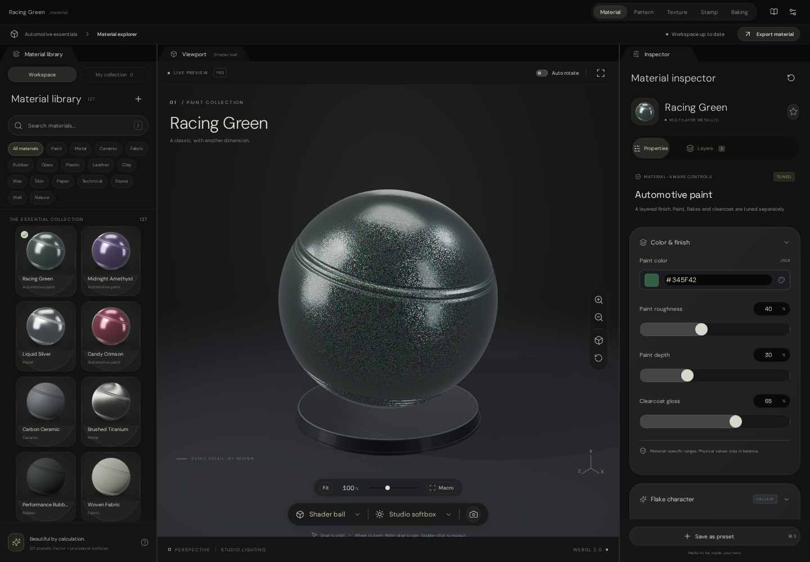
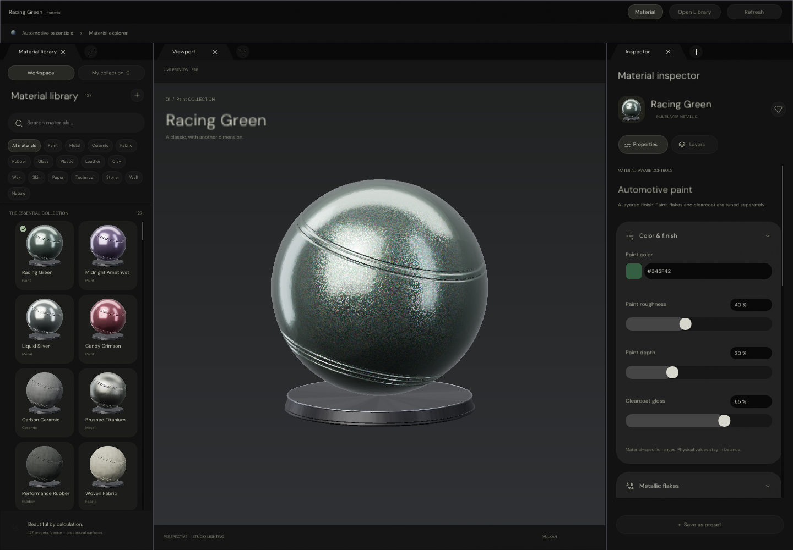

# Texture Studio implementation evidence

## Latest HTML review: Pattern surface channels and reusable groups

Pattern now has per-motif Colour, Height, Normal, Roughness, Metalness and Opacity contributions, plus **+ Channel**
for ambient occlusion. The Inspector supports unlocked multi-selection, mixed amounts, switches, supplied tangent-space
normal maps, actual channel-map inspection and PNG export. Height-derived normals are repeat-aware. Actual PBR shading
uses independent channel coverage, so a disabled contribution does not erase the material channel beneath it.
Height affects shaded relief, not silhouette displacement. Normal-map input/export uses OpenGL +Y convention.

**Groups & folders** in the layer panel provides named nested containers, destination selection, moves, collapse,
visibility/locking, rename/dissolve, and separate document-wide group-property and linked-edit switches, both off by
default. Group-wide edits share the changed appearance/channel property through the nearest group, including nested
contents, without overwriting unrelated channel settings. Locked artwork is protected.

**Stored groups** is searchable, includes actual SVG thumbnails, and supports insert-copy, insert-linked and detaching
selected links. Definitions live in the pattern document, not a project-wide content library. Matching linked feature
slots share appearance and shape parameters; feature dimensions change proportionally while position/rotation remain
local. Structural additions/deletions and container rearrangements are not live-template synchronization. Unused
unlinked definitions can be removed. Stored groups, nesting, settings and channels survive save/reopen and history.

Limits: 64 artwork layers, 64 containers, 12 nesting levels, 24 stored definitions and the existing 12 MB document cap.
Normal maps are embedded PNG/JPEG/WebP under 1.5 MB. Existing flat groups are adopted into the visible container list.

Actual captures: `Images/PatternSurfaceChannelsAndGroups.png` and `Images/PatternWeaveChannelMaterial.png`.
Reproduction: `node Exhibits/TextureStudio/Code/PatternChannelsGroupValidation.mjs` with browser dependencies installed.
Results/fingerprints: `Results/PatternChannelsGroupChecks.json`. Native C++ remains paused.

## Previous HTML review: editable arrays and unique outliner captions

Pattern and Stamp share **Inspector → Array / pattern**: linear, grid, circular/arc and radial-ring layouts.
Scale profiles are uniform, linear progression, circular wave, radial distance and deterministic seeded noise.
Sources become editable copies in one undoable edit, not a live array modifier. Group offsets scale/rotate together;
original native Stamp text runs and SVG artwork remain intact. Document limits remain Pattern 64 / Stamp 24 entries.

Case-insensitive caption collisions receive numbered suffixes, including existing imported documents; unique custom
captions remain unchanged. Owned mask rows include their artwork caption. IDs, layer order and geometry are not renamed.

Actual captures: `Images/PatternArtworkArrays.png`, `Images/StampArtworkArrays.png`.
Reproduction: `node Exhibits/TextureStudio/Code/ArtworkArrayValidation.mjs` with browser dependencies available.
Results and source/capture fingerprints: `Results/ArtworkArraysChecks.json`. Native C++ remains paused.

## Previous HTML review: selection-aware Inspector

Alignment and selection operations now live in the Inspector in both Pattern and Stamp. Two selected layers
expose eligible Boolean icons, explicit mask directions and shared properties. Relevant boolean fields use
switch presentation. `Images/PatternSelectionInspector.png` and `Images/StampSelectionInspector.png` are actual
browser captures. Selection masks are alpha snapshots with a retained hidden source, not live contour links.

Results and reproduction: `Results/SelectionInspectorChecks.json` and `Code/SelectionInspectorValidation.mjs`.
The older arrangement-disclosure descriptions below are historical; Inspector placement supersedes them.

## Current HTML review: compact tools and owned paint masks

Native Pattern/Stamp implementation remains paused for HTML review. These are actual browser captures,
not generated mock-ups or native screenshots:

- `Images/PatternCompactToolsNormal.png` and `Images/StampCompactTools.png`: compact normal drawing controls.
- `Images/PatternMaskPainting.png` and `Images/StampMaskPainting.png`: selectable mask entries and shape fills.
- `Images/PatternMaskCompactViewport.png` and `Images/StampMaskCompactViewport.png`: 900 × 680 layout checks.
- `Images/PatternCompactTools.png`: the arrangement disclosure, with the other command groups kept compact.

Reproduce with the configured local Playwright Chromium runtime:

```sh
node Exhibits/TextureStudio/Code/ArtworkMaskAuthoringValidation.mjs
node Exhibits/TextureStudio/Code/CaptureArtworkToolbars.mjs
```

The validation runner reuses or starts Vite on port 5173. The separate toolbar capture expects that preview
server to be running. Set `PLAYWRIGHT_EXECUTABLE_PATH` and any required browser-library environment paths when
using a custom Chromium installation. Prototype interaction tests and mask-capture steps are under
`Experimental/TextureStudio/tests/artwork-mask-authoring.spec.js`.

Current results: `Results/ArtworkMaskAuthoringChecks.json`, the corresponding `.log`,
`Results/ArtworkMaskOriginalStampEditing.log` and `Results/ArtworkMaskBuildChecks.log`.
Earlier native results below remain historical and do not certify the new HTML paint tools or a full native port.

## Native docked Material workspace

Native documents use **`.material` TOML**, separately from the React reference's `.texture.json`.

- `MaterialLibraryPanel`: registered library, material viewport and properties windows using `PanelDockspace`.
  Default logical side widths follow the HTML workspace (278 / remaining / 338), while panels remain dockable.
- Library cards use shared `ControlKit::SectionCard`; structured roughness, metallic and anisotropy edits use the
  existing shared slider. TOML is a secondary view. Scalar edits retain source comments and unrelated formatting.
- Apply/Revert/Save keep draft, applied and disk contents distinct. Source conflicts and dirty-close protection remain.
- `MaterialLibraryRendering`: shared Vulkan material programs, shader-ball geometry, a separate 512px preview and one
  bounded 64-slot GPU-resident thumbnail atlas. Native ImGui cards use one atlas descriptor and tile UV rectangles.
- `MaterialThumbnailAtlas`: GPU scratch rendering followed by GPU-to-GPU tile copies, replicated gutters, no mip
  chain and explicit transfer/sample dependencies. Production thumbnail pixels are never read back or re-uploaded.
- Visible requests pin resident slots before reuse. Generation tokens reject stale references. One dirty tile is
  scheduled per submission; preview updates take priority so pending shared uploads are not recorded twice.
- Immutable baking resources retire against graphics-queue completion serials. Apply invalidates changed material
  pixels; explicit Refresh reloads clean selected source/textures and checks other visible tiles. Unchanged content
  does not rebake. Automatic filesystem watching is not implemented.
- Windows composition registers preview/atlas descriptors on the presentation device, shares Frontier's startup,
  fonts/themes and Control Centre, and uses a separate `workspace.texture_studio_layout` in personal `.projectspace`.
  There is no independent ImGui settings file. Detached OS windows remain opt-in through the shared preferences.

This is not yet a signed-off pixel match to the complete HTML. More inspector fields, reference interactions,
shape/orbit/zoom controls, grid/thumbnail polish, native folder picking and last-library restoration remain pending.
The preview now uses the HTML shader-ball lathe profile and pose. Windows launch and native multi-window behaviour remain unexecuted here. A linked x64 test package is produced by `Automation/BuildTextureStudioWindows.py`; see `WindowsReadme.md`.

## HTML catalogue and style correction

`node Exhibits/TextureStudio/Code/ExportReferenceLibrary.mjs` regenerates
`EngineContent/MaterialArchives/TextureStudio`. It imports the actual reference's `materials` and
`normalizeMaterial`, preserving all 127 names, order, categories, descriptions, normalized recipe parameters and
recipe-control definitions in typed TOML. Native `.material` files contain supported physical coefficients and executable automotive paint parameters;
roughness is constrained to the native evaluator's 0.045 minimum. Complete original parameters stay in `Library.toml`.
Automotive paint now executes native Slang microstructure. Other procedural families, transmission and unsupported optical behaviour are **not** represented as shader-equivalent.
Duplicating a native `.material` copies its physical definition and complete automotive block, not the other HTML recipe archives.

Native browsing uses that catalogue, category filtering and a session-only favourite collection. The inspector binds
supported reference controls to real native coefficients and retains explicit Apply/Save transactions. Unsupported
recipe controls are disabled rather than pretending to change the native shader. Colour editing preserves unrelated
source text. `ReferenceLibraryExport.json` records provenance. The HTML's shader-ball profile is used for both atlas
baking and the separate preview; the tapered pedestal, lower foot and metallic trim are now rendered geometry. Analytic studio panels are not certified reference-HDRI equivalence.

## Verification

```sh
python3 Exhibits/TextureStudio/Code/VerifyMaterialLibrary.py \
  --destination _ClaudeScratch/tmp/TextureStudio/Verification \
  --windows-tools _ClaudeScratch/tmp/WindowsTools
```

The runner downloads nothing. It requires the pinned ImGui/toml++/stb dependencies and, for Windows compilation,
GLFW/Vulkan headers/ThorVG headers plus the supplied Zig toolchain. GCC warning exceptions cover inherited ImGui
initializers and the pre-existing unused `FillCircle` in ControlKit; new library code passes the other strict warnings.

The native tests execute real filesystem operations and actual headless ImGui pointer actions. Strict and
ASan/UBSan executions check source preservation, external-edit conflicts, failed-apply retention, contained paths,
Unicode, independent layer textures, explicit disk saves and dirty-source protection. The Windows check produces
x64 COFF **objects**, not a linked executable or Windows runtime verification. CMake configuration was not executed.

`Images/MaterialLibrary.png` is CPU rasterization of the executed native ImGui triangles and font atlas.
It is **not a Windows screenshot or GPU capture**. `Results/MaterialLibraryChecks.json` records source digests,
commands, results and the execution boundary.

On a prepared Windows CMake checkout, the intended standalone invocation is:

```sh
cmake --build <configured-build-directory> --config Release --target TextureStudio
TextureStudio.exe --library <ContentDirectory> --shaders <ShaderArchives/Surface>
```

The shader argument is optional when the archives exist under `EngineContent/ShaderArchives/Surface` beside the
executable. The shader-enabled CMake build stages them there and installs them with the application.
With no directory argument, the application uses the HTML's 127-preset library. On Windows it copies installed
reference presets into `LOCALAPPDATA/Frontier/TextureStudio/Materials`, without overwriting existing files.
An explicit `--library` directory is not populated with presets. Renderer test specimens are never injected.
Use the existing dependency/font preparation and Windows setup instructions; these commands are instructions,
not evidence that the executable was linked or launched in this session.

## GPU atlas and composed workspace evidence

```sh
python3 Exhibits/TextureStudio/Code/VerifyMaterialAtlas.py \
  --destination _ClaudeScratch/tmp/TextureStudio/AtlasVerification \
  --driver <explicit-vulkan-driver> --shaders <compiled-surface-shader-directory>
python3 Exhibits/TextureStudio/Code/VerifyMaterialWorkspace.py \
  --destination _ClaudeScratch/tmp/TextureStudio/WorkspaceEvidence \
  --driver <explicit-vulkan-driver> --shaders <compiled-surface-shader-directory>
```

`MaterialAtlasChecks.json` covers strict/sanitized Vulkan execution, independent tile updates, gutters, slot reuse,
clean residency, no-op invalidation, material changes, root replacement and stale-token refusal. Raw atlas and full
library rendering are tested as separate instances, each with one atlas and five shared material pipelines.
The supplied local driver is SwiftShader: Vulkan execution on a CPU device, not hardware-GPU acceptance.

`Images/MaterialWorkspace.png` composes actual native ImGui triangles with actual Vulkan atlas and preview readbacks.
Readback occurs only in the exhibit. This is **not a native Windows window screenshot** or GPU execution of the UI.
`MaterialWorkspaceChecks.json` records the distinction. `Images/MaterialAtlas.png` retains actual atlas pixels.

Shared typeface archives are prepared with `Automation/PrepareFonts.py`; its pinned Python font tool can live in
ignored scratch. No OS font installation is needed. Material/renderer checks download no dependencies.

## Current visual comparison — not parity acceptance

Both captures use 1440 × 1000 pixels. Both use the HTML catalogue with Racing Green selected. The native renderer evaluates its supported physical
coefficients, not the complete HTML procedural kernels; this is not a passing pixel-difference test.

| HTML Material workspace | Native docked workspace |
| ----------------------- | ----------------------- |
|  |  |

The reference capture is actual Chromium/WebGL execution. The native capture combines CPU-rasterized ImGui
with actual Vulkan material pixels. Material styling is applied in the shared native panel in both host and capture. DM Sans static faces come from
the same pinned fontsource package as the reference; the shared font preparer recovers their TTF forms. Shared
sliders now accept the reference's 24px rail/22px knob without changing other hosts' default dimensions.
The new shared/scoped SVG icons, scrollable/collapsible inspector cards and rendered pedestal address those earlier omissions. Remaining differences include reference viewport interactions, exact typography/rasterization, non-automotive procedural families and environment shading. Neither image is evidence of Windows execution or exact visual parity.

## Updated reference app

`Experimental/TextureStudio` was selectively updated from PR #1 at
`85be136ba213be6768b3acdd4c0a68cbe24c6bd2`. Only that subtree was imported; no PR merge or branch switch occurred.
`Results/ReferenceImport.json` records the 47 changed source files. Local `site/` and the prior patch were preserved;
`site/` is a historical prebuilt bundle, not the current verified preview. Use `npm run build` / `npm run preview`.

Reference build and pure GPU-paint checks are distinct from native application verification. Optional Node checks
need `@napi-rs/canvas` and `@shaderfrog/glsl-parser` as local, non-saved dependencies.
The GLSL parser reports unresolved
built-in symbols as warnings; parsing is not GPU shader compilation. Rebuild and capture all four Node checks with
`python3 Exhibits/TextureStudio/Code/VerifyReference.py`; results are in `Results/ReferenceChecks.json`.
Browser smoke checks are reproduced with:

```sh
node Exhibits/TextureStudio/Code/ReferenceBrowserChecks.mjs \
  <chromium-executable> <playwright-core-index.mjs> <chromium-library-directory>
```

This checks the updated WebGL reference on port 8774, not the native application. Painting/baking/reference optical
features were preserved, not ported into the first native Material Library.

## Evidence location

Vulkan validation is removed from `Experimental/Project browser`. Its live review is now
`Exhibits/Renderer/index.html`, linked from `Exhibits/SpaceFormats/index.html` and
`Exhibits/ProjectBrowser/index.html` alongside native/ImGui evidence.
Run `Exhibits/Renderer/Code/ServeRenderer.py` with the explicit renderer arguments described in the renderer README.
The Project Browser reference is available separately at `/project-browser/` on that evidence server.

Application plan: `Documentation/Plans/Ongoing/TextureStudio.md`. Progress: `Documentation/Tracker.md`.


## Executable automotive paint and icons

All **seven automotive presets**, including Racing Green, now compile their actual normalized particle parameters:
3D cellular interiors, independent seeded layers, binder absorption/burial tint, 12-stop palette/ramp/single modes,
48-sample linear-space unresolved colour, derivative minification, per-flake roughness/metallic/tilt and separate
orange-peel clearcoat normals. No particle bitmap or CPU thumbnail round trip implements this effect.

Inspector finish/flake/detail cards share ControlKit surfaces/sliders; units, logarithmic ranges, integer layers,
palette colour-space conversion, disabled alpha, tooltip hit areas, description wrapping and card collapse/scroll
are handled explicitly. Draft/Apply/Save semantics remain separate. Other procedural-family controls remain disabled.

Reusable editor icons: `Engine/Interface/Icons/EditorSymbols.inc`. Texture-only icons: `TextureSymbols.inc`.
Fluid-only smoke/water icons: `FluidSymbols.inc`. `IconArt::Catalogue/Available/Rasterize` and
`IconPresentation::Draw` enforce the workspace domain, including cached raster access. Native composition and CPU
evidence inject the same production SVG artwork through the shared panel interface.

```sh
python3 Exhibits/TextureStudio/Code/VerifyProceduralPaint.py \
  --destination _ClaudeScratch/tmp/TextureStudio/ProceduralAcceptance \
  --driver <explicit-vulkan-driver> --shaders <compiled-shader-directory>

python3 Automation/BuildTextureStudioWindows.py \
  --windows-tools <directory-containing-pinned-ziglang-0.13.0> \
  --shaders <verified-shader-directory> --destination _ClaudeScratch/tmp/TextureStudio/WindowsPackage
```

The first script automatically runs strict and ASan/UBSan CPU/GPU/production-SVG checks and writes
`Results/ProceduralPaintChecks.json`. Images are actual offscreen readbacks, not generated concept art. The package
script downloads nothing and produces `Binaries/TextureStudio-Windows-x64.zip`, including the executable, content,
compiled shaders, licences, instructions and fingerprints. Windows execution remains an explicit outstanding test.


Latest acceptance: **250 library/UI checks + 58 paint checks + 90 icon-domain checks**, each in strict and
ASan/UBSan runs, plus shared atlas/renderer regressions. Control-sensitivity tests deliberately use a resolved
1800 µm macro view at 128px to bound software-driver cost; the separate 1440×1000 workspace composition verifies
Racing Green's actual 450 µm recipe in the production 512px preview. Images are not Windows screenshots.

`python3 Exhibits/TextureStudio/Code/VerifyPaintDelivery.py` checks that evidence/source fingerprints are current,
that the ZIP contains a real Windows x64 GUI executable, that all 127 presets/10 shaders are present, and that
all packaged bytes and shader provenance match. Its result is `Results/DeliveryChecks.json`.

## Shared native authoring increment (2026-10-19)

The native pause is superseded by the user's retest-and-resume instruction. The selected Pattern/Stamp HTML
regression passed 57 checks; an additional 48 preserved painting/document/Stamp model checks passed. These are
selected regressions, not a claim that the entire application's test suite or every native feature was exercised.

Production ownership:

```text
Engine/ContentInterchange/ArtworkArrayPlacement
    -> neutral placements/scales for vector artwork and texture-paint layers
Engine/ContentInterchange/ArtworkAuthoringProperties
    -> neutral channel contributions, changed-field patches and enclosure properties
Engine/ContentInterchange/ArtworkEditing + VectorArtworkDocument
    -> retained-vector adaptation, organization, TOML and CPU source history
Engine/Render/VectorCoverageRasterization + Shader/VectorCoverage.slang
    -> existing shared Vulkan/Slang evaluation; no CPU pixel fallback
UI/TextureStudio/VectorArtworkControls
    -> presentation only; locked-mask pointer guard
```

`FrontierArtwork` links without ImGui or a workspace. Texture Painting can reuse the placement and channel APIs
without depending on a vector document or a renderer. Integration into the painting layer stack is still future work.
New native channel metadata is an authoring contract, **not completed native channel rendering**.

Reproduce the source contracts after restoring the existing pinned dependencies:

```bash
python3 Automation/PrepareUI.py
python3 Exhibits/TextureStudio/Code/VerifyArtworkEditing.py --sanitizers --controls
```

For actual compute readbacks and the optional headless Windows x64 cross-link:

```bash
python3 Exhibits/TextureStudio/Code/VerifyArtworkEditing.py \
  --sanitizers --controls \
  --gpu-driver /path/to/libvk_swiftshader.so \
  --slang-wasm /path/to/slang-loader-0.0.7/vendor/slang-wasm.js \
  --windows-tools /path/to/ziglang-0.13.0-python-package
```

The editing host needs GCC C++20 and Python; GPU verification additionally needs Node, the explicit Vulkan driver
and reviewed Slang compiler. The script downloads nothing. Windows compilation uses the repository-reviewed Zig
0.13.0 toolchain; bundled unwind-library warnings are distinct from project compilation failures. Generated host
executables, the Windows validation executable, shaders and object files remain ignored under `_ClaudeScratch`.
No validation executable is an application deliverable or an updated Windows download.

Evidence: `Results/NativeArtworkEditingChecks.json`, generated logs and
`Images/{GpuNativeArtworkArray,GpuNativeArtworkMasks,NativeArtworkLockedControls}.png`.
The JSON records exact commands, compiler/platform, source SHA-256 and explicit execution boundaries. The mask-lock
negative reproduction is retained as `Results/NativeArtworkLockBefore.log`; final pointer tests must pass after repair.
`NativeArtworkPreservationBefore.log` reproduces the repaired loss of small, unselected coordinates during identity
array adaptation; the final source suite verifies exact retained-instruction equality.

Remaining: hosted 1:1 Pattern/Stamp panels and complete original tools; GPU surface-channel targets and normal/height
operations; painted/image mask residence; stored/linked group definitions; full Unicode case folding; text/image
placement parity; native material profiling/detail fixes and actual Windows/hardware review. Current native arrays
are limited by the existing 128-instruction GPU budget in addition to workspace layer budgets. No full Windows app
build, Windows execution, Defender scan, publication, GitHub Actions, commit or push is implied.

## Native Pattern UI checkpoint

See [Native Pattern workspace](NativePatternWorkspace.md) for the hosted UI, actual retained capture,
`VectorAuthoring` naming, marquee/resize/rotation gestures, asynchronous GPU contour selection, fresh software-Vulkan verification,
and remaining Pattern-first acceptance gates.
The old result filenames are historical evidence, not current API names. Stamp UI has not started.


## Native retained Point checkpoint

Native Point (A) now edits cubic anchors and tangents with atomic source history, explicit primitive conversion,
corner/smooth controls, safe anchor deletion and point nudges. Current verification and an actual software-Vulkan
native capture are in [NativePatternWorkspace.md](NativePatternWorkspace.md). Pen placement is still unavailable;
full Pattern parity and Stamp UI remain deferred. No Windows linking/execution is claimed.


## Native Pen and live ImGui pixel stream

Native Pen now supports anchor placement, tangent drags, open/closed finishing and atomic undo. The live preview
on port 8776 is a real C++ ImGui pixel stream, not the HTML Pattern prototype. It is a low-rate, ephemeral native
validation session, not an OS window or durable file-saving app. See [current evidence](NativePatternWorkspace.md)
for commands, actual Chromium/native captures, 21 Pen assertions and stream/browser verification.


## Native refinement and mouse GIF

[Watch the actual C++ mouse sequence](Images/NativePatternRefinement.gif): Pen placement, Point drag,
subdivision and Undo/Redo. Cards/rectangular actions have subtle native corners; intended pills are preserved.
Following-segment subdivision and Shift-constrained placement/tangents are implemented. Current native,
sanitizer, Windows-object and shared-geometry results are in [NativePatternWorkspace.md](NativePatternWorkspace.md).


## Retained open-path continuation

Native Pen can now continue a selected open path from either endpoint; the Point Inspector exposes explicit
start/end actions too. [The C++ mouse GIF](Images/NativePatternRefinement.gif) now includes both directions.
Current native/sanitizer/source evidence is in [NativePatternWorkspace.md](NativePatternWorkspace.md).
The existing live stream is intentionally left on the earlier build to avoid resetting its temporary session.


## Retained path joining

[Watch the C++ joining GIF](Images/NativePatternJoining.gif): two native Pen paths, explicit joining and Undo/Redo.
All four endpoint pairings are available for compatible adjacent open paths. Independent styles/masks are not
silently discarded. Current normal/sanitizer, geometry, GPU and Windows-object evidence is in
[NativePatternWorkspace.md](NativePatternWorkspace.md). Existing live-session state was left untouched.


## Direct segment editing

[Watch the C++ segment-editing GIF](Images/NativePatternSegmentEditing.gif): click-to-split, drag-to-bend,
Undo/Redo and Escape cancellation. Uses shared geometry and Vulkan canvas pixels, not an HTML simulation.
Current verification and approximation boundaries: [NativePatternWorkspace.md](NativePatternWorkspace.md).


## Automatic curves and multipoint editing

[Watch the native C++ GIF](Images/NativePatternMultipoint.gif): Shift-selected anchors, group movement,
automatic tangents, batch nudge/delete and Undo/Redo. New Pen paths also support live automatic curves.
Current checks and deliberate limits: [NativePatternWorkspace.md](NativePatternWorkspace.md).

## Matched glint renders and reused material evaluation

[Glinty 2025-derived versus legacy cellular](GlintPair.md): two actual sand/metallic-paint/snow renders,
software-Vulkan timings and scoped allocation/host-memory evidence. Not a production-default switch or
physical-GPU result. [Native reused-material diagnostics](MaterialEnergy.md) report three white-furnace
energy excesses; source reuse does not imply optical acceptance.

## Cellular vehicle materials and native specimens

The user selected cellular automotive flakes. [Native material scene](../LightCompute/MaterialScene.md)
reuses the Racing Green/rubber/denim presets and C++ shaderball/cloth geometry, with actual BVH mirror,
thin-glass and plastic depth-screen reflection captures. The [native bake measurement](Results/MaterialBakeTiming.json)
compares CPU procedural denim evaluation with baked-map sampling; it is not a GPU/full-frame benchmark.
