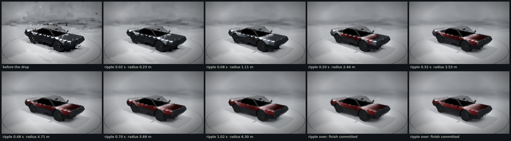
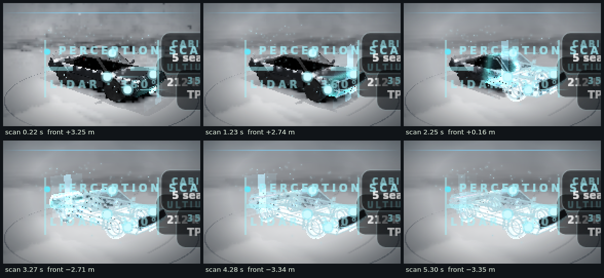
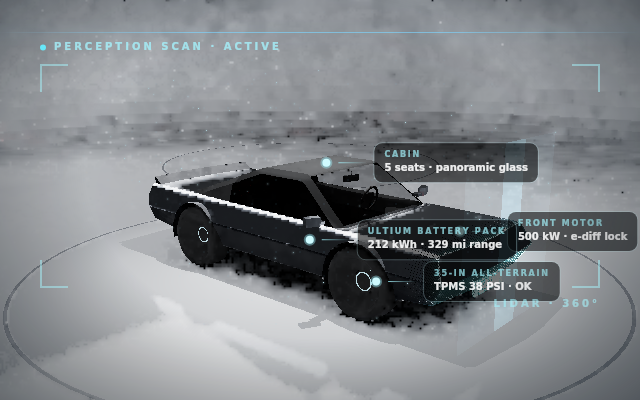
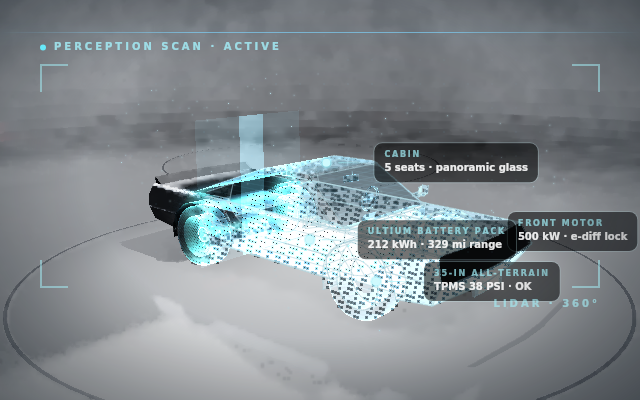
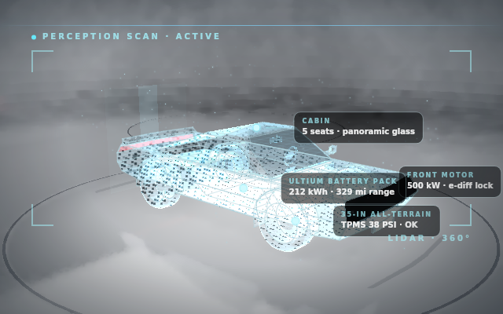

# Vehicle HMI prototype (HTML): evidence

What can be checked without a graphics card of the HTML demo in `Experimental/VehicleHmiPrototype`, which has two parts
here: the **TLAS skip when static** (`Renderer/Patches/0003-tlas-skip-static.patch`) and the **Garage**, the tablet's
configurator, whose car is drawn live by the demo's own ReSTIR scene, with the reference's paint ripple and the whole
X-ray scan. The demo's own README says how they work (`## The Garage: the car rendered live by the scene` and
`## TLAS skip when static`); this folder holds what was run, the code that ran it and what came out.

Nobody has opened the Garage in a browser with WebGPU. Everything below ran on a CPU, in Node.

## What was claimed, and what checks it

| Claim | Check | Result |
|---|---|---|
| The skip changes no TLAS byte | `ProfileTlasSkip.mjs`: every write to the node buffer is mirrored and hashed after each frame, skip on against skip off | 🟢 0 of 90 frames differ in each of four settings |
| The skip's key and guards are tested | `Tools/TlasSkip.test.mjs`, 15 tests | 🟢 15 of 15 |
| ... and the tests notice a broken key | `MutateTlasSkip.sh`, 32 one-line mutants | 🟢 32 of 32 caught (the first run caught 10 of 16: six gaps, now tests) |
| The skip fires in a static scene, and saves | `ProfileTlasSkip.mjs`, JavaScript time of `UpdateTlas` on a null backend | 🟢 fires (table below); 🟡 the claimed frame-time saving is not reproduced |
| The Garage draws the car with the scene's renderer | `RunGarageEvidence.sh`: the view under Dawn over SwiftShader | 🟢 16 pictures at 192 × 120 (10 of the ripple, 6 of the scan), 0 errors, 0 warnings in 12 + 8 frames |
| A paint change shows the reference's ripple | the `paint` plan | 🟢 12 frames, the wave crosses the car, then the finish is committed |
| The scan is whole | the `scan` plan | 🟢 transparency, ghost shell, wireframe, curtain, particles and HUD, in the sweep's order |
| ... at the stage's own size | a third run at 640 × 400 | 🟢 3 pictures at 640 × 400 (5 frames, 0 errors, 0 warnings): the HUD lays out as designed |
| Browser, tablet, GPU speed | none | 🔴 not run |

## Files

| File | What it is |
|---|---|
| `ProfileTlasSkip.mjs` | Runs the demo headless in the proving grounds and the lobby, skip off and on, as it comes and with the vehicle solver frozen from frame 40; writes the two JSON files |
| `tlas-skip-level.json`, `tlas-skip-lobby.json` | What it measured |
| `MutateTlasSkip.sh`, `tlas-skip-mutations.txt` | 32 one-line edits of the skip's key and guards (on a copy), each of which `TlasSkip.test.mjs` must fail; the result |
| `RunGarageEvidence.sh` | Drives the Garage's view with `Tools/GarageHooks.mjs` under SwiftShader: the paint plan, the scan plan, the sheets, the scan at 640 × 400 |
| `MakeContactSheets.mjs` | Tiles the pictures of each plan into a sheet, 2× and captioned from the `.json` beside each picture |
| `Images/` | The pictures at 192 × 120, one PNG and one JSON each, and the two sheets; `Images/Stage640x400/` holds the three at 640 × 400 |

The code under test is in `Experimental/VehicleHmiPrototype/` (`Source/RayTracingSpace.js`, `Source/GarageView.js`,
`Source/GarageOrbit.js`, `Source/PaintRipple.js`, `Source/ScanSequence.js`, `Source/VehicleEdges.js`, `Source/ScanHud.js`,
`Shader/ScanOverlay.wgsl`, `Shader/ViewWorld.wgsl`) and its hooks in `Tools/` (`TlasSkipHooks.mjs`, `GarageHooks.mjs`,
`TlasSkip.test.mjs`).

## Results

### TLAS skip

`ProfileTlasSkip.mjs`, 91 frames in each setting, skip on against off. The TLAS bytes of the 90 frames compared are
identical in all four. The milliseconds are JavaScript time of `UpdateTlas` on a null backend, not frame times.

| Scene, vehicle | Frames skipped | Buffer writes | TLAS bytes written | `UpdateTlas` mean, on v off |
|---|---|---|---|---|
| Proving grounds, as it comes | 0 of 91 | 91 v 91 | 2,897,440 v 2,897,440 | 1.199 v 1.133 ms |
| Proving grounds, solver frozen from frame 40 | 50 of 91 | 41 v 91 | 1,305,440 v 2,897,440 | 0.934 v 1.251 ms |
| Lobby, as it comes | 90 of 91 | 1 v 91 | 2,912 v 264,992 | 0.153 v 0.223 ms |
| Lobby, solver frozen from frame 40 | 90 of 91 | 1 v 91 | 2,912 v 264,992 | 0.111 v 0.282 ms |

- On 300 consecutive calls over a TLAS that does not change, a call costs 0.170 ms when it skips and 0.747 ms when it is
  forced to build in the level, 0.033 against 0.111 ms in the lobby; the TLASs are byte for byte the same (31,840 B and
  2,912 B).
- In the first row the skip never fires: the vehicle solver is live, so the level has 90 different TLASs in 90 frames. Its
  mean is 0.07 ms higher, the cost of comparing the key plus the noise of one run (the spread was not measured).
- The proof is the mirrored buffer, not pixels: SwiftShader's pixels differ from one run to the next even with
  `DETERMINISTIC=1`, so a picture A/B cannot show "unchanged".

### Garage: the paint ripple



`GarageHooks.mjs` (paint plan) picks the point of the body at the middle of the picture and drops Command Red there. The
captions are what the view had drawn when each picture was read (the `.json` beside it). The wave is the reference's
(`Truck.tsx`): 1.35 s to 6.4 m, a 0.55 m soft edge.

| Picture | Ripple clock | Radius |
|---|---|---|
| `paint-ripple-00-before` | no drop yet | 0 m |
| `paint-ripple-01` | 0.017 s | 0.23 m |
| `paint-ripple-02` | 0.083 s | 1.11 m |
| `paint-ripple-03` | 0.200 s | 2.44 m |
| `paint-ripple-04` | 0.317 s | 3.53 m |
| `paint-ripple-05` | 0.483 s | 4.71 m |
| `paint-ripple-06` | 0.700 s | 5.69 m |
| `paint-ripple-07` | 1.017 s | 6.30 m |
| `paint-ripple-08`, `-09` | over, the finish committed | 0 m |

The body turns from the dark coat to Command Red outward from the drop, and the last two pictures hold the new finish.

### Garage: the X-ray scan



The scan plan steps the scan's own clock (the reference's, 6.6 s long, a front from 3.25 m ahead of the nose to 3.35 m
behind the tail in 4.6 s). A software rasteriser draws only a handful of frames, so the plan advances the clock by about a
second between pictures, in the reference's own steps of at most 0.05 s, and each caption is the clock the picture was
drawn with.

| Picture | Scan clock | Front | Amount | What is seen |
|---|---|---|---|---|
| `scan-sweep-02` | 0.22 s | +3.25 m | 0.48 | the HUD is coming up and the car is still solid |
| `scan-sweep-03` | 1.23 s | +2.74 m | 0.98 | the curtain stands just ahead of the nose, the first wireframe lines show there, the body is still solid |
| `scan-sweep-04` | 2.25 s | +0.16 m | 1.00 | the front half is ghost and wireframe (the wheels' spokes show), the tail half is still solid, the curtain is over the roof |
| `scan-sweep-05` | 3.27 s | −2.71 m | 1.00 | wireframe over almost all of the car, a little solid left at the tail where the curtain is |
| `scan-sweep-06` | 4.28 s | −3.34 m | 1.00 | the front has passed the tail: the whole car is ghost and wireframe |
| `scan-sweep-07` | 5.30 s | −3.35 m | 1.00 | the hold: ghost shell and wireframe only, the curtain nearly gone |

### Garage: the scan at the stage's own size

The tablet's stage is 640 × 400 (`?garage=WxH`, the reference's size). A third run draws the scan there, three pictures in
`Images/Stage640x400/` (`RunGarageEvidence.sh`, step ④; about five minutes a frame on two cores). Here the HUD sits as
designed: the header, the corner frame, `LIDAR · 360°` and the four tags with their leader dots.

| Picture | Scan clock | Front | Amount | What is seen |
|---|---|---|---|---|
| `scan-sweep-02` | 0.22 s | +3.25 m | 0.48 | the HUD is up, the car is still solid, a bright line runs along its shoulder |
| `scan-sweep-03` | 2.73 s | −1.59 m | 1.00 | the car is a cyan ghost shell with its wireframe, the curtain stands near the tail, and the tail end the front has not yet reached is still solid |
| `scan-sweep-04` | 5.25 s | −3.35 m | 1.00 | the hold: ghost shell and wireframe, the solid gone, and the two lamps the scan spares still solid (the red tail lamp bar, the dark headlamp under the tags) |





The dark specks over the shell are the solid's 3.5 %: the fade is stochastic transparency (`Shader/SurfaceRaster.wgsl`: a
scanned pixel survives with the reference's alpha, against a threshold that changes every frame), and the pictures are one
frame each, so the coin flips have not been averaged by the temporal antialiasing, which is what smooths them on a GPU over
many frames. That smoothing is by design here and was not observed: the harness draws only a few frames.

## What is real, and what is not

Real:

- The view is the demo's own: `GarageView.js` records a second ReSTIR view of the scene (its own camera, surface,
  resampling and display targets and temporal history), and the shaders it runs are the demo's WGSL, which SwiftShader
  executes on the CPU through Dawn. The scan's layers, the ripple's blend, the orbit camera, the picking that finds the
  drop point and the paint state are the demo's modules, not stand-ins.
- Its wireframe is the car's own: 1,739 segments of feature edges for this scene's car, and 130 particles. The same module
  gives 1,751 segments on the engine's hero car, which is the car the C++ port is checked against; the two are different
  meshes (`Exhibits/XRayScan/Results/ScanReference.toml`, `[Car]` and `[Demo]`, written by `Code/ExportScanReference.mjs`;
  the `[Demo]` figures are listed there but `XRayScanValidation` does not compare them).
- The TLAS bytes compared are the ones the host writes to the node buffer: a mirror of every `writeBuffer`.

Not:

- Not a browser, not a GPU and not the tablet. The pictures are the preview well's texture read back, 192 × 120 for the
  sheets: speckled (the temporal history has had a few frames) and too small to judge a look from. They show that the
  view renders the scene and where each layer lies; they do not show timing in real time, which the plans set by
  stepping the clocks, nor how it looks on a GPU.
- At 192 × 120 the HUD does not fit: its insets and type are in the reference's pixels for a 640 × 400 stage, so its
  text runs off the edge and its frame is squeezed. Judge the HUD's layout by the pictures at 640 × 400 only.
- No picture of the tablet's own raster (the Garage page with its paint buttons) is among them: the script that made one
  was lost and was not rewritten.
- The frame times of the TLAS skip are JavaScript CPU time over a null backend, not what a graphics card spends. The GPU
  saving cannot be measured under SwiftShader.

### Not reproduced

Four statements of the request that these runs do not bear out, so they are not repeated here as results:

- "Applied after 0001 and 0002": neither patch is in this repository and neither can apply to it (`ClusteredLights.wgsl` is
  absent and three hunks reject). 0003 edits only `Source/RayTracingSpace.js`, so it is independent of both.
- The sizes, 32,544 B for the 509-instance level and 416 B for the lobby: here the level has 498 active instances and
  31,840 B, and the lobby 46 and 2,912 B.
- "It never fires in the lobby": here it fires on 90 of 91 frames, because the parked vehicle does not move.
- The saving, about 0.43 ms a frame in the level and 0.004 ms in the lobby: a skipped call saves 0.58 ms in the level and
  0.08 ms in the lobby in JavaScript here, which are not frame times.

## Environment and revision

- Linux 6.1.158 x86_64, 2 cores, 4 GB; Node v22.22.3; `webgpu@0.6.2` (Dawn) and `@napi-rs/canvas@1.1.0` (the HUD's 2D
  canvas) from `Experimental/VehicleHmiPrototype/Tools` (`npm ci`); SwiftShader's Vulkan ICD from `@sparticuz/chromium@153`,
  fetched by `Tools/RunOnSoftwareGpu.mjs` on its first run (registry.npmjs.org). The TLAS profile and the tests need
  only Node and `npm ci` in the demo.
- Revision: branch `arena/4356640b-frontier`. The TLAS profile (`tlas-skip-*.json`) was written at `c039b0e`, and
  `Source/RayTracingSpace.js` and `Tools/TlasSkipHooks.mjs` are unchanged since. The mutation run, the test count (159 in
  `npm test`: 150 pass, 0 fail, 9 skipped, which are the GPU tests that need `RUN_GPU=1`) and all the Garage pictures were
  made from the demo's code as it stands in `c564f60` (the working tree that became it). The sheets' captions
  (`MakeContactSheets.mjs`) and the 640 × 400 run (`RunGarageEvidence.sh`) came after it, in the commit with this README.
- Build type, shaders: none to build; the demo is run from source.

## Reproduce

From the repository root, after `npm ci` in `Experimental/VehicleHmiPrototype` and in its `Tools`:

```sh
node Exhibits/VehicleHmiPrototype/ProfileTlasSkip.mjs       # about a minute; rewrites tlas-skip-*.json
Exhibits/VehicleHmiPrototype/MutateTlasSkip.sh              # about 20 s; rewrites tlas-skip-mutations.txt
Exhibits/VehicleHmiPrototype/RunGarageEvidence.sh           # about 25 minutes on two cores; rewrites Images/
(cd Experimental/VehicleHmiPrototype && npm test)           # 159 tests
```

`RunGarageEvidence.sh` takes an output folder and honours `SIZE` (the studio camera's own picture, default 320 × 180
here; the harness's default 1280 × 720 takes about two minutes a frame) and `STAGE_SIZE=0` to skip the 640 × 400 run.
