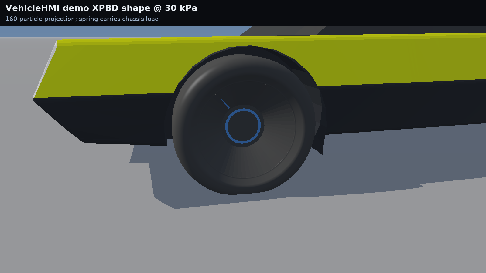
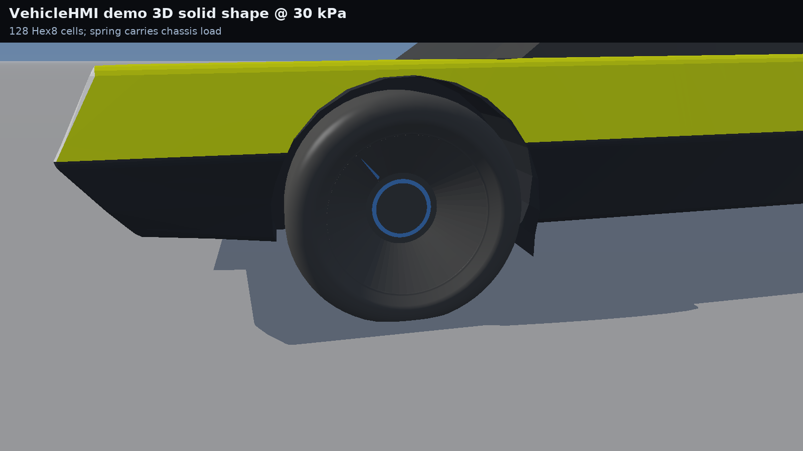
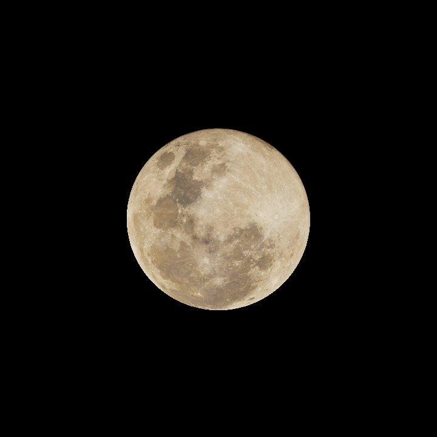
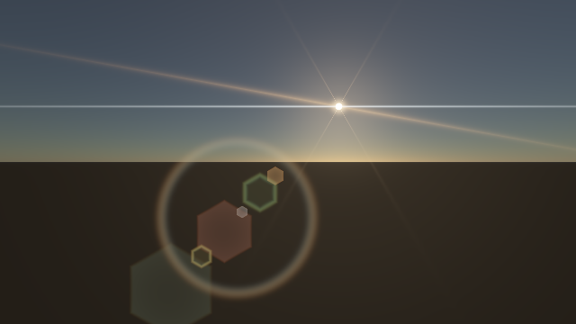

# VehicleHMI continuation — source audit and measured rendering changes

> **Later standalone GPU work:** the demo [projection](TyreProjectionDevice.md), [Hex8 solid](TyreSolidDevice.md)
> and [curved-shell model](TyreMembraneDevice.md) now run in isolated SwiftShader Vulkan fixtures. This does
> not add a shell vehicle mode or editor integration; the shell investigation also records independent mechanics
> counterexamples. The older source and integration descriptions below remain historical.

Continued from `arena/2ac8ddab-frontier` at `ae0bb7d`. The restored base is `29c5ab1`; this checkpoint is on `arena/672a179a-frontier`.
Tested 2026-10-27, GCC 12.2 / Node 22.22.3 / Linux CPU. No Windows binary, GPU or editor acceptance is claimed.

## The important correction

The previous audit inspected incomplete local demo copies. The owner's actual VehicleHMI reference,
`SultanAladin/Frontier` at `6afb6f00b5f25c45f7cda92c7da65b64845768f3`, **does contain** the missing features.
Selected original sources and their hashes are now retained in `Experimental/VehicleHmiReference/`.

| Question | Verified result |
|---|---|
| Several simultaneous flares? | Yes: warm rotatable streak, blue anamorphic, burst, ghosts and halo |
| Soft analytical Sun? | Yes: full demo has a limb-darkened, footprint-softened disc, not only the old hard step |
| Moon textures? | Yes: six-body 2K atlas and individual JPEGs; actual Luna source now retained and used |
| XPBD tyre? | Yes: full demo has a 160-particle XPBD implementation plus two continuum variants |
| What was previously ported? | Older spring/vehicle/slip/thermal sources; new custom 84-particle C++ lattice |
| Does older physics source match? | Old project's VehicleSolver/TyreSlipSolver are byte-identical to local SlateReference |
| Is custom C++ XPBD the demo port? | No. Different topology, constraints and force formulation |
| Is either verified against real tyre measurements? | No. Existing checks establish source parity and internal invariants |

Recovered XPBD uses compliant distance corrections and prescribed deformation targets. Its returned reaction is
exactly `deflection × (25000 + 0.88 × pressure)`, rather than summed constraint reactions. Twelve independent pressure/
deflection cases confirm this. The continuum variants also retain prescribed reaction laws. Consequently, blindly
replacing the current solver with the demo would not establish a more realistic force model.

**Current update:** the demo's 160-node XPBD projection and 128-cell Hex8 solid solvers are now ported and selectable
as deformation-only vehicle modes. The demo's separate *shell* model is not ported. The spring continues to carry the
chassis loads in both new modes, as it does in the source. The renderer now interpolates the actual nodal displacement
field instead of using the analytical spring fallback for these modes. The old 84-particle lattice remains separate.

Direct source comparisons and mode-switch tests are detailed below. The later standalone library and actual demo
WGSL surface-projection comparison are documented in [StandaloneTyreProjection.md](StandaloneTyreProjection.md).
These establish limited source parity, not a real-world tyre measurement or Project Drive vehicle/drivetrain/Pacejka parity. The existing native `TyreSlipSolver`
implements the demo's reduced force model and lacks Project Drive's aligning moment.

## Changes delivered

| Area | Change | Limit |
|---|---|---|
| Atmosphere | Cornette–Shanks aerosol phase, matching the full demo | Multiple scattering still approximate |
| Flare | Warm and blue anamorphic streaks mixed with other terms in the opt-in CPU reference effect | Coarse visibility; not GPU |
| Sun | Limb-darkened finite-pixel disc in the CPU reference renderer | Resolved erfc edge is approximate |
| Moon | Real 2048 × 1024 demo JPEG retained; runner regenerates PPM; topocentric position and angular size | Luna only; not reference renderer; licensing needs review |
| Moon colour | sRGB decoded before interpolation | Not absolute reflectance calibration |
| Cheap lighting | Lower, cooler hemispherical fill improves surface contrast | Artistic Lambert/Blinn lighting |
| Cheap shadows | Remove direct-light share while retaining blue skylight; guard grazing/below-ground Sun | Planar ground only |
| Highlights | Exposure before Reinhard instead of after it | Gamma 2.2 display remains approximate |
| Raster cost | Skip negligible matte highlights; reuse view distance for haze | No new buffers or extra rendering rounds |

The cheap renderer remains `Exhibits/VehiclePhysics/Code/SceneRender.cpp`, **not** a production Vulkan render path.
There is no PBR BRDF, shadow map, SSAO or ray tracing added. Its background is still the inexpensive gradient;
production atmosphere/optics are exercised by the separate NightSky exhibit, not integrated into this cheap renderer.
Ground shadows still multiply some haze along with the surface; no self-shadowing or soft penumbrae are claimed.
Near-plane triangle clipping remains missing. Glass is opaque. Existing authored geometry/material IDs are unchanged.

## Actual captures

The two new captures below were rendered and inspected on this checkpoint. They show the test raster and are not
visual-fidelity or physical-validation evidence. The older `RasterComparison.png` depicts the earlier base changes,
not the new ground fill.









## Verification

| Check | Result | Retained evidence |
|---|---|---|
| Sky, solar disc, Moon and mixed optics | 42/42 | `../NightSky/Results.txt` |
| Independent Sun/Moon ephemeris comparison | 960 2026 cases; max topocentric Moon error `0.003118°` vs JPL DE421 | `../NightSky/Results/Ephemeris-*.txt` |
| Reference solar pixels and mixed flares | Release and ASan/UBSan pass; flux error ≤ `0.000439` in seven views | `../NightSky/Results/Solar-*.txt` |
| Environment regression, release | 73/73 | `Results/EnvironmentRegression.txt` |
| Environment ASan + UBSan | 73/73, no diagnostics | `Results/EnvironmentSanitized.txt` |
| Existing production vehicle/Jolt suite | 29/29 | `Results.txt` |
| Full-demo unmodified JS tyre tests | 5/5 | `Results/FullDemoTyres.txt` |
| Recovered XPBD force/shape audit | 12/12 | `Results/ReferenceXpbd.txt` |
| Native XPBD/Hex8 node and interpolation checks | 16/16; same under ASan/UBSan | `Results/DemoTyres.txt`, `Results/DemoTyresSanitized.txt` |
| Spring and vehicle deformation wiring | 3,480 controlled spring steps; 180 frame advances, 105,600 node observations; same under ASan/UBSan | `Results/DemoTyres.txt` |
| Extended hard-drop diagnostic | **Fails strict parity** after further impacts | `Results/DemoTyresExtendedDrop.txt` |
| Synchronized one-step hard-drop | 720 JS states: max position `3.34e-16 m`, force/load `0 N`; release and ASan/UBSan | `Results/SpringStability-*.txt` |
| Hard-drop sensitivity / timestep | Same JS source is highly sensitive at impact; sampled timestep sequence does not converge | `Results/SpringStability-*.txt` |
| Raster checks | Ground coverage/reprojection, finite radiance, once-only shadows, blue fill, receiver rejection, grazing-Sun guard | `Results/RasterTiming.txt` |
| HDR ramp 1 / 2 / 4 / 8 | Display bytes 202 / 224 / 238 / 246, no premature white clipping | `Results/RasterTiming.txt` |

### Separate Project Drive vehicle core

The hook-based Project Drive core at `SultanAladin/Frontier-` commit `3f14808a6dcc909ae64070d62639a7019f5de794`
is now available separately under `Frontier/Engine/Physics/ProjectDrive/`. It includes its contact fan, suspension,
Pacejka forces **and aligning torque**, slip dynamics, drivetrain, brakes/ABS, aerodynamics and thermal model. It is
not the existing HTML-demo vehicle solver; hosts must bind the Project Drive chassis/ground hooks and opt into this
module. A visual bridge feeds Project Drive wheel telemetry and host-supplied pressures into the new demo XPBD/solid
shape models without feeding their prescribed reactions back into the Project Drive chassis.

`RunProjectDriveValidation.sh` verifies the retained reference blob hashes, preprocesses each of six imported core
translation units against the unmodified source, and separately builds/runs both implementations. Source and imported
outputs match for 7,350 force/torque cases, 4,320 transient-slip steps, 8,640 drivetrain steps, and the upstream
invariant and mock-chassis suites (126 checks). A separate 480-step mock-chassis test checks the visual bridge and
confirms identical dynamics with and without it. Normal and sanitizer outputs are in `Results/ProjectDrive*.txt`.
The standalone CMake static library also builds and links the visual-bridge consumer.

Important limitations: this is a source import, not evidence of complete independent GRIT/MF6.1 accuracy or measured
real-car calibration. Project Drive's Newton slip method is explicitly a reconstruction, not a bit-faithful GRIT copy.
The upstream `VehicleSceneValidation.cpp` is stale and does not compile against its own `WheelMount` revision; the
other drive checks use a mock chassis. Jolt/editor hosting, a complete Project Drive project port, live thermal-to-visual
wiring, and comparisons with measured tyres/vehicles remain open.

### New demo tyre tests: scope and limitations

`RunDemoTyreValidation.sh` verifies the unchanged source/shader blob identities, generates reference data directly
from JavaScript and builds the comparisons. Across 12 pressure/deflection/orientation/normal/force cases and eight
samples per model, the greatest local node difference is `2.71e-20 m`; world coordinates, prescribed forces and
contact counts match in this run. Interpolation also has synthetic constant-field, bilinear and guard checks; it is a
CPU transliteration, **not** a GPU execution comparison. Vehicle mode-switch tests synchronize prescribed pressure and
grip before each step, intentionally excluding the native host's thermal evolution.

Spring tests cover nominal, low, asymmetric and zero pressure, and a hard drop with pinched and airborne wheels.
Over the included 3,480 steps the greatest force error is `0.00145 N`, with no contact/pinch/top-out mismatches. The
same drop continued from 600 to 720 steps fails strict tolerances: maximum position error `0.00210 m` and load error
`334.5 N`. The 600-step passing result must not be interpreted as long-duration impact parity.

A targeted follow-up synchronizes public chassis and wheel inputs to each of the 720 states of that JavaScript
trajectory, then independently advances C++ once. At every synchronized step, tyre force/load and length match
exactly in this run; position differs by at most `3.34e-16 m`, spin/slip by `7.99e-15`. This supports matching
one-step equations **on that trajectory**, not free-running long-duration parity. Zero-pedal, flat-ground inputs are
used and thermal evolution is excluded.

A separate same-JavaScript perturbation test repeats exactly at identical initial conditions. Changing the initial
height by `1e-15 m` produces a maximum force difference `1,736 N` and three wheel-contact differences over 720 steps.
With only the hull-contact method disabled as a diagnostic control, the same perturbation produces `0.0041 N` maximum
force difference and no wheel-contact differences. This demonstrates strong impact/contact sensitivity that can
amplify tiny deviations; it does **not** prove that it is the sole cause of the C++/JS divergence.

The direct-JS timestep study compares 1/480, 1/960 and 1/1920 s against a 1/3840 s run, each sampled for 1.5 s.
A moderate drop shows decreasing maximum position differences `8.42 / 1.73 / 0.71 mm`; the hard drop gives
`0.234 / 0.169 / 0.367 m` and does not show monotonic convergence. The finest run is not ground truth; wheel force
and load samples come from the beginning of each final substep, so sharp contact onset is not synchronized across
rates. The demo host normally uses 1/480 s; other `Step` rates are diagnostics, not advertised host configurations.
No loose-body, shell, thermal-coupled or measured-vehicle validation is claimed.

### Performance: observed, not a universal guarantee

Same GCC `-O2`, 1280 × 720, same three fixed cameras, settled production vehicle, three warmups and 27 timed draws
per run. Alternating before/after/after/before order; no concurrent workload. Timing excludes simulation, encoding
and file I/O. The pre-ground-change source is extracted from pinned revision `29c5ab1`, not reimplemented.

| Measurement | Before | After |
|---|---:|---:|
| First run median | 61.213 ms | 38.163 ms |
| Reverse-order run median | 62.930 ms | 36.695 ms |
| RGB + depth + position buffers | 25,804,800 bytes | 25,804,800 bytes |

The analytic ground-plane fill replaces clipped ground/checker triangles; observed medians fell **38–42%** in these
paired runs. Shared-host scheduling varies; maxima are retained too.
This is not a physical-GPU benchmark or a claim of real-time engine performance.

## Reproduce

```sh
# Prerequisites: g++, ar, curl, Node; Pillow in PYTHON. First command fetches pinned Jolt 5.2.0.
PYTHON="$PWD/_ClaudeScratch/venv/bin/python" bash Exhibits/VehiclePhysics/RunVehiclePhysics.sh
bash Exhibits/VehiclePhysics/RunDemoTyreValidation.sh
SANITIZE=1 RESULTS="$PWD/Exhibits/VehiclePhysics/Results/DemoTyresSanitized.txt" bash Exhibits/VehiclePhysics/RunDemoTyreValidation.sh
bash Exhibits/VehiclePhysics/RunSpringStability.sh
SANITIZE=1 bash Exhibits/VehiclePhysics/RunSpringStability.sh
bash Exhibits/VehiclePhysics/RunProjectDriveValidation.sh
SANITIZE=1 RESULTS="$PWD/Exhibits/VehiclePhysics/Results/ProjectDriveSanitized.txt" bash Exhibits/VehiclePhysics/RunProjectDriveValidation.sh
cmake -S Frontier/Engine/Physics/ProjectDrive -B _ClaudeScratch/build/projectdrive -DCMAKE_BUILD_TYPE=Release
cmake --build _ClaudeScratch/build/projectdrive -j2
# Known failing extended drop diagnostic; use a scratch result so it doesn't overwrite the passing run:
FULL_DROP=1 RESULTS="$PWD/_ClaudeScratch/tyre-continuum/long-diagnostic.txt" bash Exhibits/VehiclePhysics/RunDemoTyreValidation.sh
bash Exhibits/VehiclePhysics/CompareRaster.sh
_ClaudeScratch/venv/bin/python Exhibits/VehiclePhysics/Code/AssembleRasterComparison.py
node --test Experimental/VehicleHmiReference/Tools/VolumetricTyrePhysics.test.mjs
node Exhibits/VehiclePhysics/Code/ReferenceTyreAudit.mjs
PYTHON="$PWD/_ClaudeScratch/venv/bin/python" bash Exhibits/NightSky/RunNightSky.sh
CMAKE=cmake bash Exhibits/NightSky/RunSolarValidation.sh
CMAKE=cmake SANITIZE=1 bash Exhibits/NightSky/RunSolarValidation.sh
cmake -S Exhibits/EnvironmentPipeline -B _ClaudeScratch/build/environment -DCMAKE_BUILD_TYPE=Release
cmake --build _ClaudeScratch/build/environment -j2
_ClaudeScratch/build/environment/EnvironmentPipelineValidation
```

For the sanitized environment run, use a separate Debug build directory and
`-DCMAKE_CXX_FLAGS="-fsanitize=address,undefined -fno-omit-frame-pointer"`.
The user approved a checkpoint push to the current `arena/672a179a-frontier` branch, including any resulting GitHub Actions.
