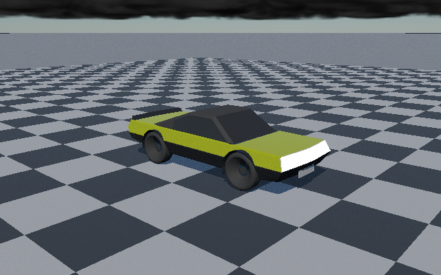
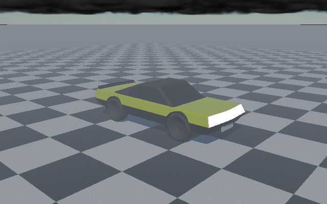
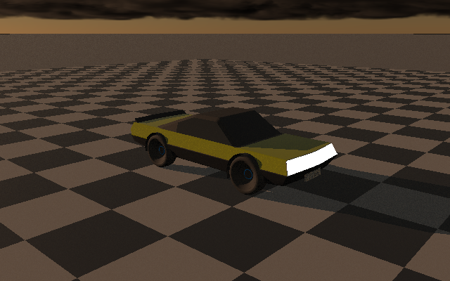
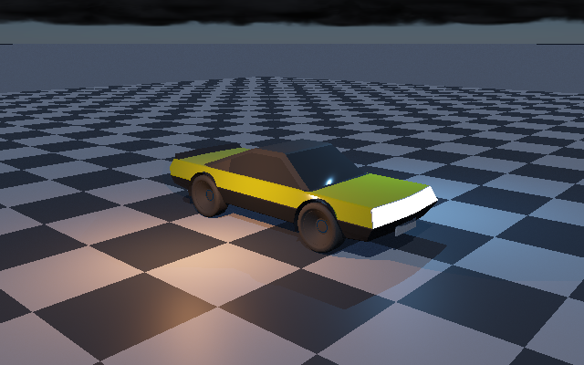

# ControlVehicle · sun, sky, fog and lighting showcase

Four native C++ reference renders reuse the same recovered ControlVehicle geometry, camera, pose and deterministic seed. The captures switch environment controls rather than substituting images or compositing effects. PNG conversion preserves the renderer's display-encoded RGB bytes.

**Rendering boundary:** these are software-reference CPU renders, not Vulkan/physical-GPU output, an editor viewport capture, or a real-time performance claim. The sky and clouds follow the current reference model; this is not the finished GPU atmosphere or an integrated vehicle editor panel. The lighting variant uses the existing analytic point-light path in addition to the Sun/environment.

## Render variants

### Sun, sky and cloud field

Sunlit ControlVehicle under the atmospheric sky and marched cloud field.



[Direct PNG](https://raw.githubusercontent.com/streamlinkinbox/Frontier/arena/5ec53579-frontier/Exhibits/VehicleReference/Capture/Showcase/VehicleSunSkyClouds.png)

### Height fog

Same pose and environment setup, with exponential height fog enabled.



[Direct PNG](https://raw.githubusercontent.com/streamlinkinbox/Frontier/arena/5ec53579-frontier/Exhibits/VehicleReference/Capture/Showcase/VehicleFog.png)

### Lower, warmer Sun

Same vehicle scene with the Sun shifted toward the horizon and a warmer irradiance balance.



[Direct PNG](https://raw.githubusercontent.com/streamlinkinbox/Frontier/arena/5ec53579-frontier/Exhibits/VehicleReference/Capture/Showcase/VehicleSunset.png)

### Local analytic lights

A dimmer Sun/environment fill remains active, with warm and cool local point lights added to the scene. This plate uses the reference renderer's exhaustive analytic-light sum (not a performance measurement of RIS).



[Direct PNG](https://raw.githubusercontent.com/streamlinkinbox/Frontier/arena/5ec53579-frontier/Exhibits/VehicleReference/Capture/Showcase/VehicleLocalLights.png)

## Reproduce

```sh
bash Exhibits/VehicleReference/RunShowcase.sh
```

The run builds `VehicleCapture`, renders four 640×400 variants from the native vehicle archives, verifies distinct pixel hashes, and losslessly wraps the PPM readbacks as PNGs. Settings and per-image hashes are recorded in [`Capture/Showcase/Manifest.json`](Capture/Showcase/Manifest.json).
