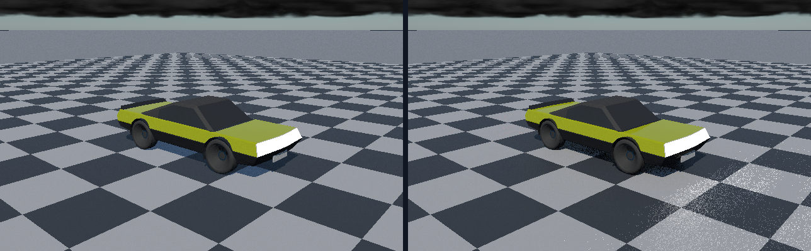

# Native ControlVehicle reference rerender

Actual C++ CPU renders of the recovered ControlVehicle body, four tyres and four rims: **25,068 original vehicle
facets**, the original 86-record material table, a checker ground, direct Sun, atmospheric environment and clouds.
Three rigid poses each have field-off and field-on captures at 640×400 with eight accumulation frames per pose. PNG conversion preserves the
native display-encoded RGB bytes; it does not synthesize geometry or lighting.
The near checker is surrounded by a 2 km ground apron so its finite edge does not expose below-horizon sky.



**Left: field off. Right: field on (joint occlusion and one-bounce radiance).** The native controls remain
`Capture/Vehicle*.png`; `Capture/Distance*.png` are the new geometry-aware renders.

For same-pose ControlVehicle renders with **Sun/sky/clouds, height fog, a warmer lower Sun, and local analytic lights**, see the [environment showcase](EnvironmentShowcase.md). It contains four lossless native CPU reference images and direct GitHub image URLs; it is not an editor viewport or hardware-GPU result.

## Continued renderer work

The recovered renderer used only primary-frustum-visible triangles as shadow occluders. An off-camera triangle
could therefore stop casting shadows. `TriangleVisibilitySpace` now builds balanced triangle bounds from the
entire scene when `SetScene` is called, independently of primary culling. Both fresh and spatial shadow queries
use that scene-space visibility structure. Primary raster culling and existing reservoir/filtering code stay intact.

| Verification | Observed result |
|---|---|
| Independent long-double exhaustive interval oracle | 8,192 comparisons, no mismatches or exclusions |
| Axis rays, interval endpoints, empty/rebuilt and invalid inputs | Passed |
| Off-camera shadow regression using original renderer | Fails as expected; `RegressionBefore.txt` |
| Same regression after fix | Passes; 2 primary-visible triangles unchanged |
| Regression scene mean luminance | 0.491849 without caster → 0.336274 with off-camera caster |
| Existing complete renderer checks | 18 passed, 0 failed |
| Recovered illumination/indirect/environment suites | 188/188; logs retained in `CoreResults.txt` |
| ControlVehicle | Three distinct finite HDR/display captures; each retains all 25,068 vehicle facets |

The luminance numbers demonstrate this specific shadow regression, not a general image-quality or performance score.
Queries use bounded double-precision triangle tests; this is not a universal watertight/grazing-intersection claim.

## Reproduce

Linux: `bash Exhibits/VehicleReference/Run.sh` with CMake 3.20+, a C++17 compiler, Node and Python.
If CMake is absent, the locally used pinned tool can be restored without vendoring it:

```bash
python3 -m pip install --target ExternalPackages/BuildTools cmake==3.31.6
bash Exhibits/VehicleReference/Run.sh
```

Windows: `./Exhibits/VehicleReference/Run.ps1` with CMake, a C++17 compiler, Node and Python.
The Windows entry point is supplied, **not executed here**. No Windows binary is claimed.
The archive paths are resolved from the repository root; scripts change to that root first.

## Explicit boundary

- Executed path: native C++ CPU reference. No Vulkan device, ray-query extension, RT core or swapchain is used.
- These captures are newly rendered, not merely restored upstream PNGs or the missing former Vulkan captures.
- The reference uses isotropic GGX and opaque surface response. Authored layered coat, transmission and corner
  normals are not fully reproduced; the archive corner normals are not consumed by this importer.
- Triangle-distance baking and one-bounce RGB radiance now execute as described below. The legacy analytic
  `IndirectSamples` gather remains disabled; transport uses the environment MIS proposals, not a fabricated
  analytic vehicle primitive. Card radiosity is not reconnected.
- Each pose builds a new scene and accumulates its own eight static frames. This is not cross-pose motion-history
  validation, a dynamics simulation or a replacement for the missing 48-view Vulkan run.
- Sky/cloud appearance is the recovered model, not a completed appearance redo. Moon work stays planned.
- Source and evidence are checkpointed to the session GitHub branch. No Actions dispatch is required.


## Triangle-distance lighting phase

`TriangleDistanceVolume` bakes **64×32×24 = 49,152 unsigned distance samples** from all **25,068 original vehicle
facets** per pose. The authored body is open-panel geometry, so no watertight signed-interior classification is
invented. Sampling subtracts a weighted distance-to-corners correction to obtain a conservative Lipschitz lower
bound. Sphere-trace strides are divided by ray speed, so non-unit directions retain their parameter intervals.
A coarse-grid near-hit or 64-stride limit always refines against original triangles: neither creates a surface hit.
The balanced triangle structure now supports nearest-point and nearest-hit queries as well as any-hit visibility.

The renderer's cosine/GGX environment proposals trace the vehicle field. Misses keep the existing sky model;
hits replace sky radiance with RGB surface radiance. The fixture computes that radiance as authored emission plus
shadowed diffuse direct sunlight (`albedo × (1−metalness) × irradiance × cos / π`) at each facet centre.
This is **one-bounce lighting from a frozen per-facet radiance approximation**, not iterative radiosity, a
multibounce solution, or a true material evaluation at every secondary hit. Rays are bounded to 200 m.
The same path works with atmospheric lighting disabled, as the red-emitter validation proves.

| Additional verification | Observed result |
|---|---|
| Independent long-double point/triangle reference | 2,048 proximity and conservative-bound checks; max distance error 1.11022e−15 m |
| Independent long-double bounded ray reference | 4,096 comparisons; 2,375 hits; max travel error 2.10942e−15 m; no exclusions |
| Actual saved ControlVehicle grid | All 49,152 finite samples reproduced through a separate archive import |
| Exhaustive actual-vehicle grid probes | 128 probes; max error 1.11022e−16 m |
| Exhaustive actual-vehicle ray probes | 256 probes; 250 hits; max travel error 1.77636e−15 m |
| Invalid inputs, failed rebakes, endpoints, RGB transport and radiance counts | Passed |
| Field-off native control images | All three match the prior `4a0e4ced` capture on the tested Linux configuration |
| Field-on native display captures | Three finite, visibly different captures; exact changes in `DistanceImageResults.json` |

The small numerical errors are observed comparisons for these fixtures, not universal precision guarantees.
Per-pose raw distance grids are generated under ignored `_ClaudeScratch/vehicle-reference/Distance*.bin` and
hashed in the comparison report. They are little-endian Float64, X-fastest, at the documented resolution; grid
bounds derive from the geometry extrema expanded by 0.15 m on each side. Run scripts regenerate them.
`TriangleDistanceValidation --vehicle` checks the actual saved pose-zero bake after capture.

`Code/DistanceImages.py --require-baseline` enforces the local committed control regression. Across compilers or
platforms, exact display-byte identity is not promised; comparison scripts report it without assuming Windows
matches the Linux run. Windows execution remains untested. Neither the tiny sampled errors nor the scene-space
bounds establish GPU precision or Vulkan execution.

**Quality limit:** bright, small emissive surfaces produce noisy low-sample reflections. This phase demonstrates
actual secondary geometry/radiance transport, not completed reflection filtering or emitter-importance sampling.
Sky/cloud appearance and the deferred Moon plan are unchanged.

## Analytic-light selection proof

`../ClusteredLighting` reuses this native vehicle importer for matched all-light/clustered captures with point,
spot and an explicit LM-63 profile. `VehicleCapture output-directory --clustered-lights` selects that two-image
fixture without changing the six default vehicle/distance controls. See its README for exact-image, fresh-RIS,
overflow and profile checks; neither exhibit claims GPU execution.
