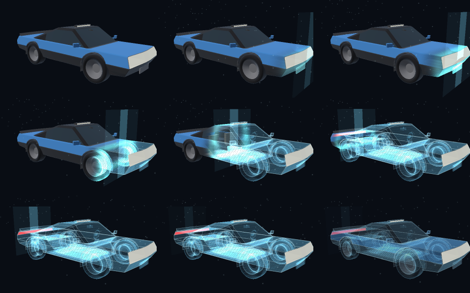
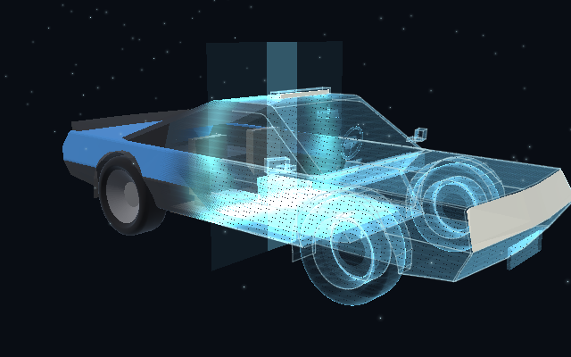

# X-ray scan (C++): evidence

The vehicle X-ray scan of the HTML prototype (`Experimental/VehicleHmiPrototype`), in C++, Vulkan and Slang. A bright
front sweeps the car from the nose to the tail. Behind it the painted body turns into a **transparent ghost shell**; the
**wireframe** of the car's feature edges appears and the solid car disappears; a two-plane **curtain** of light marks the
front; and **particles** float through the volume. It is the scan of `interactive-vehicle-hmi-configurator.zip`
(`Truck.tsx`), kept value for value by the prototype's `ScanSequence.js`, `VehicleEdges.js`, `ScanOverlay.wgsl` and
`GarageView.js`, and ported from those without approximation.

## Where the scan's code lives

| What | Where | Why there |
|---|---|---|
| The clock, ramp, front and amount; the constants; the ACES and sRGB conversions | `Engine/Rendering/XRayScan/XRayScanSequence.*`, `XRayScanSpecification.h` | A rendering system, as ParticleSimulation is: CPU state that a renderer reads |
| Feature edges (the wireframe), the particle cloud, the profile and view records | `XRayScanEdges.*`, `XRayScanSparkles.*`, `XRayScanProfile.*` | The records the shaders read |
| The overlay draws: ghost shell, wireframe, curtain, particles | `XRayScanOverlaySequence.*` (on the device exchange) | The host half of `ScanOverlay.wgsl` |
| The programs | `Engine/Shaders/XRayScan/XRayScanOverlay.slang`, `XRayScanOpacity.slang` | Slang is the shader language |
| The stored SPIR-V | `EngineContent/ShaderArchives/XRayScan/` (8 files and their manifest) | As the other archive sets |
| Which occupants a vehicle scans, and the lamps it spares | `Frontier/Extensions/Rendering/` (the vehicle binding, to come) | The scan is generic; the car is the game's |
| The HUD and the veil | The interface (planned `InterfaceSpace`) | They are UI |

`Engine/Effects/VehicleInspection.h` was an approximate CPU mirror of the effect. It is marked superseded, not removed:
`Scene/DeployableUnit.h`, `Game/SoftwarePresentation.{h,cpp}` and `Validation/SessionValidation.cpp` still use it and
must move to the modules above first.

## Results

| Check | Program | Result |
|---|---|---|
| The CPU modules against the prototype's own | `XRayScanValidation` | 🟢 3,157 assertions, 0 failures |
| Those checks, one line of a module wrong at a time | `Code/MutateXRayScan.sh` | 🟢 24 of 25 mutants caught; the survivor is equivalent (`Results/ScanMutations.txt`) |
| The Slang programs by the pinned slangc; stored archives | `Automation/RecompileShaderArchives.py --set XRayScan` | 🟢 8 of 8 SPIR-V files reproduced byte for byte |
| The overlay on a Vulkan device, over the hero car | `XRayScanCapture` (`Code/RunXRayScanCapture.sh`) | 🟢 9 shots written, SwiftShader |

`XRayScanValidation` compares with `Results/ScanReference.toml`, which `Code/ExportScanReference.mjs` writes from the
prototype's own modules (every number in it is one the JavaScript computed):

| Part | Agreement |
|---|---|
| The specification (every constant and colour) | equal |
| ACES, sRGB and the display colours | 86 of 93 values bit-identical, the rest within 2.22e-16 |
| The clock over the script: 168 sampled steps | 167 fronts bit-identical, worst 8.88e-16 |
| The layer profile and the view record | 336 of 336 floats bit-identical |
| The particle cloud (130 particles) | 520 of 520 floats bit-identical |
| Feature edges of 18 shapes | 382 segments equal |
| The hero car's wireframe | 1,751 segments, record hash `ef40c638f66069fe` (the prototype's: `ef40c638f66069fe`) |

## Captures

`XRayScanCapture` draws the hero car of the proving ground on its own Vulkan device at 640 × 400 and runs the scan's
clock over it. The car's facets, profile, particle cloud, feature edges and overlay programs are the real ones.

| Image | The scan at | Front | Amount | Scan pixels |
|---|---|---|---|---|
| `XRayScan-Scan-off.png` | off | +3.30 m | 0.00 | 0 |
| `XRayScan-Sweep-0.25-s.png` | 0.25 s | +3.25 m | 0.53 | 33,012 |
| `XRayScan-Sweep-0.9-s.png` | 0.9 s | +3.05 m | 0.93 | 41,461 |
| `XRayScan-Sweep-1.6-s.png` | 1.6 s | +2.14 m | 0.99 | 52,059 |
| `XRayScan-Sweep-2.3-s.png` | 2.3 s | −0.05 m | 1.00 | 76,961 |
| `XRayScan-Sweep-3.0-s.png` | 3.0 s | −2.24 m | 1.00 | 90,591 |
| `XRayScan-Sweep-3.8-s.png` | 3.8 s | −3.21 m | 1.00 | 93,788 |
| `XRayScan-Sweep-4.8-s.png` | 4.8 s | −3.35 m | 1.00 | 94,427 |
| `XRayScan-Hold-and-fade-6.0-s.png` | 6.0 s | −3.35 m | 0.60 | 94,409 |
| `XRayScan-Sweep.png` | all nine, as a sheet | | | |





At 2.3 s the front is at the middle of the car. Ahead of it (to the right) the shell, the wireframe, the wheels' rims and
the particles are in view and the solid car is gone; behind it the painted body is still solid, fading through the
stipple of the stochastic fade. `Results/Captures.tsv` has the clock, the draws and the pixel counts of every shot.

## What is real, and what is not

- **The picture under the overlay is a stand-in.** The illumination port's ReSTIR pipeline needs the whole scene's
  acceleration structures, and it is a 1:1 port that this work does not change. The capture draws the car flat with
  `Code/XRayScanCaptureSolid.slang` instead: it takes the engine's vertex deformation and the scan's stochastic fade
  (`XRayScanOpacity.slang`, the function the illumination port calls once the scan is bound to its refresh) and averages
  sixteen refreshes of it, as temporal antialiasing averages the fade's coin flips. The images show the overlay, not the
  port's lighting. Binding the scan's view to the illumination port's refresh is left to the game's integration.
- **The overlay's images are not compared pixel by pixel with the prototype's.** The CPU half is compared number for
  number; the programs are the WGSL line by line in Slang, and their SPIR-V is reproduced from source. What has been
  looked at is the capture above. (The Plume programs, by contrast, are compared bit for bit on Dawn: see
  `Exhibits/PlumeSimulation`.)
- **SwiftShader only.** The capture runs on the CPU Vulkan of `ExternalPackages/VulkanCompute`. Nothing here is measured
  on a GPU.
- **The vehicle binding is not written.** The scanned occupants and the spared lamps (families 13 and 14) are inputs
  of `EncodeScanView`; the vehicle extension that supplies them is to come.

## Environment and revision

Linux x86-64 sandbox, two cores, no GPU: GCC 12.2.0, CMake 4.4.4, Ninja 1.13.2, Slang 2026.14.1 (`slangc` from `Automation/PrepareVulkanCompute.py`),
Vulkan on SwiftShader, Node 22 for the exporter. Configured Debug with `-DBUILD_TESTING=ON -DFRONTIER_HOST_VERIFICATION=ON -DGLFW_BUILD_WAYLAND=OFF -DGLFW_BUILD_X11=OFF`
(the last two because the sandbox has no Wayland or X11 headers).

The results are from the sources of `4cc68b5`: nothing under `Frontier/` or this folder's `Code/` has changed since, and the mutation scripts restore what
they edit. **Not run:** Windows (no Windows binary was built for this exhibit), a GPU, a browser.

## Reproduce

```sh
cmake -S . -B build -G Ninja -DCMAKE_BUILD_TYPE=Debug -DBUILD_TESTING=ON -DFRONTIER_HOST_VERIFICATION=ON
ninja -C build XRayScanValidation XRayScanCapture XRayScanCaptureShaders
Exhibits/XRayScan/Code/RunXRayScanCapture.sh build      # validation, the nine shots, the copies into Images/ and Results/
Exhibits/XRayScan/Code/MutateXRayScan.sh build > Exhibits/XRayScan/Results/ScanMutations.txt
node Exhibits/XRayScan/Code/ExportScanReference.mjs     # rewrites Results/ScanReference.toml from the prototype
```
