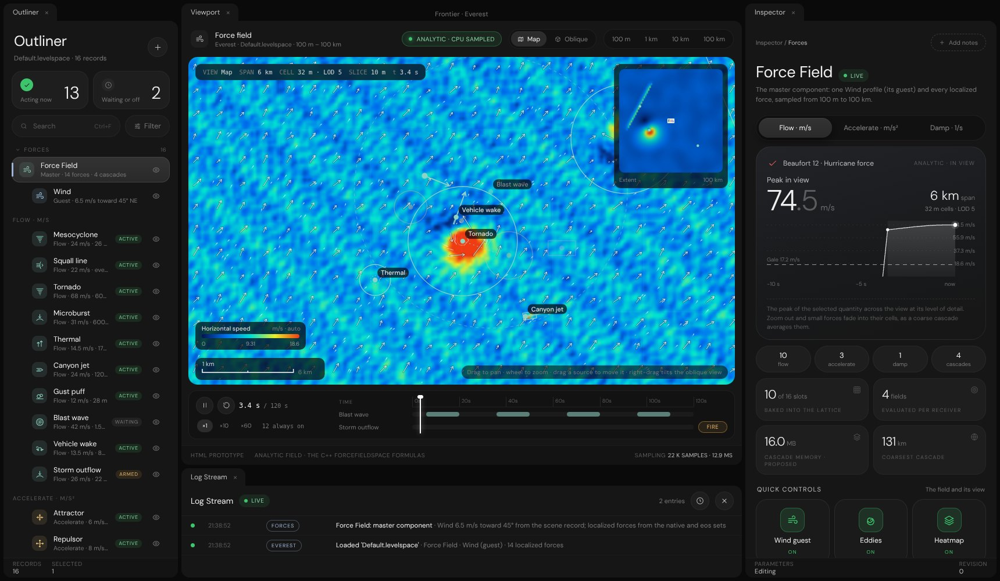

# Force Field editor prototype

The Force Field redone in the Render settings design: one master component, the Wind as its guest, and localized
forces under it, shown by the shared field visualization from 100 m to 100 km. HTML for review before the C++ step.

## Open it

From the repository root run `python -m http.server 8000` and open `/Experimental/ForceFieldEditor/`, or
double-click `index.html` (it works from a file too; the browser may then block the font files).

No build step and no engine connection. Edits persist in `localStorage` (`frontier-force-field-editor-v1`);
**Reset to the demo field** in any Levelspace block restores the defaults.

## Layout

| Panel      | Contents                                                                                  |
|------------|-------------------------------------------------------------------------------------------|
| Outliner   | Force Field (master) → Wind (guest) → localized forces by contribution, status, eye toggle |
| Viewport   | Map or Oblique slice, range pills, HUD, hover readout, minimap of the 100 km extent       |
| Timeline   | Play, ×1 · ×10 · ×60, a lane per windowed or triggered force, FIRE, scrubbing             |
| Log Stream | Every edit, trigger and view change, coalesced per setting as in Render settings         |
| Inspector  | Three pages: Force Field, Wind, and one per localized force                               |

## Inspector pages

- **Force Field:** peak in view with Beaufort and a 10 s chart; sections View, Range and detail (cascades), Localized
  forces, Receivers, Timeline, World vectors (the C++ arrows), Budget, Levelspace.
- **Wind:** speed now at 10 m with gusts shaded above the base speed; sections Flow (compass dial), Variability (gust
  preview), Altitude (Ekman profile and hodograph), Turbulence (a live eddy preview), Mesoscale, Levelspace.
- **Each force:** radial profile, status and envelope; sections Placement, Reach and falloff, Strength, Time window,
  Acts on, Levelspace; Frame in view, Duplicate, Remove, Solo and Follow.

## The field

- **Wind:** `ForceFieldSpace::EvaluateStepSample`'s profile: Ekman speed gain and veer with altitude, the travelling
  two-frequency gust wave and curl eddies. It opens with `Default.levelspace`'s Wind record (45°, 6.5 m/s,
  turbulence 0.45).
- **Flow types:** the native `ForceSourceKind` set (tornado column, gust front, microburst, thermal updraft, jet
  corridor, gust puff, blast wave, vehicle wake) and the eos Current.
- **Accelerate:** the eos force fields: attractor (with swirl and swallow), repulsor, orbit, lift, magnetic dipole,
  gravity. **Damp:** the eos drag volume.
- **Taxonomy:** eos `forcefields.js`: Flow m/s, Accelerate m/s² and Damp 1/s never share a bucket; Reach Everywhere,
  Sphere, Column or Box; Falloff None, Linear, Smooth or Inverse²; Begins, Lasts, Repeats; Acts on.

Bearings are compass degrees of travel (0° north = −Z, 90° east = +X), as `WindConfiguration::DirectionDegrees`;
the native profile reads `BearingRadians = (Bearing − 90°) · π / 180`. The validation compares the Wind with an
independent transcription of the native formulas at 400 points (worst difference below 1e-9 m/s).

## 100 m to 100 km

- The viewport samples a lattice whose cell is the power of two nearest 6 screen pixels, snapped to the world, so
  panning never shimmers and each halving of zoom is one level of detail (LOD 0 = 1 m … LOD 9 = 512 m).
- Terms shorter than two cells fade out (the 571 m gust bands, the 95 m eddies), as a coarse cascade would average
  them; at 100 km the view shows the weather systems (a mesocyclone, a squall line, a storm outflow), not aliasing.
- **Cascades (proposed):** four clipmaps of 128² × 32 cells, cells 2 m · 16 m · 128 m · 1 km, extents 256 m · 2 km ·
  16 km · 131 km, 16 MB in rgba16f. Shown at true size in the viewport with the Cascades tile.
- **Mesoscale (proposed):** a slow speed and direction variation over tens of kilometres, so a 100 km view is not one
  uniform arrow.

## Files

| File                                   | Role                                                                     |
|----------------------------------------|--------------------------------------------------------------------------|
| `index.html`                           | The page; loads the shared design, controls and visualization            |
| `ForceFieldCatalogue.js`               | Types, defaults, evaluation, activation, levelspace encoding             |
| `ForceFieldEditor.js`                  | Outliner, viewport, timeline, log and the three inspector pages          |
| `ForceFieldEditor.css`                 | The timeline and viewport cursor; everything else is shared              |
| `../ForceFieldVisualization/`          | The visualization the Particle editor also uses                          |
| `../RenderSettingsInspector/`          | The design (`RenderSettingsInspector.css`) and `InspectorControls.js`    |

## Keys

| Key         | Action                                  |
|-------------|-----------------------------------------|
| Space       | Play / pause the timeline               |
| 1 – 4       | 100 m, 1 km, 10 km, 100 km              |
| M / O       | Map / Oblique                           |
| F           | Fire the selected force                 |
| Delete      | Remove the selected force               |

## Levelspace

Each page ends with the records it would write. Keys without “proposed” are the ones `SceneWorld.cpp` reads today
(`ForceFieldRecord`, `WindRecord`); the validation checks that claim against the C++ source. Localized forces become
`ForceSource` records nested under `rec_force_field`, as the Wind record already is.

## Limits

- A browser prototype: it does not prove the C++ editor renders the same result. The C++ step ports the catalogue to
  `ForceFieldSpace` (the flow types already exist there) and the views to the editor's draw lists.
- The native names shown on the library cards (`VortexColumn`, `SphericalImpulseShell`) are the current C++ enum
  values and contain words the naming rules now bar; renames are listed in `Documentation/Tracker.md`.
- Evidence and the validation: `Exhibits/ForceFieldEditor/README.md`.
