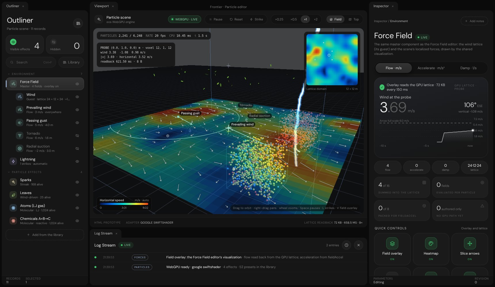

# Particle editor prototype

The eos Particle editor's WebGPU engine and preset library behind a new Frontier UI: the Render settings outliner and
inspector design, a library sheet for the same 52 presets, and the Force Field editor's visualization over the 3D view.

## Open it

From the repository root run `python -m http.server 8000` and open `/Experimental/ParticleEditor/`. WebGPU needs
Chrome or Edge (113 or later) and a secure context: `localhost` or HTTPS. `?scene=none` or `?scene=fire,snow`
replaces the default scene, as in the eos editor.

## What changed and what did not

| Part                        | State                                                                          |
|-----------------------------|--------------------------------------------------------------------------------|
| Engine, shaders, presets    | eos files, unchanged (table below)                                             |
| Frame loop                  | eos `app.js` `frame()`, systems, camera and packing, ported with Frontier names |
| Outliner, inspector, library | New, in the Render settings design (`InspectorControls`)                      |
| Field overlay and minimap   | New: `ForceFieldVisualization`, the Force Field editor's renderer              |
| Edits                       | Every effect row goes through eos `PE.Edits`, so the host handoff still hears them |

## Layout

| Panel      | Contents                                                                                       |
|------------|------------------------------------------------------------------------------------------------|
| Outliner   | Force Field → Wind (guest) → force fields; Lightning; particle effects with live counts         |
| Viewport   | WebGPU scene, field overlay (V), minimap, probe; Pause, Reset, Strike; ×0.25 – ×2; Top view    |
| Library    | 52 presets in 14 groups, group tabs, search, colour swatches, “in scene” badges                |
| Inspector  | Effect, Force Field, Wind, one page per force field, Lightning                                 |

The effect page leads with particles alive against capacity (a 10 s chart), then Source, Particle, Motion and the
preset's own sections (Transition, Black hole, Heat shimmer, Magnetic dipole, Physics, or the six fibre sections),
Readback with the full-buffer benchmark, and the proposed `ParticleEffect` record (preset plus overrides).

## The field overlay

| Contribution | Source of the readings                                                                    |
|--------------|-------------------------------------------------------------------------------------------|
| Flow         | The GPU wind lattice itself: 24 × 12 × 24 rgba16float copied back every 150 ms (73 728 B) |
| Accelerate   | `fieldAccel` from `shaders.js`, ported line for line, on the array the engine uploads    |
| Damp         | eos `SampleField` for drag volumes (authored only; the engine has no damp path yet)       |

Reading the lattice back rather than re-evaluating it means the overlay shows exactly what the particles feel: the
capture run compares the overlay's copy of the probe voxel with the engine's own probe texel and finds them equal.
The engine is not modified; the copy is a separate submission reading `windTex` (created with `COPY_SRC`).

The eos 3D lattice arrows are off by default (the overlay replaces them); the Wind page and the Force Field quick
controls turn them back on. Bearings are shown as compass bearings, as in the Force Field editor (0° = −Z, up in the
top view); eos stores `180° − bearing`, and the data is not converted.

## Engine provenance

Copied from `eosclient0001-rgb/Frontier`, branch `arena/24b8f4ad-frontier`, commit
`549c477454b0f93b23f0e295ee4b2f0d6e688ed1`, `Experimental/Editors/ParticleEditor/js/`. Not modified.

| File             | SHA-256 (first 16)  | Role                                                |
|------------------|---------------------|-----------------------------------------------------|
| `engine.js`      | `45f4f8ae8b72a884`  | Buffers, pipelines, encoding, readbacks             |
| `shaders.js`     | `323a81b462c69d40`  | WGSL: simulation, wind lattice, rendering           |
| `presets.js`     | `597563016cadefab`  | The 52 presets and the default scene                |
| `forcefields.js` | `0c1c130fc0fa4b9d`  | The Flow / Accelerate / Damp taxonomy               |
| `fibres.js`      | `225edf61aaaa39c7`  | Light fibres                                        |
| `lightning.js`   | `2ae9d2e87d69170b`  | Bolts, web arcs, thunder                            |
| `edits.js`       | `b08b86ec95ff6bf8`  | The edit funnel                                     |
| `handoff.js`     | `57c0151cc8aac8f7`  | postMessage handoff to a host editor                |
| `pe.js`          | `1d2896b991b5e9fc`  | The shared namespace                                |

`Engine/CheckForceFields.mjs` is the eos taxonomy check with its import paths shortened (`./js/` → `./`); run
`node Experimental/ParticleEditor/Engine/CheckForceFields.mjs` (91 checks pass). The engine files keep eos names
(`kind`, `system`, `emit`); they are renamed when the engine moves to C++, not in this prototype.

## Files

| File                        | Role                                                                     |
|-----------------------------|--------------------------------------------------------------------------|
| `index.html`                | The page                                                                 |
| `ParticleEditor.js`         | Scene, the ported frame loop, outliner, library, inspector pages, overlay |
| `ParticleFieldReadback.js`  | Lattice readback and the `fieldAccel` port                               |
| `ParticleEditor.css`        | WebGPU surface, library tabs, boot banner                                |
| `Engine/`                   | The eos engine, unchanged                                                |

## Limits

- Captured on SwiftShader (software WebGPU) at about 20 fps; a desktop GPU runs the eos engine at display rate.
- The 2D overlay is drawn over the 3D view, so particles below the slice show through it at the chosen opacity.
- The handoff (`PE.Handoff`) is wired but only acts when the page is framed by a host editor.
- Evidence and checks: `Exhibits/ForceFieldEditor/README.md`.
