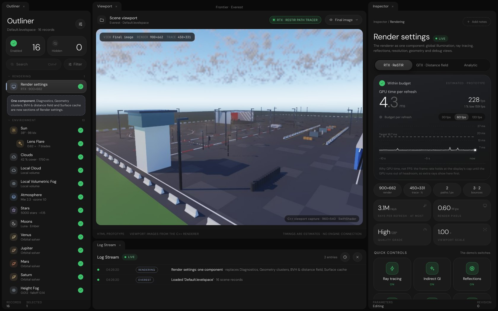
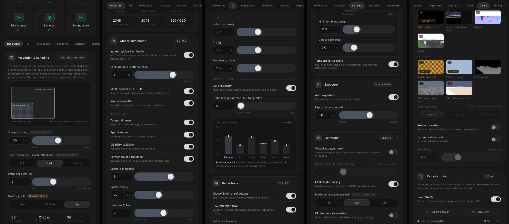

# Render settings inspector prototype

The owner asked for an HTML version of the Render settings inspector before it is built in the C++ editor. All of the
renderer's settings (multi-bounce, GI, reflections, ray tracing, viewport scale, debug views and the rest of the
VehicleHMI demo's render settings) live in **one outliner component** with **one inspector**. The look follows the
dashboard reference (pill tabs with a raised active pill, big readouts with dimmed decimals, dashed charts with white
markers) and the Frontier Editor's Sun, Post Process and Fracture inspectors (cards, numeric pill + knob fields, toggle
tiles, live parameter map). Colours are the C++ `InspectorPalette` (dark branch) value for value; the accent stands for
`ThemePalette::QueryAccentColor()`. Faces are DM Sans and JetBrains Mono, as `EditorTypefaces` loads them.





## Open it

```sh
python3 -m http.server 8080 --directory .   # from the repository root
# then http://localhost:8080/Experimental/RenderSettingsInspector/
```

`index.html` also opens straight from disk (classic scripts, relative paths). The fonts come from
`EngineContent/FontArchives` (`Automation/PrepareFonts.py`), with bundled DM Sans woff2 files as the fallback.

## Files

| File                          | Contents                                                                         |
| ----------------------------- | -------------------------------------------------------------------------------- |
| `index.html`                  | Outliner, viewport with Log Stream, inspector                                    |
| `RenderSettingsInspector.css` | Palette tokens and every control's look                                          |
| `InspectorControls.js`        | Reusable controls: rows, tiles, cards, charts, parameter map, inertial scrolling |
| `RenderSettingsCatalogue.js`  | Settings, levelspace keys, availability rules, extents, ray count, cost model    |
| `RenderSettingsInspector.js`  | The page: outliner, viewport, hero, the ten sections, levelspace record          |
| `Fonts/`                      | DM Sans 300 / 400 / 500 (OFL)                                                    |

## What is real and what is estimated

| Shown                    | Source                                                                                 |
| ------------------------ | -------------------------------------------------------------------------------------- |
| Viewport and debug views | The C++ viewport offscreen on SwiftShader (`Exhibits/SceneViewport/Images/Inspection`) |
| Render and trace extents | The demo's rule: viewport × scale under the grade's pixel ceiling, ⌈÷ trace scale⌉     |
| Rays per refresh         | Exact upper bound from the settings (every path to its last bounce)                    |
| Quality grade rows       | `IlluminationConstants.cpp`, field for field                                           |
| Scene counts             | The port's readout: 504 TLAS instances, 20,878 BLAS triangles, 8,554 cards             |
| Refinement figures       | `Documentation/Plans/Ongoing/RayTracedLighting.md`                                     |
| GPU time and its bars    | A prototype model; the C++ inspector shows measured submission times instead           |

## One component

The record `RenderPipeline` ("Render settings") absorbs `Diagnostics`, `PolygonClusters` ("Geometry clusters"),
`DistanceField` ("BVH & distance field") and `SurfaceCards` ("Surface cache"). Its sections:

| Section                  | Drives                                                                                |
| ------------------------ | ------------------------------------------------------------------------------------- |
| Hero and quick controls  | Renderer (RTX, GTX, Analytic), the demo's five switches, ray-traced shadows           |
| Resolution & sampling    | Viewport scale, trace resolution (Full / Half / Quarter), paths per pixel, grade      |
| Global illumination      | Indirect GI, path bounces, NEE, roulette, ReSTIR reuse, intensities, surface cache    |
| Reflections              | Reflections, RTX rays, bounces, intensity, roughness cutoff, mirror filter and trace  |
| Sun & shadows            | Sun shadows, ray-traced shadows, firefly filter, solar disc, stratified sun, penumbra |
| Denoising & antialiasing | Variance filter, diffuse and glossy wavelet levels, history, edge stops; temporal AA  |
| Exposure                 | Auto exposure, compensation                                                           |
| Geometry                 | Virtualized geometry, stream slots, GPU cluster culling                               |
| Distance field & BVH     | The grade's four clipmap cascades, freezing the field                                 |
| Debug views              | The fifteen inspection views, BVH / SDF view, readout overlay, slice inset            |
| Refresh timing           | Per-submission times of the last refresh                                              |

The levelspace block at the end writes the record; keys marked `# proposed` are new for the C++ step, the others are
already read by `SceneWorld.cpp`. The à-trous rows show wavelet levels: `VarianceIntegrator` dispatches
`min(4, WaveletIterations + 1)`, so the demo's glossy filter runs 3 and the diffuse filter 4.

## Found while building it

- Inspection view 6 (BVH / distance field) is black in the C++ port: `DisplayRecombination.slang` reads
  `InspectionRadiance`, but nothing writes it, because the demo's `InspectionMarch` was not ported.
- Cluster views 10 and 11 show the demo's own diagnosis without virtualized geometry: the orange checker
  (`ClusterDebugFallback`) and an empty visibility buffer. The prototype switches to the virtualized captures when
  Virtualized geometry is on.
- `BloomIntensity`, `AcesFilmicTonemap`, `ScreenSpaceReflections` and `InspectionDistanceMode` in
  `RenderPipelineConfiguration` have no reader in the renderer; the prototype leaves them out.
- The viewport forwards only GI, TAA, exposure, inspection, virtualized geometry, analytic illumination and the
  refinements today; quality and the RTX tier apply at construction.

## C++ step, after approval

1. One `RenderSettingsInspector` (its sections as separate units) replaces the RenderPipeline, Diagnostics,
   DistanceField, SurfaceCard and PolygonCluster pages, built from the shared controls.
2. `RenderPipelineConfiguration` gains the proposed fields; `ViewportRendering` forwards every one to
   `RefreshToggles`, `IlluminationSettings` and `VarianceSettings`; trace and render scale rebuild the targets.
3. `Default.levelspace` keeps one Render settings record; the four absorbed records migrate into it.
4. Port the demo's `InspectionMarch` so view 6 shows the BVH / distance field.
5. Timing from `DeviceExchange` submission timing replaces the prototype's model.
