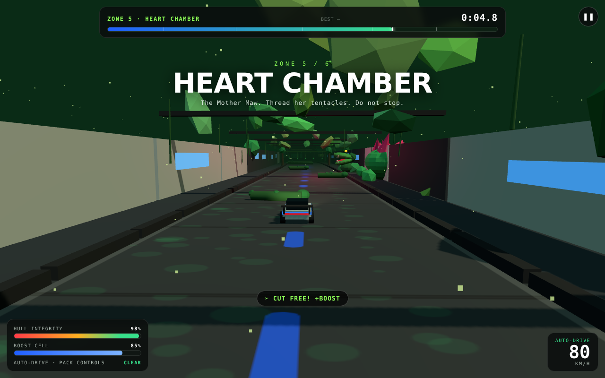
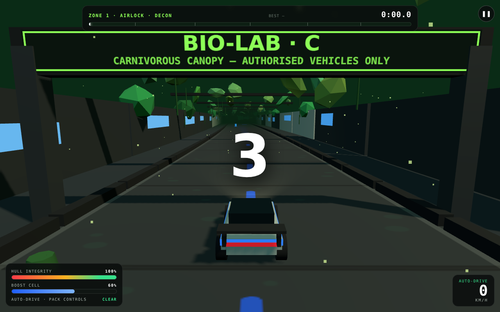

# FRONTIER · Level C — Overgrown Bio-Lab / Carnivorous Jungle Canopy

**Shadow-box (greybox) design document · v1 · playable blockout in `index.html` + `game.js`**

---

## 1. Fantasy & design pillars

> *The lab grew teeth.* The player's Pack Runner must sprint 1.44 km from the Airlock to the
> Extraction Pad through a research facility that has been completely reclaimed by its own
> specimens. **The level itself is the antagonist** — there are no rival racers. Every plant,
> vent and security door exists to **stop, grab, choke, gum up or hold the vehicle** before it
> can finish.

1. **The lab stalls you; it rarely just hurts you.** Primary failure pressure is *lost time*
   (grabs, sap, spores, doors), secondary is hull damage. A clean run is ~55 s; a bullied run
   is 100 s+.
2. **Simplified pack-driving.** Auto-drive is always ON — there is no gas pedal. The entire
   verb set is **steer · boost · brake · cut**. Anyone can play in 5 seconds; mastery is in
   reading plant telegraphs and boost management.
3. **Every hazard has a tell and a counter.** Red glow before a bite, boost to burn a vine,
   brake to time a door, cutter pulse to stun. Nothing is a pure dice roll.
4. **Teach → combine → graduate.** One new threat per zone, then everything at once in the
   final sprint.

## 2. Track shape (the shadow-box)

Linear point-to-point sprint (no laps — the fiction is an escape). Built as a gently bending
ribbon (`centerX(s)` sine blend) so sight-lines constantly hide the next threat. All gameplay
math happens in **track-space** — distance along track `s` + lateral offset — which makes
collisions, AI-free hazard logic and tuning trivial and robust.

| Zone | Name | s-range | Width | Role in the pacing curve |
|------|------|---------|-------|--------------------------|
| Z1 | Airlock · Decon | 0–200 | 16 m | Safe onboarding. Boost pads + first nitro. Learn steering. |
| Z2 | Specimen Hall | 200–460 | 15 m | Teach **Snapper** (dodge) + **Sap** (avoid/boost). Tanks sell the lab fiction. |
| Z3 | Canopy Bridge | 460–700 | **9.2 m** | Width squeeze = pressure. Teach **Vine Grabber** (boost-or-mash) + **Bramble** lane choice. |
| Z4 | Spore Greenhouse | 700–950 | 15 m | Teach **Spore Puffer** (route around clouds), sap slalom, first **Blast Door** at exit. |
| Z5 | Heart Chamber | 950–1180 | 17 m | Set-piece: **Mother Maw** + 3 sweeping tentacles + giant snap. Repair/nitro placed as a "breath" before it. |
| Z6 | Extraction Sprint | 1180–1400 | 14 m | Exam: door → snapper → sap → puffer → grabber → snapper, then double boost-pad glory run to the pad. |

Target pacing: tension saw-tooth (teach → spike → breath pickup → combine). A repair kit is
deliberately placed at the *exit* of Z4 and *entrance* of Z5 — the two highest-damage areas.

## 3. Hazard roster — how the lab stops you

| Hazard | Stall type | Telegraph (tell) | Effect on vehicle | Player counter |
|--------|-----------|------------------|-------------------|----------------|
| **Snapper Jaw** | Damage + knock | Rears up, mouth glows red & pulses ~0.7 s, aims at your *current* lane and **commits** | −12 hull, sideways knock, speed ×0.55 | Steer out after it commits, brake-check so it whiffs short, or Cutter Pulse to stun |
| **Vine Grabber** | **Full stop** | Tendrils hanging over the road from a canopy beam | Speed → 0, wrapped; plant digests you (−1.1 hull/s) until you **mash SPACE ×6** to cut free | Arrive on boost (>108 km/h) to *burn through* (+150 pts), or mash out |
| **Spore Puffer** | Slow zone | Bulb visibly swells for 2.4 s, then belches a yellow cloud onto a lane for 3 s | Engine choked to 45% power, visor fog | Route around the cloud; cutter pulse clears the choke |
| **Sap Pool** | Slow zone | Static purple pool (always visible) | Speed ×0.33, steering sluggish (boost: ×0.58) | Slalom the clean edges or boost through |
| **Bramble Wall** | Lane blocker | Thorn barricade covering ~60% of width; one in Z5 grows/shrinks cyclically | −8 hull, bounce out, speed ×0.3 | Pick the open lane early; time the growing one |
| **Blast Door** (lab element) | **Full stop** | Warning stripes + light turns amber→red; 6 s cycle (open 2.6 / close / shut 1.8 / open) | Physically held at the door line until it cycles open | Arrive on the green, or brake and time it — flooring it gains nothing |
| **Mother Maw tentacles** | Moving walls | 3 magenta arms sweep the full road width on offset sine phases | −10 hull + bounce like bramble | Read the sweep phase, thread the trailing gap |
| **Mother Maw (head)** | Boss snap | Giant jaw, longer louder telegraph | −17 hull over a 3.9 m bite radius | As Snapper, but respect the bigger radius |

**Support pickups:** Nitro cell (+45 boost), Hull patch (+22), Boost pads (free 1.15 s boost —
also your guaranteed vine-burner). Boost slowly regenerates (+3.2/s) so the player is never
soft-locked out of the vine counter.

## 4. Simplified pack-driving controls

| Input | Action | Notes |
|-------|--------|-------|
| *(nothing)* | **Auto-drive** holds cruise 27 m/s (97 km/h) | Pack-driving: the vehicle drives, you survive |
| `◀ ▶` / `A D` / touch ◀ ▶ | Steer | Lateral velocity, scaled by speed; deliberately sluggish in sap |
| `W` / `▲` / `Shift` (hold) | Boost to 42 m/s | Drains cell 21/s. Counters sap, burns vines, FOV kick |
| `S` / `▼` (hold) | Brake to 9 m/s | The timing tool for doors, jaws and tentacle phase |
| `SPACE` / CUTTER btn | **Cutter Pulse** | Mash ×6 to escape grabs · otherwise: 15-boost shockwave that stuns snappers ≤17 m and clears spore choke |
| `P`/`Esc` · `R` | Pause · Restart | Pause freezes *all* plant cycles (fair resume) |

**Win/Lose:** reach s = 1400 → extraction + medal (**Gold ≤ 1:20 · Silver ≤ 1:45 · Bronze =
survive**). Hull = 0 → wrecked ("The canopy keeps it"). Score rewards near-misses (+150),
vine burns (+150), escapes, stuns, remaining hull; penalises hits.

## 5. Greybox build notes (what's placeholder vs. locked)

- **Locked:** track-space physics, zone layout/widths, hazard placement table (`PLACEMENTS`
  in `game.js` — move a plant by editing one line), all hazard state machines, control scheme,
  HUD/meter economy, medal targets (pending playtest §6).
- **Placeholder:** every mesh is a primitive (boxes/cones/icosahedra) with flat materials;
  lab = white/grey/`#1f5eff` Frontier palette vs. saturated greens for biology; colour-coding
  is the readability system (red = bite, yellow = choke, purple = sap, amber = blocker,
  magenta = Maw). Audio is synthesized WebAudio (engine hum, snaps, chops) — no assets.
- **Tech:** Three.js r170 (vendored in `lib/`, MIT license included), single ES module, no
  build step. Serve statically: `python3 -m http.server` then open `/biolab/`.
- **Debug hook:** `window.__BIOLAB__` exposes player/hazards/state for tuning
  (e.g. `__BIOLAB__.P.s = 1050` teleports to the Maw).

## 6. Verification & next playtest questions

Verified headlessly (Chromium + scripted inputs): zero console errors; snapper bite lands on
a straight-line run (100→88 hull) and whiffs on a post-commit dodge; vine grab triggers and
mash-escape works; blast door physically holds the car while closed; finish + medal screen;
restart resets camera/HUD cleanly.

Open tuning questions for the first human playtest:
1. Is Gold (1:20) too generous for a no-hit run (~55–60 s theoretical)? Watch median first-run time.
2. Snapper commitment window (aim locks ~0.9 s before impact) — readable at boost speed?
3. Bridge grabbers ×2 within 140 m on a 9.2 m deck — fair, or does the first grab teach too late?
4. Does anyone find brake unprompted for the first door (Z4 exit), or do we need a floor decal?
5. Mother Maw tentacle phase speed (0.6 rad/s) vs. crossing time — currently ~1.2 tentacle
   widths of margin; verify it *feels* threaded, not lucky.

**Suggested next steps:** ① human playtest pass on §6, ② art pass replacing primitives
(keep colour code!), ③ ghost/leaderboard hookup to the Frontier lobby, ④ second bio-lab
variant (night cycle + "Pollen Storm" global event) reusing the same hazard kit.

