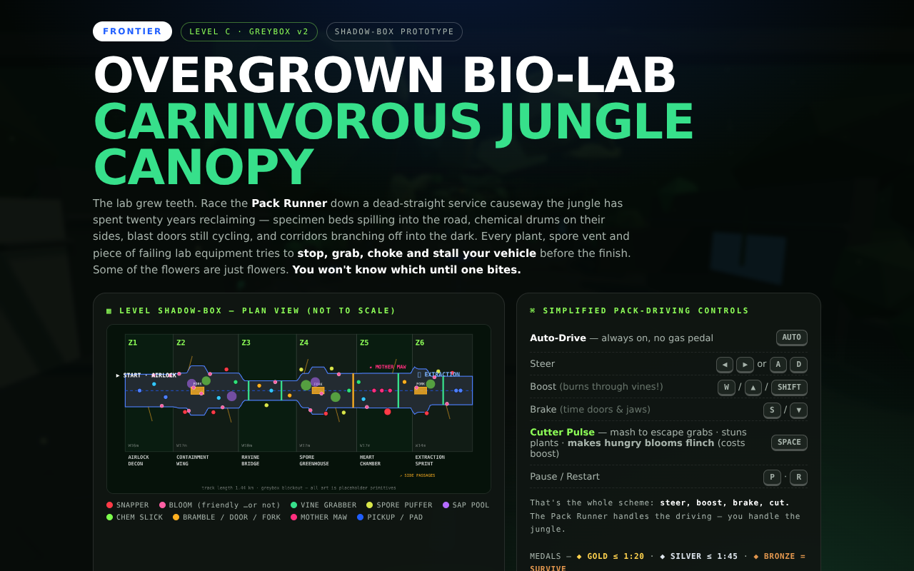
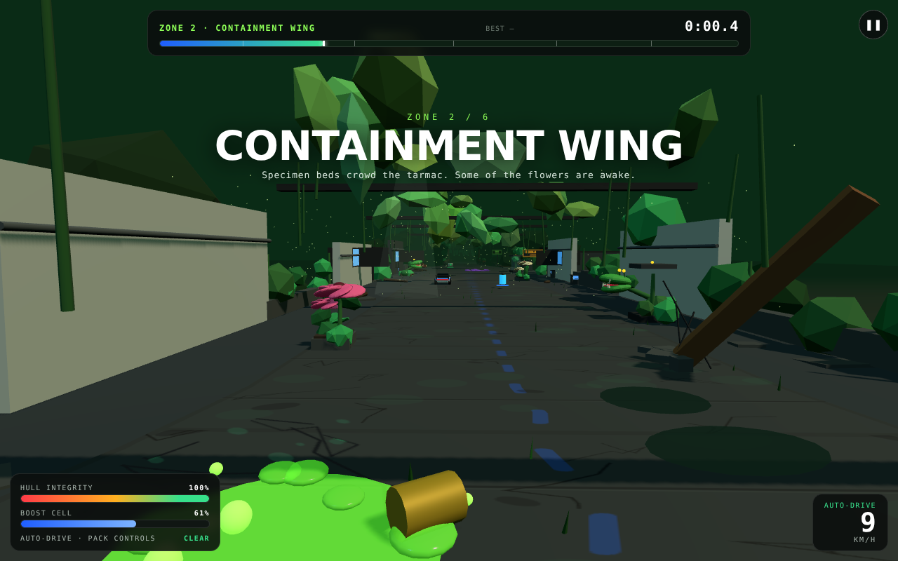
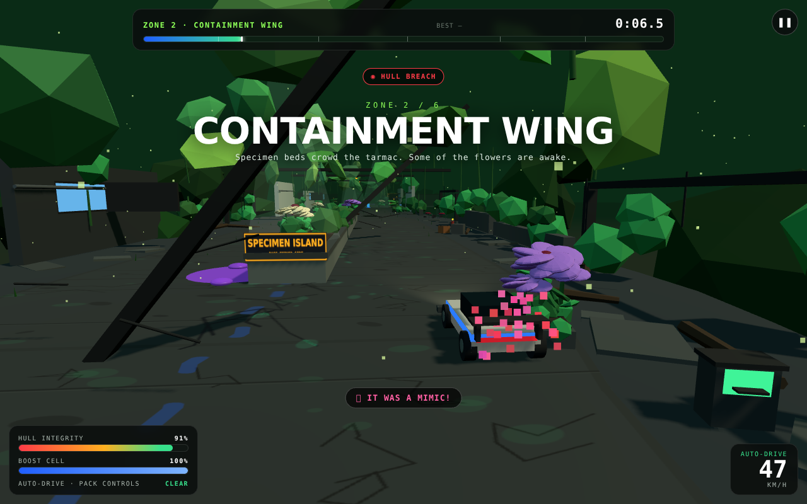
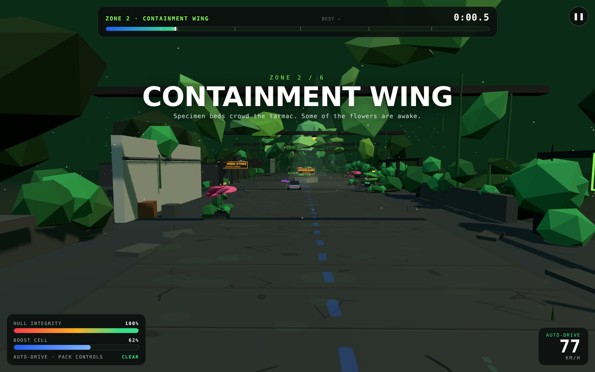
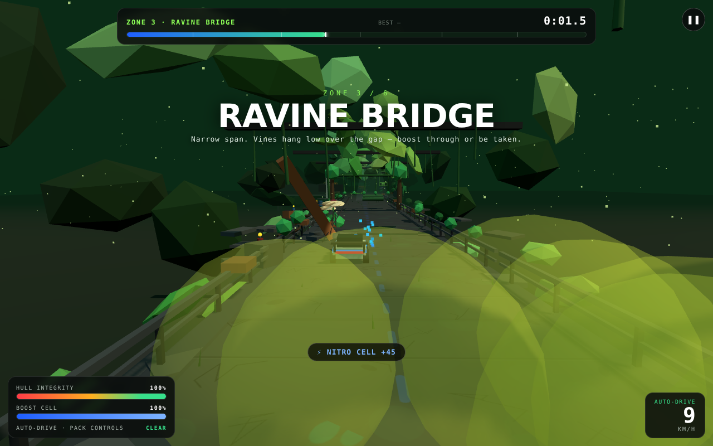

# FRONTIER · Level C — Overgrown Bio-Lab / Carnivorous Jungle Canopy

**Shadow-box (greybox) design document · v2 · playable blockout in `index.html` + `game.js`**

> **v2 changes** — the road is now a **dead-straight service causeway**, plants grow out of
> **beds, cracks, drums and toppled tanks** instead of lining up on the verge, the world is
> dressed with **lab props** (drums, consoles, gurneys, specimen tanks, gas bottles) and
> **side passages** branching off into the building, the road **forks around three central
> islands**, and there is a new hazard: **disguised carnivorous blooms** that look exactly
> like harmless garden flowers until one bites.

---

## 1. Fantasy & design pillars

> *The lab grew teeth.* The Pack Runner must sprint 1.44 km down a concrete causeway the
> jungle has spent twenty years reclaiming. **The level itself is the antagonist** — there
> are no rival racers. Every plant, vent, spill and failed door exists to **stop, grab, choke,
> gum up or hold the vehicle** before it can finish.

1. **The lab stalls you; it rarely just hurts you.** Primary pressure is *lost time* (grabs,
   sap, spore clouds, blast doors, island clips), secondary is hull damage. A clean run is
   ~55 s; a bullied run is 100 s+.
2. **Simplified pack-driving.** Auto-drive is always ON — there is no gas pedal. The whole
   verb set is **steer · boost · brake · cut**.
3. **Every hazard has a tell — except one.** Bites telegraph red, puffers swell, doors change
   their light, tentacles sweep on a sine. The **mimic bloom is the deliberate exception**:
   its tell is *behaviour* (a hungry one turns to follow you as you close) and it lands in
   about a second. That asymmetry is the level's signature.
4. **Teach → combine → graduate.** One new threat per zone, then everything at once in the
   final sprint.

## 2. Track shape: dead straight, the jungle makes the shape

The road is **flat and true** (`centerX(s) = 0`) — the lab drove it through the canopy and the
jungle has been eating it ever since: cracked slabs, hairline fractures, moss in the joints,
worn guidance dashes, half-swallowed apron, roots pushing up through the concrete.

Rhythm comes from three things instead of curves:

* **Widening + forks.** The causeway opens to 10–12 m around a central mass, splitting the
  road into **two passages**. Each side has different trouble. Neither is a dead end.
* **Zone width squeezes.** The ravine bridge narrows to 9.6 m with no shoulder and a drop.
* **Prop density.** Debris thickens as the facility fails.

| Zone | Name | s-range | Width | Role in the pacing curve |
|------|------|---------|-------|--------------------------|
| Z1 | Airlock · Decon | 0–200 | 16 m | Safe onboarding. Pads, first nitro, **three decoy blooms** — "flowers are harmless here" gets planted in the player's head. |
| Z2 | Containment Wing | 200–470 | 17.2 m | Teach **Snapper** + **first mimic bloom**, first chemical slick, **fork #1: Specimen Island**. |
| Z3 | Ravine Bridge | 470–710 | **9.6 m** | Width squeeze = pressure. **Vine Grabber** (boost-or-mash), bramble, rail-planter bloom. |
| Z4 | Spore Greenhouse | 710–960 | 16.8 m | **Spore Puffer** clouds, chem spill, **fork #2: Collapsed Column**, first **Blast Door** at the exit. |
| Z5 | Heart Chamber | 960–1190 | 17 m | Set-piece: **Mother Maw**, three sweeping tentacles, giant snap, growing bramble. |
| Z6 | Extraction Sprint | 1190–1400 | 14 m | Exam: **fork #3: Collapsed Truss**, snapper → chem → bloom → puffer → grabber → snapper, then double boost-pad glory run. |

Repair kits sit at the *exit* of Z4 and the *entrance* of Z5 — the two highest-damage areas.

## 3. Hazard roster — how the lab stops you

| Hazard | Stall type | Tell | Effect on vehicle | Counter |
|--------|-----------|------|-------------------|---------|
| **Snapper Jaw** | Damage + knock | Rears up, mouth glows red & pulses ~0.7 s, commits to your lane | −12 hull (−17 Maw), knock, ×0.55 speed | Steer out *after* the commit, brake-check it short, or stun with Cutter |
| **Disguised Bloom** *(new)* | Damage + hard slow | **None up front.** A hungry one slowly tracks you from ~24 m out, then folds shut | −9 hull, ×0.42 speed. Decoys in identical beds do nothing | Read the tracking, hug the far lane, or fire the Cutter — **nearby mimics flinch and wilt** |
| **Vine Grabber** | **Full stop** | Tendrils hanging over the road from a canopy beam | Speed → 0, wrapped, digesting (−1.1 hull/s) until you **mash SPACE ×6** | Arrive above ~30 m/s on boost to burn through (+150), or mash |
| **Spore Puffer** | Slow zone | Bulb swells 2.4 s, then 3 s of yellow cloud over a lane | Engine 45% power + visor fog | Route around it; Cutter clears the choke |
| **Sap Pool** | Slow zone | Static purple pool | ×0.33 speed, sluggish steering | Slalom the edges or boost through |
| **Chem Slick** *(new)* | Loss of control | Glowing green spill, tipped drum, bubbles | Almost no drag (×0.8) but **steering ×0.32** — you slide | Straighten before you hit it, or Cutter pulse |
| **Bramble Wall** | Lane blocker | Thorn barricade over ~60% of width (one grows/shrinks) | −8 hull, bounce, ×0.3 speed | Pick the open passage early |
| **Fork Island** *(new)* | Lane split / collision | Concrete mass with a lit `PASS EITHER SIDE` plaque | Clip it → −7 hull, shoved into a passage, ×0.6 speed | Commit to a side before the nose |
| **Blast Door** | **Full stop** | Stripes + light green→amber→red, 6 s cycle | Physically held at the line until it cycles | Time the green, or brake |
| **Mother Maw tentacles** | Moving walls | Three magenta arms on offset sine phases | −10 hull + bounce | Read the sweep, thread the gap |
| **Mother Maw** | Boss snap | Giant jaw, longer tell | −17 hull over a 3.9 m radius | As Snapper, bigger |

**Pickups:** nitro (+45 boost), hull patch (+22), boost pads (free 1.15 s boost — also your
guaranteed vine-burner). Boost regenerates +3.2/s so you can never be soft-locked out of the
Cutter.

## 4. The causeway set-dressing kit

Everything is primitives (it's a greybox) but the *layouts* are the design:

* **Planters & beds** — verge planters, rail planters on the ravine bridge, and soil beds on
  the islands. Blooms always come in these, never as loose decoration, so "flower = bed" is
  not itself a tell.
* **Lab props** — stacked drums (blue/red/yellow/rust, some tipped and leaking), wooden
  crates, gas bottles, operator consoles with green/blue screens, stainless gurneys with
  (unpleasant) specimen bodies, glass specimen tanks — intact or **smashed open**, with the
  occupant now loose on the apron.
* **Structural failure** — broken concrete shoulders, hairline cracks and puddles on the tarmac,
  low wall stubs with jungle pouring over them, fully collapsed spans that leave only a
  doorway frame and hanging cables, **four fallen trusses** resting where they hit.
* **Side passages** — seven corridors branch off the causeway into the building (Specimen
  Store, Chem Store B, Ward 4, Maintenance, Exit 9…). They are not playable routes; they are
  there so the lab reads as a *building*, they give plants somewhere to grow from, and they
  seed the next level (any one of them is a door you could open later).
* **Overhead** — intact trusses with caged lamps, sagging vine curtains, broken greenery, and
  soft shafts of daylight through the ruined roof.
* **Performance** — the straight road means nothing gets frustum-culled by curvature, so the
  static world is manually culled to a ~255 m window around the car; bloom beds hide outside
  165 m. Typical frame: **~700–950 draw calls / ~70–95 k triangles**.

## 5. Simplified pack-driving controls

| Input | Action | Notes |
|-------|--------|-------|
| *(nothing)* | **Auto-drive** holds cruise 27 m/s | Pack-driving: the vehicle drives, you survive |
| `◀ ▶` / `A D` / touch | Steer | Lateral velocity scaled by speed; deliberately numb in sap, near-useless on a chem slick |
| `W` / `▲` / `Shift` | Boost to 42 m/s | Drains 21/s. Beats sap, burns vines, widens FOV |
| `S` / `▼` | Brake to 9 m/s | Your timing tool for doors, jaws and tentacle phase |
| `SPACE` / CUTTER | **Cutter Pulse** | Mash ×6 to escape grabs · otherwise a 15-boost shockwave that stuns snappers ≤17 m, clears spore choke, and **makes hungry blooms flinch** |
| `P`/`Esc` · `R` | Pause · Restart | Pause freezes every plant cycle (fair resume) |

**Win/Lose:** s ≥ 1400 → extraction + medal (**Gold ≤ 1:20 · Silver ≤ 1:45 · Bronze =
survive**). Hull 0 → wrecked ("The canopy keeps it").

## 6. Build notes

- **Locked:** track-space physics, zone widths/widenings, fork islands, the placement table
  (`PLACEMENTS` in `game.js` — move a plant by editing one line), hazard state machines,
  controls, HUD economy, medal targets.
- **Placeholder:** all meshes are primitives; colour-coding is the readability system (red =
  bite, pink = bloom, yellow = choke, purple = sap, green = chem slick, amber = blocker/lab,
  magenta = Maw). Audio is synthesized WebAudio — no assets. Three.js r170 is vendored in
  `lib/` (MIT). No build step: serve the folder.
- **Determinism:** prop and island layout uses a seeded RNG and position-hashed jitter, so the
  level looks identical every run — tuning stays meaningful.
- **Debug hook:** `window.__BIOLAB__` exposes `P`, `hazards`, `state`, and render stats
  (`__BIOLAB__.info`). e.g. `__BIOLAB__.P.s = 1050` teleports to the Maw.

## 7. Verification & open questions

Verified headlessly (Chromium + scripted inputs), zero console errors:

- mimic bite lands exactly once and only from a hungry bloom (`hull 100 → 91`, "IT WAS A MIMIC!");
- an identical manoeuvre at a **decoy** bed leaves hull at 100;
- **Cutter Pulse reveals** nearby mimics ("A BLOOM FLINCHED");
- island collision shoves the car into a passage and never leaves it inside the mass;
- chem slick registers (`inChem`, `SLIDING` gear, chip) and steering authority drops;
- snapper bite / post-commit dodge, vine grab + mash escape, blast-door hold, finish, medal,
  best-time persistence and restart all still pass.

Open tuning questions:
1. Gold (1:20) vs. a ~55–60 s theoretical no-hit run — too generous? Watch median first-run.
2. Is one bloom bite enough to teach mimics, or does the first one need a louder post-bite cue?
3. Fork islands: does the player commit early enough at boost speed, or does the plaque read too late?
4. Chem slicks are a control-loss hazard, not a damage one — does that read as fair?
5. Do the side passages make players try to drive into them? (They can't — worth a "SEALED" sign?)

**Suggested next steps:** ① human playtest on §7, ② art pass replacing primitives (keep the
colour code), ③ open one side passage as a real shortcut/detour risk-reward, ④ second variant
(night cycle + "Pollen Storm" global event) reusing the hazard kit.

