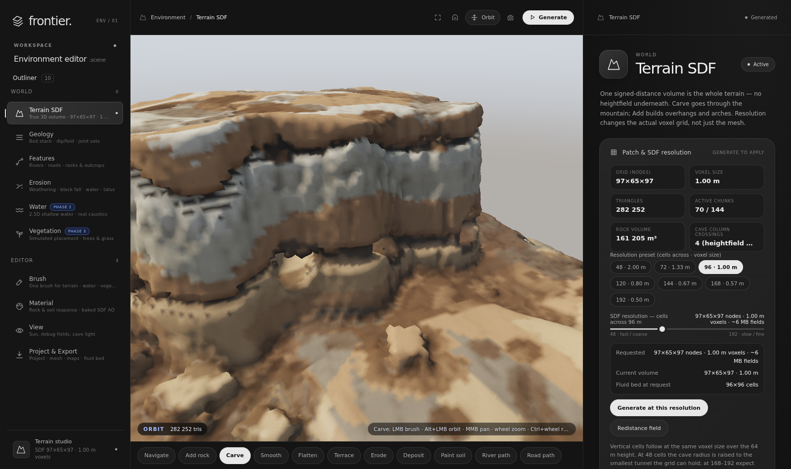
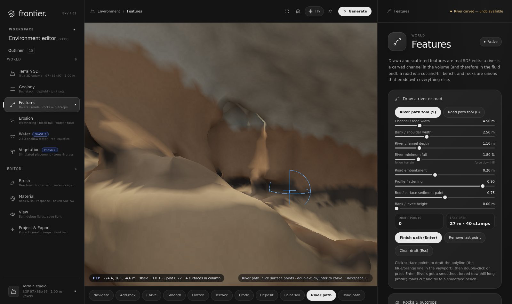

# Frontier — Environment Editor (Phase 1: SDF terrain)

A browser environment editor that unifies the three Frontier prototypes —
terrain (Slate `CliffGenerator`), water (`engine/fluid`) and vegetation
(Slate tree/grass generator) — under **one brush, one UI theme and one set of
terrain fields**. This phase ships the terrain core the other two systems
plug into: a **true 3D signed-distance volume** with sedimentary geology,
SDF-native erosion, caves/overhangs you can fly into, and the bed/flow/soil
products that water and vegetation consume.




## Run

No build step, no JavaScript CDN — plain ES modules and raw WebGPU. Serve
the folder statically:

```sh
cd environment-editor
python3 -m http.server 5173 --bind 0.0.0.0
# → http://localhost:5173/   (Chrome/Edge with WebGPU)
```

Core checks (pure JS, no browser needed):

```sh
npm run check        # 47 checks: geology, SDF ops, resolutions/landforms, features, erosion, AO seams, fluid bed
```

## Why SDF, and why the cliffs are not noise

The previous terrain prototype was a heightfield with local SDF chunks only
on steep faces. That representation cannot make a cave roof, an arch
underside, or a cornice that later calves a block — and its cliffs were
finished with vertically displaced / slope-blended noise, which is exactly
what produced the banded, wallpaper look: `sin(y)` strata, contour terracing
and stretched triplanar detail.

Here the **whole patch is one SDF volume** (97×65×97 nodes, 96×64×96 m at
1 m). Cliff form is not displaced in; it is **what remains after simulated
removal from a geological volume**:

1. **Bed stack** — a Markov (Walther-style) facies sequence of sandstone,
   siltstone, shale and limestone beds, each with its own thickness,
   hardness and colour. No periodicity.
2. **Stratigraphic coordinates** — beds live at constant
   `s = y + dip·(x,z) + fold(x,z) + fault`, with per-bed lateral thickness
   variation, so beds dip, fold, swell and lens out over ~20–45 m instead of
   running as world-Y stripes. Because the field is volumetric, digging a
   tunnel exposes the correct beds inside the mountain.
3. **Joint sets** — three near-vertical fracture families whose spacing
   scales with local bed thickness, whose phase resets at bedding planes,
   and whose persistence terminates along strike. Bedding planes themselves
   are weakened seams.
4. **Differential weathering** — a level-set retreat
   `rate · [(1−hardness)^p · 0.75 + joint² · (0.25 + 0.75(1−hardness))] · exposure`.
   Soft shale recedes into undercuts; hard sandstone/limestone stays as
   cornices; joints open into slots even inside hard beds.
5. **Block fall** — hard, jointed, unsupported rock detaches as
   **bed-thickness boxes** (not spheres) and lands at the foot keeping its
   source bed, becoming loose material for talus.

Noise still exists in the codebase, but only where it belongs: large-scale
plan meander, folding, pinch-out and persistence masks (`src/noise.js`
documents this rule). The renderer contains no cliff detail noise — set
*View → Matte grain* to 0 and the relief is unchanged, because the relief is
geometry.

## The terrain studio around the volume

### Real SDF resolution control

*Terrain SDF → Patch & SDF resolution* has preset buttons and a slider from
48 to 192 cells across the 96 m patch. Generate rebuilds the field arrays and
meshing chunks at that spacing; it is not an LOD or a rendered-mesh setting.
Vertical cells follow isotropically over 64 m:

| Cells across | Node grid | Voxel | Approx. field arrays* | Fluid bed |
|---:|---:|---:|---:|---:|
| 48 | 49×33×49 | 2.00 m | ~1 MB | 48×48 |
| 72 | 73×49×73 | 1.33 m | ~3 MB | 72×72 |
| 96 | 97×65×97 | 1.00 m | ~6 MB | 96×96 |
| 120 | 121×81×121 | 0.80 m | ~12 MB | 120×120 |
| 144 | 145×97×145 | 0.67 m | ~21 MB | 144×144 |
| 168 | 169×113×169 | 0.57 m | ~34 MB | 168×168 |
| 192 | 193×129×193 | 0.50 m | ~53 MB | 192×192 |

\*SDF + sediment Float32 and bed/hardness/joint Uint8 fields only; meshes,
temporary erosion arrays and the eight-step undo history use substantially
more. At 2 m voxels the generated cave radius is raised to the minimum tunnel
the grid can represent, and the checks verify that a 48-cell cave remains
open. Treat 168–192 as offline/detail resolutions on a typical laptop.

### Presets and landforms

Nine deterministic starting points (escarpment, coastal stacks, mesa, canyon,
rock fin/arch, tower field, dunes, benched quarry and a faulted escarpment)
feed eight SDF base landforms. Landform controls cover high/low ground,
face position/transition, relief frequency/contrast, planform warp, ridge
sharpness and the feature sizes each form uses (mesa radius, canyon
width/depth, tower spacing/height, dune height/wavelength/direction). All
forms share the same bed stack, joint fields, cave placement where the form
can host one, brushes and erosion processes.

### Rivers, roads, rocks and outcrops

*Features* adds two drawn path tools and a deterministic SDF scatter:

- **River path (9)** — click surface points, then Enter/double-click. The
  picked long profile is smoothed and forced downhill by the chosen minimum
  fall; width, banks, channel depth, levees and bed sediment are adjustable.
- **Road path (0)** — the same polyline becomes a smoothed cut-and-fill bench
  with embankment and shoulder controls.
- **Rocks & outcrops** — slope/spacing-filtered oriented boxes and rounded
  boulders are unioned into the SDF, inherit the bed beneath their base, and
  can favour a chosen elevation band as a resistant bed cropping out.

Because these are volume edits, they remesh, erode, undo and enter the fluid
bed like hand-sculpted terrain.

### Material, views and project I/O

The mesher now bakes **SDF ambient occlusion** into every vertex by probing
the distance deficit in a small hemisphere around the surface point; *View →
Baked SDF AO* inspects it directly. *Material* exposes soil/rock colours,
strata contrast, wet/dry response, joint shading, AO strength, hemisphere
fill, exposure and saturation. *View* adds camera bookmarks, fly speed and a
sea-level guide plane with submerged-bed tinting (a planning guide, not the
Phase 2 sim)—and *Project & Export* saves/loads complete deterministic
project parameters, plus OBJ, raw Float32 SDF + header, fluid bed and PNG
height/moisture/suitability/sediment maps.

## Erosion: the heightfield algorithms, re-derived on the volume

| CliffGenerator (heightfield) | Here (SDF) |
|---|---|
| Droplet erosion (Beyer) on a 2D height grid | Droplets projected onto the iso-surface, moving along tangential gravity — down faces, off cornices, along cave floors (`hydraulicDroplets`) |
| Thermal talus by height differences | Loose-material-only cellular transfer to supported air neighbours; intact rock stands at any angle, scree slumps to repose (`thermalLoose`) |
| Stream-power fluvial (Braun & Willett drainage) | Same drainage solve (priority-flood, D8, area accumulation) on the extracted top surface; incision `K·A^m·S/hardness` stamped back into the volume (`fluvialIncision`) |
| — (impossible on a heightfield) | Differential weathering and block fall, above |

Erosion also produces the shared field products: **sediment/soil** per node,
and per-column **flow, moisture and vegetation-suitability** maps.

## The one brush

One brush object — centre on the SDF surface (sphere-traced picking, so it
works on cave walls), radius, strength, CSG blend, stamp spacing — drives
every system. Phase 1 tools: Navigate, Add rock (smooth-union: buttresses,
arches), Carve (smooth-subtraction: caves, tunnels), Smooth, Flatten,
Terrace, Erode (local weathering + droplets), Deposit (loose material) and
Paint soil. Ctrl+wheel resizes, Shift+wheel changes strength, Alt+LMB
orbits, `G` toggles fly/orbit, `C` flies to the cave mouth, Ctrl+Z undoes.

## Phase 2 — water (coupling already working)

`SdfVolume.extractBedForFluid()` returns the cell-centred 96×96 bed in
exactly the layout `engine/fluid`'s `FluidSim.setBed()` consumes (see
*Water → Extract bed + flow* / *Export → FluidSim bed JSON*). The terrain
shader is structured to take `FluidRenderer.groundWGSL()` for true caustics,
wetness and mud from the simulated shallow-water surface. In Phase 2 the
same brush gains water meanings: Carve re-extracts the bed under the brush,
Deposit places `addSource()` emitters, Erode rains on the brush disc.
Known 2.5D limit, inherited from the fluid sim: water follows the **top**
surface, so it will not flow through cave interiors.

## Phase 3 — vegetation (suitability already computed)

Suitability `= slope(∇SDF) · elevation · soil(sediment) · moisture(drainage)`,
thalweg excluded, is computed now and viewable under *View → Veg.
suitability*. Paint soil or run fluvial deposition and ground becomes
plantable. Phase 3 instancing (parametric trees, grass blade mesher from the
Slate foliage branch) places through the same brush, accepted only where
suitability passes; tree roots already grow against SDF fields there, and
here that field is this volume.

## Layout

```
src/
  noise.js     RNG/value-noise + the anti-banding usage rule
  geology.js   bed stack (Markov facies), stratigraphic coords, joint sets, field fill
  volume.js    SdfVolume: fields, CSG brush stamps (sphere/box), redistancing,
               sphere-traced raycast, column queries, fluid-bed export, opening scene
  erosion.js   differential weathering, block fall, thermal, surface droplets,
               drainage + fluvial incision, suitability, brush erosion,
               outcrop scatter and drawn river/road ribbons
  mesher.js    chunked marching tetrahedra (watertight chunk seams), baked
               SDF AO, OBJ export
  renderer.js  raw WebGPU: sky, geology/material-shaded terrain + field/AO
               debug modes, brush/path/water-level overlays
  camera.js    orbit + fly editor camera
  ui.js        Frontier Editor chrome (outliner · viewport · inspector cards)
  main.js      state/presets, inspector schemas, resolution generation, brush
               and path strokes, erosion runs, project/map/SDF I/O, undo, boot
scripts/check.mjs   Node checks for the pure core
docs/               verification screenshots (headless Chromium, SwiftShader WebGPU)
```

## Performance / limits (prototype)

- 1 m voxels: cliff blocks and cave detail below ~2 m are not resolvable;
  this is the deliberate small-patch/perf trade. Meshing and erosion are CPU
  (dirty 16³ chunks remesh locally); rendering is WebGPU. Opening generation
  with erosion takes a few seconds on a desktop CPU.
- No shadow mapping yet (editor lighting: sun + hemisphere + adjustable
  cave fill); no underwater/in-cave water (see Phase 2 note).
- Redistancing is a chamfer approximation; long sculpt sessions may benefit
  from *Terrain SDF → Redistance field*.
